<!-- README.md translated: 89778b2010a0cc8491eb52d4f4938f6e667c3936 -->
<p align="center">
  
</p>

<h1 align="center">NumPlay</h1>

<p align="center"><a href="README.md">English</a> &nbsp;·&nbsp; <b>Français</b></p>

<p align="center">
  <b>27 jeux pour ta calculatrice dans une seule app, et 50 autres jeux à part.</b><br>
  Pour la NumWorks, <a href="#choisis-ta-calculatrice">TI-84 Plus CE, TI-Nspire CX et Casio fx-CG50</a>, en anglais, français et chinois.
</p>

<p align="center">
  <a href="https://github.com/Mason363/NumPlay/releases"></a>
  <a href="https://github.com/Mason363/NumPlay/stargazers"></a>
  <a href="https://github.com/Mason363/NumPlay/releases/latest"></a>
</p>

<p align="center">
  <a href="https://github.com/Mason363/NumPlay/releases/latest/download/NumPlay.nwa"></a>
  <a href="https://mason363.github.io/NumPlay/customize/"></a>
</p>

<p align="center">
  <a href="https://mason363.github.io/NumPlay/customize/">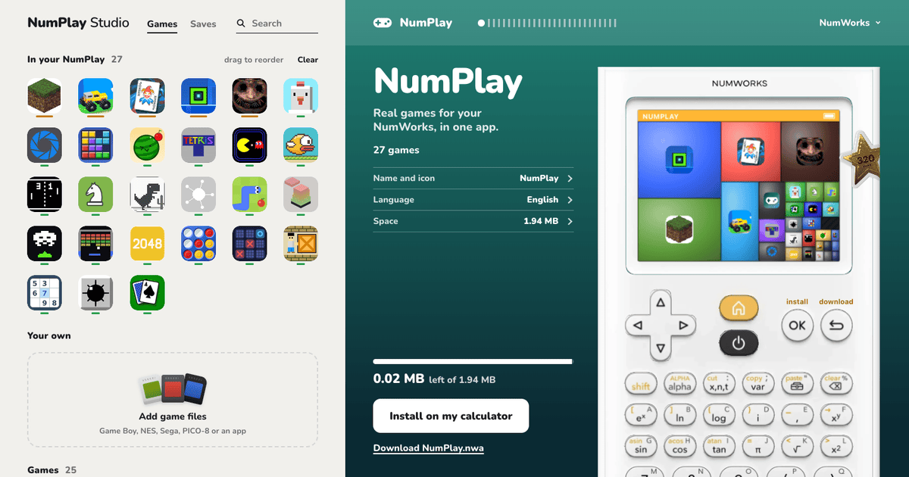</a>
</p>

<p align="center">
  <a href="#installer"><b>Installer</b></a> &nbsp;·&nbsp; <a href="#choisis-ta-calculatrice"><b>Choisis ta calculatrice</b></a> &nbsp;·&nbsp; <a href="docs/play.md"><b>Comment jouer</b></a> &nbsp;·&nbsp; <a href="https://github.com/Mason363/NumPlay/releases/latest"><b>Tous les téléchargements</b></a> &nbsp;·&nbsp; <a href="CHANGELOG.md"><b>Nouveautés</b></a> &nbsp;·&nbsp; <a href="#feuille-de-route"><b>Feuille de route</b></a> &nbsp;·&nbsp; <a href="docs/make-a-game.md"><b>Crée un jeu</b></a>
</p>

<p align="center">
  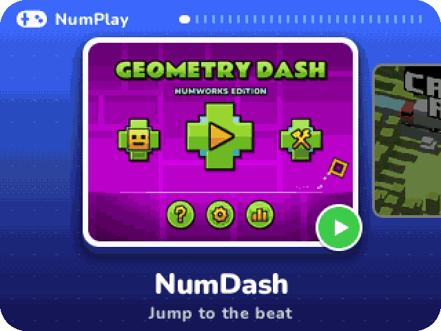
</p>

⭐ **NumPlay te plaît ?** Mets-lui une étoile : ça aide les autres à le trouver.<br>
💡 **Tu veux un autre jeu ?** Regarde la [feuille de route](#feuille-de-route), puis [demande-le](https://github.com/Mason363/NumPlay/issues/new/choose).

## Tes images, PDF, vidéos et livres

Dépose tes fichiers dans [NumPlay Studio](https://mason363.github.io/NumPlay/customize/) pour les voir sur ta calculatrice.

<table>
  <tr>
    <td align="center" width="25%">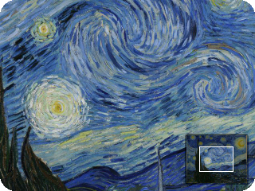<br><b>Images</b><br><sub>+ et − zooment, les flèches déplacent</sub></td>
    <td align="center" width="25%">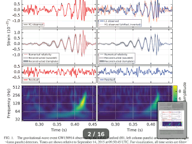<br><b>PDF</b><br><sub>Toutes les pages, zoome pour lire</sub></td>
    <td align="center" width="25%">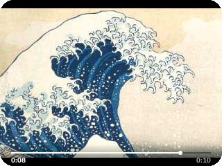<br><b>Vidéos</b><br><sub>OK pour la pause, Gauche et Droite pour sauter</sub></td>
    <td align="center" width="25%">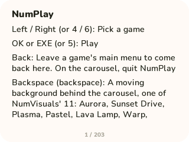<br><b>Livres</b><br><sub>+ et − changent la taille du texte</sub></td>
  </tr>
</table>

## Choisis ta calculatrice

> [!IMPORTANT]
> **Les jeux TI-84 Plus CE, TI-Nspire et Casio sont en bêta.** Quelque chose ne marche pas ? [Dis-le-moi](https://github.com/Mason363/NumPlay/issues/new?template=beta-tester.yml).

<table>
  <tr>
    <td align="center" width="20%"><a href="docs/calculators/numworks.md">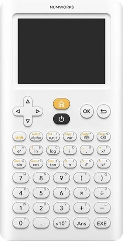<br><b>NumWorks</b></a><br><sub>N0110, N0115, N0120<br>77 jeux</sub><br><a href="https://github.com/Mason363/NumPlay/releases/latest/download/NumPlay.nwa">Télécharger</a></td>
    <td align="center" width="20%"><a href="docs/calculators/ti-84-plus-ce.md">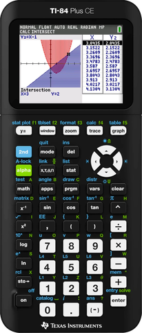<br><b>TI-84 Plus CE</b></a><br><sub>et TI-83 Premium CE<br>15 jeux</sub><br><a href="https://github.com/Mason363/NumPlay/releases/latest/download/NumPlay-TI84CE.zip">Télécharger</a></td>
    <td align="center" width="20%"><a href="docs/calculators/ti-nspire.md">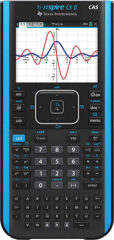<br><b>TI-Nspire CX</b></a><br><sub>CX et CX II, avec Ndless<br>78 jeux</sub><br><a href="https://github.com/Mason363/NumPlay/releases/latest/download/NumPlay-Nspire.zip">Télécharger</a></td>
    <td align="center" width="20%"><a href="docs/calculators/casio-fx-cg50.md">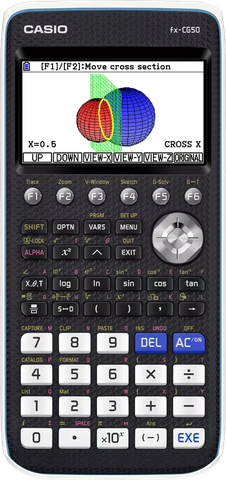<br><b>Casio fx-CG50</b></a><br><sub>et Graph 90+E, fx-CG10, fx-CG20<br>73 jeux</sub><br><a href="https://github.com/Mason363/NumPlay/releases/latest/download/NumPlay-CasioCG.zip">Télécharger</a></td>
    <td align="center" width="20%"><a href="docs/porting.md">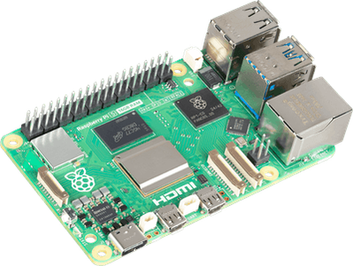<br><b>Autre chose</b></a><br><sub>un ordinateur, un Raspberry Pi,<br>une carte avec un écran</sub></td>
  </tr>
</table>

La Casio Graph 35+E II arrive plus tard.

## Jeux

Les jeux avec un anneau bleu sont tous dans **NumPlay.nwa**. Les autres jeux se téléchargent à part.

<table>
  <tr>
    <td align="center" width="33%"><a href="games/numblocks/README.md">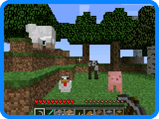<br><b>NumBlocks</b></a></td>
    <td align="center" width="33%"><a href="games/celeste/README.md">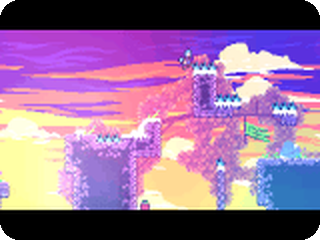<br><b>Celeste</b></a><br><a href="https://github.com/Mason363/NumPlay/releases/latest/download/Celeste.nwa">Télécharger</a></td>
    <td align="center" width="33%"><a href="games/hollowknight/README.md">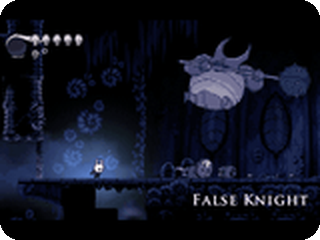<br><b>Hollow Knight</b></a><br><a href="https://github.com/Mason363/NumPlay/releases/latest/download/HollowKnight.nwa">Télécharger</a></td>
  </tr>
  <tr>
    <td align="center"><a href="games/hkfungal/README.md">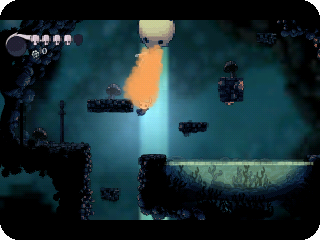<br><b>Hollow Knight: Fungal Wastes</b></a><br><a href="https://github.com/Mason363/NumPlay/releases/latest/download/HollowKnightFungalWastes.nwa">Télécharger</a></td>
    <td align="center"><a href="games/balatro/README.md">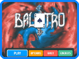<br><b>Balatro</b></a></td>
    <td align="center"><a href="games/buckshot/README.md">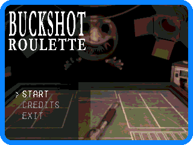<br><b>Buckshot Roulette</b></a></td>
  </tr>
  <tr>
    <td align="center"><a href="games/numdash/README.md">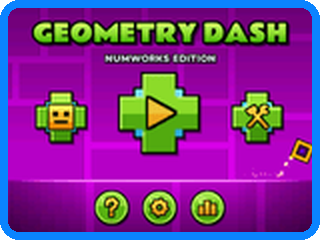<br><b>NumDash</b></a></td>
    <td align="center"><a href="games/snowrider/README.md">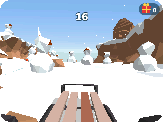<br><b>Snow Rider 3D</b></a><br><a href="https://github.com/Mason363/NumPlay/releases/latest/download/SnowRider3D.nwa">Télécharger</a></td>
    <td align="center"><a href="games/templerun/README.md">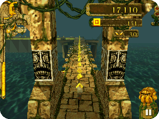<br><b>Temple Run</b></a><br><a href="https://github.com/Mason363/NumPlay/releases/latest/download/TempleRun.nwa">Télécharger</a></td>
  </tr>
  <tr>
    <td align="center"><a href="games/polytrack/README.md">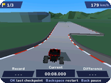<br><b>PolyTrack</b></a><br><a href="https://github.com/Mason363/NumPlay/releases/latest/download/PolyTrack.nwa">Télécharger</a></td>
    <td align="center"><a href="games/subway/README.md">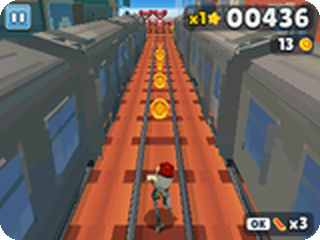<br><b>Subway Surfers</b></a><br><a href="https://github.com/Mason363/NumPlay/releases/latest/download/SubwaySurfers.nwa">Télécharger</a></td>
    <td align="center"><a href="games/amongus/README.md">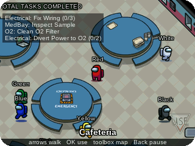<br><b>Among Us</b></a><br><a href="https://github.com/Mason363/NumPlay/releases/latest/download/AmongUs.nwa">Télécharger</a></td>
  </tr>
  <tr>
    <td align="center"><a href="games/clashroyale/README.md">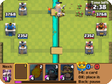<br><b>Clash Royale</b></a><br><a href="https://github.com/Mason363/NumPlay/releases/latest/download/ClashRoyale.nwa">Télécharger</a></td>
    <td align="center"><a href="games/undertale/README.md">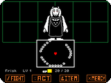<br><b>Undertale</b></a><br><a href="https://github.com/Mason363/NumPlay/releases/latest/download/Undertale.nwa">Télécharger</a></td>
    <td align="center"><a href="games/deltarune/README.md">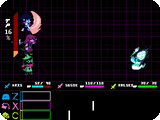<br><b>Deltarune</b></a><br><a href="https://github.com/Mason363/NumPlay/releases/latest/download/Deltarune.nwa">Télécharger</a></td>
  </tr>
  <tr>
    <td align="center"><a href="games/fnaf/README.md">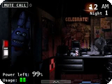<br><b>Five Nights at Freddy's</b></a><br><a href="https://github.com/Mason363/NumPlay/releases/latest/download/FiveNightsAtFreddys.nwa">Télécharger</a></td>
    <td align="center"><a href="games/fnaf2/README.md">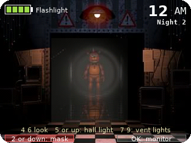<br><b>Five Nights at Freddy's 2</b></a><br><a href="https://github.com/Mason363/NumPlay/releases/latest/download/FiveNightsAtFreddys2.nwa">Télécharger</a></td>
    <td align="center"><a href="games/fnaf3/README.md">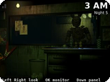<br><b>Five Nights at Freddy's 3</b></a><br><a href="https://github.com/Mason363/NumPlay/releases/latest/download/FiveNightsAtFreddys3.nwa">Télécharger</a></td>
  </tr>
  <tr>
    <td align="center"><a href="games/fnaf4/README.md">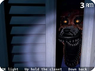<br><b>Five Nights at Freddy's 4</b></a><br><a href="https://github.com/Mason363/NumPlay/releases/latest/download/FiveNightsAtFreddys4.nwa">Télécharger</a></td>
    <td align="center"><a href="games/fnafworld/README.md">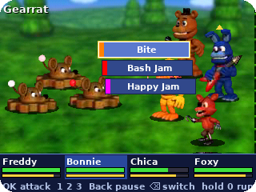<br><b>FNAF World</b></a><br><a href="https://github.com/Mason363/NumPlay/releases/latest/download/FiveNightsAtFreddysWorld.nwa">Télécharger</a></td>
    <td align="center"><a href="games/crossyroad/README.md">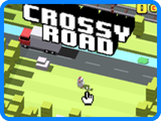<br><b>Crossy Road</b></a></td>
  </tr>
  <tr>
    <td align="center"><a href="games/rider/README.md">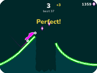<br><b>Rider</b></a><br><a href="https://github.com/Mason363/NumPlay/releases/latest/download/Rider.nwa">Télécharger</a></td>
    <td align="center"><a href="games/motox3m/README.md">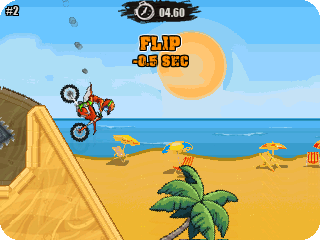<br><b>Moto X3M</b></a><br><a href="https://github.com/Mason363/NumPlay/releases/latest/download/MotoX3M.nwa">Télécharger</a></td>
    <td align="center"><a href="games/circloo/README.md"><br><b>circloO</b></a><br><a href="https://github.com/Mason363/NumPlay/releases/latest/download/CircloO.nwa">Télécharger</a></td>
  </tr>
  <tr>
    <td align="center"><a href="games/numdrive/README.md">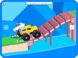<br><b>NumDrive</b></a></td>
    <td align="center"><a href="games/leveldevil/README.md">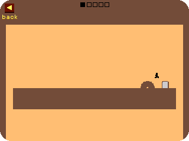<br><b>Level Devil</b></a><br><a href="https://github.com/Mason363/NumPlay/releases/latest/download/LevelDevil.nwa">Télécharger</a></td>
    <td align="center"><a href="games/hillclimb/README.md">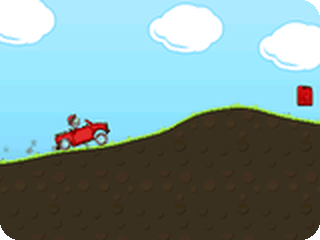<br><b>Hill Climb Racing</b></a><br><a href="https://github.com/Mason363/NumPlay/releases/latest/download/HillClimbRacing.nwa">Télécharger</a></td>
  </tr>
  <tr>
    <td align="center"><a href="games/pvz/README.md">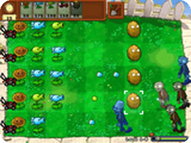<br><b>Plants vs. Zombies</b></a><br><a href="https://github.com/Mason363/NumPlay/releases/latest/download/PlantsVsZombies.nwa">Télécharger</a></td>
    <td align="center"><a href="games/famidash/README.md">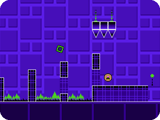<br><b>Famidash</b></a><br><a href="https://github.com/Mason363/NumPlay/releases/latest/download/Famidash.nwa">Télécharger</a></td>
    <td align="center"><a href="games/doom/README.md">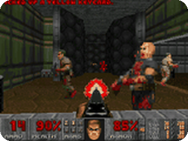<br><b>Doom</b></a><br><a href="https://github.com/Mason363/NumPlay/releases/latest/download/Doom.nwa">Télécharger</a></td>
  </tr>
  <tr>
    <td align="center"><a href="games/isaac/README.md">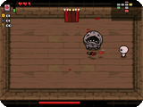<br><b>The Binding of Isaac</b></a><br><a href="https://github.com/Mason363/NumPlay/releases/latest/download/BindingOfIsaac.nwa">Télécharger</a></td>
    <td align="center"><a href="games/cookieclicker/README.md">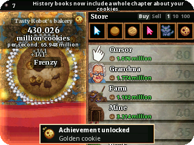<br><b>Cookie Clicker</b></a><br><a href="https://github.com/Mason363/NumPlay/releases/latest/download/CookieClicker.nwa">Télécharger</a></td>
    <td align="center"><a href="games/jetpackjoyride/README.md">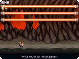<br><b>Jetpack Joyride</b></a><br><a href="https://github.com/Mason363/NumPlay/releases/latest/download/JetpackJoyride.nwa">Télécharger</a></td>
  </tr>
  <tr>
    <td align="center"><a href="games/angrybirds/README.md">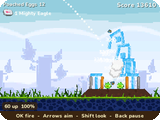<br><b>Angry Birds</b></a><br><a href="https://github.com/Mason363/NumPlay/releases/latest/download/AngryBirds.nwa">Télécharger</a></td>
    <td align="center"><a href="games/fnf/README.md">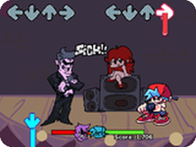<br><b>Friday Night Funkin'</b></a><br><a href="https://github.com/Mason363/NumPlay/releases/latest/download/FridayNightFunkin.nwa">Télécharger</a></td>
    <td align="center"><a href="games/kingdomrush/README.md">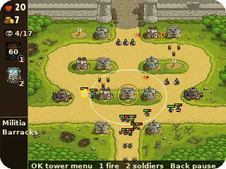<br><b>Kingdom Rush</b></a><br><a href="https://github.com/Mason363/NumPlay/releases/latest/download/KingdomRush.nwa">Télécharger</a></td>
  </tr>
  <tr>
    <td align="center"><a href="games/mrbullet/README.md">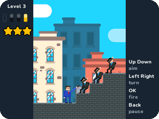<br><b>Mr Bullet</b></a><br><a href="https://github.com/Mason363/NumPlay/releases/latest/download/MrBullet.nwa">Télécharger</a></td>
    <td align="center"><a href="games/sonic/README.md">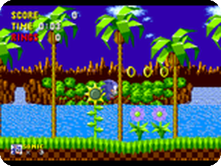<br><b>Sonic the Hedgehog</b></a><br><a href="https://github.com/Mason363/NumPlay/releases/latest/download/SonicTheHedgehog.nwa">Télécharger</a></td>
    <td align="center"><a href="games/portal/README.md">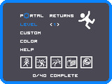<br><b>Portal Returns</b></a></td>
  </tr>
  <tr>
    <td align="center"><a href="games/stickmanhook/README.md">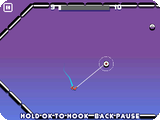<br><b>Stickman Hook</b></a><br><a href="https://github.com/Mason363/NumPlay/releases/latest/download/StickmanHook.nwa">Télécharger</a></td>
    <td align="center"><a href="games/blockblast/README.md"><br><b>Block Blast</b></a></td>
    <td align="center"><a href="games/suika/README.md"><br><b>Suika Game</b></a></td>
  </tr>
  <tr>
    <td align="center"><a href="games/tombofthemask/README.md"><br><b>Tomb of the Mask</b></a><br><a href="https://github.com/Mason363/NumPlay/releases/latest/download/TombOfTheMask.nwa">Télécharger</a></td>
    <td align="center"><a href="games/monkeymart/README.md"><br><b>Monkey Mart</b></a><br><a href="https://github.com/Mason363/NumPlay/releases/latest/download/MonkeyMart.nwa">Télécharger</a></td>
    <td align="center"><a href="games/badtime/README.md"><br><b>Bad Time Simulator</b></a><br><a href="https://github.com/Mason363/NumPlay/releases/latest/download/BadTimeSimulator.nwa">Télécharger</a></td>
  </tr>
  <tr>
    <td align="center"><a href="games/catninja/README.md"><br><b>Cat Ninja</b></a><br><a href="https://github.com/Mason363/NumPlay/releases/latest/download/CatNinja.nwa">Télécharger</a></td>
    <td align="center"><a href="games/championisland/README.md"><br><b>Champion Island</b></a><br><a href="https://github.com/Mason363/NumPlay/releases/latest/download/ChampionIsland.nwa">Télécharger</a></td>
    <td align="center"><a href="games/numpowder/README.md"><br><b>NumPowder</b></a><br><a href="https://github.com/Mason363/NumPlay/releases/latest/download/NumPowder.nwa">Télécharger</a></td>
  </tr>
  <tr>
    <td align="center"><a href="games/finalearth2/README.md"><br><b>The Final Earth 2</b></a><br><a href="https://github.com/Mason363/NumPlay/releases/latest/download/FinalEarth2.nwa">Télécharger</a></td>
    <td align="center"><a href="games/paperclips/README.md"><br><b>Universal Paperclips</b></a><br><a href="https://github.com/Mason363/NumPlay/releases/latest/download/UniversalPaperclips.nwa">Télécharger</a></td>
    <td align="center"><a href="games/dune/README.md"><br><b>Dune</b></a><br><a href="https://github.com/Mason363/NumPlay/releases/latest/download/Dune.nwa">Télécharger</a></td>
  </tr>
  <tr>
    <td align="center"><a href="games/flappybird/README.md"><br><b>Flappy Bird</b></a></td>
    <td align="center"><a href="games/doodlejump/README.md"><br><b>Doodle Jump</b></a><br><a href="https://github.com/Mason363/NumPlay/releases/latest/download/DoodleJump.nwa">Télécharger</a></td>
    <td align="center"><a href="games/dinorun/README.md"><br><b>Chrome Dino</b></a></td>
  </tr>
  <tr>
    <td align="center"><a href="games/tetris/README.md"><br><b>Tetris</b></a></td>
    <td align="center"><a href="games/pacman/README.md"><br><b>Pac-Man</b></a></td>
    <td align="center"><a href="games/donkeykong/README.md"><br><b>Donkey Kong</b></a><br><a href="https://github.com/Mason363/NumPlay/releases/latest/download/DonkeyKong.nwa">Télécharger</a></td>
  </tr>
  <tr>
    <td align="center"><a href="games/flappydunk/README.md"><br><b>Flappy Dunk</b></a><br><a href="https://github.com/Mason363/NumPlay/releases/latest/download/FlappyDunk.nwa">Télécharger</a></td>
    <td align="center"><a href="games/towerblock/README.md"><br><b>Tower Blocks</b></a></td>
    <td align="center"><a href="games/coreball/README.md"><br><b>Core Ball</b></a></td>
  </tr>
  <tr>
    <td align="center"><a href="games/uno/README.md"><br><b>UNO</b></a><br><a href="https://github.com/Mason363/NumPlay/releases/latest/download/UNO.nwa">Télécharger</a></td>
    <td align="center"><a href="games/imposter/README.md"><br><b>Imposter</b></a><br><a href="https://github.com/Mason363/NumPlay/releases/latest/download/Imposter.nwa">Télécharger</a></td>
    <td align="center"><a href="games/twoplayer/README.md"><br><b>2 Players</b></a></td>
  </tr>
  <tr>
    <td align="center"><a href="games/fourplayer/README.md"><br><b>2 3 4 Players</b></a><br><a href="https://github.com/Mason363/NumPlay/releases/latest/download/FourPlayers.nwa">Télécharger</a></td>
    <td align="center"><a href="games/chess/README.md"><br><b>Chess</b></a></td>
    <td align="center"><a href="games/invaders/README.md"><br><b>Space Invaders</b></a></td>
  </tr>
  <tr>
    <td align="center"><a href="games/breakout/README.md"><br><b>Block Breaker</b></a></td>
    <td align="center"><a href="games/snake/README.md"><br><b>Snake</b></a></td>
    <td align="center"><a href="games/connectfour/README.md"><br><b>Connect Four</b></a></td>
  </tr>
  <tr>
    <td align="center"><a href="games/mahjong/README.md"><br><b>Mahjong</b></a><br><a href="https://github.com/Mason363/NumPlay/releases/latest/download/Mahjong.nwa">Télécharger</a></td>
    <td align="center"><a href="games/g2048/README.md"><br><b>2048</b></a></td>
    <td align="center"><a href="games/solitaire/README.md"><br><b>Solitaire</b></a></td>
  </tr>
  <tr>
    <td align="center"><a href="games/minesweeper/README.md"><br><b>Minesweeper</b></a></td>
    <td align="center"><a href="games/uttt/README.md"><br><b>Ultimate Tic-Tac-Toe</b></a></td>
    <td align="center"><a href="games/sudoku/README.md"><br><b>Sudoku</b></a></td>
  </tr>
  <tr>
    <td align="center"><a href="games/sokoban/README.md"><br><b>Sokoban</b></a></td>
    <td align="center"><a href="https://github.com/Mason363/NumWorks-Super-Mario-64"><b>Super Mario 64</b></a></td>
    <td align="center"><a href="https://github.com/Mason363/NumWorks-Super-Mario-Bros"><b>Super Mario Bros.</b></a></td>
  </tr>
  <tr>
    <td align="center"><a href="#feuille-de-route"><b>D'autres arrivent</b></a></td>
  </tr>
</table>

## Tes propres jeux

<table>
  <tr>
    <td align="center" width="33%"><a href="games/retrogo/README.md"><br><b>Retro-Go</b></a><br><sub>Jeux Game Boy, NES, Sega, Game & Watch et Mega Drive</sub></td>
    <td align="center" width="33%"><a href="games/numpico/README.md"><br><b>NumPico</b></a><br><sub>Cartouches PICO-8</sub></td>
  </tr>
</table>

Dépose-les dans [NumPlay Studio](https://mason363.github.io/NumPlay/customize/) : les jeux que tu possèdes vont dans Retro-Go, les cartouches PICO-8 dans NumPico, et les autres apps ont chacune leur carte. Les plus gros jeux, comme ceux de 2 Mo de la Game Boy Color, demandent Epsilon 26 ou Nwagra. Les jeux Mega Drive viennent dans RetroGo.nwa, à part.

## Installer

Il te faut le câble USB de la calculatrice et **Chrome** ou **Edge**.

1. **Télécharge** [NumPlay.nwa](https://github.com/Mason363/NumPlay/releases/latest/download/NumPlay.nwa) ou un jeu plus haut, ou crée le tien dans [NumPlay Studio](https://mason363.github.io/NumPlay/customize/).
2. **Branche** ta calculatrice et allume-la.
3. **Va sur** [my.numworks.com/apps](https://my.numworks.com/apps) et connecte-toi.
4. Clique sur **Connecter** et choisis ta calculatrice.
5. **Ajoute** le fichier et clique sur **Installer**. Laisse-la branchée jusqu'à la fin.
6. **Joue :** appuie sur la touche maison et ouvre **NumPlay**, à la fin des apps.

> [!TIP]
> **Une mise à jour ?** Installe-la de la même façon : ta progression revient. Ajoute de nouveau tes autres apps à l'étape 5 pour les garder.

<details>
<summary><b>Calculatrices compatibles</b></summary>

| Calculatrice | Logiciel | Ce qui marche |
| --- | --- | --- |
| N0120 | Epsilon 23.2 ou plus récent | Tout |
| N0110, N0115 | Epsilon 23.2 ou plus récent | Tout, avec moins d'images par seconde dans les jeux les plus lourds |
| N0110, N0115 | Upsilon | NumPlay-Upsilon.nwa : 24 jeux |
| Toutes | Versions modifiées d'Epsilon 25.2 | Tout ; un jeu qui demande plus de mémoire que la tienne le dit |

Ton modèle et ton logiciel : **Paramètres**, puis **À propos**. Pour le mettre à jour : [my.numworks.com](https://my.numworks.com).

</details>

<details>
<summary><b>Autres versions : cachée, déguisée, en français, en chinois, Upsilon</b></summary>

| Fichier | Ce que c'est |
| --- | --- |
| [NumPlay-Invisible.nwa](https://github.com/Mason363/NumPlay/releases/latest/download/NumPlay-Invisible.nwa) | Cachée : une icône vide, sans nom |
| [NumPlay-Matrices.nwa](https://github.com/Mason363/NumPlay/releases/latest/download/NumPlay-Matrices.nwa) | Déguisée en app de maths, **Matrices** |
| [NumPlay-French.nwa](https://github.com/Mason363/NumPlay/releases/latest/download/NumPlay-French.nwa) | En français |
| [NumPlay-Chinese.nwa](https://github.com/Mason363/NumPlay/releases/latest/download/NumPlay-Chinese.nwa) | En chinois simplifié |
| [UniversalPaperclips-French.nwa](https://github.com/Mason363/NumPlay/releases/latest/download/UniversalPaperclips-French.nwa) | Universal Paperclips en français. |
| [NumPlay-Upsilon.nwa](https://github.com/Mason363/NumPlay/releases/latest/download/NumPlay-Upsilon.nwa) | Pour **Upsilon** : les 24 jeux qui tiennent |

 

Installe-en une à la place de NumPlay.nwa : ta progression suit. Les mots dans les images et les noms de niveaux et de touches restent en anglais. Les jeux à part sont en anglais seulement, mais Universal Paperclips existe aussi en français.

**Sur Upsilon,** installe avec [Node.js](https://nodejs.org) : `npx nwlink install-nwa NumPlay-Upsilon.nwa`. Il faut un Upsilon de juin 2026 ou plus récent ; sur un plus ancien, nwlink dit "invalid length for memory", alors [mets-le à jour](https://getupsilon.web.app) d'abord.

</details>

<details>
<summary><b>Garder tes sauvegardes</b></summary>

- **Installer des apps efface les sauvegardes**, mais pas les scripts Python : chaque jeu en garde une copie dans l'un d'eux (`numplay_saves.py` et d'autres) et la récupère. Ne les supprime pas.
- **Une réinitialisation efface tout**, scripts compris. Si ta calculatrice se réinitialise toute seule, [dis-moi](https://github.com/Mason363/NumPlay/issues/new/choose) à quoi tu jouais.
- **Sauvegarde-les** dans [les Saves de NumPlay Studio](https://mason363.github.io/NumPlay/customize/?saves) : il les copie chaque fois que tu branches la calculatrice, et les remet après une mise à jour ou une réinitialisation.
- La calculatrice garde 42 Ko de fichiers : un grand monde NumBlocks peut tout remplir.

</details>

<details>
<summary><b>L'app n'apparaît pas après l'installation</b></summary>

- **Elle redémarre une fois après l'installation** et demande ta langue : c'est normal. Tes apps sont à la fin de l'écran d'accueil.
- **Certains jeux prennent toute la place :** si tu en choisis plus qu'il n'en tient, ils ne s'installent pas.
- **Installer remplace tes autres apps :** ajoute-les de nouveau pour les garder.
- **Rien ne se passe quand tu la branches ?** Essaie un autre câble : certains ne font que charger.
- Il te faut **Epsilon 23.2 ou plus récent** (Paramètres, puis À propos).

</details>

## Sur une vraie calculatrice

<table>
  <tr>
    <td></td>
    <td></td>
    <td></td>
  </tr>
</table>


## Crée tes propres jeux NumWorks

NumPlay est aussi un kit pour créer des jeux NumWorks : un modèle, du dessin 2D et 3D, des polices en trois langues, des sauvegardes, de la physique et un émulateur. Sur macOS, Windows et Linux.

```bash
python3 tools/setup.py
```

```bash
python3 tools/new_game.py "My Game"
```

Puis lis **[Make your own NumWorks game](docs/make-a-game.md)** (en anglais). Pour aider NumPlay : **[Contributing](CONTRIBUTING.md)**.

## Feuille de route

[Vote](https://github.com/Mason363/NumPlay/issues?q=is%3Aissue+is%3Aopen+label%3A%22on+roadmap%22+sort%3Areactions-%2B1-desc) 👍 pour le prochain jeu. Les plus demandés passent en premier.

<details>
<summary><b>Faits avant : 49 de plus</b></summary>

- [x] Celeste
- [x] Hollow Knight
- [x] Minecraft 1.8 (NumBlocks)
- [x] The Final Earth 2
- [x] The Powder Toy (NumPowder)
- [x] Block Blast
- [x] Undertale : tout l'Underground
- [x] The Binding of Isaac : une partie entière
- [x] Plants vs. Zombies : toute l'Aventure
- [x] Doom : Knee-Deep in the Dead, l'épisode shareware
- [x] Five Nights at Freddy's : toutes les nuits
- [x] 2 Players : Pong, Air Hockey, Tanks et Light Cycles
- [x] Cookie Clicker
- [x] Level Devil
- [x] Sonic the Hedgehog : tout le jeu de 1991
- [x] Subway Surfers
- [x] Hill Climb Racing
- [x] Space Invaders
- [x] Sokoban
- [x] Sudoku
- [x] Ultimate Tic-Tac-Toe
- [x] Super Mario 64, dans [son propre dépôt](https://github.com/Mason363/NumWorks-Super-Mario-64)
- [x] Super Mario Bros., dans [son propre dépôt](https://github.com/Mason363/NumWorks-Super-Mario-Bros)
- [x] Le Nether et l'End dans NumBlocks
- [x] [Retro-Go](https://github.com/ducalex/retro-go) pour Game Boy, Game Boy Color, NES, Master System et Game Gear
- [x] Suika Game
- [x] Stickman Hook
- [x] Donkey Kong
- [x] Core Ball
- [x] Dune
- [x] Monkey Mart
- [x] Tomb of the Mask
- [x] UNO
- [x] Friday Night Funkin'
- [x] [NumPlay Studio](https://mason363.github.io/NumPlay/customize/), pour choisir les jeux de ton NumPlay
- [x] Universal Paperclips
- [x] Bad Time Simulator : le combat contre Sans
- [x] Mahjong
- [x] Meowdoku
- [x] Rider
- [x] Temple Run
- [x] Les jeux SG-1000 dans Retro-Go
- [x] Five Nights at Freddy's 2
- [x] Famidash, fait pour la calculatrice
- [x] Crossy Road : les personnages et la machine à prix
- [x] Famidash HUGE : 173 niveaux
- [x] Les jeux ColecoVision dans Retro-Go
- [x] Five Nights at Freddy's 3
- [x] Five Nights at Freddy's 4
- [x] Clash Royale, contre des bots
- [x] Cat Ninja
- [x] Un jeu de tower defense : Kingdom Rush
- [x] Deltarune : le début du chapitre 1
- [x] Villages, temples du désert et mines dans NumBlocks
- [x] FNAF World
- [x] Mr. Bullet

</details>

- [x] NumPico, pour les cartouches PICO-8
- [x] Moto X3M
- [x] Among Us, contre des bots
- [x] 2 3 4 Player Games, avec des équipes
- [x] Deltarune : le Field, le Great Board et le début de la Forest
- [x] Hollow Knight: Fungal Wastes
- [x] circloO
- [x] Kingdom Rush : les héros
- [x] Retro-Go : plus de ROM tiennent
- [x] Retro-Go : Game & Watch et Mega Drive
- [ ] Into the Breach
- [ ] Un jeu de course : F1 ou GT3
- [ ] Deltarune : la suite du chapitre 1, et chaque chapitre suivant
- [ ] Hollow Knight : plus d'Hallownest après Mantis Village
- [ ] Hill Climb Racing : les niveaux et véhicules ajoutés après la version 1.10.2
- [ ] Tower Destiny Survive
- [ ] My Little Universe
- [ ] Hungry Shark Evolution et Hungry Shark World
- [ ] Castle Crashers
- [ ] Hotline Miami
- [ ] Brawl Stars, contre des bots
- [ ] Papers, Please
- [ ] OMORI
- [ ] florr.io
- [ ] Rider Worlds
- [ ] Hollow Knight: Godhome
- [ ] Animal Well
- [ ] Rider.io
- [ ] Getting Over It
- [ ] Hill Climb Racing 2
- [ ] Hill Climb Racing en 3D
- [ ] Dog Hotel
- [ ] Kingdom Rush : Frontiers, Origins et Vengeance
- [ ] Cult of the Lamb
- [ ] Zombie Tsunami
- [ ] Bread & Fred, à deux
- [ ] Infinite Pizza
- [ ] Fez
- [ ] Grand Theft Auto, le premier
- [ ] Basketball Stars
- [ ] Stumble Guys, contre des bots
- [ ] Run 3
- [ ] Paper.io 2, contre des bots
- [ ] Enter the Gungeon
- [ ] Baldi's Basics
- [ ] Retro Bowl
- [ ] Castle Crush, contre des bots
- [ ] Bowmasters, à deux ou contre un bot
- [ ] OvO
- [ ] Ragdoll Archers
- [ ] Les autres jeux aussi en français et en chinois

## Crédits

NumPlay est un projet de fan. Si un jeu te plaît, joue à l'original et soutiens ses créateurs. D'autres jeux NumWorks : [Numcraft](https://github.com/yannis300307/NumcraftRust), [Celeste Classic](https://github.com/BenchatonDev/Celeste-Numworks), [All the Apps de Tatone26](https://github.com/Tatone26/Numworks-games), les apps de [Nwagyu](https://nwagyu.org/guide/) et [la liste de yannis300307](https://gist.github.com/yannis300307/9123136f90877107ec0d49ba96b303e5).

- **reversal_lava63**, qui teste les bêtas sur une vraie calculatrice.
- **[Gabriel](https://github.com/tomcalif9-stack)**, qui a fait les fonds animés de l'écran d'accueil et la première traduction française, et teste sur Upsilon et une N0115.
- **[LanoCodes17](https://github.com/LanoCodes17)**, à qui l'on doit l'idée du code Konami pour entrer dans NumPlay depuis Matrices.
- Toutes celles et ceux dont un signalement de bug ou une idée a été retenu : **NEE** ([reversallava63](https://github.com/reversallava63)), **Gabriel**, **[briac134](https://github.com/briac134)**, **[Raphanobie](https://github.com/Raphanobie)**, **[zbigzo](https://github.com/zbigzo)**, **Yacine**, **PelicanMan75**, **[Spykube](https://github.com/Spykube)**, **[axio-m](https://github.com/axio-m)**, **[CleanCEZ](https://github.com/CleanCEZ)**, **[ZIOTI](https://github.com/ZIOTI)**, **[Saphire-132](https://github.com/Saphire-132)**, **[thegunpal](https://github.com/thegunpal)**, **[LilyTheCuteCatgirl](https://github.com/LilyTheCuteCatgirl)**, **[Henri-VIP](https://github.com/Henri-VIP)**, **[elouangrimm](https://github.com/elouangrimm)**, **[louloubrawl050607](https://github.com/louloubrawl050607)**, **[Spaghettiboy-55](https://github.com/Spaghettiboy-55)**, **[mosesfosterwtbw-a11y](https://github.com/mosesfosterwtbw-a11y)**, **[finleyrichard123-creator](https://github.com/finleyrichard123-creator)**, **[Banane-3000](https://github.com/Banane-3000)**, **[Squ1r3l](https://github.com/Squ1r3l)**, **[Truyty-1](https://github.com/Truyty-1)**, **[hellellelle](https://github.com/hellellelle)**, **[MadTDawg5](https://github.com/MadTDawg5)**, **[SnoepieMC](https://github.com/SnoepieMC)**, **[akiraunao-rgb](https://github.com/akiraunao-rgb)**, **[GraniteBlock](https://github.com/GraniteBlock)**, **[N1col4s21](https://github.com/N1col4s21)**, **[Alexoudu73](https://github.com/Alexoudu73)**, **[24Forrin](https://github.com/24Forrin)**, **[xLEVK1NGx](https://github.com/xLEVK1NGx)**, **[9ewrff](https://github.com/9ewrff)**, **[matos91250-cpu](https://github.com/matos91250-cpu)**, **[douwepronl](https://github.com/douwepronl)**, **[GLaDOS-still-alive](https://github.com/GLaDOS-still-alive)**, **[Temumu475](https://github.com/Temumu475)**, **[patrickivasenko-lang](https://github.com/patrickivasenko-lang)**, **[KYKY5435](https://github.com/KYKY5435)**, **[Denisarbeto](https://github.com/Denisarbeto)**, **[Someone3141591](https://github.com/Someone3141591)**, **[jobusbobus](https://github.com/jobusbobus)**, **[Drayen-Virest](https://github.com/Drayen-Virest)**, **[vortx25](https://github.com/vortx25)** et **[md3rn](https://github.com/md3rn)**. Merci !
- Les versions des autres calculatrices utilisent la [CE C toolchain](https://github.com/CE-Programming/toolchain) et ses bibliothèques, [Ndless](https://github.com/ndless-nspire/Ndless), [libfxcg](https://github.com/Jonimoose/libfxcg), [newlib](https://sourceware.org/newlib/), GCC, [SDL](https://libsdl.org) et [Emscripten](https://emscripten.org).

<details>
<summary><b>Les crédits de chaque jeu</b></summary>

- **All the Apps** de **[Tatone26](https://github.com/Tatone26/Numworks-games)** a inspiré la liste de classiques de NumPlay. Flappy Bird, Pac-Man, Snake, Connect Four, Solitaire et 2048 sont écrits en C pour NumPlay et gardent ses options, sans code copié. Tetris est celui de Tatone26, qu'il a placé dans le domaine public, adapté pour NumPlay.
- **[Gabriele Cirulli](https://github.com/gabrielecirulli/2048)** a créé 2048.
- **Crossy Road** de Hipster Whale a inspiré le Crossy Road de NumPlay, écrit en C pour NumPlay. Ses personnages (le poulet, et les neuf autres que donne la machine à prix) sont construits à partir des modèles du jeu et portent les noms que le jeu leur donne, lus dans sa version iOS (1.3.7825). Sans lien avec Hipster Whale.
- **Block Blast!** de [Hungry Studio](https://www.hungrystudio.com) a inspiré le Block Blast de NumPlay, écrit en C pour NumPlay sans code ni image du jeu. Ses blocs, son score et ses couleurs suivent les mesures de l'app faites par les joueurs de [blockblast-Self-Improvement-loop](https://github.com/Kucze3205/blockblast-Self-Improvement-loop).
- **Flappy Dunk** de Voodoo (fait avec Acid Cousins) a inspiré le Flappy Dunk de NumPlay, qui reprend les images, la physique, les défis et les objectifs de skins du jeu dans sa version Android, avec la police **Lilita One** (SIL Open Font License, [licence](LICENSES/OFL-1.1-LilitaOne.txt)). **Bobydeluxe** a apporté la première version à NumPlay. Sans lien avec Voodoo.
- **Tower Blocks** de [Steve Gardner](https://codepen.io/ste-vg/pen/ppLQNW) (licence MIT) est porté en C pour NumPlay depuis sa source : ses tailles, vitesses, couleurs, sa lumière et sa caméra sont celles de l'original. **Bobydeluxe** l'a apporté à NumPlay.
- **Doodle Jump** de Lima Sky a inspiré le Doodle Jump de NumPlay, qui reprend les images, la police et les textes du jeu dans sa version Android. **Bobydeluxe** a apporté la première version à NumPlay. Sans lien avec Lima Sky.
- **Suika Game** d'Aladdin X a inspiré le Suika Game de NumPlay, écrit en C pour NumPlay sans code ni image du jeu. Les tailles, couleurs, vitesses et temps de ses fruits ont été mesurés sur la version Switch, et les tailles vérifiées avec [kairess/suika-game](https://github.com/kairess/suika-game). **Bobydeluxe** l'a apporté à NumPlay. Sans lien avec Aladdin X.
- **[Core Ball](https://github.com/randomyang/core-ball)** de Random (Yang Hao, licence MIT) est porté en C pour NumPlay depuis sa propre version : ses 60 niveaux, ses rotations, ses vitesses et son rythme sont ceux de l'original. **Bobydeluxe** l'a apporté à NumPlay.
- **Balatro** de LocalThunk a inspiré le Balatro de NumPlay, qui utilise des images adaptées du jeu et la police **m6x11** de Daniel Linssen.
- **Celeste** a inspiré le Celeste de NumPlay, qui reprend les images, les cartes, les textes et les polices du jeu. Sans lien avec Maddy Makes Games.
- **Hollow Knight** a inspiré Hollow Knight et Hollow Knight: Fungal Wastes de NumPlay, qui reprennent les images, les animations, les cartes, les textes et les polices du jeu. Sans lien avec Team Cherry.
- **Undertale** de Toby Fox a inspiré l'Undertale de NumPlay, qui reprend les cartes, les images et les textes du jeu depuis le [Undertale Wiki](https://undertale.fandom.com) et la démo gratuite du jeu, et les polices **Pixel Operator** de Jayvee Enaguas (domaine public). Sans lien avec Toby Fox.
- **The Binding of Isaac** d'Edmund McMillen et Florian Himsl (Rebirth par Nicalis) a inspiré le The Binding of Isaac de NumPlay, qui reprend les images du jeu depuis les ressources de [Basement Renovator](https://github.com/Basement-Renovator/basement-renovator) et la police **Upheaval** de Brian Kent (freeware). Sans lien avec eux.
- **Plants vs. Zombies** de PopCap Games a inspiré le Plants vs. Zombies de NumPlay, qui reprend les images, les animations et les nombres du jeu tels que [pvz-web](https://github.com/xyxiao001/pvz-web) les garde, et les polices **Rammetto One** et **Nunito** (SIL Open Font License). Sans lien avec PopCap Games ni Electronic Arts.
- **Five Nights at Freddy's** de Scott Cawthon a inspiré le Five Nights at Freddy's de NumPlay, qui reprend les images et les mots du jeu, tels que les gardent les portages de fans [Five Nights at Freddy's Web](https://github.com/souwell/Five-Nights-at-Freddys-Web) (wellsousaaa) et [HX-NAF](https://github.com/BaranMuzu/HX-NAF) (BaranMuzu), et les polices DejaVu ([licence](LICENSES/DejaVu.txt)). Les déplacements des animatroniques suivent [FNaF64](https://github.com/RosieSapphire/FNaF64) de RosieSapphire et [fnaf-1-godot](https://github.com/LOUDO2/fnaf-1-godot) de LOUDO2. Sans lien avec Scott Cawthon.
- **Sonic the Hedgehog** de Sonic Team a inspiré le Sonic the Hedgehog de NumPlay, qui lit les images, les niveaux et les démos du jeu dans le [désassemblage de Sonic Retro](https://github.com/sonicretro/s1disasm) et suit le [Sonic Physics Guide](https://info.sonicretro.org/Sonic_Physics_Guide). Sans lien avec SEGA.
- **Subway Surfers** de SYBO et Kiloo a inspiré le Subway Surfers de NumPlay : ses personnages sont ajustés aux modèles 3D du jeu et portent leurs textures, et son logo et ses icônes d'objets sont ceux du jeu, tels que les montre le [Subway Surfers Wiki](https://subwaysurf.fandom.com) ; la gare et les trains sont dessinés d'après le jeu. Ses textes sont en police **Lilita One** de Juan Montoreano (SIL Open Font License, [licence](LICENSES/OFL-1.1-LilitaOne.txt)). Sans lien avec eux.
- **Hill Climb Racing** de Fingersoft a inspiré le Hill Climb Racing de NumPlay, qui reprend les images du jeu depuis le [Hill Climb Racing Wiki](https://hillclimbracing.fandom.com), la police **Teko** (SIL Open Font License, [licence](LICENSES/OFL-1.1-Teko.txt)) et **Box2D 2.2.1** d'Erin Catto (licence zlib, [licence](games/hillclimb/src/box2d/License.txt)), le moteur physique sur lequel le jeu est construit. Sans lien avec Fingersoft.
- **Jetpack Joyride** de Halfbrick a inspiré le Jetpack Joyride de NumPlay, écrit en C pour NumPlay avec les images du jeu (de l'archive d'images Facebook de Halfbrick et du jeu Android) et ses nombres, lus dans les fichiers du jeu. **Bobydeluxe** l'a apporté à NumPlay. Sans lien avec Halfbrick.
- **Stickman Hook** de Madbox a inspiré le Stickman Hook de NumPlay, écrit en C pour NumPlay avec les images, les niveaux et la police **JUNEGULL** du jeu, lus dans sa version web, et sa physique vérifiée pas à pas avec le code du jeu. **Bobydeluxe** l'a apporté à NumPlay. Sans lien avec Madbox.
- **Donkey Kong** de Nintendo a inspiré le Donkey Kong de NumPlay, qui suit les règles et les nombres du programme d'arcade, étudiés dans le désassemblage [dkdasm](https://github.com/furrykef/dkdasm) de furrykef et le listing annoté de tcdev, avec de nouvelles images dessinées pour lui. **Bobydeluxe** l'a apporté à NumPlay et a dessiné ses images. Sans lien avec Nintendo.
- **Dune!** de Team Lava a inspiré le Dune de NumPlay, qui porte Dune Rider, la version web d'Inlogic Software : ses images, ses lettres Bango Pro et ses nombres, et sa physique, [p2.js](https://github.com/schteppe/p2.js) de Stefan Hedman (licence MIT), réécrite en C. **Bobydeluxe** l'a apporté à NumPlay. Sans lien avec Team Lava ni Inlogic Software.
- **Monkey Mart** de TinyDobbins a inspiré le Monkey Mart de NumPlay, qui suit les règles, les temps et les nombres de la version web du jeu et reprend ses images, ses singes et ses animaux, et sa police **Riffic**. **Bobydeluxe** l'a apporté à NumPlay. Sans lien avec TinyDobbins.
- **Tomb of the Mask** de Playgendary a inspiré le Tomb of the Mask de NumPlay, qui suit les règles de la version web du jeu et reprend ses niveaux, ses images et sa police pixel. **Bobydeluxe** l'a apporté à NumPlay. Sans lien avec Playgendary.
- **UNO** de Mattel a inspiré le UNO de NumPlay, qui suit les règles officielles avec des cartes dessinées pour la calculatrice. **Bobydeluxe** l'a apporté à NumPlay. Sans lien avec Mattel.
- **Friday Night Funkin'** du Funkin' Crew (ninjamuffin99, PhantomArcade, evilsk8r, Kawai Sprite) a inspiré le Friday Night Funkin' de NumPlay, qui suit le code open source du jeu (Apache-2.0) et construit ses partitions et ses images à partir des fichiers du jeu au moment de la compilation. **Bobydeluxe** l'a apporté à NumPlay. Sans lien avec le Funkin' Crew.
- **Angry Birds** de Rovio Entertainment a inspiré l'Angry Birds de NumPlay, qui joue les 429 niveaux de l'édition Chrome avec ses images, lues dans sa version web, et suit ses règles et ses nombres. Sa physique est **Box2D 2.2.1** d'Erin Catto (licence zlib, [licence](games/angrybirds/src/box2d/License.txt)), le moteur du jeu. **Bobydeluxe** l'a apporté à NumPlay. Sans lien avec Rovio.
- **[PolyTrack](https://www.kodub.com/apps/polytrack)** de Kodub a inspiré le PolyTrack de NumPlay, qui roule sur les 17 circuits du jeu avec ses nombres de physique, ses modèles, ses couleurs et son logo, lus dans sa version web. Son moteur 3D est né de PolyGT 3D de **Boris-TH**. Sans lien avec Kodub.
- **[Universal Paperclips](https://www.decisionproblem.com/paperclips/)** de Frank Lantz (Everybody House Games), avec la programmation des combats de Bennett Foddy, a inspiré l'Universal Paperclips de NumPlay, qui joue tout le jeu avec ses règles, ses nombres, ses projets et ses messages, lus dans sa version web. Sans lien avec eux.
- **[Bad Time Simulator](https://github.com/jcw87/c2-sans-fight)** de jcw87, le combat contre Sans d'Undertale refait, a inspiré le Bad Time Simulator de NumPlay, qui joue ses 24 scripts d'attaque avec ses sprites (ceux d'Undertale, de Toby Fox), ses mots et ses nombres, lus dans son projet, et la police **Pixel Operator**. Sans lien avec jcw87 ni Toby Fox.
- **Le mahjong solitaire**, créé par Brodie Lockard (Mah-Jongg, 1981) et rendu célèbre par **Shanghai** d'Activision (1986), a inspiré le Mahjong de NumPlay, écrit en C pour NumPlay avec des tuiles dessinées de zéro. Ses dispositions sont celles de [KMahjongg](https://apps.kde.org/kmahjongg/), par l'équipe KDE Games, et les caractères de ses tuiles viennent de la police **Fusion Pixel** de TakWolf (SIL Open Font License, [licence](LICENSES/OFL-1.1-Fusion-Pixel.txt)). Sans lien avec eux.
- **Rider** de Ketchapp a inspiré le Rider de NumPlay, qui roule sur les niveaux, les pièces de piste et les formes de collision du jeu avec ses nombres de physique, ses motos, ses défis et ses couleurs, lus dans les fichiers du jeu, avec les motos redessinées en contours. Sa physique est **LiquidFun 1.1.0** (Box2D 2.3.0) d'Erin Catto et Google (licence zlib, [licence](LICENSES/Zlib-LiquidFun.txt)), le moteur du jeu. Sans lien avec Ketchapp.
- **Snow Rider 3D** a inspiré le Snow Rider 3D de NumPlay, qui fait sa pente, ses luges, ses cadeaux et sa caméra comme le jeu, avec ses modèles, ses couleurs, ses nombres et son logo lus dans son projet Unity ([q8j-dev/snow-rider-3d](https://github.com/q8j-dev/snow-rider-3d)). **[dennisimoo](https://github.com/dennisimoo)** l'a apporté à NumPlay. Sans lien avec ses créateurs.
- **Temple Run** d'Imangi Studios a inspiré le Temple Run de NumPlay, qui suit les règles et les nombres du jeu (son chemin, pièce par pièce, et son rythme, ses vitesses, ses pièces, ses bonus, ses améliorations et ses objectifs) et reprend ses modèles (Guy Dangerous, les singes démons, le chemin, les pièces et le décor), ses images et ses light maps, sa caméra, son brouillard et son interface, et ses lettres Cheboygan, tout cela lu dans son paquet Android (version 1.0.8), et la police **Lilita One** (SIL Open Font License, [licence](LICENSES/OFL-1.1-LilitaOne.txt)). Sans lien avec Imangi Studios.
- **[Famidash](https://github.com/tfdsoft/famidash)** de TFDSoft, Geometry Dash fait pour la NES, a inspiré le Famidash de NumPlay, qui traduit le code du jeu en C et joue les 173 niveaux de sa version HUGE avec ses graphismes, ses écrans de menu, ses icônes et ses nombres (licence MIT, [licence](LICENSES/MIT-Famidash.txt)). Famidash est fait par Zephyrside (UserSniper), kandowontu, Ficus mcHousePlant, dajinkosa, ElAngel378, SeaGlowingPro, KawaiiDawn et le reste de son équipe. Ses niveaux portent le nom de morceaux de ForeverBound, DJVI, Step, Waterflame, Dj-Nate et OcularNebula, qui ne sont pas dans l'app. Sans lien avec TFDSoft ni RobTop Games.
- **Five Nights at Freddy's 2** de Scott Cawthon a inspiré le Five Nights at Freddy's 2 de NumPlay, qui reprend les images du jeu, depuis sa version HTML5 Clickteam telle que la garde le portage de fan [fnaf-2_html5](https://github.com/VocalNutria9174/fnaf-2_html5) (VocalNutria9174), deux d'entre elles depuis [FNaF2-RaylibCs](https://github.com/fredtheking/FNaF2-RaylibCs) de fredtheking, et les polices DejaVu ([licence](LICENSES/DejaVu.txt)). Ses niveaux d'IA, ses chemins, sa boîte à musique, sa lampe et Withered Foxy suivent ce que les joueurs ont lu dans ses événements, noté sur le [Technical FNaF Wiki](https://technicalfnaf.fandom.com) et le [Five Nights at Freddy's Wiki](https://freddy-fazbears-pizza.fandom.com). Sans lien avec Scott Cawthon.
- **Five Nights at Freddy's 3** de Scott Cawthon a inspiré le Five Nights at Freddy's 3 de NumPlay, qui reprend les images du jeu et joue ses nuits comme le font les événements du jeu, les deux lus dans son paquet Android. Sans lien avec Scott Cawthon.
- **Five Nights at Freddy's 4** de Scott Cawthon a inspiré le Five Nights at Freddy's 4 de NumPlay, qui reprend les images du jeu et joue ses nuits comme le font les événements du jeu, les deux lus dans son paquet iOS. Sans lien avec Scott Cawthon.
- **Clash Royale** de Supercell a inspiré le Clash Royale de NumPlay, qui joue les cartes, les tours et les règles du jeu de 2016 avec leurs propres nombres et reprend ses arènes, ses troupes, ses bâtiments, ses illustrations de cartes et ses polices (Supercell-Magic, CCBackBeat), lus dans son paquet Android. Son bot est celui de NumPlay. Sans lien avec Supercell.
- **[Cat Ninja](https://jayisgames.com/review/cat-ninja.php)** de Richman Stewart, publié par TrackMill, a inspiré le Cat Ninja de NumPlay, qui traduit l'ActionScript du jeu en C et joue ses 30 niveaux avec ses images et ses deux polices, lues dans CatNinja.swf tel que le garde Flashpoint de BlueMaxima. Sans lien avec Richman Stewart ni TrackMill.
- **[Kingdom Rush](https://armorgames.com/play/12141/kingdom-rush)** d'Ironhide Game Studio, publié par Armor Games en 2011, a inspiré le Kingdom Rush de NumPlay, qui lit ses règles, ses nombres, ses niveaux, ses vagues et ses images dans le fichier Flash du jeu, et ses héros dans une version Flash plus récente avec la Hero Room. Ses nombres utilisent la police Lilita One (SIL Open Font License). Sans lien avec Ironhide Game Studio ni Armor Games.
- **Deltarune** de Toby Fox a inspiré le Deltarune de NumPlay, qui reprend les images, les polices, les salles et les textes des fichiers du chapitre 1. Sans lien avec Toby Fox.
- **FNAF World** de Scott Cawthon a inspiré le FNAF World de NumPlay, qui reprend les images et la carte du jeu et joue ses combats comme le font les événements du jeu, tout cela lu dans sa version Windows. Sans lien avec Scott Cawthon.
- **Mr Bullet - Spy Puzzles** de Lion Studios et 1Button a inspiré le Mr Bullet de NumPlay, qui joue les niveaux Classic, Grenades, Hostages et Friendly Fire du jeu avec ses images, lues dans sa version Android, et suit ses règles et ses nombres. Sa physique est **Box2D 2.3.1** d'Erin Catto (licence zlib, [licence](LICENSES/Zlib-Box2D.txt)), le moteur du jeu. Sans lien avec Lion Studios.
- **Moto X3M** de Madpuffers a inspiré le Moto X3M de NumPlay, qui joue les 50 niveaux du jeu avec ses images et ses polices **Impact** et **CF Crack and Bold**, lues dans sa version web, et suit ses règles et ses nombres. Sa physique est **[Nape](https://github.com/deltaluca/nape)** de Luca Deltodesco (licence BSD, [licence](LICENSES/BSD-2-Clause-Nape.txt)), le moteur du jeu, porté en C. Sans lien avec Madpuffers.
- **circloO** de Florian van Strien a inspiré le circloO de NumPlay, qui joue les 14 niveaux et les 6 niveaux du mode difficile du jeu, lus dans sa version web, et suit ses règles, ses couleurs et ses nombres. Sa physique suit **[Box2D](https://box2d.org)** d'Erin Catto (licence zlib, [licence](LICENSES/Zlib-Box2D.txt)), le moteur du jeu, et sa police est **Open Sans** (Apache License 2.0, [licence](LICENSES/Apache-2.0-OpenSans.txt)). Sans lien avec Florian van Strien.
- **Among Us** d'Innersloth a inspiré l'Among Us de NumPlay, qui joue le Skeld avec les images du jeu, lues dans sa version Android, et suit ses règles et ses nombres. Ses bots sont ceux de NumPlay. Ses textes sont en **Liberation Sans** (SIL Open Font License, [licence](LICENSES/OFL-1.1-LiberationSans.txt)). Sans lien avec Innersloth.
- Le jeu de soirée **Imposter** a inspiré l'Imposter de NumPlay, écrit en C pour NumPlay avec ses propres mots et images et la police Nunito de NumPlay.
- L'app de soirée **2 3 4 Player Games** de JindoBlu a inspiré le 2 3 4 Players de NumPlay, écrit en C pour NumPlay avec ses propres mini-jeux, joueurs et images et la police Nunito de NumPlay. Sans lien avec eux.
- **PICO-8** de Lexaloffle a inspiré NumPico de NumPlay, qui fait tourner les cartouches PICO-8 avec **[femto8](https://github.com/benbaker76/femto8)** de Ben Baker (licence MIT, [licence](LICENSES/MIT-femto8.txt)) et son Lua, z8lua de Sam Hocevar (WTFPL) sur Lua 5.2 (licence MIT), et décompresse les cartouches .p8.png avec les algorithmes de Lexaloffle (licences MIT et zlib). Ses images montrent [Combo Pool](https://www.lexaloffle.com/bbs/?pid=combopool-0) de NuSan (CC4-BY-NC-SA), qui n'est pas dans NumPlay. Sans lien avec Lexaloffle.
- **Pong** d'Atari (1972) a inspiré 2 Players de NumPlay, avec du hockey sur table, des chars dans un labyrinthe dans l'esprit de Tank Trouble et les motos de lumière de Tron. Les quatre sont écrits en C pour NumPlay et dessinés avec des formes, sans code ni image d'eux.
- **[Cookie Clicker](https://orteil.dashnet.org/cookieclicker/)** d'Orteil et Opti (DashNet) a inspiré le Cookie Clicker de NumPlay, qui reprend les images, les textes et les nombres du jeu (version 2.058, de son miroir public [ozh/cookieclicker](https://github.com/ozh/cookieclicker)) et les polices **Merriweather**, **Kavoon** et **Noto Sans** (SIL Open Font License : [Merriweather](LICENSES/OFL-1.1-Merriweather.txt), [Kavoon](LICENSES/OFL-1.1-Kavoon.txt), [Noto Sans](LICENSES/OFL-1.1-NotoSans.txt)). Sans lien avec Orteil ni DashNet.
- **Space Invaders** de Tomohiro Nishikado et Taito (1978, Midway en Amérique) a inspiré le Space Invaders de NumPlay, écrit en C pour NumPlay d'après les règles de l'arcade, avec ses images redessinées d'après celles de l'arcade, sous le film coloré de la borne Midway.
- **Sokoban** d'Hiroyuki Imabayashi (Thinking Rabbit, 1982) a inspiré le Sokoban de NumPlay, écrit en C pour NumPlay sans code ni image d'aucun Sokoban. Ses niveaux sont **Microban** de David W. Skinner (2000), utilisés en le créditant.
- **Meowdoku** d'[Oakever Games](https://play.google.com/store/apps/details?id=com.oakever.meowdoku) a inspiré le Meowdoku de NumPlay, qui reprend les puzzles, les chats, les poissons, la lampe et les couleurs du jeu depuis son paquet Android (version 1.23.0), et la police **Nunito**. Sans lien avec Oakever Games.
- **[The Final Earth 2](https://store.steampowered.com/app/1180130/The_Final_Earth_2/)** de [Florian van Strien](https://florianvanstrien.nl) a inspiré le The Final Earth 2 de NumPlay, qui reprend les images, les polices et les textes du jeu, avec des sprites en plus de LukXD99. Sans lien avec lui.
- **Buckshot Roulette** de Mike Klubnika a inspiré le Buckshot Roulette de NumPlay, dont les scènes sont rendues depuis le jeu grâce au projet Open Buckshot Roulette (1503Dev). Polices : Fake Receipt de Ray Larabie et Dot Matrix de Dionaea.
- **[Retro-Go](https://github.com/ducalex/retro-go)** de ducalex a inspiré le Retro-Go de NumPlay, dont le lanceur, les menus et le saut d'images sont réécrits pour NumPlay sans code copié. Ses émulateurs sont **[gnuboy](https://github.com/rofl0r/gnuboy)** de Laguna et Gilgamesh (GNU GPL v2 ou ultérieure) pour la Game Boy et **nofrendo** de Matthew Conte (GNU LGPL v2, utilisé sous GPL) pour la NES ; la Master System et la Game Gear sont ceux de NumPlay, autour de **[z80 de superzazu](https://github.com/superzazu/z80)** par Nicolas Allemand (licence MIT). Game & Watch est **[LCD-Game-Emulator](https://github.com/bzhxx/LCD-Game-Emulator)** de bzhxx (GNU GPL v3), avec les cœurs Sharp SM5xx de MAME par hap (BSD-3-Clause), et la Mega Drive est **[gwenesis](https://github.com/bzhxx/gwenesis)** de bzhxx (GNU GPL v3), avec **Musashi** de Karl Stenerud (licence MIT). Ses tests utilisent les ROM de test de Blargg, dmg-acid2 et cgb-acid2 de Matt Currie, nestest de kevtris et zexdoc et zexall de Frank Cringle. Sans lien avec eux.

</details>

<details>
<summary><b>Polices, bibliothèques et outils</b></summary>

- Snake, Solitaire et Block Breaker ressemblent aux **jeux de Google** dans la recherche et se jouent pareil. Ils sont dessinés de zéro ; rien n'est pris à Google.
- **Le jeu du dinosaure de Chrome** de Google a inspiré Chrome Dino, qui porte ses règles, ses nombres et ses images depuis [la source de Chromium](https://chromium.googlesource.com/chromium/src/+/main/components/neterror/resources/dino_game/) (licence BSD). **[LilyTheCatgirl](https://github.com/LilyTheCuteCatgirl)** l'a apporté à NumPlay, et a aussi fait l'émulateur en direct (`tools/emulator.py`) et le constructeur (`tools/build.py`). Sans lien avec Google.
- **[gd3ds](https://github.com/AleFunky/gd3ds)** d'AleFunky et ses amis, dont les recherches sur Geometry Dash ont rendu NumDash possible. Clubstep, Deadlocked, Dash et The Seven Seas, Viking Arena, Airborne Robots et Nock Em de NumDash.nwa (de Geometry Dash Meltdown et SubZero) s'appuient aussi sur les mesures de Geometry Dash 2.2 de [gdsolver](https://github.com/gdsolver/gdsolver), les données de niveaux de [gmdkit](https://github.com/UHDanke/gmdkit) de HDanke et des vérifications avec [GDRWeb](https://github.com/iliasHDZ/GDRWeb) d'IliasHDZ.
- **Minecraft** de Mojang a inspiré NumBlocks, qui suit exactement Minecraft 1.8.8 : il crée ses mondes comme Minecraft 1.8.8 et reprend ses blocs, ses objets, ses recettes, ses textures, sa police et ses écrans.
- **Doom** (1993) d'id Software, lancé par son propre moteur : [RP2040 Doom](https://github.com/kilograham/rp2040-doom) de Graham Sanderson (GNU GPL v2, ses propres fichiers en BSD 3-Clause), fait à partir de [Chocolate Doom](https://github.com/chocolate-doom/chocolate-doom) de Simon Howard et ses contributeurs et du code source de Doom publié par id Software sous GNU GPL, avec les niveaux, les images et les textes du DOOM1.WAD shareware. Sans lien avec id Software, ZeniMax ni Bethesda.
- **[Level Devil](https://store.steampowered.com/app/3242750/)** d'Unept : le Level Devil de NumPlay est écrit en C sans code du jeu, mais ses 80 salles (leurs tuiles, leurs pièges et leur timing) sont celles du jeu, prises dans sa version web par games/leveldevil/tools/fetch.py, et son coureur est dessiné d'après les sprites du jeu.
- **Le sudoku**, le puzzle de chiffres (Dell Magazines, 1979 ; nommé par Nikoli), est écrit en C pour NumPlay : ses grilles sont créées sur la calculatrice, et son apparence et ses commandes suivent les apps pour téléphone.
- **Le morpion ultime** est un jeu populaire, rendu célèbre par [l'article de Ben Orlin de 2013](https://mathwithbaddrawings.com/2013/06/16/ultimate-tic-tac-toe/) ; celui de NumPlay est écrit en C pour lui.
- **[The Powder Toy](https://powdertoy.co.uk)** a inspiré NumPowder, qui porte le comportement de ses matériaux, sa police et ses icônes depuis [son code source](https://github.com/The-Powder-Toy/The-Powder-Toy) (GNU GPL v3.0), de Stanislaw K Skowronek, Simon Robertshaw et ses contributeurs. Sans lien avec eux.
- Les **Doodle Champion Island Games** (2021) ont inspiré Champion Island, qui reprend les images, les cartes et les textes du doodle depuis l'archive [Google-Doodle-Champion-Island](https://github.com/potherca-blog/Google-Doodle-Champion-Island) de potherca-blog et depuis le doodle tel que Google le sert aujourd'hui, et la police **PixelMplus** d'Itou Hiroki ([licence](LICENSES/PixelMplus.txt)).
- **[Portal Returns](https://www.cemetech.net/downloads/files/1313/x1313)** de MateoConLechuga pour la TI-84 Plus CE, avec des sprites de CKH4 et des salles de Portal Prelude portées par Unicorn depuis l'original de BuilderBoy.
- Les polices **Nunito** et **Rammetto One**, sous SIL Open Font License ([LICENSES](LICENSES)).
- La police **Fusion Pixel** de TakWolf (avec des glyphes d'**Ark Pixel**), sous SIL Open Font License ([licence](LICENSES/OFL-1.1-Fusion-Pixel.txt)), pour les caractères chinois.
- **[Upsilon](https://github.com/UpsilonNumworks/Upsilon)**, le logiciel modifié sur lequel tourne NumPlay-Upsilon.nwa.
- Les apps de tes fichiers affichent images et pages avec un décodeur JPEG d'après celui de stb_image (domaine public), et NumPlay Studio dessine les PDF avec **[pdf.js](https://github.com/mozilla/pdf.js)** de Mozilla (Apache License 2.0, [licence](LICENSES/Apache-2.0-pdf.js.txt)). Les images plus haut montrent [*Observation of Gravitational Waves from a Binary Black Hole Merger*](https://arxiv.org/abs/1602.03837) de la LIGO Scientific Collaboration et de la Virgo Collaboration (CC BY 4.0), et *La Nuit étoilée* de Van Gogh et *La Grande Vague de Kanagawa* d'Hokusai (domaine public).
- **NumPlay Studio** construit ton NumPlay directement dans le navigateur avec **GNU ld et objcopy** de [binutils](https://www.gnu.org/software/binutils/) (GNU GPL v3), compilés en WebAssembly avec [emscripten](https://emscripten.org). Tes propres apps .nwa dedans viennent de l'idée et du fork de **[Banane-3000](https://github.com/Banane-3000)**.

</details>

## Licence

NumPlay est sous [licence publique générale GNU v3.0](LICENSE). Copyright (c) 2026 Mason Chen. Le code et les polices d'autres personnes gardent leurs propres licences : les fichiers `UNLICENSE` dans les dossiers des jeux et le dossier [LICENSES](LICENSES). Les noms, les illustrations et la musique des jeux qui inspirent NumPlay appartiennent à leurs créateurs et n'en font pas partie.

<sub>Jeux de fans non officiels, sans lien avec NumWorks, Texas Instruments, Casio, RobTop Games (Geometry Dash, Geometry Dash Meltdown, Geometry Dash SubZero), Hipster Whale (Crossy Road), les créateurs de Drive Mad, LocalThunk ou Playstack (Balatro), Mike Klubnika ou Critical Reflex (Buckshot Roulette), Hungry Studio (Block Blast!), Aladdin X (Suika Game), Voodoo (Flappy Dunk), Lima Sky (Doodle Jump), Mojang ou Microsoft (Minecraft), Maddy Makes Games (Celeste), Team Cherry (Hollow Knight), Toby Fox (Undertale, Deltarune), jcw87 (Bad Time Simulator), Imangi Studios (Temple Run), id Software (Doom), Edmund McMillen, Florian Himsl ou Nicalis (The Binding of Isaac), PopCap Games ou Electronic Arts (Plants vs. Zombies), Scott Cawthon (Five Nights at Freddy's, Five Nights at Freddy's 2, Five Nights at Freddy's 3, Five Nights at Freddy's 4, FNAF World), SEGA (Sonic the Hedgehog, Master System, Game Gear, SG-1000), SYBO ou Kiloo (Subway Surfers), Fingersoft (Hill Climb Racing), Unept (Level Devil), Halfbrick (Jetpack Joyride), Madbox (Stickman Hook), Nintendo (Donkey Kong, Game Boy, NES), Team Lava (Dune!), Inlogic Software (Dune Rider), TinyDobbins (Monkey Mart), Playgendary (Tomb of the Mask), Mattel (UNO), the Funkin' Crew (Friday Night Funkin'), Rovio Entertainment (Angry Birds), Kodub (PolyTrack), Frank Lantz ou Everybody House Games (Universal Paperclips), les créateurs de Snow Rider 3D, Ketchapp (Rider), TFDSoft (Famidash), Brodie Lockard ou Activision (Shanghai), Atari (Pong), Disney (Tron), Orteil ou DashNet (Cookie Clicker), Taito ou Midway (Space Invaders), Thinking Rabbit ou Falcon (Sokoban), Oakever Games (Meowdoku), Florian van Strien (The Final Earth 2, circloO), les développeurs de The Powder Toy (The Powder Toy), MateoConLechuga (Portal Returns), Valve (Portal), .GEARS (Flappy Bird), Bandai Namco (Pac-Man), Hasbro (Connect Four), Google (Snake, Solitaire, Block Breaker, Chrome Dino, Doodle Champion Island Games), STUDIO4°C ou Microsoft (Minesweeper), ducalex (Retro-Go), Coleco (ColecoVision), Supercell (Clash Royale), Richman Stewart ou TrackMill (Cat Ninja), Ironhide Game Studio ou Armor Games (Kingdom Rush), Lion Studios (Mr Bullet), Lexaloffle (PICO-8), Madpuffers (Moto X3M), Innersloth (Among Us), JindoBlu (2 3 4 Player Games), bzhxx (LCD-Game-Emulator, gwenesis). TI-84 Plus CE, TI-83 Premium CE et TI-Nspire sont des marques de Texas Instruments, fx-CG50, Graph 90+E et Graph 35+E II de Casio, Raspberry Pi de Raspberry Pi Ltd. Tetris est une marque de The Tetris Company, Chrome de Google LLC, Minecraft de Mojang Synergies AB, Pac-Man de Bandai Namco, Connect Four de Hasbro, DOOM de ZeniMax Media, Sonic the Hedgehog, Master System, Game Gear et SG-1000 de SEGA, Space Invaders de Taito, UNO de Mattel, Angry Birds de Rovio Entertainment, Clash Royale de Supercell, et Donkey Kong, Game Boy, Game Boy Color, NES et Game & Watch de Nintendo, Mega Drive et Genesis de SEGA.</sub>

## Galerie

<table>
  <tr>
    <td align="center"><br><a href="games/numblocks/README.md"><b>NumBlocks</b></a></td>
    <td align="center"><br><a href="games/numdrive/README.md"><b>NumDrive</b></a></td>
    <td align="center"><br><a href="games/balatro/README.md"><b>Balatro</b></a></td>
  </tr>
  <tr>
    <td align="center"><br><a href="games/buckshot/README.md"><b>Buckshot Roulette</b></a></td>
    <td align="center"><br><a href="games/blockblast/README.md"><b>Block Blast</b></a></td>
    <td align="center"><br><a href="games/suika/README.md"><b>Suika Game</b></a></td>
  </tr>
  <tr>
    <td align="center"><br><a href="games/portal/README.md"><b>Portal Returns</b></a></td>
    <td align="center"><br><a href="games/tetris/README.md"><b>Tetris</b></a></td>
    <td align="center"><br><a href="games/dinorun/README.md"><b>Chrome Dino</b></a></td>
  </tr>
  <tr>
    <td align="center"><br><a href="games/chess/README.md"><b>Chess</b></a></td>
    <td align="center"><br><a href="games/flappybird/README.md"><b>Flappy Bird</b></a></td>
    <td align="center"><br><a href="games/pacman/README.md"><b>Pac-Man</b></a></td>
  </tr>
  <tr>
    <td align="center"><br><a href="games/snake/README.md"><b>Snake</b></a></td>
    <td align="center"><br><a href="games/connectfour/README.md"><b>Connect Four</b></a></td>
    <td align="center"><br><a href="games/solitaire/README.md"><b>Solitaire</b></a></td>
  </tr>
  <tr>
    <td align="center"><br><a href="games/g2048/README.md"><b>2048</b></a></td>
    <td align="center"><br><a href="games/minesweeper/README.md"><b>Minesweeper</b></a></td>
    <td align="center"><br><a href="games/breakout/README.md"><b>Block Breaker</b></a></td>
  </tr>
  <tr>
    <td align="center"><br><a href="games/numvisuals/README.md"><b>NumVisuals</b></a></td>
    <td align="center"><br><a href="games/numpowder/README.md"><b>NumPowder</b></a></td>
    <td align="center"><br><a href="games/finalearth2/README.md"><b>The Final Earth 2</b></a></td>
  </tr>
  <tr>
    <td align="center"><br><a href="games/hollowknight/README.md"><b>Hollow Knight</b></a></td>
    <td align="center"><br><a href="games/celeste/README.md"><b>Celeste</b></a></td>
    <td align="center"><br><a href="games/championisland/README.md"><b>Champion Island</b></a></td>
  </tr>
  <tr>
    <td align="center"><br><a href="games/undertale/README.md"><b>Undertale</b></a></td>
    <td align="center"><br><a href="games/doom/README.md"><b>Doom</b></a></td>
    <td align="center"><br><a href="games/isaac/README.md"><b>The Binding of Isaac</b></a></td>
  </tr>
  <tr>
    <td align="center"><br><a href="games/pvz/README.md"><b>Plants vs. Zombies</b></a></td>
    <td align="center"><br><a href="games/fnaf/README.md"><b>Five Nights at Freddy's</b></a></td>
    <td align="center"><br><a href="games/sonic/README.md"><b>Sonic the Hedgehog</b></a></td>
  </tr>
  <tr>
    <td align="center"><br><a href="games/subway/README.md"><b>Subway Surfers</b></a></td>
    <td align="center"><br><a href="games/hillclimb/README.md"><b>Hill Climb Racing</b></a></td>
    <td align="center"><br><a href="games/leveldevil/README.md"><b>Level Devil</b></a></td>
  </tr>
  <tr>
    <td align="center"><br><a href="games/twoplayer/README.md"><b>2 Players</b></a></td>
    <td align="center"><br><a href="games/cookieclicker/README.md"><b>Cookie Clicker</b></a></td>
    <td align="center"><br><a href="games/invaders/README.md"><b>Space Invaders</b></a></td>
  </tr>
  <tr>
    <td align="center"><br><a href="games/sudoku/README.md"><b>Sudoku</b></a></td>
    <td align="center"><br><a href="games/uttt/README.md"><b>Ultimate Tic-Tac-Toe</b></a></td>
    <td align="center"><br><a href="games/sokoban/README.md"><b>Sokoban</b></a></td>
  </tr>
  <tr>
    <td align="center"><br><a href="games/meowdoku/README.md"><b>Meowdoku</b></a></td>
    <td align="center"><br><a href="games/retrogo/README.md"><b>Retro-Go</b></a></td>
    <td align="center"><br><a href="games/flappydunk/README.md"><b>Flappy Dunk</b></a></td>
  </tr>
  <tr>
    <td align="center"><br><a href="games/towerblock/README.md"><b>Tower Blocks</b></a></td>
    <td align="center"><br><a href="games/coreball/README.md"><b>Core Ball</b></a></td>
    <td align="center"><br><a href="games/doodlejump/README.md"><b>Doodle Jump</b></a></td>
  </tr>
  <tr>
    <td align="center"><br><a href="games/jetpackjoyride/README.md"><b>Jetpack Joyride</b></a></td>
    <td align="center"><br><a href="games/stickmanhook/README.md"><b>Stickman Hook</b></a></td>
    <td align="center"><br><a href="games/donkeykong/README.md"><b>Donkey Kong</b></a></td>
  </tr>
  <tr>
    <td align="center"><br><a href="games/dune/README.md"><b>Dune</b></a></td>
    <td align="center"><br><a href="games/monkeymart/README.md"><b>Monkey Mart</b></a></td>
    <td align="center"><br><a href="games/tombofthemask/README.md"><b>Tomb of the Mask</b></a></td>
  </tr>
  <tr>
    <td align="center"><br><a href="games/uno/README.md"><b>UNO</b></a></td>
    <td align="center"><br><a href="games/fnf/README.md"><b>Friday Night Funkin'</b></a></td>
    <td align="center"><br><a href="games/angrybirds/README.md"><b>Angry Birds</b></a></td>
  </tr>
  <tr>
    <td align="center"><br><a href="games/polytrack/README.md"><b>PolyTrack</b></a></td>
    <td align="center"><br><a href="games/paperclips/README.md"><b>Universal Paperclips</b></a></td>
    <td align="center"><br><a href="games/badtime/README.md"><b>Bad Time Simulator</b></a></td>
  </tr>
  <tr>
    <td align="center"><br><a href="games/mahjong/README.md"><b>Mahjong</b></a></td>
    <td align="center"><br><a href="games/rider/README.md"><b>Rider</b></a></td>
    <td align="center"><br><a href="games/snowrider/README.md"><b>Snow Rider 3D</b></a></td>
  </tr>
  <tr>
    <td align="center"><br><a href="games/templerun/README.md"><b>Temple Run</b></a></td>
    <td align="center"><br><a href="games/fnaf2/README.md"><b>Five Nights at Freddy's 2</b></a></td>
    <td align="center"><br><a href="games/famidash/README.md"><b>Famidash</b></a></td>
  </tr>
  <tr>
    <td align="center"><br><a href="games/fnaf3/README.md"><b>Five Nights at Freddy's 3</b></a></td>
    <td align="center"><br><a href="games/fnaf4/README.md"><b>Five Nights at Freddy's 4</b></a></td>
    <td align="center"><br><a href="games/clashroyale/README.md"><b>Clash Royale</b></a></td>
  </tr>
  <tr>
    <td align="center"><br><a href="games/catninja/README.md"><b>Cat Ninja</b></a></td>
    <td align="center"><br><a href="games/kingdomrush/README.md"><b>Kingdom Rush</b></a></td>
    <td align="center"><br><a href="games/deltarune/README.md"><b>Deltarune</b></a></td>
  </tr>
  <tr>
    <td align="center"><br><a href="games/fnafworld/README.md"><b>FNAF World</b></a></td>
    <td align="center"><br><a href="games/mrbullet/README.md"><b>Mr Bullet</b></a></td>
    <td align="center"><br><a href="games/numpico/README.md"><b>NumPico</b></a></td>
  </tr>
  <tr>
    <td align="center"><br><a href="games/motox3m/README.md"><b>Moto X3M</b></a></td>
    <td align="center"><br><a href="games/amongus/README.md"><b>Among Us</b></a></td>
    <td align="center"><br><a href="games/imposter/README.md"><b>Imposter</b></a></td>
  </tr>
  <tr>
    <td align="center"><br><a href="games/fourplayer/README.md"><b>2 3 4 Players</b></a></td>
    <td align="center"><br><a href="games/hkfungal/README.md"><b>Hollow Knight: Fungal Wastes</b></a></td>
    <td align="center"><br><a href="games/circloo/README.md"><b>circloO</b></a></td>
  </tr>
</table>
