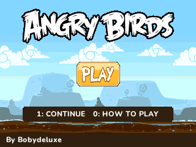

<p align="center">
  
</p>

<h1 align="center">NumPlay</h1>

<p align="center">
  <b>29 free games for your NumWorks calculator, in one app.</b><br>
  Plus 22 big games that install on their own. For the N0110, N0115 and N0120, in English, French and Chinese.
</p>

<p align="center">
  <a href="https://github.com/Mason363/NumPlay/releases"></a>
  <a href="https://github.com/Mason363/NumPlay/stargazers"></a>
  <a href="https://github.com/Mason363/NumPlay/releases/latest"></a>
</p>

<p align="center">
  <a href="https://github.com/Mason363/NumPlay/releases/latest/download/NumPlay.nwa"></a>
  <a href="https://mason363.github.io/NumPlay/customize/"></a>
</p>

<p align="center">
  <a href="https://mason363.github.io/NumPlay/customize/"></a>
  <br>
  <a href="https://mason363.github.io/NumPlay/customize/"><b>Make your own NumPlay in NumPlay Studio</b></a>
</p>

<p align="center">
  <a href="#how-to-install"><b>How to install</b></a> &nbsp;·&nbsp; <a href="docs/play.md"><b>How to play</b></a> &nbsp;·&nbsp; <a href="https://github.com/Mason363/NumPlay/releases/latest"><b>All downloads</b></a> &nbsp;·&nbsp; <a href="CHANGELOG.md"><b>What's new</b></a> &nbsp;·&nbsp; <a href="#roadmap"><b>Roadmap</b></a> &nbsp;·&nbsp; <a href="docs/make-a-game.md"><b>Make a game</b></a>
</p>

<p align="center">
  
</p>

⭐ **Enjoying NumPlay?** Give it a star at the top of this page: it takes a second and helps other people find it.<br>
💡 **Want a game that isn't here?** Check the [roadmap](#roadmap) first, then email me at [masonchen204@gmail.com](mailto:masonchen204@gmail.com).

## Games in NumPlay

All of these come in one app, **NumPlay.nwa**.

<table>
  <tr>
    <td align="center" width="20%"><a href="games/numdash/README.md"><br><b>NumDash</b></a></td>
    <td align="center" width="20%"><a href="games/crossyroad/README.md"><br><b>Crossy Road</b></a></td>
    <td align="center" width="20%"><a href="games/numblocks/README.md"><br><b>NumBlocks</b></a></td>
    <td align="center" width="20%"><a href="games/numdrive/README.md"><br><b>NumDrive</b></a></td>
    <td align="center" width="20%"><a href="games/balatro/README.md"><br><b>Balatro</b></a></td>
  </tr>
  <tr>
    <td align="center"><a href="games/buckshot/README.md"><br><b>Buckshot Roulette</b></a></td>
    <td align="center"><a href="games/blockblast/README.md"><br><b>Block Blast</b></a></td>
    <td align="center"><a href="games/suika/README.md"><br><b>Suika Game</b></a></td>
    <td align="center"><a href="games/portal/README.md"><br><b>Portal Returns</b></a></td>
    <td align="center"><a href="games/tetris/README.md"><br><b>Tetris</b></a></td>
  </tr>
  <tr>
    <td align="center"><a href="games/dinorun/README.md"><br><b>Chrome Dino</b></a></td>
    <td align="center"><a href="games/doodlejump/README.md"><br><b>Doodle Jump</b></a></td>
    <td align="center"><a href="games/chess/README.md"><br><b>Chess</b></a></td>
    <td align="center"><a href="games/flappybird/README.md"><br><b>Flappy Bird</b></a></td>
    <td align="center"><a href="games/flappydunk/README.md"><br><b>Flappy Dunk</b></a></td>
  </tr>
  <tr>
    <td align="center"><a href="games/towerblock/README.md"><br><b>Tower Blocks</b></a></td>
    <td align="center"><a href="games/coreball/README.md"><br><b>Core Ball</b></a></td>
    <td align="center"><a href="games/pacman/README.md"><br><b>Pac-Man</b></a></td>
    <td align="center"><a href="games/snake/README.md"><br><b>Snake</b></a></td>
    <td align="center"><a href="games/connectfour/README.md"><br><b>Connect Four</b></a></td>
  </tr>
  <tr>
    <td align="center"><a href="games/solitaire/README.md"><br><b>Solitaire</b></a></td>
    <td align="center"><a href="games/g2048/README.md"><br><b>2048</b></a></td>
    <td align="center"><a href="games/minesweeper/README.md"><br><b>Minesweeper</b></a></td>
    <td align="center"><a href="games/breakout/README.md"><br><b>Block Breaker</b></a></td>
    <td align="center"><a href="games/twoplayer/README.md"><br><b>2 Players</b></a></td>
  </tr>
  <tr>
    <td align="center"><a href="games/invaders/README.md"><br><b>Space Invaders</b></a></td>
    <td align="center"><a href="games/sudoku/README.md"><br><b>Sudoku</b></a></td>
    <td align="center"><a href="games/uttt/README.md"><br><b>Ultimate Tic-Tac-Toe</b></a></td>
    <td align="center"><a href="games/sokoban/README.md"><br><b>Sokoban</b></a></td>
  </tr>
</table>

Want just one game? Each one also comes as its own file on the [downloads page](https://github.com/Mason363/NumPlay/releases/latest).

**NumVisuals**, moving backgrounds with a clock, a stopwatch, a timer or a counter on top, comes on its own: [download NumVisuals.nwa](https://github.com/Mason363/NumPlay/releases/latest/download/NumVisuals.nwa). Its backgrounds are also in NumPlay: press ⌫ on the home screen.

## Big games, installed on their own

These are too big to fit next to NumPlay, so each one is its own app. Install it without NumPlay.

<table>
  <tr>
    <td align="center" width="33%"><a href="games/numpowder/README.md"><br><b>NumPowder</b></a><br><sub>The Powder Toy: 175 materials to mix, melt, burn and blow up</sub><br><a href="https://github.com/Mason363/NumPlay/releases/latest/download/NumPowder.nwa">Download</a></td>
    <td align="center" width="33%"><a href="games/finalearth2/README.md"><br><b>The Final Earth 2</b></a><br><sub>Build a city on floating islands in space</sub><br><a href="https://github.com/Mason363/NumPlay/releases/latest/download/FinalEarth2.nwa">Download</a></td>
    <td align="center" width="33%"><a href="games/hollowknight/README.md"><br><b>Hollow Knight</b></a><br><sub>From King's Pass to Hornet in Greenpath</sub><br><a href="https://github.com/Mason363/NumPlay/releases/latest/download/HollowKnight.nwa">Download</a></td>
  </tr>
  <tr>
    <td align="center"><a href="games/celeste/README.md"><br><b>Celeste</b></a><br><sub>The whole climb, with every B-side and C-side</sub><br><a href="https://github.com/Mason363/NumPlay/releases/latest/download/Celeste.nwa">Download</a></td>
    <td align="center"><a href="games/championisland/README.md"><br><b>Champion Island</b></a><br><sub>The whole island and its seven sports</sub><br><a href="https://github.com/Mason363/NumPlay/releases/latest/download/ChampionIsland.nwa">Download</a></td>
    <td align="center"><a href="games/undertale/README.md"><br><b>Undertale</b></a><br><sub>The whole Underground, from the golden flowers to the barrier and the neutral ending</sub><br><a href="https://github.com/Mason363/NumPlay/releases/latest/download/Undertale.nwa">Download</a></td>
  </tr>
  <tr>
    <td align="center"><a href="games/doom/README.md"><br><b>Doom</b></a><br><sub>Knee-Deep in the Dead: all nine levels of the shareware episode</sub><br><a href="https://github.com/Mason363/NumPlay/releases/latest/download/Doom.nwa">Download</a></td>
    <td align="center"><a href="games/isaac/README.md"><br><b>The Binding of Isaac</b></a><br><sub>A whole run: the Basement to Mom, her heart, Sheol and the Cathedral</sub><br><a href="https://github.com/Mason363/NumPlay/releases/latest/download/BindingOfIsaac.nwa">Download</a></td>
    <td align="center"><a href="games/pvz/README.md"><br><b>Plants vs. Zombies</b></a><br><sub>The whole Adventure, from the front lawn to the roof and Dr. Zomboss</sub><br><a href="https://github.com/Mason363/NumPlay/releases/latest/download/PlantsVsZombies.nwa">Download</a></td>
  </tr>
  <tr>
    <td align="center"><a href="games/fnaf/README.md"><br><b>Five Nights at Freddy's</b></a><br><sub>All five nights, the 6th and the Custom Night</sub><br><a href="https://github.com/Mason363/NumPlay/releases/latest/download/FiveNightsAtFreddys.nwa">Download</a></td>
    <td align="center"><a href="games/sonic/README.md"><br><b>Sonic the Hedgehog</b></a><br><sub>The whole 1991 game: six zones, the Final Zone, the Special Stages and the ending</sub><br><a href="https://github.com/Mason363/NumPlay/releases/latest/download/SonicTheHedgehog.nwa">Download</a></td>
    <td align="center"><a href="games/subway/README.md"><br><b>Subway Surfers</b></a><br><sub>The endless run down the tracks, in 3D</sub><br><a href="https://github.com/Mason363/NumPlay/releases/latest/download/SubwaySurfers.nwa">Download</a></td>
  </tr>
  <tr>
    <td align="center"><a href="games/hillclimb/README.md"><br><b>Hill Climb Racing</b></a><br><sub>Thirteen stages, thirteen vehicles and all their upgrades</sub><br><a href="https://github.com/Mason363/NumPlay/releases/latest/download/HillClimbRacing.nwa">Download</a></td>
    <td align="center"><a href="games/cookieclicker/README.md"><br><b>Cookie Clicker</b></a><br><sub>The whole game with its own pictures: ascension, the dragon, the Grimoire and the Pantheon</sub><br><a href="https://github.com/Mason363/NumPlay/releases/latest/download/CookieClicker.nwa">Download</a></td>
    <td align="center"><a href="games/leveldevil/README.md"><br><b>Level Devil</b></a><br><sub>Unept's troll platformer: the game's 80 rooms, with their own traps</sub><br><a href="https://github.com/Mason363/NumPlay/releases/latest/download/LevelDevil.nwa">Download</a></td>
  </tr>
  <tr>
    <td align="center"><a href="games/jetpackjoyride/README.md"><br><b>Jetpack Joyride</b></a><br><sub>Barry's run through the lab, with the vehicles and the Final Spin</sub><br><a href="https://github.com/Mason363/NumPlay/releases/latest/download/JetpackJoyride.nwa">Download</a></td>
    <td align="center"><a href="games/stickmanhook/README.md"><br><b>Stickman Hook</b></a><br><sub>Swing from hook to hook: the 39 levels, then no end</sub><br><a href="https://github.com/Mason363/NumPlay/releases/latest/download/StickmanHook.nwa">Download</a></td>
    <td align="center"><a href="games/donkeykong/README.md"><br><b>Donkey Kong</b></a><br><sub>The 1981 arcade game: barrels, pies, elevators and rivets</sub><br><a href="https://github.com/Mason363/NumPlay/releases/latest/download/DonkeyKong.nwa">Download</a></td>
  </tr>
  <tr>
    <td align="center"><a href="games/dune/README.md"><br><b>Dune</b></a><br><sub>Roll down the dunes and fly over the line: 26 balls, 7 landscapes</sub><br><a href="https://github.com/Mason363/NumPlay/releases/latest/download/Dune.nwa">Download</a></td>
    <td align="center"><a href="games/monkeymart/README.md"><br><b>Monkey Mart</b></a><br><sub>Run a grocery mart as a monkey: both marts, their crops, animals and workers</sub><br><a href="https://github.com/Mason363/NumPlay/releases/latest/download/MonkeyMart.nwa">Download</a></td>
    <td align="center"><a href="games/tombofthemask/README.md"><br><b>Tomb of the Mask</b></a><br><sub>Dash through the tomb: the arcade climb and all 200 stages</sub><br><a href="https://github.com/Mason363/NumPlay/releases/latest/download/TombOfTheMask.nwa">Download</a></td>
  </tr>
  <tr>
    <td align="center"><a href="https://github.com/Mason363/NumWorks-Super-Mario-64"><b>Super Mario 64</b></a><br><sub>In a repository of its own: NumWorks-Super-Mario-64</sub></td>
    <td align="center"><a href="https://github.com/Mason363/NumWorks-Super-Mario-Bros"><b>Super Mario Bros.</b></a><br><sub>All 32 stages, in a repository of its own: NumWorks-Super-Mario-Bros</sub></td>
    <td align="center"><a href="games/angrybirds/README.md"><br><b>Angry Birds</b></a><br><sub>Experimental adaptation: 443 stages and bonus maps. Known bugs remain. By Bobydeluxe.</sub><br><a href="https://github.com/Mason363/NumPlay/releases/latest/download/AngryBirds.nwa">Download</a></td>
  </tr>
</table>

## Your own Game Boy, NES and Sega games

<table>
  <tr>
    <td align="center" width="33%"><a href="games/retrogo/README.md"><br><b>Retro-Go</b></a><br><sub>Game Boy, Game Boy Color, NES, Master System and Game Gear games, with Retro-Go's menus and save slots</sub></td>
  </tr>
</table>

Retro-Go plays the Game Boy, Game Boy Color, NES, Master System and Game Gear games you choose: games you own, or free ones like homebrew games. It isn't in NumPlay.nwa. Drop your games on [NumPlay Studio](https://mason363.github.io/NumPlay/customize/) and you get a NumPlay with Retro-Go and your games inside.

## How to install

You need your calculator, its USB cable, and a computer with **Google Chrome** or **Microsoft Edge**. It takes about 2 minutes.

1. **Download** [NumPlay.nwa](https://github.com/Mason363/NumPlay/releases/latest/download/NumPlay.nwa), or one of the big games above. Want other games in it? Pick them in [NumPlay Studio](https://mason363.github.io/NumPlay/customize/) and it makes a NumPlay.nwa with just those.
2. **Plug** your calculator into the computer and turn it on.
3. **Go to** [my.numworks.com/apps](https://my.numworks.com/apps) and log in. No account? Sign up there, it's free.
4. Click **Connect**, then pick your calculator in the small window that opens.
5. **Add** the file you downloaded, then click **Install**. Keep the calculator plugged in until it's done.
6. **Play!** On your calculator, press the **Home** key (the little house), go to the end of the apps and open **NumPlay**.

> [!TIP]
> **Updating?** Install the new file the same way: your progress comes back by itself. Already have other apps from that website? Add them again in step 5 to keep them.

<details>
<summary><b>Which calculators work</b></summary>

| Calculator | Software | What runs |
| --- | --- | --- |
| N0120 | Epsilon 23.2 or newer (the calculator's own software) | Everything |
| N0110, N0115 | Epsilon 23.2 or newer | Everything. These models are about 2.5 times slower, so the big games show fewer frames per second, but they keep their speed. |
| N0110, N0115 | Upsilon | NumPlay-Upsilon.nwa: 24 games (see Other versions) |
| Any | Custom software built from Epsilon 25.2's source | Everything. These builds can give apps less memory (133 KB): on one that gives even less, a game that needs more says how much on its card. |

To see your calculator's model and software, open **Settings**, then **About**. To update the software, go to [my.numworks.com](https://my.numworks.com) with the calculator plugged in.

</details>

<details>
<summary><b>Other versions: hidden, disguised, French, Chinese, Upsilon</b></summary>

| File | What it is |
| --- | --- |
| [NumPlay-Invisible.nwa](https://github.com/Mason363/NumPlay/releases/latest/download/NumPlay-Invisible.nwa) | The same app, hidden: a blank white icon with no name, so it looks like an empty spot on the home screen. |
| [NumPlay-Matrices.nwa](https://github.com/Mason363/NumPlay/releases/latest/download/NumPlay-Matrices.nwa) | The same app, in disguise: it looks like a math app called **Matrices**. |
| [NumPlay-French.nwa](https://github.com/Mason363/NumPlay/releases/latest/download/NumPlay-French.nwa) | NumPlay en français : tous les jeux, en français. |
| [NumPlay-Chinese.nwa](https://github.com/Mason363/NumPlay/releases/latest/download/NumPlay-Chinese.nwa) | NumPlay 中文版：所有游戏，简体中文。 |
| [NumPlay-Upsilon.nwa](https://github.com/Mason363/NumPlay/releases/latest/download/NumPlay-Upsilon.nwa) | For calculators running **Upsilon**: the 24 games that fit in the memory it gives apps. |

 

Install any of them instead of NumPlay.nwa: your progress is the same in each. A few things stay in English in French and Chinese: words drawn into pictures, level names, key names, NumBlocks' commands and Portal Returns' stories. The big games come in English only.

**On Upsilon,** the NumWorks website doesn't install apps (it shows 0 KB free). Install [Node.js](https://nodejs.org), plug in the calculator, and run `npx nwlink install-nwa NumPlay-Upsilon.nwa` in the folder you downloaded it to. This needs an Upsilon that runs .nwa apps: its builds from June 2026 on. On an older one, like Upsilon 1.0.1, nwlink stops with "invalid length for memory": update Upsilon first from [its website](https://getupsilon.web.app).

</details>

<details>
<summary><b>Keeping your saves</b></summary>

- Your progress is saved on the calculator as files. Turning it off keeps them.
- **Installing apps erases these files**, all but the Python scripts. So NumPlay keeps a copy of every save in a Python script, `numplay_saves.py` (the big games have their own), and your progress comes back the first time you open the game. Don't delete these scripts.
- **A restart erases every file**, scripts included: the reset button on the back, or a crash. If your calculator restarts by itself while you play, please [email me](mailto:masonchen204@gmail.com) which game and what you were doing.
- The calculator holds 42 KB of files in all. A big NumBlocks world can fill it: delete worlds or scripts you don't need to make room.

</details>

<details>
<summary><b>The app doesn't show up after installing</b></summary>

- **The calculator restarts once after installing:** it shows the NumWorks logo, then asks for your language. That's normal. Your apps are at the end of the home screen.
- **Each big game installs alone,** without NumPlay and without the other big games: if you pick more than fits, they don't install.
- **Installing replaces the apps you installed before.** To keep one, add it again with the new one.
- **Nothing happens when you plug it in?** Try another cable: some only charge.
- Check your calculator's software is **Epsilon 23.2 or newer** (Settings, then About).

</details>

## On a real calculator

<table>
  <tr>
    <td></td>
    <td></td>
    <td></td>
  </tr>
</table>

Filmed on my own calculator, no emulator.

## Make your own NumWorks games

NumPlay is also a kit for making games and apps for the NumWorks calculator. Start from its template in one command, then use the same pieces its games are built with: 2D and 3D drawing that fits the calculator's memory, fonts in three languages, saves that survive a reinstall, physics, and an emulator that tests your game without a calculator. It works on macOS, Windows and Linux.

```bash
python3 tools/setup.py
```

```bash
python3 tools/new_game.py "My Game"
```

Read **[Make your own NumWorks game](docs/make-a-game.md)** to go from there, and **[Contributing](CONTRIBUTING.md)** if you'd like to help with NumPlay itself.

## Roadmap

- [x] Celeste
- [x] Hollow Knight
- [x] Minecraft 1.8 (NumBlocks)
- [x] The Final Earth 2
- [x] The Powder Toy (NumPowder)
- [x] Block Blast
- [x] Undertale: the whole Underground, from the Ruins to New Home and the neutral ending
- [x] The Binding of Isaac: a whole run, from the Basement to the Cathedral
- [x] Plants vs. Zombies: the whole Adventure, from the front lawn to the roof and Dr. Zomboss
- [x] Doom: Knee-Deep in the Dead, the shareware episode
- [x] Five Nights at Freddy's: all five nights, the 6th and the Custom Night
- [x] Pong and more two-player games: 2 Players, with Pong, Air Hockey, Tanks and Light Cycles
- [x] Cookie Clicker
- [x] Level Devil
- [x] Sonic the Hedgehog: the whole 1991 game, Green Hill to the Final Zone, with the Special Stages
- [x] Subway Surfers
- [x] Hill Climb Racing
- [x] Space Invaders
- [x] Sokoban
- [x] Sudoku
- [x] Ultimate Tic-Tac-Toe
- [x] Super Mario 64, in a repository of its own: [NumWorks-Super-Mario-64](https://github.com/Mason363/NumWorks-Super-Mario-64)
- [x] Super Mario Bros., in a repository of its own: [NumWorks-Super-Mario-Bros](https://github.com/Mason363/NumWorks-Super-Mario-Bros)
- [x] The Nether and the End in NumBlocks: portals, fortresses, strongholds and the Ender Dragon, in NumBlocks.nwa
- [x] [Retro-Go](https://github.com/ducalex/retro-go) for Game Boy, Game Boy Color, NES, Master System and Game Gear: upload your own ROMs on the website and get a .nwa app that plays them
- [x] Suika Game
- [x] Stickman Hook
- [x] Donkey Kong
- [x] Core Ball
- [x] Dune
- [x] Monkey Mart
- [x] Tomb of the Mask
- [x] [NumPlay Studio](https://mason363.github.io/NumPlay/customize/), the website where you pick the games in your NumPlay, with Enlarged Extra Apps to fit several big games
- [ ] Full Minecraft 1.18.2 as a standalone app
- [ ] Among Us, against bots
- [ ] Cat Ninja
- [ ] A tower defense game: Kingdom Rush or Bloons TD
- [ ] Into the Breach
- [ ] A racing game: F1 or GT3
- [ ] Ori and the Blind Forest
- [ ] Bad Time Simulator: the Sans fight
- [ ] A PICO-8 emulator: add your own .p8 games on the website
- [ ] Hades
- [ ] Super Smash Bros
- [ ] Rocket League
- [ ] Temple Run
- [ ] Deltarune: Chapter 1, and each later chapter as an app of its own
- [ ] Hollow Knight: more of Hallownest after Greenpath
- [ ] Hill Climb Racing: the stages and vehicles added after version 1.10.2
- [ ] Tower Destiny Survive
- [ ] My Little Universe
- [ ] Famidash, made for the calculator (not through an emulator)
- [ ] Mr. Bullet
- [ ] Hungry Shark Evolution and Hungry Shark World
- [ ] Castle Crashers
- [ ] Hotline Miami
- [ ] Meowdoku
- [ ] More of Retro-Go: Game & Watch, SNES, Mega Drive, SG-1000 and ColecoVision
- [ ] Five Nights at Freddy's 2, 3, 4 and FNAF World
- [ ] Brawl Stars, against bots
- [ ] Friday Night Funkin'

## Credits

- **Angry Birds** by **Rovio**: original levels, sprites and artwork from the supplied Chrome/Seasons reference. Native NumWorks adaptation by **[Bobydeluxe](https://github.com/Bobydeluxe)**, installed separately as **AngryBirds.nwa**. UI text uses NumPlay's Nunito font. See [asset provenance](games/angrybirds/ASSETS.md). Not affiliated with Rovio.

NumPlay is a fan project, made out of love for these games and for the NumWorks calculator. If you enjoy a game here, go play the original and support the people who made it. NumWorks also has a great community of people making games by hand: try [Numcraft](https://github.com/yannis300307/NumcraftRust), [Celeste Classic](https://github.com/BenchatonDev/Celeste-Numworks), [Tatone26's All the Apps](https://github.com/Tatone26/Numworks-games), the apps on [Nwagyu](https://nwagyu.org/guide/) and [yannis300307's list](https://gist.github.com/yannis300307/9123136f90877107ec0d49ba96b303e5).

- **[Tatone26](https://github.com/Tatone26/Numworks-games)**'s **All the Apps** inspired NumPlay's list of classics. Flappy Bird, Pac-Man, Snake, Connect Four, Solitaire and 2048 are written in C for NumPlay and keep its options, with no code copied from it. Tetris is Tatone26's own, which they released into the public domain, adapted for NumPlay.
- **[Gabriele Cirulli](https://github.com/gabrielecirulli/2048)** made 2048.
- **Block Blast!** by [Hungry Studio](https://www.hungrystudio.com) inspired NumPlay's Block Blast, written in C for NumPlay with no code or art from it. Its blocks, scoring and colours follow measurements of the app by the players behind [blockblast-Self-Improvement-loop](https://github.com/Kucze3205/blockblast-Self-Improvement-loop).
- **Flappy Dunk** by Voodoo (made with Acid Cousins) inspired NumPlay's Flappy Dunk, written in C for NumPlay with no code or art from it. Its physics and hoops follow the numbers in the game's Android build. **[Bobydeluxe](https://github.com/Bobydeluxe)** brought it to NumPlay. Not affiliated with Voodoo.
- **Tower Blocks** by [Steve Gardner](https://codepen.io/ste-vg/pen/ppLQNW) (MIT License) is ported to C for NumPlay from its source: its sizes, speeds, colours, light and camera are the original's. **[Bobydeluxe](https://github.com/Bobydeluxe)** brought it to NumPlay.
- **Doodle Jump** by Lima Sky inspired NumPlay's Doodle Jump, written in C for NumPlay with no code or art from it, drawn in its style on its own page size. **[Bobydeluxe](https://github.com/Bobydeluxe)** brought it to NumPlay. Not affiliated with Lima Sky.
- **Suika Game** by Aladdin X inspired NumPlay's Suika Game, written in C for NumPlay with no code or art from it. Its fruit sizes, colours, speeds and timings were measured on the Switch version, with the sizes checked against [kairess/suika-game](https://github.com/kairess/suika-game). **[Bobydeluxe](https://github.com/Bobydeluxe)** brought it to NumPlay. Not affiliated with Aladdin X.
- **[Core Ball](https://github.com/randomyang/core-ball)** by Random (Yang Hao, MIT License) is ported to C for NumPlay from its own build: its 60 levels, turns, speeds and timing are the original's. **[Bobydeluxe](https://github.com/Bobydeluxe)** brought it to NumPlay.
- Snake, Solitaire and Block Breaker look and play like **Google's games** in Search. They are drawn from scratch; nothing is taken from Google.
- **Chrome's dinosaur game** by Google inspired Chrome Dino, which ports its rules, numbers and pictures from [Chromium's source](https://chromium.googlesource.com/chromium/src/+/main/components/neterror/resources/dino_game/) (BSD license). **[LilyTheCatgirl](https://github.com/LilyTheCuteCatgirl)** brought it to NumPlay, and also made the live emulator (`tools/emulator.py`) and the builder (`tools/build.py`). Not affiliated with Google.
- **[gd3ds](https://github.com/AleFunky/gd3ds)** by AleFunky and friends, whose research into Geometry Dash made NumDash possible. Clubstep, Deadlocked and Dash also rely on [gdsolver](https://github.com/gdsolver/gdsolver)'s measurements of Geometry Dash 2.2, level data from [gmdkit](https://github.com/UHDanke/gmdkit) by HDanke and checks against [GDRWeb](https://github.com/iliasHDZ/GDRWeb) by IliasHDZ.
- **Balatro** by LocalThunk inspired NumPlay's Balatro, which uses art adapted from the game and the **m6x11** font by Daniel Linssen.
- **Minecraft** by Mojang inspired NumBlocks, which follows Minecraft 1.8.8 exactly: it makes its worlds the way Minecraft 1.8.8 does and uses its blocks, items, recipes, textures, font and screens.
- **Celeste** inspired NumPlay's Celeste, which uses the game's own pictures, maps, texts and fonts. Not affiliated with Maddy Makes Games.
- **Hollow Knight** inspired NumPlay's Hollow Knight, which uses the game's own pictures, animations, maps, texts and fonts. Not affiliated with Team Cherry.
- **Undertale** by Toby Fox inspired NumPlay's Undertale, which uses the game's maps, pictures and texts from the [Undertale Wiki](https://undertale.fandom.com) and the game's free demo, and the **Pixel Operator** fonts by Jayvee Enaguas (public domain). Not affiliated with Toby Fox.
- **Doom** (1993) by id Software, run by its own engine: [RP2040 Doom](https://github.com/kilograham/rp2040-doom) by Graham Sanderson (GNU GPL v2, its own files BSD 3-Clause), made from [Chocolate Doom](https://github.com/chocolate-doom/chocolate-doom) by Simon Howard and its contributors and the Doom source code id Software released under the GNU GPL, with the levels, pictures and texts of the shareware DOOM1.WAD. Not affiliated with id Software, ZeniMax or Bethesda.
- **The Binding of Isaac** by Edmund McMillen and Florian Himsl (Rebirth by Nicalis) inspired NumPlay's The Binding of Isaac, which uses the game's own pictures from [Basement Renovator](https://github.com/Basement-Renovator/basement-renovator)'s resources and the **Upheaval** font by Brian Kent (freeware). Not affiliated with them.
- **Plants vs. Zombies** by PopCap Games inspired NumPlay's Plants vs. Zombies, which uses the game's pictures, animations and numbers as kept by [pvz-web](https://github.com/xyxiao001/pvz-web), and the **Rammetto One** and **Nunito** fonts (SIL Open Font License). Not affiliated with PopCap Games or Electronic Arts.
- **Five Nights at Freddy's** by Scott Cawthon inspired NumPlay's Five Nights at Freddy's, which uses the game's own pictures and words, as the fan ports [Five Nights at Freddy's Web](https://github.com/souwell/Five-Nights-at-Freddys-Web) (wellsousaaa) and [HX-NAF](https://github.com/BaranMuzu/HX-NAF) (BaranMuzu) keep them, and the DejaVu fonts ([license](LICENSES/DejaVu.txt)). How the animatronics move follows RosieSapphire's [FNaF64](https://github.com/RosieSapphire/FNaF64) and LOUDO2's [fnaf-1-godot](https://github.com/LOUDO2/fnaf-1-godot). Not affiliated with Scott Cawthon.
- **Sonic the Hedgehog** by Sonic Team inspired NumPlay's Sonic the Hedgehog, which reads the game's art, levels and demos from the [Sonic Retro disassembly](https://github.com/sonicretro/s1disasm) and follows the [Sonic Physics Guide](https://info.sonicretro.org/Sonic_Physics_Guide). Not affiliated with SEGA.
- **Subway Surfers** by SYBO and Kiloo inspired NumPlay's Subway Surfers: its people are fitted to the game's own 3D models and wear their textures, and its logo and item icons are the game's, as the [Subway Surfers Wiki](https://subwaysurf.fandom.com) shows them; the yard and the trains are drawn after the game. It is lettered in the **Lilita One** font by Juan Montoreano (SIL Open Font License, [license](LICENSES/OFL-1.1-LilitaOne.txt)). Not affiliated with them.
- **Hill Climb Racing** by Fingersoft inspired NumPlay's Hill Climb Racing, which uses the game's own pictures from the [Hill Climb Racing Wiki](https://hillclimbracing.fandom.com), the **Teko** font (SIL Open Font License, [license](LICENSES/OFL-1.1-Teko.txt)) and **Box2D 2.2.1** by Erin Catto (zlib license, [license](games/hillclimb/src/box2d/License.txt)), the physics engine the game is built on. Not affiliated with Fingersoft.
- **Jetpack Joyride** by Halfbrick inspired NumPlay's Jetpack Joyride, written in C for NumPlay with the game's own pictures (from Halfbrick's Facebook asset archive and the Android game) and its numbers, read from the game's files. **[Bobydeluxe](https://github.com/Bobydeluxe)** brought it to NumPlay. Not affiliated with Halfbrick.
- **Stickman Hook** by Madbox inspired NumPlay's Stickman Hook, written in C for NumPlay with the game's own pictures, levels and **JUNEGULL** font, read from its web version, and its physics checked step by step against the game's code. **[Bobydeluxe](https://github.com/Bobydeluxe)** brought it to NumPlay. Not affiliated with Madbox.
- **Donkey Kong** by Nintendo inspired NumPlay's Donkey Kong, which follows the arcade program's rules and numbers, studied in furrykef's [dkdasm](https://github.com/furrykef/dkdasm) disassembly and tcdev's annotated listing, with new pictures drawn for it. **[Bobydeluxe](https://github.com/Bobydeluxe)** brought it to NumPlay and drew its pictures. Not affiliated with Nintendo.
- **Dune!** by Team Lava inspired NumPlay's Dune, which ports Dune Rider, Inlogic Software's web version: its pictures, Bango Pro lettering and numbers, and its physics, [p2.js](https://github.com/schteppe/p2.js) by Stefan Hedman (MIT License), written again in C. **[Bobydeluxe](https://github.com/Bobydeluxe)** brought it to NumPlay. Not affiliated with Team Lava or Inlogic Software.
- **Monkey Mart** by TinyDobbins inspired NumPlay's Monkey Mart, which follows the rules, timings and numbers of the game's web version and uses its pictures, its monkeys and animals and the **Riffic** font from it. **[Bobydeluxe](https://github.com/Bobydeluxe)** brought it to NumPlay. Not affiliated with TinyDobbins.
- **Tomb of the Mask** by Playgendary inspired NumPlay's Tomb of the Mask, which follows the rules of the game's web version and uses its stages, pictures and pixel font. **[Bobydeluxe](https://github.com/Bobydeluxe)** brought it to NumPlay. Not affiliated with Playgendary.
- **[Level Devil](https://store.steampowered.com/app/3242750/)** by Unept: NumPlay's Level Devil is written in C with no code from the game, but its 80 rooms (their tiles, traps and timing) are the game's own, taken from its web build by games/leveldevil/tools/fetch.py, and its runner is drawn from the game's sprites.

- **Pong** by Atari (1972) inspired NumPlay's 2 Players, with air hockey, tanks in a maze in the spirit of Tank Trouble and the light cycles of Tron. All four are written in C for NumPlay and drawn from shapes, with no code or art from them.
- **[Cookie Clicker](https://orteil.dashnet.org/cookieclicker/)** by Orteil and Opti (DashNet) inspired NumPlay's Cookie Clicker, which uses the game's own pictures, texts and numbers (version 2.058, from its public mirror [ozh/cookieclicker](https://github.com/ozh/cookieclicker)) and the **Merriweather**, **Kavoon** and **Noto Sans** fonts (SIL Open Font License: [Merriweather](LICENSES/OFL-1.1-Merriweather.txt), [Kavoon](LICENSES/OFL-1.1-Kavoon.txt), [Noto Sans](LICENSES/OFL-1.1-NotoSans.txt)). Not affiliated with Orteil or DashNet.
- **Space Invaders** by Tomohiro Nishikado and Taito (1978, Midway in America) inspired NumPlay's Space Invaders, written in C for NumPlay from the arcade's rules with its pictures redrawn from the arcade's, under the Midway cabinet's coloured film.
- **Sokoban** by Hiroyuki Imabayashi (Thinking Rabbit, 1982) inspired NumPlay's Sokoban, written in C for NumPlay with no code or art from any Sokoban. Its levels are **Microban** by David W. Skinner (2000), used with credit to him.
- **Sudoku**, the number place puzzle (Dell Magazines, 1979; named by Nikoli), is written in C for NumPlay: its puzzles are made on the calculator, and its look and controls follow the phone apps.
- **Ultimate tic-tac-toe** is a folk game, made widely known by [Ben Orlin's 2013 article](https://mathwithbaddrawings.com/2013/06/16/ultimate-tic-tac-toe/); NumPlay's is written in C for it.

- **[The Powder Toy](https://powdertoy.co.uk)** inspired NumPowder, which ports its materials' behaviour, its font and its icons from [its source code](https://github.com/The-Powder-Toy/The-Powder-Toy) (GNU GPL v3.0), by Stanislaw K Skowronek, Simon Robertshaw and its contributors. Not affiliated with them.
- **[The Final Earth 2](https://store.steampowered.com/app/1180130/The_Final_Earth_2/)** by [Florian van Strien](https://florianvanstrien.nl) inspired NumPlay's The Final Earth 2, which uses the game's own pictures, fonts and texts, with additional sprites by LukXD99. Not affiliated with him.
- **Buckshot Roulette** by Mike Klubnika inspired NumPlay's Buckshot Roulette, whose scenes are rendered from the game through the Open Buckshot Roulette project (1503Dev). Fonts: Fake Receipt by Ray Larabie and Dot Matrix by Dionaea.
- The **Doodle Champion Island Games** (2021) inspired Champion Island, which uses the doodle's own pictures, maps and texts from the [Google-Doodle-Champion-Island](https://github.com/potherca-blog/Google-Doodle-Champion-Island) archive by potherca-blog and from the doodle as Google serves it now, and the **PixelMplus** font by Itou Hiroki ([license](LICENSES/PixelMplus.txt)).
- **[Portal Returns](https://www.cemetech.net/downloads/files/1313/x1313)** by MateoConLechuga for the TI-84 Plus CE, with sprites by CKH4 and Portal Prelude chambers ported by Unicorn from BuilderBoy's original.
- The **Nunito** and **Rammetto One** fonts, under the SIL Open Font License ([LICENSES](LICENSES)).
- The **Fusion Pixel** font by TakWolf (with glyphs from **Ark Pixel**), under the SIL Open Font License ([license](LICENSES/OFL-1.1-Fusion-Pixel.txt)), for the Chinese letters.
- **[Upsilon](https://github.com/UpsilonNumworks/Upsilon)**, the custom software NumPlay-Upsilon.nwa runs on.
- **reversal_lava63**, a beta tester who plays NumPlay's apps on a real calculator and reports what's wrong.
- **[Gabriel](https://github.com/tomcalif9-stack)**, who made the home screen's moving backgrounds, translated NumPlay into French first, and tests it on Upsilon and an N0115.
- **[LanoCodes17](https://github.com/LanoCodes17)**, whose idea the Konami code is: one of the secret ways into NumPlay from Matrices.
- **[Retro-Go](https://github.com/ducalex/retro-go)** by ducalex inspired NumPlay's Retro-Go, whose launcher, menus and frame skipping are written again for NumPlay with no code copied from it. Its emulators are **[gnuboy](https://github.com/rofl0r/gnuboy)** by Laguna and Gilgamesh (GNU GPL v2 or later) for the Game Boy and **nofrendo** by Matthew Conte (GNU LGPL v2, used under the GPL) for the NES; the Master System and Game Gear are NumPlay's own, around **[superzazu's z80](https://github.com/superzazu/z80)** by Nicolas Allemand (MIT License). Its tests use Blargg's test ROMs, Matt Currie's dmg-acid2 and cgb-acid2, kevtris's nestest and Frank Cringle's zexdoc and zexall. Not affiliated with them.
- **NumPlay Studio** builds your NumPlay right in the browser with **GNU ld and objcopy** from [binutils](https://www.gnu.org/software/binutils/) (GNU GPL v3), compiled to WebAssembly with [emscripten](https://emscripten.org).
- Everyone who reported a bug: **NEE** ([reversallava63](https://github.com/reversallava63)), **Gabriel**, **[briac134](https://github.com/briac134)**, **[Raphanobie](https://github.com/Raphanobie)**, **[zbigzo](https://github.com/zbigzo)**, **Yacine**, **PelicanMan75**, **[Spykube](https://github.com/Spykube)** and **[axio-m](https://github.com/axio-m)**. Thank you!

## License

NumPlay is licensed under the [GNU General Public License v3.0](LICENSE). Copyright (c) 2026 Mason Chen. Code and fonts from others keep their own licenses: the `UNLICENSE` files in the games' folders and the [LICENSES](LICENSES) folder. The names, artwork and music of the games NumPlay is inspired by belong to their makers and are not covered by it.

<sub>Unofficial fan games, not affiliated with NumWorks, RobTop Games (Geometry Dash), Hipster Whale (Crossy Road), the makers of Drive Mad, LocalThunk or Playstack (Balatro), Mike Klubnika or Critical Reflex (Buckshot Roulette), Hungry Studio (Block Blast!), Aladdin X (Suika Game), Voodoo (Flappy Dunk), Lima Sky (Doodle Jump), Mojang or Microsoft (Minecraft), Maddy Makes Games (Celeste), Team Cherry (Hollow Knight), Toby Fox (Undertale), id Software (Doom), Edmund McMillen, Florian Himsl or Nicalis (The Binding of Isaac), PopCap Games or Electronic Arts (Plants vs. Zombies), Scott Cawthon (Five Nights at Freddy's), SEGA (Sonic the Hedgehog, Master System, Game Gear), SYBO or Kiloo (Subway Surfers), Fingersoft (Hill Climb Racing), Unept (Level Devil), Halfbrick (Jetpack Joyride), Madbox (Stickman Hook), Nintendo (Donkey Kong, Game Boy, NES), Team Lava (Dune!), Inlogic Software (Dune Rider), TinyDobbins (Monkey Mart), Playgendary (Tomb of the Mask), Atari (Pong), Disney (Tron), Orteil or DashNet (Cookie Clicker), Taito or Midway (Space Invaders), Thinking Rabbit or Falcon (Sokoban), Florian van Strien (The Final Earth 2), The Powder Toy's developers (The Powder Toy), MateoConLechuga (Portal Returns), Valve (Portal), .GEARS (Flappy Bird), Bandai Namco (Pac-Man), Hasbro (Connect Four), Google (Snake, Solitaire, Block Breaker, Chrome Dino, Doodle Champion Island Games), STUDIO4°C or Microsoft (Minesweeper), ducalex (Retro-Go). Tetris is a trademark of The Tetris Company, Chrome of Google LLC, Minecraft of Mojang Synergies AB, Pac-Man of Bandai Namco, Connect Four of Hasbro, DOOM of ZeniMax Media, Sonic the Hedgehog, Master System and Game Gear of SEGA, Space Invaders of Taito, and Donkey Kong, Game Boy, Game Boy Color and NES of Nintendo.</sub>

## Gallery

<table>
  <tr>
    <td align="center"><br><a href="games/numblocks/README.md"><b>NumBlocks</b></a></td>
    <td align="center"><br><a href="games/numdrive/README.md"><b>NumDrive</b></a></td>
    <td align="center"><br><a href="games/balatro/README.md"><b>Balatro</b></a></td>
  </tr>
  <tr>
    <td align="center"><br><a href="games/buckshot/README.md"><b>Buckshot Roulette</b></a></td>
    <td align="center"><br><a href="games/blockblast/README.md"><b>Block Blast</b></a></td>
    <td align="center"><br><a href="games/suika/README.md"><b>Suika Game</b></a></td>
  </tr>
  <tr>
    <td align="center"><br><a href="games/portal/README.md"><b>Portal Returns</b></a></td>
    <td align="center"><br><a href="games/tetris/README.md"><b>Tetris</b></a></td>
    <td align="center"><br><a href="games/dinorun/README.md"><b>Chrome Dino</b></a></td>
  </tr>
  <tr>
    <td align="center"><br><a href="games/chess/README.md"><b>Chess</b></a></td>
    <td align="center"><br><a href="games/flappybird/README.md"><b>Flappy Bird</b></a></td>
    <td align="center"><br><a href="games/pacman/README.md"><b>Pac-Man</b></a></td>
  </tr>
  <tr>
    <td align="center"><br><a href="games/snake/README.md"><b>Snake</b></a></td>
    <td align="center"><br><a href="games/connectfour/README.md"><b>Connect Four</b></a></td>
    <td align="center"><br><a href="games/solitaire/README.md"><b>Solitaire</b></a></td>
  </tr>
  <tr>
    <td align="center"><br><a href="games/g2048/README.md"><b>2048</b></a></td>
    <td align="center"><br><a href="games/minesweeper/README.md"><b>Minesweeper</b></a></td>
    <td align="center"><br><a href="games/breakout/README.md"><b>Block Breaker</b></a></td>
  </tr>
  <tr>
    <td align="center"><br><a href="games/numvisuals/README.md"><b>NumVisuals</b></a></td>
    <td align="center"><br><a href="games/numpowder/README.md"><b>NumPowder</b></a></td>
    <td align="center"><br><a href="games/finalearth2/README.md"><b>The Final Earth 2</b></a></td>
  </tr>
  <tr>
    <td align="center"><br><a href="games/hollowknight/README.md"><b>Hollow Knight</b></a></td>
    <td align="center"><br><a href="games/celeste/README.md"><b>Celeste</b></a></td>
    <td align="center"><br><a href="games/championisland/README.md"><b>Champion Island</b></a></td>
  </tr>
  <tr>
    <td align="center"><br><a href="games/undertale/README.md"><b>Undertale</b></a></td>
    <td align="center"><br><a href="games/doom/README.md"><b>Doom</b></a></td>
    <td align="center"><br><a href="games/isaac/README.md"><b>The Binding of Isaac</b></a></td>
  </tr>
  <tr>
    <td align="center"><br><a href="games/pvz/README.md"><b>Plants vs. Zombies</b></a></td>
    <td align="center"><br><a href="games/fnaf/README.md"><b>Five Nights at Freddy's</b></a></td>
    <td align="center"><br><a href="games/sonic/README.md"><b>Sonic the Hedgehog</b></a></td>
  </tr>
  <tr>
    <td align="center"><br><a href="games/subway/README.md"><b>Subway Surfers</b></a></td>
    <td align="center"><br><a href="games/hillclimb/README.md"><b>Hill Climb Racing</b></a></td>
    <td align="center"><br><a href="games/leveldevil/README.md"><b>Level Devil</b></a></td>
  </tr>
  <tr>
    <td align="center"><br><a href="games/twoplayer/README.md"><b>2 Players</b></a></td>
    <td align="center"><br><a href="games/cookieclicker/README.md"><b>Cookie Clicker</b></a></td>
    <td align="center"><br><a href="games/invaders/README.md"><b>Space Invaders</b></a></td>
  </tr>
  <tr>
    <td align="center"><br><a href="games/sudoku/README.md"><b>Sudoku</b></a></td>
    <td align="center"><br><a href="games/uttt/README.md"><b>Ultimate Tic-Tac-Toe</b></a></td>
    <td align="center"><br><a href="games/sokoban/README.md"><b>Sokoban</b></a></td>
  </tr>
  <tr>
    <td align="center"><br><a href="games/retrogo/README.md"><b>Retro-Go</b></a></td>
    <td align="center"><br><a href="games/flappydunk/README.md"><b>Flappy Dunk</b></a></td>
    <td align="center"><br><a href="games/towerblock/README.md"><b>Tower Blocks</b></a></td>
  </tr>
  <tr>
    <td align="center"><br><a href="games/coreball/README.md"><b>Core Ball</b></a></td>
    <td align="center"><br><a href="games/doodlejump/README.md"><b>Doodle Jump</b></a></td>
    <td align="center"><br><a href="games/jetpackjoyride/README.md"><b>Jetpack Joyride</b></a></td>
  </tr>
  <tr>
    <td align="center"><br><a href="games/stickmanhook/README.md"><b>Stickman Hook</b></a></td>
    <td align="center"><br><a href="games/donkeykong/README.md"><b>Donkey Kong</b></a></td>
    <td align="center"><br><a href="games/dune/README.md"><b>Dune</b></a></td>
  </tr>
  <tr>
    <td align="center"><br><a href="games/monkeymart/README.md"><b>Monkey Mart</b></a></td>
    <td align="center"><br><a href="games/tombofthemask/README.md"><b>Tomb of the Mask</b></a></td>
  </tr>
</table>
