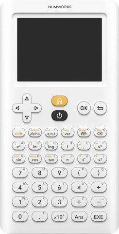

# NumPlay on the NumWorks

27 free games in one app, NumPlay.nwa, and 50 big games that install on their own. For the N0110, N0115 and N0120.

## Install

You need your calculator, its USB cable, and a computer with **Google Chrome** or **Microsoft Edge**.

1. **Download** [NumPlay.nwa](https://github.com/Mason363/NumPlay/releases/latest/download/NumPlay.nwa), or a big game below. Want other games in it? Pick them in [NumPlay Studio](https://mason363.github.io/NumPlay/customize/) and it makes a NumPlay.nwa with just those.
2. **Plug** your calculator into the computer and turn it on.
3. **Go to** [my.numworks.com/apps](https://my.numworks.com/apps) and log in. No account? Sign up there, it's free.
4. Click **Connect**, then pick your calculator in the small window that opens.
5. **Add** the file you downloaded, then click **Install**. Keep the calculator plugged in until it's done.
6. **Play!** Press **Home**, go to the end of the apps and open **NumPlay**.

Updating? Install the new file the same way: your progress comes back by itself. On Upsilon, see [Other versions](../../README.md#how-to-install).

## Keys

The games use the calculator's own keys: arrows to move, **OK** and **EXE** to act, **Back** to pause or go back, and **Home** to save and quit.

## The 27 games in NumPlay.nwa

| Game | |
| --- | --- |
| [NumDash](../../games/numdash/README.md) | Jump to the beat |
| [Crossy Road](../../games/crossyroad/README.md) | Hop, dodge, survive |
| [NumBlocks](../../games/numblocks/README.md) | Mine, craft, survive |
| [NumDrive](../../games/numdrive/README.md) | Drive, flip, finish |
| [Balatro](../../games/balatro/README.md) | Poker hands, wild jokers |
| [Buckshot Roulette](../../games/buckshot/README.md) | You, the Dealer, one shotgun |
| [Block Blast](../../games/blockblast/README.md) | Fit the blocks, blast the lines |
| [Suika Game](../../games/suika/README.md) | Merge the fruit into a watermelon |
| [Portal Returns](../../games/portal/README.md) | Think with portals |
| [Tetris](../../games/tetris/README.md) | Stack and clear lines |
| [Chrome Dino](../../games/dinorun/README.md) | Jump, duck, survive |
| [Chess](../../games/chess/README.md) | Bots, puzzles, 2 players |
| [Flappy Bird](../../games/flappybird/README.md) | Flap through the pipes |
| [Tower Blocks](../../games/towerblock/README.md) | Stack the blocks as high as you can |
| [Core Ball](../../games/coreball/README.md) | Stick every ball to the spinning core |
| [Pac-Man](../../games/pacman/README.md) | Eat dots, dodge ghosts |
| [Snake](../../games/snake/README.md) | Eat apples, grow long |
| [Connect Four](../../games/connectfour/README.md) | Four in a row wins |
| [Solitaire](../../games/solitaire/README.md) | The classic card game |
| [2048](../../games/g2048/README.md) | Slide, merge, reach 2048 |
| [Minesweeper](../../games/minesweeper/README.md) | Clear the field, flag the mines |
| [Block Breaker](../../games/breakout/README.md) | Break every brick |
| [2 Players](../../games/twoplayer/README.md) | Pong and more, side by side |
| [Space Invaders](../../games/invaders/README.md) | Stop the invasion, one cannon |
| [Sudoku](../../games/sudoku/README.md) | Fill the grid, 1 to 9 |
| [Ultimate Tic-Tac-Toe](../../games/uttt/README.md) | Tic-tac-toe in tic-tac-toe |
| [Sokoban](../../games/sokoban/README.md) | Push every box home |

## The 50 big games

Each one installs on its own, the same way.

| Game | | Download |
| --- | --- | --- |
| [Hollow Knight](../../games/hollowknight/README.md) | Explore Hallownest | [HollowKnight.nwa](https://github.com/Mason363/NumPlay/releases/latest/download/HollowKnight.nwa) |
| [Celeste](../../games/celeste/README.md) | Climb the mountain | [Celeste.nwa](https://github.com/Mason363/NumPlay/releases/latest/download/Celeste.nwa) |
| [Undertale](../../games/undertale/README.md) | Fall into the Underground | [Undertale.nwa](https://github.com/Mason363/NumPlay/releases/latest/download/Undertale.nwa) |
| [Friday Night Funkin'](../../games/fnf/README.md) | Win the rap battles, note by note | [FridayNightFunkin.nwa](https://github.com/Mason363/NumPlay/releases/latest/download/FridayNightFunkin.nwa) |
| [Angry Birds](../../games/angrybirds/README.md) | Fling the birds at the pigs | [AngryBirds.nwa](https://github.com/Mason363/NumPlay/releases/latest/download/AngryBirds.nwa) |
| [Subway Surfers](../../games/subway/README.md) | Dodge the trains | [SubwaySurfers.nwa](https://github.com/Mason363/NumPlay/releases/latest/download/SubwaySurfers.nwa) |
| [Jetpack Joyride](../../games/jetpackjoyride/README.md) | Fly Barry through the lab | [JetpackJoyride.nwa](https://github.com/Mason363/NumPlay/releases/latest/download/JetpackJoyride.nwa) |
| [Monkey Mart](../../games/monkeymart/README.md) | Run a grocery mart as a monkey | [MonkeyMart.nwa](https://github.com/Mason363/NumPlay/releases/latest/download/MonkeyMart.nwa) |
| [Plants vs. Zombies](../../games/pvz/README.md) | Plant your lawn | [PlantsVsZombies.nwa](https://github.com/Mason363/NumPlay/releases/latest/download/PlantsVsZombies.nwa) |
| [Tomb of the Mask](../../games/tombofthemask/README.md) | Dash through the tomb ahead of the lava | [TombOfTheMask.nwa](https://github.com/Mason363/NumPlay/releases/latest/download/TombOfTheMask.nwa) |
| [Doodle Jump](../../games/doodlejump/README.md) | Bounce as high as you can | [DoodleJump.nwa](https://github.com/Mason363/NumPlay/releases/latest/download/DoodleJump.nwa) |
| [Stickman Hook](../../games/stickmanhook/README.md) | Swing from hook to hook | [StickmanHook.nwa](https://github.com/Mason363/NumPlay/releases/latest/download/StickmanHook.nwa) |
| [Dune](../../games/dune/README.md) | Roll down the dunes and fly over the line | [Dune.nwa](https://github.com/Mason363/NumPlay/releases/latest/download/Dune.nwa) |
| [Doom](../../games/doom/README.md) | Rip and tear | [Doom.nwa](https://github.com/Mason363/NumPlay/releases/latest/download/Doom.nwa) |
| [UNO](../../games/uno/README.md) | Match the cards, shout UNO | [UNO.nwa](https://github.com/Mason363/NumPlay/releases/latest/download/UNO.nwa) |
| [Mahjong](../../games/mahjong/README.md) | Match free tiles, clear the board | [Mahjong.nwa](https://github.com/Mason363/NumPlay/releases/latest/download/Mahjong.nwa) |
| [Flappy Dunk](../../games/flappydunk/README.md) | Flap the ball down through every hoop | [FlappyDunk.nwa](https://github.com/Mason363/NumPlay/releases/latest/download/FlappyDunk.nwa) |
| [Five Nights at Freddy's](../../games/fnaf/README.md) | Survive five nights | [FiveNightsAtFreddys.nwa](https://github.com/Mason363/NumPlay/releases/latest/download/FiveNightsAtFreddys.nwa) |
| [Donkey Kong](../../games/donkeykong/README.md) | Climb the girders and save Pauline | [DonkeyKong.nwa](https://github.com/Mason363/NumPlay/releases/latest/download/DonkeyKong.nwa) |
| [NumPowder](../../games/numpowder/README.md) | Sand, water, fire and more | [NumPowder.nwa](https://github.com/Mason363/NumPlay/releases/latest/download/NumPowder.nwa) |
| [Sonic the Hedgehog](../../games/sonic/README.md) | Run through six zones | [SonicTheHedgehog.nwa](https://github.com/Mason363/NumPlay/releases/latest/download/SonicTheHedgehog.nwa) |
| [The Binding of Isaac](../../games/isaac/README.md) | Cry through the basement | [BindingOfIsaac.nwa](https://github.com/Mason363/NumPlay/releases/latest/download/BindingOfIsaac.nwa) |
| [Hill Climb Racing](../../games/hillclimb/README.md) | Drive up, don't flip | [HillClimbRacing.nwa](https://github.com/Mason363/NumPlay/releases/latest/download/HillClimbRacing.nwa) |
| [PolyTrack](../../games/polytrack/README.md) | Time trials on 17 low-poly tracks | [PolyTrack.nwa](https://github.com/Mason363/NumPlay/releases/latest/download/PolyTrack.nwa) |
| [Champion Island](../../games/championisland/README.md) | Seven sports, one island | [ChampionIsland.nwa](https://github.com/Mason363/NumPlay/releases/latest/download/ChampionIsland.nwa) |
| [The Final Earth 2](../../games/finalearth2/README.md) | Build a city in space | [FinalEarth2.nwa](https://github.com/Mason363/NumPlay/releases/latest/download/FinalEarth2.nwa) |
| [Level Devil](../../games/leveldevil/README.md) | Run to the door | [LevelDevil.nwa](https://github.com/Mason363/NumPlay/releases/latest/download/LevelDevil.nwa) |
| [Cookie Clicker](../../games/cookieclicker/README.md) | Bake billions of cookies | [CookieClicker.nwa](https://github.com/Mason363/NumPlay/releases/latest/download/CookieClicker.nwa) |
| [Universal Paperclips](../../games/paperclips/README.md) | Turn everything into paperclips | [UniversalPaperclips.nwa](https://github.com/Mason363/NumPlay/releases/latest/download/UniversalPaperclips.nwa) |
| [Bad Time Simulator](../../games/badtime/README.md) | Dodge Sans' 24 attacks | [BadTimeSimulator.nwa](https://github.com/Mason363/NumPlay/releases/latest/download/BadTimeSimulator.nwa) |
| [Rider](../../games/rider/README.md) | Ride, flip, land on both wheels | [Rider.nwa](https://github.com/Mason363/NumPlay/releases/latest/download/Rider.nwa) |
| [Snow Rider 3D](../../games/snowrider/README.md) | Sled down the endless slope | [SnowRider3D.nwa](https://github.com/Mason363/NumPlay/releases/latest/download/SnowRider3D.nwa) |
| [Temple Run](../../games/templerun/README.md) | Run from the temple, turn, jump, slide | [TempleRun.nwa](https://github.com/Mason363/NumPlay/releases/latest/download/TempleRun.nwa) |
| [Five Nights at Freddy's 2](../../games/fnaf2/README.md) | Survive the new pizzeria | [FiveNightsAtFreddys2.nwa](https://github.com/Mason363/NumPlay/releases/latest/download/FiveNightsAtFreddys2.nwa) |
| [Famidash](../../games/famidash/README.md) | Geometry Dash for the NES: 173 levels | [Famidash.nwa](https://github.com/Mason363/NumPlay/releases/latest/download/Famidash.nwa) |
| [Five Nights at Freddy's 3](../../games/fnaf3/README.md) | Survive Fazbear's Fright | [FiveNightsAtFreddys3.nwa](https://github.com/Mason363/NumPlay/releases/latest/download/FiveNightsAtFreddys3.nwa) |
| [Five Nights at Freddy's 4](../../games/fnaf4/README.md) | Survive the bedroom | [FiveNightsAtFreddys4.nwa](https://github.com/Mason363/NumPlay/releases/latest/download/FiveNightsAtFreddys4.nwa) |
| [Clash Royale](../../games/clashroyale/README.md) | Knock down the towers | [ClashRoyale.nwa](https://github.com/Mason363/NumPlay/releases/latest/download/ClashRoyale.nwa) |
| [Cat Ninja](../../games/catninja/README.md) | Wall jumps, traps and 50 crystals | [CatNinja.nwa](https://github.com/Mason363/NumPlay/releases/latest/download/CatNinja.nwa) |
| [Kingdom Rush](../../games/kingdomrush/README.md) | Defend the realm with towers | [KingdomRush.nwa](https://github.com/Mason363/NumPlay/releases/latest/download/KingdomRush.nwa) |
| [Deltarune](../../games/deltarune/README.md) | Chapter 1: into the Dark World | [Deltarune.nwa](https://github.com/Mason363/NumPlay/releases/latest/download/Deltarune.nwa) |
| [FNAF World](../../games/fnafworld/README.md) | Battle through the world | [FiveNightsAtFreddysWorld.nwa](https://github.com/Mason363/NumPlay/releases/latest/download/FiveNightsAtFreddysWorld.nwa) |
| [Mr Bullet](../../games/mrbullet/README.md) | Bounce the bullets, get the spies | [MrBullet.nwa](https://github.com/Mason363/NumPlay/releases/latest/download/MrBullet.nwa) |
| [NumPico](../../games/numpico/README.md) | Your own PICO-8 carts | [NumPico.nwa](https://github.com/Mason363/NumPlay/releases/latest/download/NumPico.nwa) |
| [Moto X3M](../../games/motox3m/README.md) | Flip the bike, beat the clock | [MotoX3M.nwa](https://github.com/Mason363/NumPlay/releases/latest/download/MotoX3M.nwa) |
| [Among Us](../../games/amongus/README.md) | Find the Impostor, or be one | [AmongUs.nwa](https://github.com/Mason363/NumPlay/releases/latest/download/AmongUs.nwa) |
| [Imposter](../../games/imposter/README.md) | One of you doesn't know the word | [Imposter.nwa](https://github.com/Mason363/NumPlay/releases/latest/download/Imposter.nwa) |
| [2 3 4 Players](../../games/fourplayer/README.md) | One key each, 14 party games | [FourPlayers.nwa](https://github.com/Mason363/NumPlay/releases/latest/download/FourPlayers.nwa) |
| [Hollow Knight: Fungal Wastes](../../games/hkfungal/README.md) | Hallownest past Greenpath | [HollowKnightFungalWastes.nwa](https://github.com/Mason363/NumPlay/releases/latest/download/HollowKnightFungalWastes.nwa) |
| [circloO](../../games/circloo/README.md) | Roll the ball, grow the circle | [CircloO.nwa](https://github.com/Mason363/NumPlay/releases/latest/download/CircloO.nwa) |

 

[All calculators](../../README.md#pick-your-calculator) · [How to play each game](../play.md)
