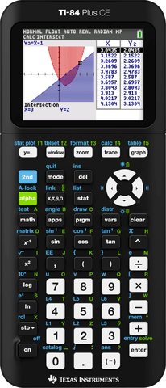

# NumPlay on the TI-84 Plus CE

15 free games for the TI-84 Plus CE, TI-84 Plus CE Python, TI-84 Plus CE-T and TI-83 Premium CE: Balatro, Block Blast, Pac-Man, 2 Players, Chess, Five Nights at Freddy's and more. The same games as on the NumWorks, made for this calculator's screen and keys.

> [!NOTE]
> **In beta.** Something doesn't work? [Tell me](https://github.com/Mason363/NumPlay/issues/new?template=beta-tester.yml).

## Install

1. Get [NumPlay-TI84CE.zip](https://github.com/Mason363/NumPlay/releases/latest/download/NumPlay-TI84CE.zip) and unzip it.
2. Send the games you want (`.8xp` files, and the `.8xv` files of Balatro and FNAF) with [TI Connect CE](https://education.ti.com/en/products/computer-software/ti-connect-ce-sw).
3. Press **prgm**, pick a game, press **enter**.

On OS 5.5 and newer, programs like these need [arTIfiCE](https://yvantt.github.io/arTIfiCE/) first. Each game also needs the CE C libraries (`clibs.8xg` from [the CE toolchain's releases](https://github.com/CE-Programming/libraries/releases/latest)), sent once. Balatro and FNAF need most of the RAM free: if one doesn't start, archive your other programs.

Or pick just the games you want in [NumPlay Studio](https://mason363.github.io/NumPlay/customize/?calc=ti84ce).

## Keys

| Key | What it does |
| --- | --- |
| Arrows | move |
| 2nd | OK |
| enter | EXE |
| clear | Back |
| mode | Home (save and quit) |
| del | ⌫ |
| y= | shift |
| alpha | alpha |
| math | toolbox |
| vars | var |
| X,T,θ,n | x,n,t |
| 0 to 9, + − × ÷ . , ( ) ^ x² | the same |

Games save by themselves, and when you leave with Home.

## The 15 games

The CE is the slowest of these calculators (48 MHz, no floating point unit) and has the least memory, so it gets the lighter games, and Balatro and Five Nights at Freddy's in versions made for it.

| Game | |
| --- | --- |
| [Balatro](../../games/balatro/README.md) | Poker hands, wild jokers |
| [Block Blast](../../games/blockblast/README.md) | Fit the blocks, blast the lines |
| [Pac-Man](../../games/pacman/README.md) | Eat dots, dodge ghosts |
| [2 Players](../../games/twoplayer/README.md) | Pong and more, side by side |
| [Chess](../../games/chess/README.md) | Bots, puzzles, 2 players |
| [Five Nights at Freddy's](../../games/fnaf/README.md) | Survive five nights |
| [Space Invaders](../../games/invaders/README.md) | Stop the invasion, one cannon |
| [Block Breaker](../../games/breakout/README.md) | Break every brick |
| [Connect Four](../../games/connectfour/README.md) | Four in a row wins |
| [Ultimate Tic-Tac-Toe](../../games/uttt/README.md) | Tic-tac-toe in tic-tac-toe |
| [Sokoban](../../games/sokoban/README.md) | Push every box home |
| [Sudoku](../../games/sudoku/README.md) | Fill the grid, 1 to 9 |
| [Minesweeper](../../games/minesweeper/README.md) | Clear the field, flag the mines |
| [Solitaire](../../games/solitaire/README.md) | The classic card game |
| [Imposter](../../games/imposter/README.md) | One of you doesn't know the word |

 

[All calculators](../../README.md#pick-your-calculator) · [Run NumPlay on anything](../porting.md)
