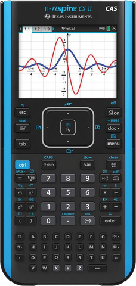

# NumPlay on the TI-Nspire CX

78 free games for the TI-Nspire CX and CX II, CAS or not: NumBlocks, Hollow Knight, NumDrive, Celeste, Balatro, Undertale and more. The same games as on the NumWorks, made for this calculator's screen and keys.

> [!NOTE]
> **In beta.** Something doesn't work? [Tell me](https://github.com/Mason363/NumPlay/issues/new?template=beta-tester.yml).

## Install

1. Install [Ndless](https://ndless.me) on the calculator.
2. Get [NumPlay-Nspire.zip](https://github.com/Mason363/NumPlay/releases/latest/download/NumPlay-Nspire.zip) and unzip it.
3. Copy the games you want (`.tns` files) to the calculator with TI-Nspire Link or the TI-Nspire computer software.
4. Open a game from **My Documents**.

Or pick just the games you want in [NumPlay Studio](https://mason363.github.io/NumPlay/customize/?calc=nspire).

Retro-Go plays the games in a folder named **retrogo** in My Documents: Game Boy, Game Boy Color, NES, Master System, Game Gear, SG-1000 and ColecoVision files (`.gb` `.gbc` `.nes` `.sms` `.gg` `.sg` `.col`). Not Game Boy Advance.

## Keys

| Key | What it does |
| --- | --- |
| Arrows (the touchpad or clickpad) | move |
| enter, the touchpad's middle | OK |
| return | EXE |
| esc | Back |
| home, on | Home (save and quit) |
| del | ⌫ |
| shift | shift |
| ctrl | alpha |
| menu | toolbox |
| var | var |
| tab | x,n,t |
| 0 to 9, + − × ÷ . , ( ) ^ x² | the same |
| e^x | e^x |
| A to Z, space, ?! | the NumWorks key that types the same letter: A is e^x, B ln, C log, D i, G sin, H cos, K √, M 7, Z + |

Games save by themselves, and when you leave with Home.

## The 78 games

| Game | |
| --- | --- |
| [NumBlocks](../../games/numblocks/README.md) | Mine, craft, survive |
| [Hollow Knight](../../games/hollowknight/README.md) | Explore Hallownest |
| [NumDrive](../../games/numdrive/README.md) | Drive, flip, finish |
| [Celeste](../../games/celeste/README.md) | Climb the mountain |
| [Balatro](../../games/balatro/README.md) | Poker hands, wild jokers |
| [Undertale](../../games/undertale/README.md) | Fall into the Underground |
| [NumDash](../../games/numdash/README.md) | Jump to the beat |
| [Friday Night Funkin'](../../games/fnf/README.md) | Win the rap battles, note by note |
| [Buckshot Roulette](../../games/buckshot/README.md) | You, the Dealer, one shotgun |
| [Angry Birds](../../games/angrybirds/README.md) | Fling the birds at the pigs |
| [Crossy Road](../../games/crossyroad/README.md) | Hop, dodge, survive |
| [Subway Surfers](../../games/subway/README.md) | Dodge the trains |
| [Portal Returns](../../games/portal/README.md) | Think with portals |
| [Jetpack Joyride](../../games/jetpackjoyride/README.md) | Fly Barry through the lab |
| [Block Blast](../../games/blockblast/README.md) | Fit the blocks, blast the lines |
| [Monkey Mart](../../games/monkeymart/README.md) | Run a grocery mart as a monkey |
| [Suika Game](../../games/suika/README.md) | Merge the fruit into a watermelon |
| [Plants vs. Zombies](../../games/pvz/README.md) | Plant your lawn |
| [Tomb of the Mask](../../games/tombofthemask/README.md) | Dash through the tomb ahead of the lava |
| [Doodle Jump](../../games/doodlejump/README.md) | Bounce as high as you can |
| [Stickman Hook](../../games/stickmanhook/README.md) | Swing from hook to hook |
| [Pac-Man](../../games/pacman/README.md) | Eat dots, dodge ghosts |
| [Dune](../../games/dune/README.md) | Roll down the dunes and fly over the line |
| [Flappy Bird](../../games/flappybird/README.md) | Flap through the pipes |
| [Doom](../../games/doom/README.md) | Rip and tear |
| [2 Players](../../games/twoplayer/README.md) | Pong and more, side by side |
| [UNO](../../games/uno/README.md) | Match the cards, shout UNO |
| [Chess](../../games/chess/README.md) | Bots, puzzles, 2 players |
| [Mahjong](../../games/mahjong/README.md) | Match free tiles, clear the board |
| [Flappy Dunk](../../games/flappydunk/README.md) | Flap the ball down through every hoop |
| [Five Nights at Freddy's](../../games/fnaf/README.md) | Survive five nights |
| [Chrome Dino](../../games/dinorun/README.md) | Jump, duck, survive |
| [Donkey Kong](../../games/donkeykong/README.md) | Climb the girders and save Pauline |
| [Core Ball](../../games/coreball/README.md) | Stick every ball to the spinning core |
| [NumPowder](../../games/numpowder/README.md) | Sand, water, fire and more |
| [Snake](../../games/snake/README.md) | Eat apples, grow long |
| [Sonic the Hedgehog](../../games/sonic/README.md) | Run through six zones |
| [Tower Blocks](../../games/towerblock/README.md) | Stack the blocks as high as you can |
| [The Binding of Isaac](../../games/isaac/README.md) | Cry through the basement |
| [Space Invaders](../../games/invaders/README.md) | Stop the invasion, one cannon |
| [Hill Climb Racing](../../games/hillclimb/README.md) | Drive up, don't flip |
| [Block Breaker](../../games/breakout/README.md) | Break every brick |
| [2048](../../games/g2048/README.md) | Slide, merge, reach 2048 |
| [PolyTrack](../../games/polytrack/README.md) | Time trials on 17 low-poly tracks |
| [Connect Four](../../games/connectfour/README.md) | Four in a row wins |
| [Champion Island](../../games/championisland/README.md) | Seven sports, one island |
| [Ultimate Tic-Tac-Toe](../../games/uttt/README.md) | Tic-tac-toe in tic-tac-toe |
| [The Final Earth 2](../../games/finalearth2/README.md) | Build a city in space |
| [Sokoban](../../games/sokoban/README.md) | Push every box home |
| [Level Devil](../../games/leveldevil/README.md) | Run to the door |
| [Sudoku](../../games/sudoku/README.md) | Fill the grid, 1 to 9 |
| [Cookie Clicker](../../games/cookieclicker/README.md) | Bake billions of cookies |
| [Minesweeper](../../games/minesweeper/README.md) | Clear the field, flag the mines |
| [Meowdoku](../../games/meowdoku/README.md) | One cat per row, column and color |
| [Universal Paperclips](../../games/paperclips/README.md) | Turn everything into paperclips |
| [Solitaire](../../games/solitaire/README.md) | The classic card game |
| [Bad Time Simulator](../../games/badtime/README.md) | Dodge Sans' 24 attacks |
| [Retro-Go](../../games/retrogo/README.md) | Game Boy, NES and Sega games |
| [Rider](../../games/rider/README.md) | Ride, flip, land on both wheels |
| [NumVisuals](../../games/numvisuals/README.md) | Backgrounds, clocks, timers |
| [Snow Rider 3D](../../games/snowrider/README.md) | Sled down the endless slope |
| [Temple Run](../../games/templerun/README.md) | Run from the temple, turn, jump, slide |
| [Five Nights at Freddy's 2](../../games/fnaf2/README.md) | Survive the new pizzeria |
| [Famidash](../../games/famidash/README.md) | Geometry Dash for the NES: 173 levels |
| [Five Nights at Freddy's 3](../../games/fnaf3/README.md) | Survive Fazbear's Fright |
| [Five Nights at Freddy's 4](../../games/fnaf4/README.md) | Survive the bedroom |
| [Clash Royale](../../games/clashroyale/README.md) | Knock down the towers |
| [Cat Ninja](../../games/catninja/README.md) | Wall jumps, traps and 50 crystals |
| [Kingdom Rush](../../games/kingdomrush/README.md) | Defend the realm with towers |
| [Deltarune](../../games/deltarune/README.md) | Chapter 1: into the Dark World |
| [FNAF World](../../games/fnafworld/README.md) | Battle through the world |
| [Mr Bullet](../../games/mrbullet/README.md) | Bounce the bullets, get the spies |
| [Moto X3M](../../games/motox3m/README.md) | Flip the bike, beat the clock |
| [Among Us](../../games/amongus/README.md) | Find the Impostor, or be one |
| [Imposter](../../games/imposter/README.md) | One of you doesn't know the word |
| [2 3 4 Players](../../games/fourplayer/README.md) | One key each, 14 party games |
| [Hollow Knight: Fungal Wastes](../../games/hkfungal/README.md) | Hallownest past Greenpath |
| [circloO](../../games/circloo/README.md) | Roll the ball, grow the circle |

 

[All calculators](../../README.md#pick-your-calculator) · [Run NumPlay on anything](../porting.md)
