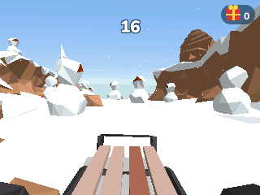

# How to play

## NumPlay

| Key | What it does |
| --- | --- |
| **Left / Right** (or 4 / 6) | Pick a game |
| **OK** or **EXE** (or 5) | Play |
| **Back** | Leave a game's main menu to come back here. On the carousel, quit NumPlay |
| **⌫** (backspace) | A moving background behind the carousel: Aurora, Sunset Drive, Plasma, Pastel, Lava Lamp, Ocean, then none again. NumPlay remembers it |
| **Home** | Quit, from anywhere |

The last card, **Settings**, can:

- **Reset** a game's progress, or every game's at once: hold **OK** on the red button to confirm (levels you made are kept)
- **Uninstall** the games you don't play, to free up space
- **Start as Matrices**: NumPlay opens as a plain matrix calculator. Your secret way in opens the games: pick the x,n,t key, var, Toolbox, π, √, *Examples* in the Toolbox menu, or the Konami code (up, up, down, down, left, right, left, right; [LanoCodes17](https://github.com/LanoCodes17)'s idea). A small gray hint in the corner names it (turn it off with **Show a hint**)

Your progress is also copied into a Python script, `numplay_saves.py`, so updating NumPlay doesn't erase it. Leave it there; if it gets deleted, NumPlay writes it again.

In every game, **Back** pauses, and the pause menu has a small **Quit game** button. It always asks first, since Back sits right next to OK.

## NumDash

| Key | What it does |
| --- | --- |
| **OK**, **EXE** or **Up** | Jump. Hold to keep jumping, fly the ship up, or flip the ball's gravity |
| **Back** | Pause, or go back in menus |
| **0** | Place a checkpoint (practice mode) |
| **⌫** | Remove your last checkpoint |

Twelve levels, from Stereo Madness to Clubstep, Deadlocked and Dash. The **?** button on the main menu shows every key. In the level editor, **KEYS** on the My Levels screen draws the keyboard with what each key does (it also shows the first time you open the editor).

 

## Crossy Road

| Key | What it does |
| --- | --- |
| **Up**, **OK** or **EXE** | Hop forward |
| **Left / Right / Down** | Hop sideways or back |
| **Back** | Pause (then Quit game) |

Keep moving, or the eagle gets you. Coins add up across every run and stay saved.

 

## NumBlocks

| Key | What it does |
| --- | --- |
| **Arrows** | Look around |
| **,** / **π** / **√** / **x²** | Walk forward / left / back / right (like W, A, S, D) |
| **shift** | Jump (twice in Creative: fly) |
| **alpha** | Sneak |
| **⌫** | Sprint (or press forward twice) |
| **OK** or **EXE** | Mine and attack, like the left mouse button (hold it to mine) |
| **Back** | Place a block, use, eat, like the right mouse button |
| **var** | Inventory (in Creative: every block and item) |
| **1** to **9** | Pick a hotbar slot |
| **x,n,t** | Drop the item |
| **log** | Pick the block you look at |
| **×** / **÷** | Chat / type a command |
| **ans** | Pause |
| **Home** | Save and quit |

The left thumb looks with the arrows (shift and alpha are just under them), the right one walks. The first time you open NumBlocks it shows these keys. You can change them in Options, then Controls, which also shows the key sheet again. In NumBlocks, Back places blocks, so **ans** pauses. In the inventory, the arrows move between slots, **OK** picks up or puts down a stack, **EXE** one item, and **shift** with **OK** sends a stack to the other side. To spread a stack, hold **OK** and move over the slots: it splits evenly when you let go (hold **EXE** instead to drop one in each). In Creative, the Search Items tab finds blocks as you type, and **shift** with up or down jumps to the top or bottom of a tab. Commands like /gamemode and /give work in worlds with Allow Cheats on (or after Open to LAN in the pause menu); **toolbox** finishes a word as you type it. Your world saves as you play and when you quit, and on its own NumBlocks keeps a copy in `numblocks_saves.py` (inside NumPlay, `numplay_saves.py` holds it), so installing again doesn't erase your worlds.

On its own, `NumBlocks.nwa` also has the Nether and the End: portals, fortresses, strongholds and the Ender Dragon, as Minecraft 1.8.8 makes them (NumPlay's NumBlocks stays in the Overworld).

 

## Hollow Knight

Hollow Knight comes as its own app, `HollowKnight.nwa`: it is too big to share the calculator with NumPlay.

| Key | What it does |
| --- | --- |
| **Arrows** | Move, look up and down, aim the nail up or down |
| **Up** | Talk, read, rest at a bench, go through a door |
| **OK** | Jump |
| **Back** | Nail |
| **shift** | Dash, once you have the Mothwing Cloak |
| **alpha** | Hold to focus and heal, tap to cast a spell |
| **var** | Hold for the quick map |
| **toolbox** | Inventory |
| **⌫** | Pause |
| **Home** | Save and quit |

Choose Start Game, then a save. Rest at benches to save and to change charms: **toolbox**, right to Charms, then **OK** on a charm. In menus, **OK** or **EXE** confirms and **Back** goes back. In the inventory, left and right at the edges change pages; on the map page, **OK** places markers once you have them, and **shift** shows or hides the key and the pins. Home saves and quits, as Quit to Menu does. Your saves are also copied into `hollowknight_saves.py`, so installing the app again doesn't erase them.

 

## Celeste

Celeste comes as its own app, `Celeste.nwa`: it is too big to share the calculator with NumPlay.

| Key | What it does |
| --- | --- |
| **Arrows** | Move, and aim the dash |
| **OK** | Jump |
| **Back** | Dash, and talk |
| **toolbox** | Grab, climb |
| **⌫** | Pause |
| **Home** | Save and quit |

Choose Climb, then a chapter, then Start. Madeline can dash once in the air (twice later on), and grab and climb walls until she gets tired. In menus, **OK** or **EXE** confirms and **Back** goes back. The first time you open Celeste it shows these keys; you can change them in Options, then Keyboard Config. Home saves and quits, and Climb then offers Continue. Your progress is also copied into `celeste_saves.py`, so installing the app again doesn't erase it. The game's cheat code works too: in the Prologue's hidden room, left of the start, press left, right, var, toolbox, up, up, down, left, toolbox and OK.

 

## NumPowder

NumPowder comes as its own app, `NumPowder.nwa`: it is too big to share the calculator with NumPlay.

| Key | What it does |
| --- | --- |
| **Arrows** | Move the brush (**shift**: 4 at a time) |
| **OK** | Draw with the OK material |
| **Back** | Draw with the Back tool (ERASE at first) |
| **toolbox** | The materials: left and right pick, up and down change category, **OK** takes it, **shift**+**OK** for Back |
| **var** | The menu: How to play, keys, save, load, clear, display, settings, credits |
| **+** and **-** | The brush's size (**shift**: its shape) |
| **shift**+**OK** | Draw a line; **⌫** switches to a box or a fill |
| **⌫** | Take the material under the brush |
| **alpha** | Pause (**shift**+**alpha**: one frame) |
| **Home** | Save and quit |

Pick a material with **toolbox**, then hold **OK** to draw it. The bar at the bottom always shows what **OK** and **Back** draw with, and the line under it says what the keys do right now. Try sand on water, fire on wood, lava on ice, or draw metal (METL) and touch it with a spark (SPRK). How to play, in the **var** menu, has more ideas. Home saves, and four save slots keep more; they are also copied into `numpowder_saves.py`, so installing the app again doesn't erase them.

 

## The Final Earth 2

The Final Earth 2 comes as its own app, `FinalEarth2.nwa`: it is too big to share the calculator with NumPlay.

| Key | What it does |
| --- | --- |
| **Arrows** | Move the cursor, or the focus in menus and windows |
| **shift** + **arrows** | Move the view faster |
| **OK** | Open what is under the cursor, choose, build here |
| **Back** | Close, stop building, open the game menu |
| **toolbox** | Open or close the build menu |
| **var** | Go to the buttons and materials at the bottom right, and back |
| **alpha** | Pause |
| **+** and **-** | Zoom in and out |
| **⌫** | Destroy the building under the cursor |
| **Home** | Save and quit |

Choose a scenario or a free play map. Build woodcutters and stone mines for materials, farms for food and houses for your citizens; buildings stack on top of each other. In the build menu, left and right go through the buildings, up and down change the category, and **OK** picks one; then **OK** builds where the cursor is, and **Back** goes back to the menu. Each goal of a scenario tells you what to do next, and **?** shows it again. On the speed button, **OK** switches between normal and double speed, and **shift** with **OK** goes through all five speeds. Home saves and quits, and the title then offers Continue. Your city is also copied into `finalearth2_saves.py`, so installing the app again doesn't erase it.

 

## NumDrive

| Key | What it does |
| --- | --- |
| **Right** or **6** | Drive forward |
| **Left** or **4** | Brake and reverse |
| **OK** or **Back** | Pause. **Back** again resumes |
| **Levels** on the pause card | Pick any level |

Don't floor it the whole way: too much gas flips the car.

 

## Balatro

| Key | What it does |
| --- | --- |
| **Arrows** | Move between cards, Jokers and buttons |
| **OK** | Pick a card, or open a Joker or shop item (Buy, Sell, Use) |
| **EXE** | Play hand |
| **⌫** | Discard |
| **Shift** | Sort by rank or suit |
| **Alpha** | Pick up a card or Joker to move it with Left / Right, then OK |
| **Toolbox** / **Var** | Run info / your deck |
| **Back** | Options |

Hold **OK** or **EXE** to speed up the scoring.

 

## Buckshot Roulette

| Key | What it does |
| --- | --- |
| **Arrows** | Move between your items and the shotgun. Go up to read the Dealer's items |
| **OK** or **EXE** | Use an item, pick up the shotgun, fire |
| **Up / Down** | With the shotgun: aim at the Dealer / at yourself |
| **Letter keys** | Sign the waiver (EXE signs) |
| **Back** | Pause |

Shooting yourself with a blank keeps your turn.

 

## Block Blast

| Key | What it does |
| --- | --- |
| **1, 2, 3** | Take that block |
| **Arrows** | Move it on the board |
| **OK** | Place it |
| **Back** | Menu (with How to play and Quit) |

Fill a row or a column to clear it; blocks never turn. The lines a block would fill light up in its colour before you place it. Clear again within three blocks for a combo, which multiplies the points. The game ends when none of your three blocks fits; your game and best score are saved.

 

## Suika Game

| Key | What it does |
| --- | --- |
| **Left, Right** (or **4, 6**) | Move the fruit |
| **OK** or **EXE** | Drop it |
| **Back** | Menu (with Restart, How to play and Quit) |

Drop fruit into the box. Two of the same fruit touching join into the next one up, from cherry to watermelon, and score points; two watermelons vanish. The next fruit is shown in the bubble. The game ends when the box overflows. Your game and best score are saved.

 

## Champion Island

Champion Island comes as its own app, `ChampionIsland.nwa`: it is too big to share the calculator with NumPlay.

| Key | What it does |
| --- | --- |
| **Arrows** (or 4, 6, 8, 2) | Walk, and play |
| **OK**, **EXE** or 5 | Talk, go through doors, and each sport's action |
| **Back** | On the island: the map. In a sport: pause |
| **Home** | Save and quit |

| Sport | Arrows | OK |
| --- | --- | --- |
| Table Tennis | Move to the ball | Power shot |
| Skateboarding | Move and do tricks | Jump and do tricks |
| Archery | Move | Shoot |
| Rugby | Move | Pass |
| Artistic Swimming | Hit the arrow beats | |
| Marathon | Move | Dodge |
| Climbing | Move | Jump |

Every sport shows its rules and keys before it starts. Your progress is also copied into `champion_saves.py`, so installing the app again doesn't erase it.

 

## Undertale

Undertale comes as its own app, `Undertale.nwa`: it is too big to share the calculator with NumPlay.

| Key | What it does |
| --- | --- |
| **Arrows** (or 4, 6, 8, 2) | Walk, move your SOUL, choose |
| **OK**, **EXE** or 5 | Talk, read, confirm (Z in the game) |
| **Back** or **⌫** | Cancel, show the whole text at once (X in the game) |
| **toolbox**, **shift** or **var** | The menu: ITEM, STAT, CELL (C in the game) |
| **Home** | Keep the moment and quit |

Name the fallen human, then walk and talk your way through the Ruins, Snowdin, Waterfall, Hotland, the MTT Resort, the CORE and New Home. In a battle, FIGHT attacks (press **OK** when the bar crosses the middle), ACT checks a monster or does something to it, ITEM eats, and MERCY spares a monster that no longer wants to fight, or flees. Then move your SOUL to dodge; when it turns blue, it falls, and **Up** jumps; when it turns green, it stays put, and the arrows turn its shield to block. On ice you slide until something stops you. In Snowdin Town, walk into the shop to buy, and into the inn to rest. In Waterfall, walk into a bridge seed to push it into the water, where it blooms into a flower you can walk on; the bell calls the seeds back. A green bullet heals you. Walk up to a star and press **OK** to SAVE. Home keeps the moment you were at, and the next start is back there. Your save is also copied into `undertale_saves.py`, so installing the app again doesn't erase it. The Tem Shop in Temmie Village also buys what you carry. In Hotland, steam vents throw you over the lava, orange lasers hit you if you stand still and blue ones if you move, and in a shooting puzzle the arrows push the dark blocks and Z shoots. On the second floor, press the switches as the top conveyor belt carries you past them, and in Mettaton's news report, touch each bomb and defuse it while it's in the DEFUSE ZONE. When Muffet turns your SOUL purple, it keeps to three strings: **Up** and **Down** hop between them. In the tile puzzle, red tiles are walls, yellow ones shock you back, orange makes you smell of oranges (and blue water's piranhas bite then), and purple soap slides you on and smells of lemons. When your SOUL turns yellow, **OK** shoots. At the MTT Resort, the desk rents you a room and the hotel's doors want room service. On the CORE's laser bridge, walk while the power is off and freeze when it comes back on. Mettaton EX's show is won on its ratings: Boast, Pose, a Heel Turn and his brand's food raise them. In New Home, find both keys to unchain the stairs. Asgore breaks MERCY, so you'll have to fight him. Against Omega Flowey, dodge, and reach the ACT button that comes down among a SOUL's attack; once all six SOULs are on your side, reach FIGHT. The game ends at the neutral ending.

 

## Doom

Doom comes as its own app, `Doom.nwa`: it is too big to share the calculator with NumPlay.

| Key | What it does |
| --- | --- |
| **Up** / **Down** | Walk forward / back |
| **Left** / **Right** | Turn |
| **OK** | Fire |
| **Back** | Use: open doors, press switches |
| **EXE** or **⌫** | Menu and pause |
| **shift** (held) | Strafe with left and right |
| **x,n,t** / **var** | Strafe left / right |
| **alpha** (held) | Run |
| **1** to **7** | Choose a weapon |
| **toolbox** | Automap: the map, the map over the game, the game |
| **+** / **−** | Screen size; on the automap, zoom |
| **×** / **÷** / **0** | Automap: follow, grid, the whole map |
| **8** / **9** | Automap: mark, clear the marks |
| **√** | Brightness |
| **ln** / **log** | Quick Save / Quick Load |
| **π** | Pause |
| **ans** | Type a cheat code |
| **Home** | Keep the moment and quit |

Press a key on the title screen for the menu, then choose New Game, Knee-Deep in the Dead and a skill. In menus, **OK** or **EXE** confirms and **Back** goes back; when the game asks a question, **OK** says yes and **Back** says no. Read This! shows the keys as they are: Options, Keys gives any key any action, and Options, Cheats has every cheat code. Home keeps the moment you were at, and the next start puts you back there. Save Game has six slots; your saves are also copied into `doom_saves.py`, so installing the app again doesn't erase them. You can also build `Doom.nwa` from your own WAD (Doom, Doom II, Freedoom...): see the [game's page](../games/doom/README.md#doom-from-your-own-wad).

 

## The Binding of Isaac

The Binding of Isaac comes as its own app, `BindingOfIsaac.nwa`: it is too big to share the calculator with NumPlay.

| Key | What it does |
| --- | --- |
| **Arrows** | Walk |
| **8 4 6 2** (or 5) | Cry up, left, right, down |
| **9**, **shift** or **×** | Drop a bomb |
| **7**, **alpha** or **OK** | Use the active item |
| **1**, **3** or **−** | Take the pill or use the card |
| **toolbox**, **var** or **x,n,t** | Hold to see the whole map |
| **Back** | Pause |
| **Home** | Keep the run and quit |

On the menu, **Controls** swaps them: the number keys walk and the arrows cry. Every run is a new set of floors, from the Basement down to Mom, her heart and beyond: clear a room to open its doors, find the treasure room, the shop and the boss, and bomb the walls for secret rooms. Keys open the golden doors and chests, coins buy in the shop, and the Devil's and the angel's rooms come after a boss. Win a run to unlock ???, Eve, Samson and Azazel. Home keeps the run, and it is copied into `isaac_saves.py`, so installing the app again doesn't erase it.

 

## Plants vs. Zombies

Plants vs. Zombies comes as its own app, `PlantsVsZombies.nwa`: it is too big to share the calculator with NumPlay.

| Key | What it does |
| --- | --- |
| **Arrows** | Move over the lawn, choose in the menus |
| **1** to **9**, **0** | Pick a seed packet (from the conveyor belt too) |
| **OK** or **EXE** | Plant, whack a zombie, break a vase, confirm |
| **⌫** | The shovel: then **OK** digs up a plant |
| **Back** | Put the seed back, or pause |
| **toolbox** | The Almanac, in the menu |
| **Home** | Keep the level and quit |

Plant your lawn to stop the zombies before they reach your house. Sunflowers make sun, and seeds cost sun: move the cursor over falling sun and coins to pick them up. Each seed recharges after you plant it. At night no sun falls and mushrooms are awake; in the day they sleep unless you plant a Coffee Bean on them. The pool's lanes need Lily Pads, the fog hides the zombies until a Plantern lights it or a Blover blows it away, and on the roof every plant goes in a Flower Pot and only lobbed shots get over the slope. A lawn mower saves each lane once. Before most levels you choose your seeds; on the conveyor-belt levels they come to you. Crazy Dave opens his shop once you find his car key, and the coins zombies drop buy more seed slots, pool and roof cleaners, a rake and Wall-nut First Aid. At the end of the roof, Dr. Zomboss waits in his Zombot: hit his head when he lowers it, put out his fire balls with an Ice-shroom and melt his ice balls with a Jalapeno. Home keeps the level you are playing, and Continue brings it back. Your saves are also copied into `pvz_saves.py`, so installing the app again doesn't erase them.

 

## Five Nights at Freddy's

Five Nights at Freddy's comes as its own app, `FiveNightsAtFreddys.nwa`: it is too big to share the calculator with NumPlay.

| Key | What it does |
| --- | --- |
| **← →** (or 4 / 6) | Look left and right |
| **7** / **1** | The left door / the left light |
| **9** / **3** | The right door / the right light |
| **OK**, **EXE** or **8** | The monitor up and down |
| **1** to **7** | On the monitor: that camera (1, 2 and 4 again for 1B, 1C, 2B, 4B) |
| **Arrows** | On the monitor: the camera next to it on the map |
| **0** or **⌫** | Mute the phone call |
| **Back** | Pause |
| **Home** | Keep the night and quit: the next start is back in it |

Last from 12 AM to 6 AM, five nights in a row. Light the doorways to see who is there and close the door on them, check the cameras (Foxy comes out of Pirate Cove when they stay down), and watch the power: when it runs out, the doors won't close. The Phone Guy's calls are subtitles, and what you would hear is written at the bottom left. Your nights and stars are also copied into `fnaf_saves.py`, so installing the app again doesn't erase them.

 

## Sonic the Hedgehog

Sonic the Hedgehog comes as its own app, `SonicTheHedgehog.nwa`: it is too big to share the calculator with NumPlay.

| Key | What it does |
| --- | --- |
| **Arrows** (or 4, 6, 8, 2) | Run, look up, duck; **Down** while running rolls |
| **OK**, **EXE**, 5, 0 or **shift** | Jump |
| **Back** or **⌫** | Pause: Resume or Quit game |
| **Home** or **On/Off** | Save and quit: Continue on the title goes back there |

Run right to the signpost at the end of each act; each zone's third act ends with Dr. Robotnik and the capsule of animals. When something hits you, you drop your rings; with none you lose a life, and 100 give an extra life. Finish an act with 50 rings and jump into the giant ring for a Special Stage: steer through the turning maze to the Chaos Emerald, away from the GOAL blocks. All six emeralds change the ending. Each act is saved as it starts, and the save is copied into `sonic_saves.py`, so installing the app again doesn't erase it.

 

## Subway Surfers

Subway Surfers comes as its own app, `SubwaySurfers.nwa`: it is too big to share the calculator with NumPlay.

| Key | What it does |
| --- | --- |
| **Left / Right** (or 4 / 6) | Change tracks |
| **Up** (or 8) | Jump |
| **Down** (or 2) | Roll; in the air, dive down and roll |
| **OK**, **EXE** or 5 | Ride a hoverboard: one crash is forgiven |
| **1** / **3** | At the start of a run: a headstart / a score booster |
| **Back** | Pause (Resume, Quit game), or go back in menus |
| **Home** or **On/Off** | Save and quit |

Hit the side of a train or a barrier's edge and you stumble: the Inspector and his dog are right behind you, and a second stumble gets you caught. The yard is the classic one: the orange viaduct and its trees, steel bridges over the water, tunnels, and the orange and lime trains. Run into anything head-on and the run is over, unless you spend keys to be saved. Ramps lead up onto the trains' roofs; Super Sneakers jump high enough to land on them. Missions raise your score multiplier, and coins buy upgrades, items, characters and boards in the shop. Your progress is also copied into `subway_saves.py`, so installing the app again doesn't erase it.

 

## Hill Climb Racing

Hill Climb Racing comes as its own app, `HillClimbRacing.nwa`: it is too big to share the calculator with NumPlay.

| Key | What it does |
| --- | --- |
| **Right**, **OK** or **EXE** (or 6) | Gas; in the air, tilt back |
| **Left** (or 4) | Brake, then reverse; in the air, tilt forward |
| **Back** | Pause (Resume, Restart, Garage, Quit game) |
| **Home** | Keep the run's coins and quit |

Drive as far as you can before the fuel runs out or Bill lands on his head. It drives like the real game: the same physics engine (Box2D) with the game's own numbers for every vehicle and stage. Pick up fuel cans on the way, collect coins, and earn more with air time and flips; each stage's levels pay a bonus when you reach their goal, and the next level waits for you on your next run. In the garage, spend coins on new vehicles and their four upgrades, and on new stages: the Desert's dunes, the slippery Arctic, the Cave's ceiling, the Moon's low gravity, the Forest's trees to ram through, with rope bridges along the way. Your coins, upgrades, levels and best distances are saved, and copied into `hillclimb_saves.py` so installing the app again doesn't erase them.

 

## Cookie Clicker

Cookie Clicker comes as its own app, `CookieClicker.nwa`: it is too big to share the calculator with NumPlay.

| Key | What it does |
| --- | --- |
| **OK** | Click the big cookie |
| **Arrows** | Choose in the store (up from its top: the news ticker) |
| **EXE** | Buy or sell what is chosen; press the ticker |
| **÷** / **×** | Buy or sell / 1, 10, 100 (all, to sell) |
| **shift** | Click a golden cookie or a reindeer |
| **var** | Pop a wrinkler |
| **x,n,t** | Harvest the sugar lump |
| **alpha** | The buildings' rows: EXE levels one up or opens its minigame |
| **toolbox** | Statistics |
| **⌫** | Close a note |
| **Back** | Menu: Options, Statistics, Info, Legacy, Santa, Krumblor, Keys, Save |
| **Home** | Save and quit |

Click the cookie, buy buildings that bake for you and upgrades that make them bake more. Golden cookies give Frenzies, Lucky!, Click frenzies and more; when the elders awaken, wrath cookies and wrinklers come. Level your buildings up with sugar lumps to unlock the Grimoire's spells and the Pantheon's spirits. When you have baked enough, ascend from the Legacy menu: your cookies become heavenly chips to spend on the heavenly upgrades, then you start again stronger. The calculator has no clock, so the bakery only bakes while the game is open, and sugar lumps grow 24 times faster to make up for it. Your bakery is also copied into `cookieclicker_saves.py`, so installing the app again doesn't erase it.

 

## Level Devil

Level Devil comes as its own app, `LevelDevil.nwa`: install it on its own.

| Key | What it does |
| --- | --- |
| **Left / Right** (or 4 / 6) | Run; on the map, the world before or after |
| **Up**, **OK** or **EXE** (or 8 / 5) | Jump (in Gravity: turn gravity round; in Flappy: flap) |
| **Down** (or 2) | Jump, in the room that says so |
| **Up / Down** on the map | The nearest world up or down |
| **OK** on the title and the map | Play |
| **Any key**, once dead | Try again |
| **Back** | Pause: Resume, Restart, Levels, Quit game |
| **Home** | Save and quit |

Run to the door. These are the game's 80 rooms in its order: sixteen worlds of five (Pits, Spikes, Push, Coins, Controls, Platforms, Springs, Warps, Scale, Doors, Saws, Flappy, Gravity, Movement, Wraparound and the Boss), each with its own traps and timing, drawn with the game's own pictures. Clear a world's five rooms to open the next portal on the game's map. Your deaths are counted, with your best for each world. The game keeps a copy of its save in `leveldevil_saves.py`, so installing apps again doesn't erase your progress.

 

## Jetpack Joyride

| Key | What it does |
| --- | --- |
| **OK** (or **EXE**, **Up**), held | Fly; let go to fall |
| **OK** on a vehicle | What the vehicle does: jump, flap, flip gravity, teleport |
| **Back** | Pause (with Retry, How to play and Quit) |

Barry runs through the lab by himself: hold OK to fire the jetpack and fly, let go to drop. Keep clear of the zappers, the lasers that charge up across the screen and the missiles that warn, lock on and fire. Grab coins, and the vehicle boxes for a ride that takes one hit. Spin tokens play the Final Spin when the run ends, where a Second Chance brings it back. Your best distance and coins are saved.

 
## Stickman Hook

| Key | What it does |
| --- | --- |
| **OK** (or **EXE**), held | Hook onto the nearest hook; let go to fly |
| **Arrows** | Move in the menus |
| **Back** | Pause (with Restart, Levels, How to play and Quit) |

Swing the stickman from hook to hook and over the finish line. Hold OK to grab the nearest hook and let go at the top of the swing to fly; bumpers throw you on, walls stop you, and falling off the bottom starts the level again. The first 39 levels are the game's own; after that every level is a new course made from the game's pieces. Reaching some levels opens new skins. Your level and skins are saved.

 

## Donkey Kong

| Key | What it does |
| --- | --- |
| **Arrows** (or **4, 6, 8, 2**) | Walk, climb ladders |
| **OK** (or **EXE**) | Jump |
| **Back** | Pause (with New game, How to play and Quit) |

Climb to the top and save Pauline, as in the 1981 arcade game. Jump over Kong's barrels for points, or grab a hammer (in mid-jump) and smash them. Four boards: the girders, the pie factory, the elevators and the rivets, where pulling out all eight rivets brings Kong down. Watch the bonus timer: it's your points if you finish and your life if it runs out. An extra life comes at 7,000 points. Home saves your game, and your best score is kept.

 

## Dune

| Key | What it does |
| --- | --- |
| **OK** (or **EXE**, **shift**), held | Speed up downhill and dive in the air |
| **Back** | Pause (with Restart, Shop, How to play and Quit) |

The ball rolls on by itself. Hold OK going downhill to speed up and let go going uphill to take off. Fly over the line for points, and land on a downslope for a Perfect Slide. Land on your head, or on the uphill, and the run is over. Coins buy new balls and landscapes in the shop. Your best score, coins and shop are saved.

 

## Monkey Mart

| Key | What it does |
| --- | --- |
| **Arrows** | Walk |
| **OK** | Upgrades |
| **shift** | Hats |
| **Back** | Menu (with How to play and Quit) |

Walk the monkey over the plants and animals to pick up what they make, carry it to the shelves, and take the money at the counter. Stand on a price pad to pay for a new stand, a machine or a worker; plants and animals get tired and need a visit to wake up. When the first mart is full, the truck takes you to the second. Your mart is saved.

 

## Tomb of the Mask

| Key | What it does |
| --- | --- |
| **Arrows** | Dash until you hit a wall |
| **OK** | Use a shield |
| **Back** | Pause (with Restart, How to play and Quit) |

Dash up the tomb ahead of the rising flood, picking up dots and coins and dodging spikes, bats and other traps. The arcade climb goes on forever; the 200 stages each have three stars to find. Coins buy powerups and masks. Your progress is saved.

 

## UNO

| Key | What it does |
| --- | --- |
| **Left, Right** | Pick a card |
| **OK** | Play it |
| **Up** | Draw |
| **shift** | Say UNO, or catch a bot that didn't |
| **Back** | Pause (with New game, How to play and Quit) |

Match the top card by colour or number, or play a Wild. Skip, Reverse, Draw Two and Wild Draw Four work as in the official rules, and you can challenge a Wild Draw Four. Say UNO when you're down to one card. The first to empty their hand scores the others' cards; the first to 500 wins. Your game is saved.

 

## Friday Night Funkin'

| Key | What it does |
| --- | --- |
| **Left, Down, Up, Right** (or **7, 8, (, )**) | Hit the arrows |
| **OK** | Choose |
| **Back** | Pause (with Restart, Options and Quit) |

Press each arrow as it reaches the line at the top. Sick, Good, Bad and Shit depend on how close you are; misses cost health, and the song is lost when it runs out. Play the weeks in story mode or any song in freeplay. There's no sound: the characters and the camera keep the beat. Your scores are saved.

 

## Turbo Rush

| Key | What it does |
| --- | --- |
| **Up** | Accelerate |
| **Down** | Brake |
| **Left, Right** | Steer |
| **OK** | Nitro |
| **+, -** | Change gear (manual gearbox) |
| **Back** | Pause (with Restart race, How to play and Quit game) |

Three laps against seven rivals. A bend pulls you outwards, more the faster you go, so brake before the sharp ones. The grass slows you, and trees, lamps and buildings stop you and damage the car. Races pay credits for the engine, tires, nitro and armor in the garage. Play one race, the six circuits as a Grand Prix, or Free Ride. Home saves the race, and Continue picks it up.

 

## Angry Birds

| Key | What it does |
| --- | --- |
| **Up, Down** | Aim the slingshot |
| **Left, Right** | Pull it back less or more |
| **OK** | Fire, then OK again for the bird's power |
| **1** | Call the Mighty Eagle |
| **shift** (hold) | Look at the pigs |
| **Back** | Pause (with Restart, Levels, How to play and Quit game) |

Knock down the pigs' castles and pop every pig. Each bird has its own power: the yellow one speeds up, the blue one splits in three, the black one explodes, the white one drops an egg bomb and the green one turns back. Fewer birds used means more points and up to three stars. Your progress is saved.

 

## PolyTrack

| Key | What it does |
| --- | --- |
| **Up** | Accelerate |
| **Down** | Brake, then reverse |
| **Left, Right** | Steer |
| **OK** | Back to the last checkpoint |
| **Backspace** | Start the run over |
| **Toolbox** | Behind the car or the cockpit |
| **Back** | Pause (with Restart, How to play and Quit game) |

Drive each track as fast as you can, through its checkpoints in order to the finish. Loops, wall rides and tubes hold the car if you keep your speed. Your best time and a ghost of that run are kept for each track, and the clock at the bottom shows how far ahead or behind you are.

 

## Snow Rider 3D

| Key | What it does |
| --- | --- |
| **Left, Right** | Steer |
| **Up, OK** | Jump (held, again on landing) |
| **Back** | Pause (with Restart and Quit game) |

The sled slides down the endless slope by itself, faster and faster. Steer around the trees, rocks, snowmen, stumps and walls: one hit and it breaks. Fences and signs break as you ride through them. Every 10 metres is a point. Past 10 points come tunnels, cracks to jump and floating islands, and giant snowballs roll across. Gifts on the slope buy new sleds at the camp. Your best score, gifts and sleds are saved.

 

## Portal Returns

| Key | What it does |
| --- | --- |
| **Left / Right** | Run |
| **Up** | Jump |
| **1 to 9** (not 5) | Fire a portal that way: 7 is up left, 3 is down right |
| **5** | Switch the color of the next portal |
| **OK** or **EXE** | Pick up or drop a cube, continue |
| **Back** | Pause |

**Help** on the title screen shows every key and every test element.

 

## Tetris

| Key | What it does |
| --- | --- |
| **Left / Right** (or 4 / 6) | Move |
| **Down** (or 2) | Soft drop |
| **Up** (or 8) | Hard drop |
| **OK** | Rotate |
| **Toolbox** | Rotate the other way |
| **⌫** | Hold the piece |
| **Back** | Pause (then Quit game) |

 

## Chrome Dino

| Key | What it does |
| --- | --- |
| **OK** or **Up** (or 8) | Jump: hold it to jump higher |
| **Down** (or 2) | Duck, or in the air, come down faster |
| **EXE** | After a crash, play again at once |
| **Back** | Pause menu (with Quit game) |

Chrome's game when you're offline, as Chrome plays it. Run as far as you can: jump the cacti and the low pterodactyls, duck under the ones flying at head height. You go faster and faster, and every 700 points night falls for a while. Your best score is kept.

 

## Doodle Jump

| Key | What it does |
| --- | --- |
| **Left, Right** (or **4**, **6**) | Steer the doodler |
| **OK** | Shoot |
| **Back** | Menu (with How to play and Quit) |

He jumps by himself whenever he lands: steer him from platform to platform, as high as you can. Off one side of the page he comes back on the other. Green platforms stay, blue ones slide, brown ones break under him, white ones are gone after one jump and yellow ones blow up. Springs, trampolines, propeller hats and jetpacks throw him higher. Shoot monsters or land on their heads, and keep away from black holes; falling off the bottom ends the climb. Your climb and high score are saved.

 

## Chess

| Key | What it does |
| --- | --- |
| **Arrows** | Move the cursor |
| **OK** or **EXE** | Pick a piece, then its move |
| **Back** | Deselect, pause menu (with Quit game), or back |
| **⌫** | Undo |

12 bots from 150 to 2100 Elo, endless puzzles, and a two-player clock.

 

## Flappy Bird

| Key | What it does |
| --- | --- |
| **OK**, **Up** or **EXE** | Flap |
| **Back** | Pause menu (with Quit game) |

**Classic** plays like the original. **Custom** brings All the Apps' extras from Settings: speed, pipe density, gap size, moving pipes, jump strength, and events like wind gusts, gravity changes and narrow gaps. Medals at 10, 20, 30 and 40.

 

## Flappy Dunk

| Key | What it does |
| --- | --- |
| **OK** (or **EXE**, **Up**) | Flap |
| **Back** | Menu (with Balls, How to play and Quit) |

Each press flaps the wings once and the ball falls in between: drop it down through every hoop, as a missed hoop ends the run. The floor and the ceiling bounce it back, and the rims stop it dead. Going in without touching the rim is a swish: a basket is worth 1, a swish 2, and every swish in a row one more, with the ball on fire from the second. Six balls unlock with the original's goals. Your run, best score and balls are saved.

 

## Tower Blocks

| Key | What it does |
| --- | --- |
| **OK** (or **EXE**) | Drop the block |
| **Back** | Menu (with How to play and Quit) |

Each block slides in from one side, along one edge of the tower and then the other, a little faster each time. Drop it on the block below: the part that hangs over falls away, so the blocks get smaller, and landing it just right keeps it whole. Miss the tower and the game is over. Your tower and best score are saved.

 

## Core Ball

| Key | What it does |
| --- | --- |
| **OK** (or **EXE**) | Shoot a ball |
| **Back** | Menu (with Restart, Levels, How to play and Quit) |

Shoot every ball onto the spinning core without touching the balls already on it. The core turns faster, slower and back the other way as the levels go on, through 60 levels. The screen turns green when the level is cleared and red when two balls touch. Your level is saved.

 

## Pac-Man

| Key | What it does |
| --- | --- |
| **Arrows** | Steer (a turn pressed early is taken at the next gap) |
| **Back** | Pause menu (with Quit game) |

The arcade maze and its four ghosts, each with its own way of hunting you. Leave in the middle of a game and **Continue** it later. Options: game speed, lives, input buffer, starting level.

 

## Snake

| Key | What it does |
| --- | --- |
| **Arrows** | Turn (two turns can wait in line) |
| **Left / Right** (Settings) | Change a setting |
| **Back** | Pause menu (with Quit game) |

Google's Snake, with its settings: 6 fruits, 12 modes (Classic, Wall, Portal, Cheese, Borderless, Twin, Winged, Yin Yang, Statue, Light, Magnet, Peaceful), 1, 3 or 5 fruits at a time, 3 speeds, 3 board sizes, 8 snake colors and 4 themes. **Shuffle** picks them all at random.

 

## Connect Four

| Key | What it does |
| --- | --- |
| **Left / Right** | Choose a column |
| **OK**, **Down** or **1-8** | Drop a disc |
| **⌫** | Undo (against the computer) |
| **Back** | Pause menu (with Quit game) |

Against a friend, or the computer at three strengths, or three players at once. Wins are counted across rounds.

 

## Solitaire

| Key | What it does |
| --- | --- |
| **Arrows** | Move (Up / Down on a column picks how many cards; the side columns hold the deck, Undo, New and the foundations) |
| **OK** | Pick up, put down; twice sends a card home |
| **EXE** | Draw |
| **Toolbox** | Send every card you can home |
| **⌫** | Undo |
| **Shift** | Hint |
| **Back** | Put cards back, or the pause menu |

Klondike the way Google Solitaire looks and plays: **Easy** draws 1 card, **Hard** draws 3. Options add Standard or Vegas scoring, a timed game and four card backs, and the cards bounce when you win. Your game is kept for next time.

 

## 2048

| Key | What it does |
| --- | --- |
| **Arrows** | Slide the tiles |
| **⌫** | Undo one move |
| **Left / Right** (title) | Board size, 3x3 to 6x6 |
| **Back** | Pause menu (with Quit game) |

Merge equal tiles to reach 2048, then keep going. Each board size keeps its game and best score.

 

## Minesweeper

| Key | What it does |
| --- | --- |
| **Arrows** | Move |
| **OK** | Open a square; on a number with all its flags, open around it |
| **Shift**, **⌫** or **0** | Flag |
| **Back** | Pause menu (with Help and Quit game) |

Beginner, Intermediate, Expert or your own size and number of mines. The first square is always safe. Options: **No guessing** (only boards you can solve by logic), ? marks, whether the first square opens an area, and whether the cursor wraps around the edges.

 

## Block Breaker

| Key | What it does |
| --- | --- |
| **Left / Right** | Move the paddle (hold to speed up) |
| **OK** or **Up** | Launch the ball |
| **Back** | Pause menu (with Quit game) |

Google's brick breaker: seven bricks across in blue, red, yellow and green, wall after wall, each a little faster. Bricks with a sign hold a power-up: **TNT** blows up its neighbors, **+** gives a ball, **O** splits the ball in three, **<->** widens the paddle, a **flame** makes a fireball and **beams** fire lasers. Settings: speed and screen shake.

 

## 2 Players

| Key | Player 1 | Player 2 |
| --- | --- | --- |
| **Move** (in Pong, up and down) | Arrows | **×** up, **Ans** down, **3** left, **−** right |
| **Fire, draw, pull** | **OK** | **EXE** |

On the menu, **Up / Down** pick a game and **Left / Right** who player 2 is: a friend, or the computer (easy, normal, hard). Against the computer, **EXE** works as OK too. **Back** pauses (Resume, Restart, Other games, Quit game).

Pong (first to 11), Air Hockey (first to 7), Tanks in a new maze every round, Light Cycles (first to 5 rounds), Quick Draw (draw first when the signal shows) and Tug of War (tap faster than the other side). Before each game, a map of the keyboard lights up each player's keys. The matches each side wins are kept for every game.

 

## Space Invaders

| Key | What it does |
| --- | --- |
| **Left / Right** (or 4 / 6) | Move the cannon |
| **OK**, **EXE** or **Up** (or 8) | Fire: a new press each shot, as in the arcade |
| **Back** | Pause (Resume, Quit game) |

The arcade's game, pixel for pixel, under the Midway cabinet's red and green film. Squids are worth 30, crabs 20 and octopuses 10; the mystery saucer 50 to 300, from how many shots you have fired (the 23rd, then every 15th, gets 300). The rack speeds up as it thins out, drops at each edge and starts lower every wave; shots and invaders wear the bunkers away. A new cannon at 1500 points; the game ends when the invaders land. Your best score is kept.

 

## Sudoku

| Key | What it does |
| --- | --- |
| **Arrows** | Pick a cell |
| **1** to **9** | Write that digit (a note in notes mode) |
| **OK** or **EXE** | Notes on and off |
| **0** | Erase the cell |
| **⌫** | Undo |
| **shift** | Hint |
| **Back** | Pause (Resume, New game, How to play, Quit game) |

Fill the grid so every row, column and 3×3 box holds 1 to 9 once. The row, column and box of the cell you pick light up, and so does every cell with its digit; wrong digits turn red and count as mistakes. Notes are small pencil digits, and a digit you write takes its note off the cells it sees. Easy and Medium need only singles, Hard needs pointing, Expert more; every puzzle is made on the calculator, and each level keeps its best time.

 

## Ultimate Tic-Tac-Toe

| Key | What it does |
| --- | --- |
| **1** to **9** | Take that cell of the small board you must play in (the number pad is a small board, 7 at the top left). On a free move, the first number picks the board |
| **Arrows**, then **OK** or **EXE** | Move over the cells, then take one |
| **Back** | Menu: Resume, New game (**Left / Right** choose a friend or the computer: easy, normal, hard), Quit game |

Nine small boards make a big one. The cell you take sends the other player to the small board in the same place; a small board won or full is closed, and a player sent there plays anywhere. Win three small boards in a row. The boards you may play in light up in your colour, and the games won and drawn are kept for every opponent.

 

## Sokoban

| Key | What it does |
| --- | --- |
| **Arrows** (or 8 4 6 2) | Walk, and push a crate; hold to keep going |
| **⌫** | Undo a step (hold to undo more) |
| **OK** or **EXE** | Choose |
| **Back** | Pause: Resume, Restart, Levels, How to play, Quit game |

Push every crate onto a goal: the keeper pushes one at a time and can't pull, so a crate in a corner stays there. Microban's 155 levels by David W. Skinner, the first 35 inside NumPlay and all of them in Sokoban.nwa; solved levels turn dark on the level list, and the fewest moves for each are kept.

 

## NumVisuals

| Key | What it does |
| --- | --- |
| **Left / Right** | Pick a background, then an add-on |
| **OK** | Next step: backgrounds, add-ons, then full screen |
| **Back** | One step back |
| **OK** (clock, text) | Change the time or the words |
| **OK / ⌫** (stopwatch, timer) | Start or stop / reset |
| **OK, Up, +** / **Down, -** (counter) | Count up / down. **⌫** goes back to 0 |

NumVisuals comes on its own, as NumVisuals.nwa, or in a NumPlay of your own from NumPlay Studio (its backgrounds are also on NumPlay's home screen: press ⌫). 11 backgrounds and 5 add-ons: a clock, a stopwatch, a timer, a counter and your own text (press **Alpha** for letters). Everything is kept for next time.

 

## Retro-Go

| Key | What it does |
| --- | --- |
| **Arrows** | Choose a system, then a game. In a game: the D-pad |
| **OK** | Open it. In a game: **A** (**2** on Sega's pads) |
| **Back** | Back to the systems. In a game: **B** (**1**) |
| **shift** / **EXE** | In a game: **Select** / **Start** (the Master System's **Pause**) |
| **Backspace** | Retro-Go's menu: save, load, reset, options |
| **Home** | Save and quit |

Game Boy, Game Boy Color, NES, Master System and Game Gear games you pick on NumPlay's customizer website. Open a game for New game, or Resume game from one of its 4 save slots. In a game, Backspace opens Retro-Go's menu: Save & Continue, Save & Quit, Load game, Reset and Options, where the picture can be 1x, Fit or Full screen. The cartridges' own saves are kept as well.

 
