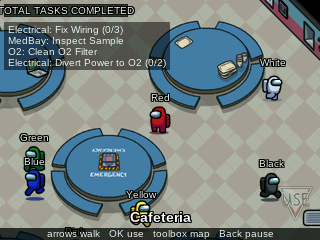
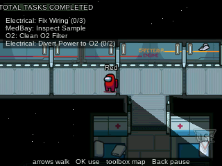
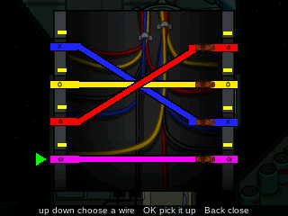
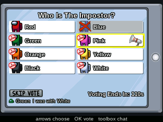
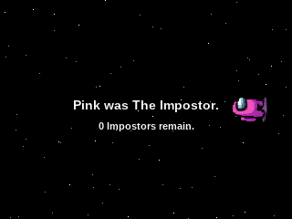
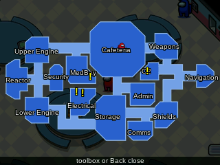
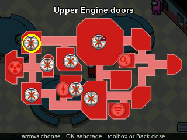
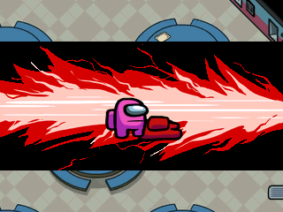
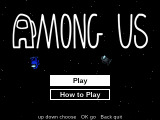

> **Among Us is a [NumPlay](../../README.md) game that comes on its own.** It is too big to fit next to NumPlay on the calculator. Get `AmongUs.nwa` from the [latest release](https://github.com/Mason363/NumPlay/releases/latest).

  

<h1 align="center">Among Us</h1>

  <b>Do your tasks on the Skeld, or be the Impostor, against up to 9 bots on the NumWorks calculator.</b> 
  Find the Impostor and vote them out before it's too late.

  <a href="https://github.com/Mason363/NumPlay/releases/latest/download/AmongUs.nwa"><b>Download AmongUs.nwa</b></a>
  &nbsp;·&nbsp; <a href="#controls">Controls</a>

  

## Highlights

* **The Skeld:** the whole ship from the game's own pictures, with its walls casting shadows on your light, its doors, vents, cameras and admin map.
* **Every Skeld task:** wires, the card swipe, asteroids, the scan, the sample, fuel, the reactor, garbage, data, the distributor, the course, the O2 filter, manifolds, steering, shields and power, each one made for the keypad.
* **Bots:** crewmates do their tasks, report bodies and remember who they saw where. Impostors fake tasks, kill when nobody's looking, vent and sabotage. Nobody knows more than they saw.
* **Sabotage:** reactor meltdown, oxygen, lights, comms and doors, from the Impostor's sabotage map.
* **Meetings:** report a body or press the emergency button, hear the bots out, vote or skip, then the ejection.
* **Kills and ghosts:** the kill animation, and dead crewmates finish their tasks as ghosts.
* **The lobby's settings** with the original's defaults: impostors, kill cooldown and distance, vision, speed, tasks, meetings, votes and more.
* **Saves:** Home saves and quits mid-round. Your game and settings are also copied into `amongus_saves.py`, so installing the app again doesn't erase them.

<table>
  <tr>
    <td align="center"> Walls cast shadows</td>
    <td align="center"> Fix Wiring</td>
  </tr>
  <tr>
    <td align="center"> Who is the Impostor?</td>
    <td align="center"> The ejection</td>
  </tr>
  <tr>
    <td align="center"> The map</td>
    <td align="center"> The sabotage map</td>
  </tr>
  <tr>
    <td align="center"> A kill</td>
    <td align="center"> The title</td>
  </tr>
</table>

## How to play

**As a crewmate,** walk to your tasks (the list at the top left, or the yellow marks on the map) and press OK at each one. The crew wins when every task is done or every Impostor is voted out. Find a body? Report it. Suspect someone? Call a meeting with the button in the Cafeteria. In the meeting, the bots say what they saw: vote for the Impostor or skip. If you die, finish your tasks as a ghost.

**As the Impostor,** kill the crewmates one by one without being seen, then hide in the vents. Sabotage the ship to split the crew: if nobody fixes the reactor or the oxygen in time, you win. Fake tasks and blend in. You win when there are as many Impostors as crewmates.

## Controls

| Key | What it does |
| --- | --- |
| Arrows | Walk (in a vent, go to the vent the arrow points at) |
| OK | Use, report, vent, and the tasks' main key |
| EXE | Kill (Impostors) |
| Toolbox | Map (the sabotage map for Impostors), the chat in meetings |
| Back | Close, or pause (Resume, How to Play, Quit game) |
| Home | Save and quit |

A few tasks also take the digit keys: the reactor's buttons, the oxygen code, the light switches and the shields.

## Good to know

* **On its own:** Among Us is too big to fit next to NumPlay. Installing it from the NumWorks website swaps out NumPlay and the other apps, and installing NumPlay again swaps it back out. Your progress in each one is kept.
* **What's in:** the Skeld from the 2021.3.31 version, against bots made for this version (the original has none). There is no online play, chat, cosmetics, other maps or sound (the calculator has no speaker).

## Credits

Inspired by Among Us by Innersloth, not affiliated with them. Go play the original.

* The ship, the players, the tasks, the meetings, the buttons and the kill come from the game's Android release, read by [tools/pack.py](tools/pack.py) into `src/data.bin`. Its rules and numbers follow the game's own code.
* The text is in **Liberation Sans**, the game's font (SIL Open Font License 1.1, see [LICENSES/OFL-1.1-LiberationSans.txt](LICENSES/OFL-1.1-LiberationSans.txt)).

Made by Mason Chen as part of NumPlay.

## License

The game's code is licensed under the GNU General Public License v3.0: see the `LICENSE` file at the root of the repository. The game's pictures and font keep their own terms (see Credits). Among Us is a trademark of Innersloth.
