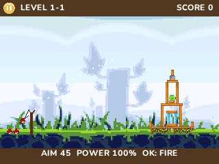

# Angry Birds

Native standalone NumWorks adaptation by **Bobydeluxe**, based on the supplied Angry Birds Chrome/Seasons reference. English interface, offline play, seven bird types, Mighty Eagle, destructible structures, TNT, stars and persistent progression.

The reference contains **429 campaign stages and 14 additional maps**. All 443 are included; the separate benchmark is excluded. This is the content of this web reference, not every episode released for the mobile games.



## Known bugs

**This game still has bugs and is experimental.** Freezes or unexpected closure when selecting a level have been reported on a physical calculator. Loading has been split into interruptible steps and passes emulator tests, but the reported hardware issue still needs confirmation on a real device. Crowded scenes may slow down on older models, and the native physics differs from the original engine. Not every stage has been played through to completion.

## Play

Install `build/apps/AngryBirds.nwa` through the usual NumWorks external-app workflow. It is a standalone large game, excluded from the NumPlay launcher and `games/games.json`. From the repository root, build it with `make build/data/apps/AngryBirds.nwa` or `python tools/build.py --game angrybirds`. The release catalogue lists it among the individual large games. This fan adaptation is not affiliated with Rovio.

| Key | Action |
| --- | --- |
| Arrows in menus | Select episode, page or stage |
| Up / Down in play | Adjust launch angle; hold to repeat |
| Left / Right in play | Adjust launch power |
| OK / EXE | Launch; press again in flight to activate a bird's power |
| 1 in play | Aim a sardine for Mighty Eagle, once per attempt |
| 2 in play | Toggle overview and following camera |
| Back | Pause, resume or return |
| Home / Power | Save progression and exit |
| 1 on title | Restart the last selected stage |
| 0 on title | Open controls |

Each episode starts with its first stage unlocked. Clearing a stage opens the next. The 2,336-byte `angrybirds.sav` record stores best scores, stars, Eagle destruction percentages, feathers and unlocked stages. A 100% Eagle attempt earns a feather without overwriting the normal score or stars. An interrupted attempt restarts; moving bodies are not saved. Full storage offers retry, return to menu, or explicit exit without saving.

## Content and fidelity

The level placements, bird order, object geometry, materials and star thresholds come from the reference data. Original sprites, classic logo, episode artwork, backgrounds and 19 story images are converted for the 320×240 screen. UI text uses NumPlay's native-size Nunito glyphs with measured wrapping and contrasting colors; the Chrome/Beta title badges are excluded.

The physics engine is a native bounded rigid-body solver, rather than the original Java/GWT Box2D runtime. Collision responses, destruction outcomes, joints, bird abilities and Eagle percentages can therefore differ. Controls and menu layouts are adapted to the keypad. Backgrounds are composited, sprites use reduced palettes, stories are static images, and there is no audio, web editor, online service or external web comic. This adaptation does not promise identical physics or verified solutions for every stage.

## Storage and RAM

Current release: **1,391,696 bytes** as `.nwa`, **1,377,744 bytes** installed, **87,068 bytes** static RAM. Maximum stack observed in ARM tests: **2,504 bytes**. See [validation](VALIDATION.md) for the exact build and limits of these measurements.

Levels use independent lossless DEFLATE streams and keep float32 placements. Immutable geometry and 4-bit sprite palettes stay in flash. Rendering uses an eight-line strip rather than a framebuffer; cached fixed-point sprite transforms avoid repeated floating-point work per pixel. Loading scratch shares memory with the contact buffer. Simulation has fixed body/contact/joint limits, sleeping objects and a sweep broad phase, with no gameplay heap allocation. Fast projectiles use two substeps; crowded moving scenes use fewer solver iterations.

Level preparation is split across keypad polls with a visible loading screen. Back cancels preparation and Home saves and exits. The twelve original preparation steps remain in the same order, preserving the resulting starting state. Catch-up simulation work and off-screen line rendering are bounded so expensive frames cannot build an unlimited input backlog.

## Build and validate

Requirements: ARM GNU toolchain, Node.js with `nwlink`, Python 3 and Pillow. The checked-in inputs build offline. The recorded build used ARM GCC 15.2.1, nwlink 1.0.0 and Pillow 11.3.0.

```sh
python build.py --arm-bin /path/to/arm/bin --nwlink /path/to/nwlink
```

Run from this directory, or use the repository-relative path to `build.py`. The script exports the release to `build/apps/AngryBirds.nwa` and writes `output/build-report.json`. It checks installation against the smallest supported RAM budget and compares release/debug installed bytes.

With the tools on `PATH`, Make also supports:

```sh
make check test test-assets
cd output && ./test solve && cd ..
python tests/test_arm.py --nwlink /path/to/nwlink
python tests/test_arm.py --nwlink /path/to/nwlink --selection-only
```

Host tests need a C11 compiler. ARM tests additionally need Unicorn and pyelftools and use the repository's `tools/emu.py`. `test solve` writes the launch-angle fixture required by the complete ARM playthrough test. Generated reports, test storage and binaries remain in ignored `output/`.

Original game, characters and artwork: **Rovio**. Native adaptation: **Bobydeluxe**. See [asset provenance](ASSETS.md).
