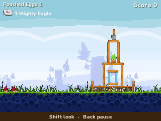
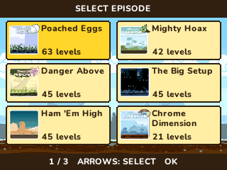

> **Angry Birds is a [NumPlay](../../README.md) game that comes on its own.** It is too big to fit next to NumPlay on the calculator. Get `AngryBirds.nwa` from the [latest release](https://github.com/Mason363/NumPlay/releases/latest).

  

<h1 align="center">Angry Birds</h1>

  <b>Fling the birds at the pigs' castles, on the NumWorks calculator.</b> 
  The 429 levels of the Chrome edition, its seven birds and the Mighty Eagle.

  <a href="https://github.com/Mason363/NumPlay/releases/latest/download/AngryBirds.nwa"><b>Download AngryBirds.nwa</b></a>
  &nbsp;·&nbsp; <a href="#controls">Controls</a>

  

## Highlights

* **Every level of the Chrome edition:** 429 of them in twelve episodes, Poached Eggs, Mighty Hoax, Danger Above, The Big Setup, Ham 'Em High, the Chrome Dimension, Trick or Treat, Season's Greedings, Easter Eggs, Moon Festival, Cherry Blossom and Summer Pignic.
* **The real physics:** Box2D, the engine the original runs on, set up as the original sets it up: the same gravity, time step, materials, damage, explosions and joints. Towers lean, topple and break the way they do there.
* **The seven birds:** the red bird and his big brother, the yellow bird that speeds up, the blue bird that splits in three, the black bird that explodes, the white bird that drops an egg bomb, and the green bird that turns back like a boomerang.
* **The Mighty Eagle:** throw the sardine can and the eagle sweeps through the level. Destroy it all for the level's feather. The eagle comes back after an hour of play, and stays ready on the level you used it on.
* **Secrets:** the golden eggs hidden in the classic levels open the Chrome Dimension, and the eggs hidden in Easter Eggs open its special levels.
* **The game's look:** its own birds, pigs, blocks, slingshot, backgrounds, episode pictures and story comics.
* **Saved as you go:** stars, best scores, feathers and the levels you opened. Home saves and quits. Your progress is also copied into `angrybirds_saves.py`, so installing the app again doesn't erase it.

<table>
  <tr>
    <td align="center"> The blue bird, split in three, through the ice</td>
    <td align="center"> The Mighty Eagle on its way</td>
  </tr>
  <tr>
    <td align="center"> The first level's tower coming down</td>
    <td align="center"> Level cleared, with the birds left over</td>
  </tr>
  <tr>
    <td align="center"> The levels and their stars</td>
    <td align="center"> The episodes</td>
  </tr>
  <tr>
    <td align="center"> The pigs take the eggs</td>
    <td align="center"> The title screen</td>
  </tr>
</table>

## How to play

Knock out every pig in the level with the birds you're given. Aim with the arrows: the corner shows how high you aim and how far back the slingshot is pulled. Press **OK** to fire, and **OK** again while the bird flies to use its power. The dotted line is your last shot. Every bird you don't need is worth 10,000 points when the level is cleared, and enough points earn the second and third stars.

Clearing a level opens the next one. Mighty Hoax opens once Poached Eggs is done, and Danger Above after Mighty Hoax; the other episodes are open from the start.

## Controls

| Key | What it does |
| --- | --- |
| Up and Down | Aim the slingshot (hold to aim faster) |
| Left and Right | Pull it back less or more |
| OK | Fire the bird; press again while it flies to use its power |
| 1 | Call the Mighty Eagle: the sardine can goes in the slingshot |
| shift (hold) | Look at the pigs |
| Back | Pause (Resume, Restart, Levels, How to play, Quit game) |
| Home | Save and quit |

## Good to know

* **On its own:** Angry Birds is too big to fit next to NumPlay. Installing it from the NumWorks website swaps out NumPlay and the other apps, and installing NumPlay again swaps it back out. Your progress in each one is kept.
* **The Chrome edition's content:** its 429 levels, not the levels of the phone versions. The few levels left unfinished in its files, which the original never shows, aren't here either. There is no music or sound (the calculator has no speaker).
* **The Mighty Eagle's hour:** the calculator has no clock, so the hour counts while the game is open.
* **On Upsilon:** Upsilon gives apps less memory, and seven of the most crowded levels need more than it has. They say so instead of being played.

## Credits

Inspired by Angry Birds by [Rovio Entertainment](https://www.rovio.com), not affiliated with Rovio. Go play Rovio's own Angry Birds games.

* The pictures (the birds, pigs and blocks, the slingshot, the backgrounds, the episode pictures, the story comics and the logo) and the levels come from the Chrome edition's web build, read by [tools/art.py](tools/art.py) and [tools/pack.py](tools/pack.py) into `src/data.bin`. Its rules and numbers follow the game's own code.
* The physics is [Box2D](https://box2d.org) 2.2.1 by Erin Catto (zlib license, see [src/box2d/License.txt](src/box2d/License.txt)), altered to fit the calculator's memory. The text uses NumPlay's **Nunito** font (SIL Open Font License).
* The calculator adaptation is by **Bobydeluxe**, who brought it to NumPlay.

Made by Mason Chen as part of NumPlay.

## License

The game's code is licensed under the GNU General Public License v3.0: see the `LICENSE` file at the root of the repository. Box2D keeps its zlib license. The game's pictures and levels keep their own terms (see Credits). Angry Birds is a trademark of Rovio Entertainment.
