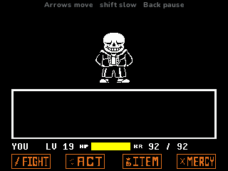
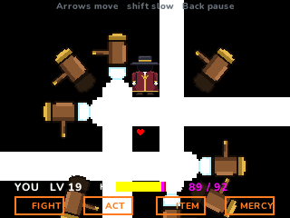
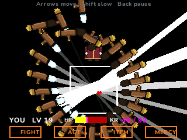
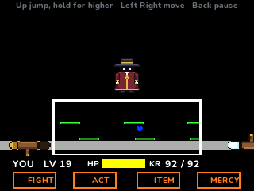
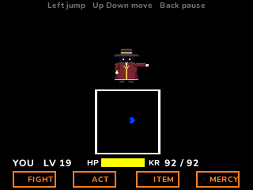
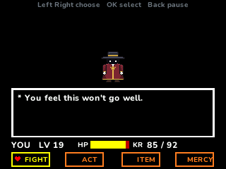
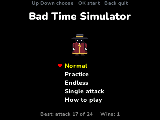

> **Bad Time Simulator is a [NumPlay](../../README.md) game that comes on its own.** It is too big to fit next to NumPlay on the calculator. Get `BadTimeSimulator.nwa` from the [latest release](https://github.com/Mason363/NumPlay/releases/latest).

  

<h1 align="center">Bad Time Simulator</h1>

  <b>Bad Time Simulator's fight for the NumWorks calculator.</b> 
  24 attacks of bones, gavels and gravity, one hit point at a time.

  <a href="https://github.com/Mason363/NumPlay/releases/latest/download/BadTimeSimulator.nwa"><b>Download BadTimeSimulator.nwa</b></a>
  &nbsp;·&nbsp; <a href="#controls">Controls</a>

  

## Highlights

* **The whole fight:** all 24 attacks in their order, from the first slam to the final attack, with the break in the middle and the ending. Each attack plays from jcw87's own attack scripts, with the same timings, speeds and gaps, 30 times a second as in Undertale.
* **The red and the blue heart:** the red heart goes where you push it. The blue heart falls, and jumps higher the longer you hold the key. The Judge slams it into any wall, and gravity turns with it.
* **Bones, gavels and platforms:** white bones always hurt, blue ones only if you move, orange ones only if you stand still. Walls of bones burst out of the box's sides. Gavels fly in and fire beams across the screen.
* **KR:** every hit takes 1 HP and adds karma, which keeps draining your HP after the hit, faster the more you have.
* **The menu:** FIGHT (he dodges every time), ACT, ITEM (eight snacks to heal) and MERCY, between attacks. Late in the fight, the menu itself fights back.
* **Practice:** every attack in order, each one again until you pass it. **Endless:** attacks back to back, forever. **Single attack:** pick any of the 24 and play it again and again.
* **Saved:** your furthest attack and your wins. Home saves and quits from anywhere. Your record is also copied into `badtime_saves.py`, so installing the app again doesn't erase it.

<table>
  <tr>
    <td align="center"> The first attack's gavels</td>
    <td align="center"> The final attack</td>
  </tr>
  <tr>
    <td align="center"> Platforms over a beam</td>
    <td align="center"> Slammed into the wall</td>
  </tr>
  <tr>
    <td align="center"> Between attacks</td>
    <td align="center"> Normal, Practice, Endless or a single attack</td>
  </tr>
</table>

## How to play

The Judge attacks, you dodge. Move your heart with the arrows and keep it out of everything that comes into the box. When the heart turns blue it falls to the floor: **Up** jumps, and holding it jumps higher. When he slams you into a wall, that wall is the floor, and the arrow pointing away from it jumps.

Between attacks, choose what to do with **Left**, **Right** and **OK**. FIGHT swings at him: press **OK** as the bar crosses the middle. He always dodges, but keep swinging: the fight only moves on when you try. ITEM eats something to heal. Survive all 24 attacks to win.

## Controls

| Key | What it does |
| --- | --- |
| Arrows | Move the heart |
| Up (blue heart) | Jump, higher while held |
| Shift | Move slowly, while held |
| OK or EXE | Choose, strike, read on |
| Back | Back in a list, otherwise pause (Resume, How to play, Quit game) |
| Home | Save and quit |

8, 4, 6, 2 and 5 work as the arrows and OK. The top line always says which keys do what right now.

## Good to know

* **On its own:** Bad Time Simulator is too big to fit next to NumPlay. Installing it from the NumWorks website swaps out NumPlay and the other apps, and installing NumPlay again swaps it back out. Your progress in each one is kept.
* **Quit game** in the pause menu asks first.
* The Judge, the gavels, the heart, the icon and every word the Judge says are drawn and written for this game. The fight's rules, attacks and numbers are the original's.
* In Practice an attack counts as passed if your HP minus your KR stays at 60 or more (2 in the final attack).
* There is no music or sound: the calculator has no speaker.

## Credits

Made by Mason Chen as part of NumPlay, inspired by [Undertale](https://undertale.com) by **Toby Fox** and [Bad Time Simulator](https://github.com/jcw87/c2-sans-fight) by **jcw87**. Not affiliated with them.

* From jcw87's Bad Time Simulator: the 24 attack scripts (turned into the game's tables by `tools/attacks.py`) and the fight's rules and numbers, read from its event sheets.
* No sprites or fonts are taken from Undertale or Bad Time Simulator: the pictures are drawn for this game (`tools/art.py`).
* The text uses NumPlay's **Nunito** font (SIL Open Font License).

## License

The game's code is licensed under the GNU General Public License v3.0: see the `LICENSE` file at the root of the repository. Undertale belongs to Toby Fox. Nunito keeps the SIL Open Font License (`LICENSES/OFL-1.1-Nunito.txt`).
