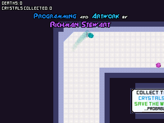
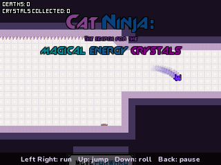
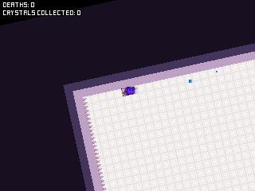
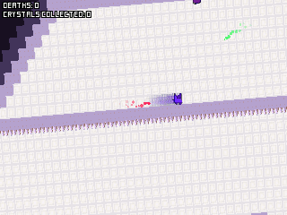

# Cat Ninja

Save the world, or something: collect the energy crystals. Richman Stewart's Flash platformer on the NumWorks calculator, with the game's own levels, traps and pictures: all 30 levels, the boss and the big crystal at the end.

- **The whole game, in its order:** the title map, then 30 levels that lead into each other, with the game's own branches (the Crossroads, the teleporters, the paths that loop back). Its TV screens talk to you, and mock you when you die.
- **The cat as the game moves it:** its run, jump and double jump, wall jumps on plain walls (not on the sticky green ones), the roll, the slam that breaks glass and presses buttons, the slide down walls. The same numbers, frame by frame, at the game's 60 frames a second.
- **Every trap:** spikes, lasers on timers, mines that blink before they blow, shooters and homing shooters, falling spikes, sun spikes that crawl along walls, dirt that crumbles, crates, springs, boosts, magnets, gravity changers that turn the whole world round, gravity blocks that don't, teleporters, the jetpack, the speed pill and the hallucination pill that makes the world wobble.
- **Checkpoints** as the game has them (die before the next one and you go back, even to the level before), the deaths and crystals counted at the top, the boss of level 29 and the ending: collect more than 20 of the 50 crystals to save the world.
- **Its pictures and fonts, all of them the game's,** with the map slowly changing colour as in the original. The world is drawn at half size, so a bit less of it shows than in the browser; the TV screens are drawn bigger so their words can be read.
- **Saves:** Home or Quit game keeps the level and the place you reached, your checkpoint, deaths and crystals. Next time the title map's way right takes you back there. A copy goes into `catninja_saves.py`, so installing the app again doesn't erase it.

  

## Controls

| Key | Action |
| --- | --- |
| Left, Right (or 4, 6) | Run |
| Up, OK or EXE (or 8) | Jump; again in the air: double jump; against a wall: wall jump. With the jetpack on: fly up |
| Down (or 2) | Roll (hold it and run); in the air: slam. With the jetpack on: fly down |
| Shift | Jetpack on or off, once you have one |
| Backspace | Back to the last checkpoint |
| Back | Pause: Resume, Retry, Title, How to play, Quit game (it asks first) |
| Home | Save and quit |

## Good to know

- The original's keys were the arrows, space for the jetpack and R to go back to the checkpoint: here Shift and Backspace, and the two TV screens that name those keys say so.
- There's no music or sound, and the pause bar's buttons for them are gone; its pause and exit are the pause's Resume and Title.
- Like the original, the game starts in the dark and the title map slowly lights up. Walk right to play.
- After a quit, the crystals you took stay taken; buttons pressed and lit checkpoints in a level you left start over.

## Credits

[Cat Ninja: The Quest for the Magical Energy Crystals](https://jayisgames.com/review/cat-ninja.php) is **Richman Stewart**'s game (2013), published by **TrackMill**. This version is written in C for the calculator from the game's own ActionScript, read from `CatNinja.swf` (BlueMaxima's Flashpoint keeps it) with JPEXS: the cat, the map and its tiles, every trap, the scripts of the levels, the boss and the ending follow its code, number for number. What it shows is the original's: [tools/data.py](tools/data.py) takes the 30 levels and the title map, their scripts and texts, the game's pictures (shrunk to half size) and its two fonts, "square" and "cubic", from the files JPEXS takes out of the game, and packs them into `src/data.c`. [tools/icon.py](tools/icon.py) makes the icon from the cat and its floor. The title cards credit the game's music by BunnyMajs and Eric Skiff, which isn't played here.

Not affiliated with Richman Stewart or TrackMill.

`make test` checks the cat's physics against the game's numbers, plays the title map and the first two levels with a little player that wall jumps, runs every level on random keys, checks the saves and runs the whole app on random keys. `build/play docs DIR` and `build/play gif DIR` draw the pictures above and the frames of the gallery's GIF.

It comes as its own app, `CatNinja.nwa`, from the [latest release](https://github.com/Mason363/NumPlay/releases/latest).

Build: `make` (needs `arm-none-eabi-gcc` and Node.js for nwlink). `make data` packs the levels and pictures again (Python 3 with Pillow and NumPy, and the files taken out of the game in `GAMESRC`).
