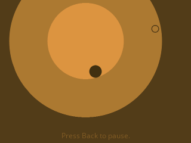
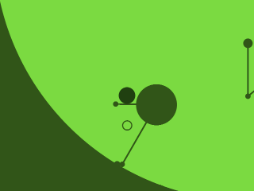
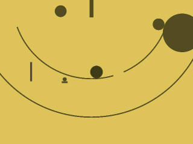
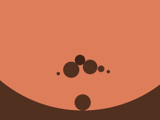
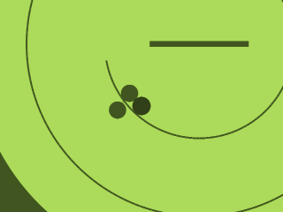
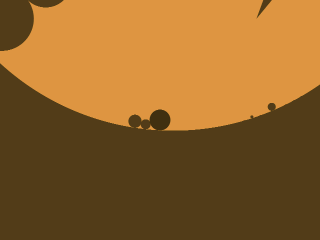
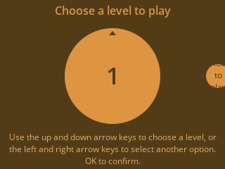

> **circloO is a [NumPlay](../../README.md) game that comes on its own.** It is too big to fit next to NumPlay on the calculator. Get `CircloO.nwa` from the [latest release](https://github.com/Mason363/NumPlay/releases/latest).

  

<h1 align="center">circloO</h1>

  <b>Roll a ball through round levels that grow each time you collect a circle, on the NumWorks calculator.</b> 
  Collect seven circles to complete a level.

  <a href="https://github.com/Mason363/NumPlay/releases/latest/download/CircloO.nwa"><b>Download CircloO.nwa</b></a>
  &nbsp;·&nbsp; <a href="#controls">Controls</a>

  

## Highlights

* **The game's own levels:** all 14 levels and the 6 hard mode levels of the original web game, read from its level scripts, with every circle, line, rope, rotating bar and falling ball where the original puts them.
* **The same physics:** the original runs on Box2D, so this does too: the same gravity, ball, friction, damping and steps, at the game's 60 steps a second.
* **Levels that grow:** each circle you collect opens the next ring of the level, with its new balls, ropes and texts.
* **Hard mode:** opens once you've beaten ten levels, as in the original.
* **The game's look:** its colour for each level, its row of circles for menus, and its font, Open Sans.
* **Saves:** the levels you've beaten and your best time on each. Home saves and quits. Your progress is also copied into `circloo_saves.py`, so installing the app again doesn't erase it.

<table>
  <tr>
    <td align="center"> Level 3</td>
    <td align="center"> Curved paths and rotating bars</td>
  </tr>
  <tr>
    <td align="center"> Balls that come and go</td>
    <td align="center"> Level 14</td>
  </tr>
  <tr>
    <td align="center"> Hard mode</td>
    <td align="center"> Choosing a level</td>
  </tr>
</table>

## How to play

Left and Right roll the ball. Rock it back and forth to climb the walls. Collect seven circles to complete a level: each one makes the level grow by a ring. A circle with a dot in it can't be taken by your ball: push another ball or a bar into it.

Beating a level opens the next one, and every fifth level opens one more. Beat ten levels and Hard mode appears on the main menu.

## Controls

| Key | What it does |
| --- | --- |
| Left and Right | Roll the ball |
| Up and Down | Choose a level on the main menu |
| OK | Confirm |
| Back | Pause (Continue, Retry level, Main menu) |
| Home | Save and quit |

## Good to know

* **On its own:** circloO is too big to fit next to NumPlay. Installing it from the NumWorks website swaps out NumPlay and the other apps, and installing NumPlay again swaps it back out. Your progress in each one is kept.
* **Which circloO:** this is the original free web game from 2014, with its 14 levels and 6 hard mode levels. The later circloO games, with their editor and player levels, aren't in it.
* **What's left out:** music, sounds, the settings menu (full screen, music and sounds) and the "more games" links.
* **Best times:** the original doesn't time levels. This version keeps your best time on each level and shows it when you finish one.

## Credits

Inspired by circloO by Florian van Strien, not affiliated with him. Go play the original.

* The levels come from the game's web release, read by [tools/levels.py](tools/levels.py) into `src/levels.h`. Its rules, colours and numbers follow the game's own code.
* The physics follows [Box2D](https://box2d.org) by Erin Catto (zlib license, see [LICENSES/Zlib-Box2D.txt](../../LICENSES/Zlib-Box2D.txt)), the engine the original runs on, in [src/phys.c](src/phys.c).
* The font is **Open Sans** by Steve Matteson for Google (Apache License 2.0, see [LICENSES/Apache-2.0-OpenSans.txt](../../LICENSES/Apache-2.0-OpenSans.txt)), the original's font.

Made by Mason Chen as part of NumPlay.

## License

The game's code is licensed under the GNU General Public License v3.0: see the `LICENSE` file at the root of the repository. The physics follows Box2D's zlib license and the font keeps its Apache license. The game's levels keep their own terms (see Credits). circloO is a game by Florian van Strien.
