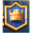
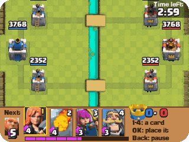
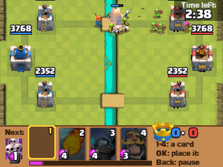
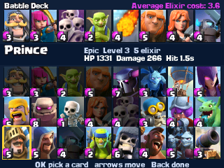
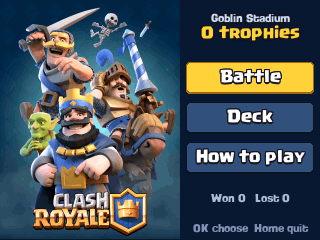
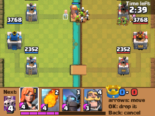

  

<h1 align="center">Clash Royale</h1>

  <b>Knock down the towers, on the NumWorks calculator.</b> 
  One against a bot: the 2016 game's cards, arenas, elixir and crowns.

  <a href="https://github.com/Mason363/NumPlay/releases/latest/download/ClashRoyale.nwa"><b>Download ClashRoyale.nwa</b></a>
  &nbsp;·&nbsp; <a href="#controls">Controls</a>

  

## Highlights

* **41 cards of the 2016 game,** every one but Mirror: troops, buildings and spells, with the game's own hitpoints, damage, hit speed, range, speed, splash, spawns and death damage, read out of its Android package, at tournament standard (Common 8, Rare 6, Epic 3).
* **The game's rules:** 3 minutes, an elixir every 2.8 s, double elixir in the last minute, a minute of sudden death, a crown for each Princess tower and three for the King's. The King tower wakes when hit or when a Princess tower falls.
* **The game's pictures:** its arenas, towers, troops in eight directions, card art and font.
* **Seven arenas,** from Goblin Stadium to the Legendary Arena, opened by trophies. The bot gets quicker in each.
* **A deck of your own** from all the cards, and the bot plays the training camp's decks.

<table>
  <tr>
    <td align="center"> A battle</td>
    <td align="center"> The deck</td>
  </tr>
  <tr>
    <td align="center"> The title</td>
    <td align="center"> Placing a card</td>
  </tr>
</table>

## How to play

Knock down the bot's towers before it knocks down yours. A Princess tower is a crown, the King tower is three and ends the battle at once. After 3 minutes the one with more crowns wins; even crowns bring a minute of overtime, where the next crown wins.

Elixir fills up by itself, up to 10, and each card costs some. You hold four cards: play one and it goes to the back of your deck, and the next card takes its place. Troops and buildings go on your side of the river (and on the enemy's side of a lane once its Princess tower is down), spells anywhere. Troops walk to the nearest building and fight what they meet on the way; some only go for buildings.

## Controls

| Key | What it does |
| --- | --- |
| 1 to 4 | Pick a card |
| ← → and OK | Pick a card, then take it to the field |
| Arrows | Move it on the field |
| OK | Drop it |
| Back | Put the card back; in the hand, pause |
| Home | Keep the battle and quit |

## Good to know

* **Too big to install next to NumPlay.** Your trophies and deck are kept.
* **The arena is turned** to fit the wide screen: your side on the left.
* **The bot is NumPlay's own,** not Supercell's.
* **Left out:** Mirror, chests, gold and card upgrades, clans and online play. No sound: the calculator has no speaker.
* Leaving a battle counts as a loss, as in the game.

## Credits

Inspired by Clash Royale by Supercell, not affiliated with Supercell. Clash Royale is a trademark of Supercell.

* The numbers, pictures, card names and fonts (Supercell-Magic, CCBackBeat) come from the game's 2016 Android package: `tools/sc.py` reads its pictures, and `tools/pack.py` makes them and its card tables into `src/data.bin` and `src/tables.c`.

Made by Mason Chen as part of NumPlay.

## License

The game's code is licensed under the GNU General Public License v3.0: see the `LICENSE` file at the root of the repository. The game's pictures, names and fonts keep their own terms (see Credits).

Build: `make` (needs `arm-none-eabi-gcc` and Node.js for nwlink), `make test` on a computer.
