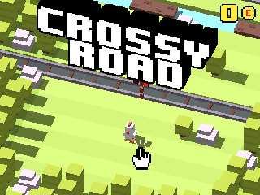
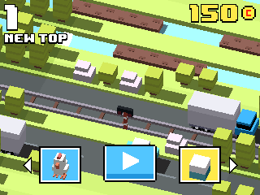
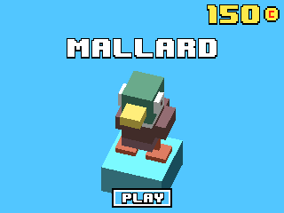

> **Crossy Road is part of [NumPlay](../../README.md)**, every NumWorks game in one app. Get it with all the others, or on its own as `CrossyRoad.nwa` from the [latest release](https://github.com/Mason363/NumPlay/releases/latest).

# CrossyWorks

Crossy Road for the NumWorks calculator.

  
  
  
  

Hop as far as you can. Dodge cars, trucks and trains, ride logs and lily pads across rivers, grab coins, and keep moving or the eagle will get you. Spend 100 coins at the prize machine for a new character: ten of the game's own, from the Chicken and the Mallard to the Penguin, the Ghost and Frankenstein, each built from its original model.

  
  

## Install

1. Download [`CrossyRoad.nwa`](https://github.com/Mason363/NumPlay/releases/latest/download/CrossyRoad.nwa) from the [latest NumPlay release](https://github.com/Mason363/NumPlay/releases/latest).
2. Plug in your calculator and open [my.numworks.com/apps](https://my.numworks.com/apps).
3. Add the file and send it to the calculator.

Made for the NumWorks N0120.

## Controls

| Key | Action |
| --- | --- |
| Up, OK or EXE | Hop forward |
| Left, Right, Down | Hop left, right or back |
| Back | Pause. On the title or game over screen, quit |
| Left (game over) | The characters: Left and Right to look, OK to play one you have won |
| Right (game over) | The prize machine, with 100 coins: OK turns it, OK opens the ball |

Your top score, coins and characters are saved on the calculator. The prize machine never gives one you already have.

## Build

You need `arm-none-eabi-gcc`, Python 3 and Node.js. Run `make` to get `output/crossyroad.nwa`.

Crossy Road is a trademark of Hipster Whale. This is an unofficial fan remake.
