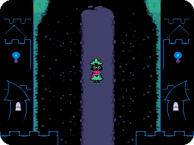
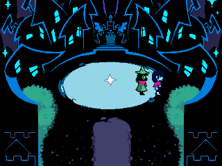
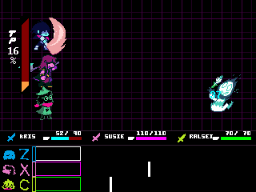

> **Deltarune is a [NumPlay](../../README.md) game that comes on its own.** It is too big to fit next to NumPlay on the calculator. Get `Deltarune.nwa` from the [latest release](https://github.com/Mason363/NumPlay/releases/latest).

  

<h1 align="center">Deltarune</h1>

  <b>Chapter 1, on the NumWorks calculator.</b> 
  From Kris's room to the school's supply closet, the Dark World, Castle Town and the Field.

  <a href="https://github.com/Mason363/NumPlay/releases/latest/download/Deltarune.nwa"><b>Download Deltarune.nwa</b></a>
  &nbsp;·&nbsp; <a href="#controls">Controls</a>

  

## Highlights

* **The Light World:** Toriel wakes Kris up, drives Kris to school, Alphys's class, Susie in the hall and the supply closet, where the floor gives way. Every bed, shelf and sign says what it says in the game.
* **The Dark World:** the cliffs where Kris lands, Susie in the dust pile, the eye puzzle, the slopes, Lancer's chase, the castle, Lancer's first fight and Ralsei, Castle Town, the tutorial and the Great Door to the Field.
* **Battles like in the game:** each member of the party picks FIGHT, ACT or MAGIC, ITEM, SPARE or DEFEND. FIGHT's bars, TP from defending, hitting and grazing, Rude Buster, Pacify and Heal Prayer, the enemies' bubbles and their bullets in the box: Lancer, the Dummy, Rudinn and Hathy.
* **The original's own pictures, rooms and texts**, read from Chapter 1's game files, with its numbers: stats, items, spells, enemies and battles.
* **Saved like in the game:** SAVE at the SAVE points. Home keeps the moment you were at, and your save is also copied into `deltarune_saves.py`, so installing the app again doesn't erase it.

<table>
  <tr>
    <td align="center"> Castle Town, with Ralsei</td>
    <td align="center"> Rudinn's diamonds</td>
  </tr>
</table>

## How to play

Name the vessel, then walk and talk your way from Kris's room into the Dark World. In a battle each member of your party picks in turn. FIGHT: press **OK** as each bar reaches the line. ACT does something to an enemy, MAGIC casts a spell for TP, ITEM heals, SPARE spares an enemy whose name is yellow, and DEFEND takes less damage and gives TP. Then move your SOUL in the box to dodge; bullets that pass close by give TP too.

## Controls

| Key | What it does |
| --- | --- |
| **Arrows** (or 4, 6, 8, 2) | Walk, move your SOUL, choose |
| **OK**, **EXE** or 5 | Talk, read, confirm (Z in the game) |
| **Back** or **⌫** | Cancel; hold it to run, or to show the whole text at once (X in the game) |
| **toolbox**, **shift** or **var** | The menu (C in the game) |
| **Home** | Keep the moment and quit |

## Good to know

* The chapter goes as far as the Field so far: the Great Board, the Forest and the Card Castle come next.
* The battle's menus and numbers are drawn at half the original's size, as the Dark World is; the enemies' bubbles keep their size, so their words stay readable.
* No music or sound: the calculator has no speaker.

## Credits

Inspired by [Deltarune](https://deltarune.com) by Toby Fox, not affiliated with him. Go play the original: it's on Windows, Mac, Switch and PlayStation, with music, every chapter and more.

* The pictures, fonts, rooms and texts come from the game's own files (Chapter 1, 2018), and its rules and numbers follow the game's own code.

Made by Mason Chen as part of NumPlay.

## License

The game's code is licensed under the GNU General Public License v3.0: see the `LICENSE` file at the root of the repository. The game's pictures, fonts and texts keep their own terms (see Credits).
