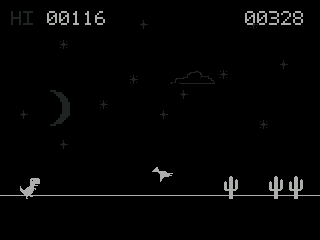

# Chrome Dino

**Google Chrome Dino for NumWorks**, adapted in C by **LilyTheCatgirl** and integrated into [NumPlay](https://github.com/Mason363/NumPlay).

An unofficial adaptation of the classic dinosaur runner, featuring pixel-art graphics, smooth scrolling, increasingly challenging obstacles, and high-score saving.

## Gameplay

Jump over cacti, duck under flying birds, and survive for as long as possible!

Features:

- Classic dinosaur running, jumping, and ducking animations
- Single and grouped cacti
- Flying birds with animated wings
- Increasing obstacle speed and difficulty
- Safe spacing between birds and cacti to prevent impossible obstacle combinations
- Scrolling clouds and ground details
- Day and night cycles
- Persistent high scores

The game uses a 50 ms physics update interval, with a jump lasting approximately 0.7 seconds and reaching a height of 49 pixels. Birds and cacti move left at the same speed, starting at approximately 180 pixels per second.

Rendering targets approximately 30 FPS using partial-screen updates to improve performance on the calculator. Actual frame rates depend on the hardware.

## Controls

| Key | Action |
|---|---|
| **OK** | Start, jump, or restart |
| **Down** / **2** | Duck; fall faster while airborne |
| **Clear / Backspace** | Pause or resume |
| **Back / Undo** | Exit the game |
| **Home** | Exit the game |
| **Shift** (title screen) | Show controls |

Holding OK can automatically trigger another jump after landing.

## Building

Chrome Dino is integrated into NumPlay and is also available as a standalone NumWorks application.

To build the standalone application from the repository root, using the NumPlay ARM toolchain and `nwlink`:

`make -C games/dinorun build`

The resulting file is:

`games/dinorun/output/dinorun.nwa`

To check the installable build:

`make -C games/dinorun check`

To run the host gameplay tests:

`make -C games/dinorun host-test`

The host tests cover movement, collision detection, jumping, bird direction, obstacle spacing, rendering, and controls.

The game is already registered in `games/games.json` and is included automatically when building the full NumPlay launcher.

## Credits

- **Original Chrome Dino game:** Google
- **NumWorks C adaptation and NumPlay integration:** LilyTheCatgirl
- **Python sprite reference:** [Chrome Dino in Lily's Small NumWorks Games](https://github.com/LilyTheCuteCatgirl/lilys-small-numworks-games/blob/main/games/chrome_dino.py)