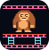
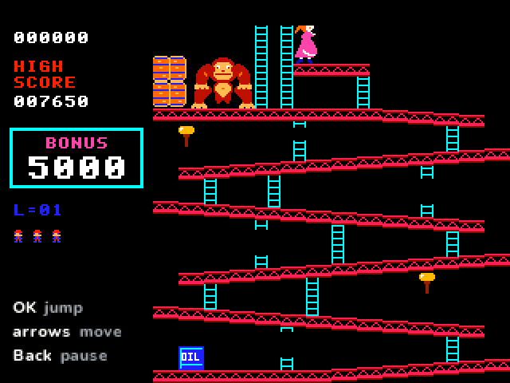

> **Donkey Kong is a [NumPlay](../../README.md) game that comes on its own.** It doesn't fit next to NumPlay on the calculator. Get `DonkeyKong.nwa` from the [latest release](https://github.com/Mason363/NumPlay/releases/latest).

  

<h1 align="center">Donkey Kong</h1>

  <b>Mario climbs a building site after Pauline, on the NumWorks calculator.</b> 
  The 1981 arcade game: barrels, pies, elevators and rivets, up to Kong's fall.

  <a href="https://github.com/Mason363/NumPlay/releases/latest/download/DonkeyKong.nwa"><b>Download DonkeyKong.nwa</b></a>
  &nbsp;·&nbsp; <a href="#controls">Controls</a>

  

## Highlights

* **The arcade's own game:** its program is ported routine by routine and runs 60 times a second, as the arcade did. Mario walks, jumps, climbs and falls exactly as far and as fast, and every barrel, fire, pie, spring and elevator moves as it does in the arcade.
* **All four boards:** 25m with its girders and barrels, 50m with its conveyor belts and pies, 75m with its elevators and springs, and 100m with its rivets, in the arcade's order: two boards on the first level, up to six from the fifth.
* **Kong's barrels:** they roll down the girders, sometimes take a ladder down toward you (more often when you push toward them), and the blue ones light the oil drum, which lets out the fires.
* **Points as in the arcade:** jumping over barrels and fires, smashing them with a hammer, Pauline's hat, purse and umbrella, the rivets, and the bonus left when you reach her. One extra life at 7,000.
* **Harder as you go:** the bonus, the barrels and the fires speed up with each level and the longer you stay on a board, up to level 22, the arcade's kill screen.
* **The scenes:** Kong climbing up with Pauline, How high can you get?, the heart, Kong taking her higher, and Kong's fall when the last rivet goes.
* **Drawn for the calculator:** new pictures, with the arcade's sizes, poses and colours, and the playfield at its full 224 pixels.
* **Saved as you go:** Home saves the game and quits, and the next start picks it up paused. Your game and best score are also copied into `donkeykong_saves.py`, so installing the app again doesn't erase it.

<table>
  <tr>
    <td align="center"> 25m: the girders and Kong's barrels</td>
    <td align="center"> 50m: the conveyor belts and their pies</td>
  </tr>
  <tr>
    <td align="center"> 75m: the elevators and the springs</td>
    <td align="center"> 100m: the rivets</td>
  </tr>
  <tr>
    <td align="center"> Kong climbs up with Pauline</td>
    <td align="center"> The last rivet: Kong falls</td>
  </tr>
  <tr>
    <td align="center"> Back pauses</td>
    <td align="center"> The title screen</td>
  </tr>
</table>

## How to play

Press **OK** on the title to start. Climb to Pauline at the top: walk with the arrows, climb a ladder with up and down when you stand in front of it, and jump with **OK**. Jump over the barrels and the fires, or grab a hammer by jumping up into it: for a while Mario smashes whatever he touches, but he can't jump or climb. On 100m, walk or jump over all eight rivets to bring Kong down, and mind the holes they leave.

A fall from any real height costs a life, and so does the bonus running out. Each board's bonus is yours when you reach Pauline.

## Controls

| Key | What it does |
| --- | --- |
| Arrows (or 4, 6, 8, 2) | Walk, climb ladders, move the focus in menus |
| OK or EXE | Jump, choose |
| Back | Pause: Resume, New game, How to play, Quit game (it asks first) |
| Home | Save and quit |

## Good to know

* **On its own:** Donkey Kong doesn't fit next to NumPlay. Installing it from the NumWorks website swaps out NumPlay and the other apps, and installing NumPlay again swaps it back out.
* **The arcade's factory settings:** three lives and one extra life at 7,000 points. The high score starts at the arcade's 7,650 and becomes your best once you beat it.
* **One player:** the second player, coins, the demo and the name entry are left out, and there's no music or sound (the calculator has no speaker).
* **The arcade's quirks are kept:** a 500 point jump shows 800, and on level 22, the kill screen, the bonus runs out before Mario can reach the top.

## Credits

Inspired by [Donkey Kong](https://en.wikipedia.org/wiki/Donkey_Kong_(arcade_game)) by Nintendo (1981), not affiliated with them. Go play the original: it's on the Nintendo Switch in Arcade Archives.

* Brought to NumPlay by **Bobydeluxe**, who adapted it for the calculator and drew its pictures and its 5x7 lettering.
* The rules and numbers follow the arcade's program, studied in furrykef's [dkdasm](https://github.com/furrykef/dkdasm) disassembly and tcdev's annotated listing. The program's data tables (the boards, Kong's poses, the levels) are read from the listing by [tools/rom.py](tools/rom.py) into [src/rom.h](src/rom.h). No graphics are taken from the arcade.

Made by Mason Chen as part of NumPlay.

## License

The game's code is licensed under the GNU General Public License v3.0: see the `LICENSE` file at the root of the repository. Donkey Kong, its characters and the arcade program's data are Nintendo's and keep their own terms (see Credits).
