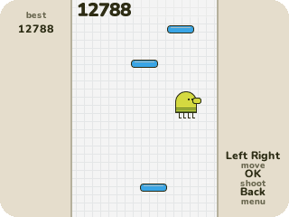
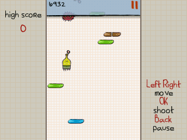
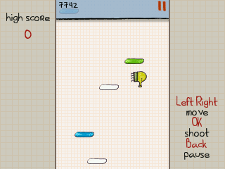
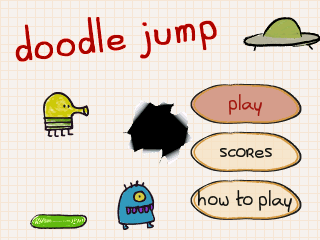
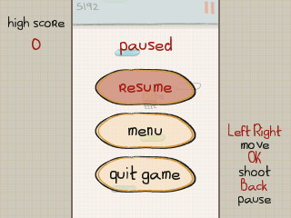
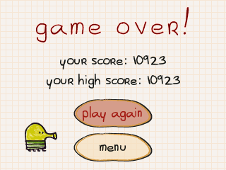
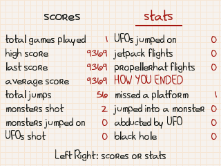

> **Doodle Jump is a [NumPlay](../../README.md) game that comes on its own.** It is too big to fit in NumPlay.nwa. Get `DoodleJump.nwa` from the [latest release](https://github.com/Mason363/NumPlay/releases/latest).

  

<h1 align="center">Doodle Jump</h1>

  <b>Bounce from platform to platform, as high as you can, on the NumWorks calculator.</b> 
  Lima Sky's game on its graph paper, with its own doodler, platforms and monsters.

  <a href="https://github.com/Mason363/NumPlay/releases/latest/download/DoodleJump.nwa"><b>Download DoodleJump.nwa</b></a>
  &nbsp;·&nbsp; <a href="#controls">Controls</a>

  

## Highlights

* **The original's pictures:** the doodler and his nose when he shoots, every platform, springs and trampolines, the propeller hat, the jetpack and its flames, the monsters, black holes and UFOs, the top bar and its digits, the font.
* **Every platform:** green ones stay, blue ones slide, brown ones break under him, white ones are gone after one jump, and yellow ones turn orange, then red, then blow up.
* **Springs, trampolines, propeller hats and jetpacks** throw him higher. He turns over on a trampoline, and the hat and the jetpack fall away when they're spent.
* **Monsters, black holes and UFOs.** Shoot a monster or a UFO, or land on its head. Touch one any other way and he falls. A black hole takes him, and so does a UFO.
* **The original's page:** its 320 by 480 page at half size, so every jump and gap is the one you know, harder and harder as you climb.
* **Scores and stats:** your ten best scores, and the original's stats: games played, jumps, monsters shot, flights, and how each climb ended.
* **Saved as you go:** Home keeps your climb, and you go on from there next time. Your scores are also copied into `doodlejump_saves.py`, so installing the app again doesn't erase them. The high score of Doodle Jump inside NumPlay comes along.

<table>
  <tr>
    <td align="center"> Shoot the monsters, or land on them</td>
    <td align="center"> A trampoline turns him over</td>
  </tr>
  <tr>
    <td align="center"> The title</td>
    <td align="center"> Paused</td>
  </tr>
  <tr>
    <td align="center"> Game over</td>
    <td align="center"> Scores and stats</td>
  </tr>
</table>

## How to play

The doodler jumps by himself whenever he lands. Steer him with Left and Right from platform to platform, as high as you can: going off one side of the page brings him back on the other. Your score is how high you've climbed. Press OK to shoot straight up. Land on a monster to knock it out, but touch it from below or the side and he falls. Keep away from black holes. If he misses every platform and falls off the bottom of the page, the climb is over.

## Controls

| Key | What it does |
| --- | --- |
| Left and Right (or 4 and 6) | Steer |
| OK or Up | Shoot |
| Up and Down, OK | Choose in the menus |
| Back | Pause (Resume, Menu, Quit game) |
| Home | Save and quit |

## Good to know

* **On its own:** Doodle Jump is too big to fit in NumPlay.nwa. Installing it from the NumWorks website swaps out NumPlay and the other apps, and installing NumPlay again swaps it back out. Your scores in each one are kept.
* **What's in:** the classic game. The other themes, missions, achievements, tournaments, multiplayer, online scores, ads and purchases are left out, and there is no sound (the calculator has no speaker).
* **Shooting:** with no screen to touch, OK shoots straight up.

## Credits

Inspired by [Doodle Jump](https://limasky.com) by Lima Sky, not affiliated with them. Go play the original.

* The pictures, the font and the texts come from the game's Android release, read by [tools/pack.py](tools/pack.py) into `src/data.c`.
* **Bobydeluxe** brought the first version of Doodle Jump to NumPlay, and its rules and numbers carry on here.

Made by Mason Chen as part of NumPlay.

## License

The game's code is licensed under the GNU General Public License v3.0: see the `LICENSE` file at the root of the repository. The game's pictures, font and texts keep their own terms (see Credits). Doodle Jump is a trademark of Lima Sky.
