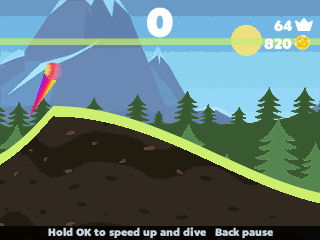

> **Dune is a [NumPlay](../../README.md) game that comes on its own.** It is too big to fit next to NumPlay on the calculator. Get `Dune.nwa` from the [latest release](https://github.com/Mason363/NumPlay/releases/latest).

  

<h1 align="center">Dune</h1>

  <b>Roll down the dunes and fly off the next one, on the NumWorks calculator.</b> 
  The web version of Dune!, with all 26 balls and 7 landscapes of its shop.

  <a href="https://github.com/Mason363/NumPlay/releases/latest/download/Dune.nwa"><b>Download Dune.nwa</b></a>
  &nbsp;·&nbsp; <a href="#controls">Controls</a>

  

## Highlights

* **The ride:** hold to roll faster down a dune, let go to fly off the top of the next, and hold in the air to dive. The ball moves with the web game's own physics engine and numbers, checked step by step against its code.
* **Endless dunes:** the game's nine dunes, shaped by its own generator and shuffled as you go.
* **Points:** fly over the line for 1 to 3 points, more the faster you climb. Slide fast down a whole dune for a Nice Slide (+1) or, from near its top, a Perfect Slide (+3), each with a burst of speed.
* **Coins:** on the dunes, and in rows, blocks and letters in the sky when you fly over the line.
* **The shop:** all 26 balls, each with its own trail, and all 7 landscapes, from Night Land to Candy Land, at the game's prices.
* **The game's look:** its pictures, its landscapes with their moving layers, and its Bango Pro lettering.
* **Saved as you go:** coins count the moment you grab them. Home saves the run and quits, and the next start picks it up paused. Your best, coins and shop are also copied into `dune_saves.py`, so installing the app again doesn't erase them.

<table>
  <tr>
    <td align="center"> Mountains</td>
    <td align="center"> Over the line in Night Land</td>
  </tr>
  <tr>
    <td align="center"> A Perfect Slide in Mushroom Land</td>
    <td align="center"> Volcano</td>
  </tr>
  <tr>
    <td align="center"> Outer Space</td>
    <td align="center"> Candy Land</td>
  </tr>
  <tr>
    <td align="center"> Ice Mountains</td>
    <td align="center"> The shop's balls</td>
  </tr>
  <tr>
    <td align="center"> The shop's landscapes</td>
    <td align="center"> The title screen</td>
  </tr>
</table>

## How to play

Press **OK** on Play, then hold **OK** to go. Hold it while the ball rolls downhill to speed it up, and let go as it climbs the next dune to fly off the top. In the air, hold **OK** to dive back down. Land on a slope going down to keep your speed: landing hard on a slope going up ends the run.

Fly over the line to score and to fill the sky with coins. Spend the coins in the shop: pick a ball or a landscape with the arrows and press **OK** to buy it or to use it.

## Controls

| Key | What it does |
| --- | --- |
| OK, EXE or Shift | Hold to speed up downhill and to dive in the air; let go to fly |
| Arrows | Move the focus in menus and in the shop |
| OK | Choose, buy, use |
| Back | Pause: Resume, Restart, Shop, How to play, Quit game (it asks first) |
| Home | Save and quit |

## Good to know

* **On its own:** Dune is too big to fit next to NumPlay. Installing it from the NumWorks website swaps out NumPlay and the other apps, and installing NumPlay again swaps it back out.
* **The web version:** the dunes, numbers and shop are those of Dune! as Inlogic Software made it for the web. The phone game's later balls and modes aren't here.
* **Left out:** ads, the sound settings, and music and sound (the calculator has no speaker). The landscapes' candies, planets and mushrooms stand upright instead of at random angles.

## Credits

Inspired by **Dune!** by Team Lava, not affiliated with them. Go play the original: it's free on iOS and Android.

* The pictures (the balls, the landscapes, the coins and the icons), the Bango Pro lettering, the texts and the numbers come from Dune Rider, Inlogic Software's web version of the game (not affiliated with them), read by [tools/data.py](tools/data.py) into [src/art.c](src/art.c).
* The ball moves as in [p2.js](https://github.com/schteppe/p2.js) 0.7.1 by Stefan Hedman (MIT license), the physics engine the web game runs on, written again in C. [tests/oracle.cjs](tests/oracle.cjs) checks every step against the engine itself, reading it from the web build.
* Adapted for the calculator by **Bobydeluxe**.

Made by Mason Chen as part of NumPlay.

## License

The game's code is licensed under the GNU General Public License v3.0: see the `LICENSE` file at the root of the repository. The pictures, the lettering and the texts are their makers' and keep their own terms (see Credits).
