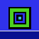
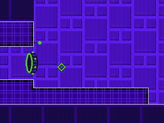
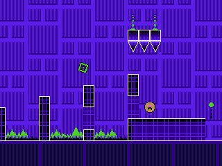
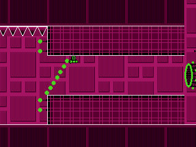
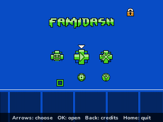
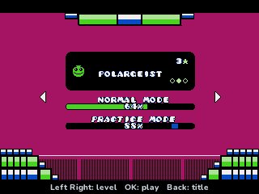
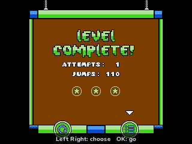
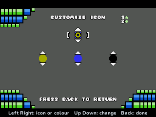

> **Famidash is a [NumPlay](../../README.md) game that comes on its own.** It is too big to fit next to NumPlay on the calculator. Get `Famidash.nwa` from the [latest release](https://github.com/Mason363/NumPlay/releases/latest).

  

<h1 align="center">Famidash</h1>

  <b>TFDSoft's Geometry Dash for the NES, made for the NumWorks calculator.</b> 
  Not an emulator: the game's own code, levels and art, on your calculator.

  <a href="https://github.com/Mason363/NumPlay/releases/latest/download/Famidash.nwa"><b>Download Famidash.nwa</b></a>
  &nbsp;·&nbsp; <a href="#controls">Controls</a>

  

## Highlights

* **Famidash itself:** the game's code, written for the NES, turned into C for the calculator. Jumps, gravity, speeds, orbs and pads use its numbers to the last fraction of a pixel, 60 times a second, as on the NES.
* **All 45 levels of the main game,** in its order: the 27 main levels, from Stereo Madness to The Challenge, and the 18 community levels, from Retray to Water Temple. Each has its three coins, attempts, and two progress bars: normal and practice.
* **Every mode its levels use:** cube, ship, ball, UFO, robot, spider, wave, swing and ninja, and the random portals' pogo, snake and football. Gravity, speed, size and dual portals, teleports, orbs and pads of every colour, dash orbs and the rest.
* **Practice mode:** checkpoints you place, and ones the game places for you, up to eight.
* **Its NES art:** the tiles, the moving background, the sprites and the menus, at their real size. The level is shown 320 pixels wide: the NES's 256 in the middle and a little more of the level on each side.
* **19 icons and three colours** to choose in Customize. Beat the first 13 levels and the **fun settings** open: invisible player, platformer, retro, disco, blind mode, camera seesaw and the gameboy colours.
* **Saved:** your coins, progress, icon, colours and settings. Home saves and quits from anywhere. Your game is also copied into `famidash_saves.py`, so installing the app again doesn't erase it.

<table>
  <tr>
    <td align="center"> Stereo Madness</td>
    <td align="center"> The ship</td>
  </tr>
  <tr>
    <td align="center"> The title screen</td>
    <td align="center"> The level select</td>
  </tr>
  <tr>
    <td align="center"> Level complete</td>
    <td align="center"> Customize</td>
  </tr>
</table>

## How to play

Your icon moves on by itself. Press **OK** to jump over the spikes and reach the end of the level. Hold it and the cube jumps again as soon as it lands.

Portals change everything. In the ship, hold OK to fly up and let go to come down. The ball and the spider flip upside down when you press. The UFO hops in the air. The wave goes up while you hold and down when you let go. Touch a ring (an orb) and press to jump in the air; pads throw you up on their own.

Each level hides three coins. They only count when you finish the level in one go. To learn a hard level, pause and choose **Practice**: the game puts checkpoints down as you play, and you start again from the last one.

## Controls

| Key | What it does |
| --- | --- |
| OK, EXE or Up | Jump, fly, flip (hold where the game holds) |
| Back | Pause (Resume, Practice, Quit game) |
| Down | In practice mode: place a checkpoint |
| ⌫ (backspace) | In practice mode: remove the last checkpoint |
| Left, Right | In the menus: choose. In platformer mode: walk |
| Home | Save and quit |

8, 4, 6, 2 and 5 work as the arrows and OK.

## Good to know

* **On its own:** Famidash is too big to fit next to NumPlay. Installing it from the NumWorks website swaps out NumPlay and the other apps, and installing NumPlay again swaps it back out. Your progress in each one is kept.
* **Quit game** in the pause menu asks first, and takes you back to the level select.
* It is Famidash's main game, "The Original Game". Its B, C, D and E-Sides and the big collections are other versions of Famidash and are not in this app.
* There is no music or sound: the calculator has no speaker. So the sound test, the music settings and the practice music sync are left out.
* Two-player mode is left out: the calculator has one keypad. Levels with two icons (the dual portals) play as in the game, both icons on one button. The debug mode and the hidden cheats are left out too.
* Around the NES's screen the level goes on 32 pixels to each side. Those sides only show the level; what happens still happens on the NES's 256 pixels, as in the game.

## Credits

Made by Mason Chen as part of NumPlay, a port of **[Famidash](https://github.com/tfdsoft/famidash)** by **TFDSoft**. Geometry Dash is by **RobTop Games**. Not affiliated with them.

* From Famidash (MIT License, `LICENSES/MIT-Famidash.txt`): its game code, turned into C; its 45 levels, metatiles and ground; its graphics (the CHR banks: tiles, parallax, sprites, icons, menus); its menu screens and palettes. Read by `tools/data.py`.
* Famidash is made by its core team, Zephyrside (UserSniper), kandowontu, Ficus mcHousePlant, dajinkosa, ElAngel378, SeaGlowingPro and KawaiiDawn, with Aquamarine, vikrinox, adrluc096, Zee_Scott, StudsX, cloud54, RedGD, AnnoyedArt1256, sussysy and Crafty Jumper, and the winners of its icon contest.
* Its levels are named after the songs of ForeverBound, DJVI, Step, Waterflame, Dj-Nate and OcularNebula, as Famidash's credits say. The songs themselves are not in the app.
* The menus' help texts use NumPlay's **Nunito** (SIL Open Font License).

## License

The game's code is licensed under the GNU General Public License v3.0: see the `LICENSE` file at the root of the repository. The parts from Famidash keep their MIT License (`LICENSES/MIT-Famidash.txt`, copyright TFDSoft). Geometry Dash and its levels' names belong to RobTop Games and to the songs' artists. Nunito keeps the SIL Open Font License (`LICENSES/OFL-1.1-Nunito.txt`).
