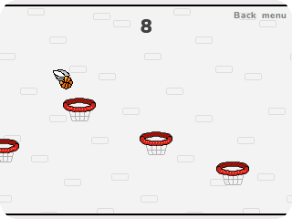
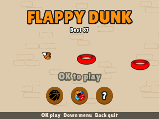
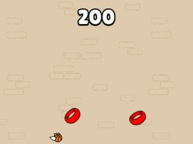
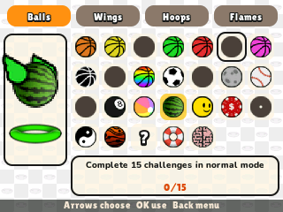
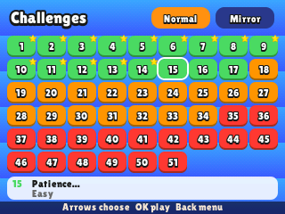
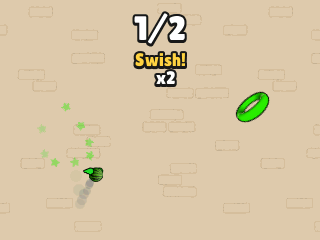
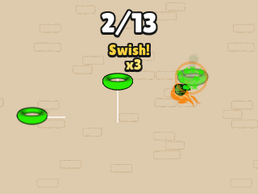

> **Flappy Dunk is a [NumPlay](../../README.md) game that comes on its own.** It is too big to fit next to NumPlay on the calculator. Get `FlappyDunk.nwa` from the [latest release](https://github.com/Mason363/NumPlay/releases/latest).

  

<h1 align="center">Flappy Dunk</h1>

  <b>Flap the winged ball down through every hoop, on the NumWorks calculator.</b> 
  The endless run and all 51 challenges, with the game's balls, wings, hoops and flames.

  <a href="https://github.com/Mason363/NumPlay/releases/latest/download/FlappyDunk.nwa"><b>Download FlappyDunk.nwa</b></a>
  &nbsp;·&nbsp; <a href="#controls">Controls</a>

  

## Highlights

* **The game's own physics:** its gravity, flap, speed, rims that stop the ball dead and the ball rolling on them, 100 steps a second, read from the game's Android build.
* **Endless mode:** hoops 9 apart, tilted, narrower and moving up and down or side to side as the game's own difficulty curves bring them in.
* **All 51 challenges:** every hoop where the game puts it, the mad hoops, the heavy, low and upside down gravity, the swishes only, the narrow and pixelated levels, and the Mirror mode that plays them flipped.
* **Swishes:** no rim touched is a swish, and each swish in a row scores one more. The ball smokes after one and catches fire after two, the hoop throws its stars and bursts.
* **Balls, wings, hoops and flames:** 26 balls, 10 wings, 9 hoops and 6 flames, unlocked with the game's goals, from scoring 20 to the mystery skins.
* **The game's look:** its ball, wings, hoops in their back and front halves with the ball between, flames, stars and brick wall, and its Lilita One lettering.
* **Saved as you go:** best score, goals, skins and challenges. Home saves and quits. It is all copied into `flappydunk_saves.py` too, so installing the app again doesn't erase it, and the first Flappy Dunk's best score and balls carry over.

<table>
  <tr>
    <td align="center"> The title</td>
    <td align="center"> Tilted and moving hoops</td>
  </tr>
  <tr>
    <td align="center"> The skins and their goals</td>
    <td align="center"> The 51 challenges</td>
  </tr>
  <tr>
    <td align="center"> A mad hoop</td>
    <td align="center"> Mirror mode</td>
  </tr>
</table>

## How to play

Press **OK** to flap. Each press beats the wings once and the ball falls in between. Drop it down through every hoop. Missing a hoop, going up through one or touching the floor or the ceiling ends the run.

Going in without touching the rim is a swish. A basket is worth 1, a swish 2, and every swish in a row one more. From the title, **Down** reaches the skins, the challenges and How to play. In a challenge, reach the finish line on its terms.

## Controls

| Key | What it does |
| --- | --- |
| OK, EXE or Up | Flap; in the menus, choose |
| Arrows | Move in the menus |
| Back | Pause (Resume, Main menu, How to play, Quit game), or go back |
| Home | Save and quit |

## Good to know

* **On its own:** Flappy Dunk is too big to fit next to NumPlay. Installing it from the NumWorks website swaps out NumPlay and the other apps, and installing NumPlay again swaps it back out. Your progress in each one is kept.
* **What's left out:** ads and what they give (revives and the skins they unlock), in-app purchases, the cards, ranks, duels and events of later versions, the days-in-a-row goals (the calculator has no calendar), holiday skins, music and sound.
* **Goals:** they say what the game's skins say. The skins played goals count 12, 25 and 35 skins, as the game's own counters do.

## Credits

Inspired by Flappy Dunk by Voodoo (2017), not affiliated with Voodoo. Go play the original.

* The pictures (ball, wings, hoops, flames, stars, brick wall, icons) come from the game's Android build, and its rules, numbers, challenges and goals follow the game's own data and code.
* The lettering is **Lilita One** by Juan Montoreano (SIL Open Font License, see [LICENSES/OFL-1.1-LilitaOne.txt](../../LICENSES/OFL-1.1-LilitaOne.txt)).
* **Bobydeluxe** brought the first Flappy Dunk to NumPlay.

Made by Mason Chen as part of NumPlay.

## License

The game's code is licensed under the GNU General Public License v3.0: see the `LICENSE` file at the root of the repository. The game's pictures keep their own terms (see Credits). Flappy Dunk is a trademark of Voodoo.
