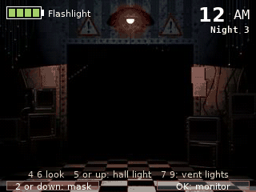
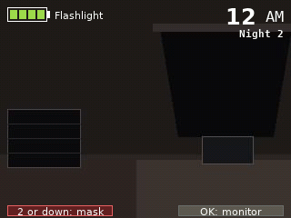

> **Five Nights at Freddy's 2 is a [NumPlay](../../README.md) game that comes on its own.** It is too big to sit next to NumPlay. Get `FiveNightsAtFreddys2.nwa` from the [latest release](https://github.com/Mason363/NumPlay/releases/latest).

  

<h1 align="center">Five Nights at Freddy's 2</h1>

  <b>Survive the night shift at the new Freddy Fazbear's Pizza, on the NumWorks calculator.</b> 
  Nights 1 to 6 and the Custom Night, with the mask, the music box and the flashlight.

  <a href="https://github.com/Mason363/NumPlay/releases/latest/download/FiveNightsAtFreddys2.nwa"><b>Download FiveNightsAtFreddys2.nwa</b></a>
  &nbsp;·&nbsp; <a href="#controls">Controls</a>

  

## Highlights

* **The whole game:** nights 1 to 5, the 6th once the 5th is beaten, then the Custom Night with its ten animatronics and its ten modes, from 20/20/20/20 to Golden Freddy. The paycheck, the overtime check and the pink slip, and the stars on the title screen.
* **The office as you know it:** no doors, a hallway in front and a vent on each side. Look left and right, light the hallway with the flashlight and the vents with their lights, and put on the Freddy mask.
* **The twelve cameras,** the four party rooms and the two vents dark but for the camera's light, and the music box on CAM 11 to wind.
* **Everyone, as the game moves them:** the Toys, the Withereds, Mangle, Balloon Boy, the Puppet and Golden Freddy, with the AI levels each night sets at its hours and the game's caps. A movement opportunity every 5 seconds, each on its own path through the building to the hallway or a vent.
* **The mask, the light and the box:** whoever waits in the hallway or a vent comes in while the monitor is up, and is in the office when it comes down: the mask at once, or they get you. Mangle stays on the ceiling, Balloon Boy takes your lights, Withered Foxy only leaves for the flashlight, and the Puppet comes for anyone who lets the music box run down.
* **What the game makes you hear, written down:** the vents banging, Balloon Boy's voice, Mangle's radio static, the music box's tune.
* **Saved like in the game:** the night you reached, your stars and your last Custom Night. Home keeps the night as it is, and the next start puts you back in it, paused. Your saves are also copied into `fnaf2_saves.py`, so installing the app again doesn't erase them.

  

## How to play

New Game shows the newspaper and, the first time, which key does what. Then it is 12 AM and your shift starts. You have to last until 6 AM: an hour is a little over a minute.

Keep the music box on CAM 11 wound, or the Puppet comes, and nothing stops it. The others come down the hallway or through the vents: light them, and when someone is there, put the mask on and wait for them to leave. Someone in the office when the monitor comes down? The mask, right away. Flash the hallway now and then: Withered Foxy waits there, and the mask doesn't fool him. The flashlight's battery doesn't come back during the night.

Back pauses: from there you can go on, read how to play again, or quit the night.

## Controls

| Key | What it does |
| --- | --- |
| ← → or 4 6 | Look left and right |
| 5 or ↑, held | The flashlight, down the hallway |
| 7 or 1, held | The left vent light |
| 9 or 3, held | The right vent light |
| 2 or ↓ | The Freddy mask on and off |
| OK or EXE | The monitor up and down (↓ also puts it down) |
| 0 to 9 | On the monitor: that camera (0 is CAM 10); 1 again for CAM 11, then 12 |
| ← → | On the monitor: the previous and next camera |
| ↑, held | On the monitor: the camera's light; on CAM 11, wind the music box |
| Back | Pause |
| Home | Keep the night and quit |

The vent keys turn you to that side first if you're looking the other way. On the title and the Custom Night, the arrows choose and OK starts.

## Good to know

* **One app at a time:** Five Nights at Freddy's 2 can't share the calculator's room for apps with NumPlay. Install it on its own; your saves in each one are kept.
* **No sound:** the calculator has no speaker. What you would hear is written at the bottom left: the vents banging when someone crawls in or out, Balloon Boy's voice, Mangle's radio static, the music box's tune when the Puppet is out. The music box's warning sign is the game's.
* **No calls:** each of the game's calls runs a minute or two. The night's card gives a short tip instead.
* **Left out:** the minigames after a death and between nights, Shadow Freddy, Shadow Bonnie, the Endo, JJ and the prizes the Custom Night puts on the desk. None of them are part of surviving a night.
* **A few numbers are the port's own,** where nobody has read them out of the game yet: the music box winds full in about 6 seconds, you get a second to put the mask on, a fooled visitor stays 4 seconds, Mangle in the office attacks 1 time in 3 the monitor comes down, and Withered Foxy leaves after 5 flashes.
* **The pictures are the game's,** at 240 pixels high: the office turns a little further, as the screen is 4:3.

## Credits

Inspired by Five Nights at Freddy's 2 by Scott Cawthon, not affiliated with him.

* The pictures come from the game, as VocalNutria9174's fan port [fnaf-2_html5](https://github.com/VocalNutria9174/fnaf-2_html5) keeps them. `tools/fetch.py` gets it, `tools/pack.py` makes them into `src/data.bin`.
* How the animatronics move, their AI levels, the music box, the flashlight and Withered Foxy follow what the game's players read out of its events, as the [Technical FNaF Wiki](https://technicalfnaf.fandom.com) and the [Five Nights at Freddy's Wiki](https://freddy-fazbears-pizza.fandom.com) write them down.
* The words are drawn in the DejaVu fonts ([license](../../LICENSES/DejaVu.txt)), and the paychecks with them.

Made by Mason Chen as part of NumPlay.

## License

The game's code is licensed under the GNU General Public License v3.0: see the `LICENSE` file at the root of the repository. The game's pictures keep their own terms (see Credits).

Build: `make` (needs `arm-none-eabi-gcc` and Node.js for nwlink), `make test` on a computer.
