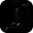
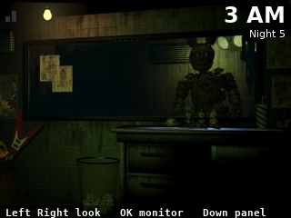
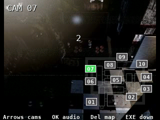
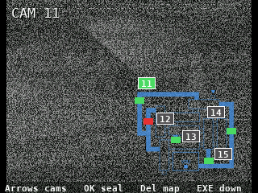
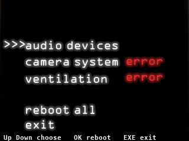

> **Five Nights at Freddy's 3 is a [NumPlay](../../README.md) game that comes on its own.** It is too big to sit next to NumPlay. Get `FiveNightsAtFreddys3.nwa` from the [latest release](https://github.com/Mason363/NumPlay/releases/latest).

  

<h1 align="center">Five Nights at Freddy's 3</h1>

  <b>Survive the night shift at Fazbear's Fright, on the NumWorks calculator.</b> 
  Nights 1 to 5 and the 6th night, with Springtrap, the phantoms, the audio lure, the vents and the maintenance panel.

  <a href="https://github.com/Mason363/NumPlay/releases/latest/download/FiveNightsAtFreddys3.nwa"><b>Download FiveNightsAtFreddys3.nwa</b></a>
  &nbsp;·&nbsp; <a href="#controls">Controls</a>

## Highlights

* **The game's own night:** Springtrap, the phantoms and the three systems run as the game's own events run them, read out of its Android package: his rooms and his moves, when he waits for you to look at a screen, the lure that fails 1 time in 7, the wear on each system and the reboot times.
* **Springtrap** walks the attraction's ten cameras and its five vents. He looks in through the window, runs past it, hides by the door and peeks around it. Lure him away with BB's laugh, and seal the vent he's in.
* **The maintenance panel:** the audio, the cameras and the ventilation wear out. Reboot one or all. With the ventilation down the office flashes red, the cameras show him where he isn't, and the dark comes in waves.
* **The phantoms:** BB, Mangle, Chica, Phantom Freddy, the Puppet and Foxy, when and where the game brings them, each once a night.
* **Nights 1 to 5, then the 6th:** the 6th night and the Extras open once the game is beaten, a star for each ending.
* **Saved like in the game:** the night you reached and your stars. Home keeps the night as it is, and the next start puts you back in it, paused. Your saves are also copied into `fnaf3_saves.py`, so installing the app again doesn't erase them.

<table>
  <tr>
    <td align="center"> Springtrap at the window</td>
    <td align="center"> The cameras</td>
  </tr>
  <tr>
    <td align="center"> The vents</td>
    <td align="center"> The maintenance panel</td>
  </tr>
</table>

## How to play

New Game starts the first night. Last from 12 to 6 AM: an hour is half a minute on the first night, a minute after that.

Springtrap comes closer room by room. Find him on the cameras, then play the audio on a camera next to his: he follows the sound. On the vent map, seal the vent he crawls into, and he turns back. Watch the maintenance panel: when a system errors, reboot it. Looking away from every screen too long wears the ventilation down.

The phantoms don't kill you, but their scare brings the ventilation down and Springtrap closer. Look away from a phantom on a camera before it jumps out.

## Controls

| Key | What it does |
| --- | --- |
| ← → or 4 6 | Look left and right |
| OK, EXE or ↑ | The monitor up (looking right first) |
| ↓ | The maintenance panel up (looking left first) |
| Arrows or 0 to 9 | On the monitor: a camera (0 is CAM 10; 1 to 5 on the vent map are CAM 11 to 15) |
| OK | On the monitor: play the audio, or seal the vent on the vent map |
| Backspace | On the monitor: the camera map or the vent map |
| EXE | The monitor down, the panel's Exit |
| ↑ ↓, OK | On the panel: a system, reboot it |
| Back | Pause |
| Home | Keep the night and quit |

## Good to know

* **One app at a time:** Five Nights at Freddy's 3 can't share the calculator's room for apps with NumPlay. Install it on its own; your saves in each one are kept.
* **No sound:** the calculator has no speaker. What you would hear is written at the bottom left: the footsteps, the vents, BB's laugh, the alarm. Springtrap's hum, louder the closer he is, is the two bars at the top left.
* **Left out:** the phone calls and the 8-bit minigames between nights, with the good ending they lead to. The cheats in Extras open with the good ending, so they stay shut.
* **The pictures are the game's,** at half size: the screen shows 640 of its 800 pixels around where the game looks.

## Credits

Inspired by Five Nights at Freddy's 3 by Scott Cawthon, not affiliated with him.

* The pictures and the rules come from the game's Android package (its Clickteam application): `tools/ccn.py` reads its pictures and objects, and `tools/pack.py` places them as the game places them and makes them into `src/data.bin`. The night follows the game's own events, read out of the same file.
* The words are drawn in the DejaVu fonts ([license](../../LICENSES/DejaVu.txt)).

Made by Mason Chen as part of NumPlay.

## License

The game's code is licensed under the GNU General Public License v3.0: see the `LICENSE` file at the root of the repository. The game's pictures keep their own terms (see Credits).

Build: `make` (needs `arm-none-eabi-gcc` and Node.js for nwlink), `make test` on a computer.
