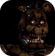
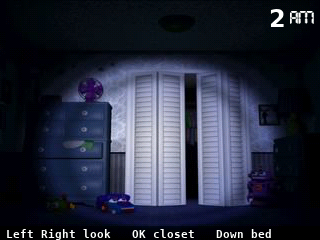
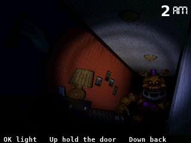
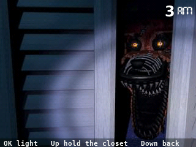
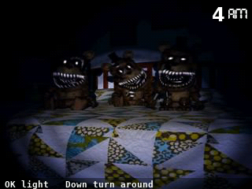

  

<h1 align="center">Five Nights at Freddy's 4</h1>

  <b>Survive the nights in the bedroom, on the NumWorks calculator.</b> 
  Nights 1 to 6, the Nightmare and 20/20/20/20, Fun with Plushtrap and the box.

  <a href="https://github.com/Mason363/NumPlay/releases/latest/download/FiveNightsAtFreddys4.nwa"><b>Download FiveNightsAtFreddys4.nwa</b></a>
  &nbsp;·&nbsp; <a href="#controls">Controls</a>

## Highlights

* **The game's own nights:** Nightmare Bonnie, Chica, Foxy, the Freddles, Fredbear and Nightmare move as the game's own events move them, read out of its iOS package, with each night's AI.
* **Two doors, the closet, the bed.** Listen at a door before the light, hold it shut on breathing, shut the closet on Foxy, light the Freddles off the bed.
* **Fun with Plushtrap** after each of the first five nights: stop him on the X and the next night starts at 2 AM.
* **Extras** once the 5th night is beaten: the animatronics, the making of Foxy and Fredbear, the jumpscares, Plushtrap, the Nightmare and 20/20/20/20. Then the ending and the box.

<table>
  <tr>
    <td align="center"> The bedroom</td>
    <td align="center"> A door</td>
  </tr>
  <tr>
    <td align="center"> The closet</td>
    <td align="center"> The bed</td>
  </tr>
</table>

## How to play

Last from 12 to 6 AM, a minute an hour.

At a door, listen first with the light off. Breathing means someone stands right there: hold the door shut until the steps go. No breathing, light the hall to send away whoever is down it. Foxy runs into the closet when your back is turned: light it, and hold its door shut while he is out. Turn to the bed and light it often, or the Freddles pile up. Fredbear comes up a hall: hold that door shut, or chase him off the bed with the light and out of the closet with its door.

## Controls

| Key | What it does |
| --- | --- |
| ← → | Look left and right, at a door |
| OK | Run to the door you face, or the closet |
| ↓ | Turn to the bed, run back, turn around |
| OK held | The flashlight |
| ↑ held | Hold the door or the closet shut |
| Back | Pause |
| Home | Keep the night and quit |

## Good to know

* **Too big to install next to NumPlay.** Your saves in each are kept.
* **No sound:** the calculator has no speaker. What you would hear is written at the bottom left: breathing at a door, steps on either side, Foxy running, the kitchen, laughing.
* **The pictures are the game's,** at half size: the screen shows 640 of its 800 pixels.

## Credits

Inspired by Five Nights at Freddy's 4 by Scott Cawthon, not affiliated with him.

* The pictures and the rules come from the game's iOS package (its Clickteam application): `tools/ccn.py` reads its pictures and objects, and `tools/pack.py` makes them into `src/data.bin`. The nights follow the game's own events, read out of the same file.
* The words are drawn in the DejaVu fonts ([license](../../LICENSES/DejaVu.txt)).

Made by Mason Chen as part of NumPlay.

## License

The game's code is licensed under the GNU General Public License v3.0: see the `LICENSE` file at the root of the repository. The game's pictures keep their own terms (see Credits).

Build: `make` (needs `arm-none-eabi-gcc` and Node.js for nwlink), `make test` on a computer.
