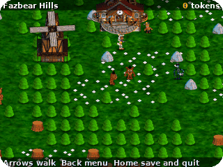
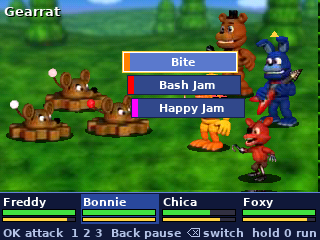
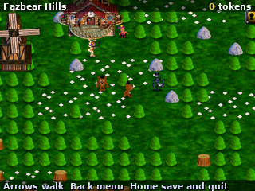
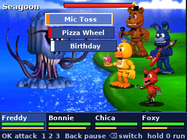
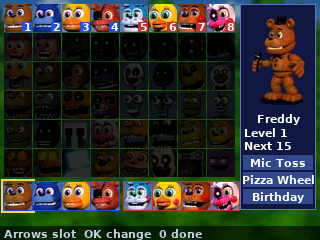

  

<h1 align="center">FNAF World</h1>

  <b>The FNAF World adventure, on the NumWorks calculator.</b> 
  Walk the world, battle with a party of eight, find chips, buy bytes, beat the bosses.

  <a href="https://github.com/Mason363/NumPlay/releases/latest/download/FiveNightsAtFreddysWorld.nwa"><b>Download FiveNightsAtFreddysWorld.nwa</b></a>
  &nbsp;·&nbsp; <a href="#controls">Controls</a>

  

## Highlights

* **The whole overworld:** Fazbear Hills, Choppy's Woods, Dusting Fields, Lilygear Lake, Mysterious Mine, Blacktomb Yard, Deep-Metal Mine, Pinwheel Circus, Pinwheel Funhouse and the Geist Lair, with their chests, switches, keys, mines and jumps.
* **The game's battles:** a party of eight in two rows, charges, the 48 characters with their 60 attacks, the enemies of each area with their specials, exp, levels and Faz Tokens, read from the game's own events.
* **Challengers** after a battle: beat them to make them yours.
* **Chips and bytes:** 21 chips from the chests, 21 bytes from Lolbit's shops, armor from Mendo.
* **The bosses** on the map, from Auto Chipper to Chipper's Revenge, and the endings.

<table>
  <tr>
    <td align="center"> A battle</td>
    <td align="center"> Fazbear Hills</td>
  </tr>
  <tr>
    <td align="center"> A boss</td>
    <td align="center"> The party</td>
  </tr>
</table>

## How to play

Pick a file, then Adventure (find new characters as you play) or Fixed Party, and Normal or Hard. Choose your eight.

Walk the world: enemies jump you now and then. In a battle each of your four fills its charge; when one is full its three attacks show, pick one. Some attacks hit, some heal or help the party. The other four come in with the backspace key. Win for exp, levels and Faz Tokens. A challenger may follow a battle: beat it and it joins you.

Chests hold chips; wear four from the menu. Lolbit sells bytes, helpers that fight with you; Mendo sells armor. Switches open new ways and the jumps between areas. In Normal the road ends at the end of the Pinwheel Funhouse; in Hard it goes on to the last boss.

## Controls

| Key | What it does |
| --- | --- |
| Arrows | Walk, pick |
| OK or EXE | Attack, choose |
| 1 2 3 | An attack straight away |
| Backspace | Switch the party's rows in a battle |
| 0 held | Run from a battle |
| Back | Menu: party, chips, bytes, jump, save, how to play |
| Home | Save and quit |

## Good to know

* **Needs 6 MB apps** (Enlarged Extra Apps with Nwagra, which doesn't work on Epsilon 26): the game is 4.9 MB. It comes on its own, not inside NumPlay. Your files are kept in each.
* **No sound:** the calculator has no speaker.
* **The pictures are the game's,** at 0.4 of their size: the battle is the game's 800 x 480 screen, the map at the same scale.
* **Not in this version:** Halloween Land and its minigames (the portal there leads straight to the Geist Lair, once Security is beaten), the fishing spot, the hidden dungeons under the map, the clock, Fredbear's hints and the cutscenes.

## Credits

Inspired by FNAF World by Scott Cawthon, not affiliated with him.

* The pictures, the map and the rules come from the game's Windows release (its Clickteam application): `tools/ccn.py` reads its pictures and objects, `tools/world.py` its map and `tools/pack.py` makes them into `src/data.bin`. The battles follow the game's own events, read out of the same file.
* The words are drawn in the DejaVu fonts ([license](../../LICENSES/DejaVu.txt)).

Made by Mason Chen as part of NumPlay.

## License

The game's code is licensed under the GNU General Public License v3.0: see the `LICENSE` file at the root of the repository. The game's pictures keep their own terms (see Credits).

Build: `make` (needs `arm-none-eabi-gcc` and Node.js for nwlink), `make test` on a computer.
