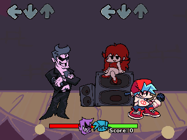

> **Friday Night Funkin' is a [NumPlay](../../README.md) game that comes on its own.** It is too big to fit next to NumPlay on the calculator. Get `FridayNightFunkin.nwa` from the [latest release](https://github.com/Mason363/NumPlay/releases/latest).

  

<h1 align="center">Friday Night Funkin'</h1>

  <b>Win the rap battles, note by note, on the NumWorks calculator.</b> 
  Every week of the game, from the Tutorial to Weekend 1, with its charts, characters and stages.

  <a href="https://github.com/Mason363/NumPlay/releases/latest/download/FridayNightFunkin.nwa"><b>Download FridayNightFunkin.nwa</b></a>
  &nbsp;·&nbsp; <a href="#controls">Controls</a>

  

## Highlights

* **Every song and chart:** the Tutorial, Weeks 1 to 7, Weekend 1 and LE SSERAFIM: 27 songs with their Erect and Pico remixes, 166 charts with every note, at the game's own timing.
* **Story mode and freeplay:** a week's songs one after the other, for the week's score, or any song at any difficulty, from Boyfriend's songs or Pico's.
* **The game's own scoring:** points for how close each hit is, Sick, Good, Bad and Shit, the health bar, combos, long notes, misses, and the ranks from Loss to Perfect.
* **The beat, without the music:** the characters bop and sing, the camera and the health icons bump on the beat, and Ready, Set, Go counts you in.
* **The game's look:** its own characters, stages, notes, ratings and letters, with Week 6 in pixels.
* **Saved as you go:** Home saves and quits. Your scores are also copied into `fnf_saves.py`, so installing the app again doesn't erase them.

<table>
  <tr>
    <td align="center"> Week 1: Daddy Dearest</td>
    <td align="center"> Week 6, in pixels</td>
  </tr>
  <tr>
    <td align="center"> Week 5: the mall at Christmas</td>
    <td align="center"> Week 7: Tankman</td>
  </tr>
  <tr>
    <td align="center"> Pico's remixes, in freeplay</td>
    <td align="center"> Freeplay: your best score and rank</td>
  </tr>
  <tr>
    <td align="center"> Story mode, week by week</td>
    <td align="center"> The results</td>
  </tr>
  <tr>
    <td align="center"> The pause menu</td>
    <td align="center"> The title screen</td>
  </tr>
</table>

## How to play

The notes scroll up to the arrows at the top of the screen. Press each note's key as it reaches its arrow: **Left**, **Down**, **Up** or **Right**, or **7**, **8**, **(** and **)**. Keep the key down to the end of a long note. The closer to the beat, the better: Sick, Good, Bad or Shit, and Sick and Good keep your combo going.

A missed note, or a key pressed with no note to hit, costs health: when the green side of the bar runs out, it's game over. The singer on the left sings first, then it's your turn: watch them, and the characters bopping, to keep the beat.

## Controls

| Key | What it does |
| --- | --- |
| Left, Down, Up, Right | Hit the notes (7, 8, ( and ) too) |
| Up and Down | Choose a week or a song |
| Left and Right | Choose the difficulty |
| shift | In freeplay, Boyfriend's songs or Pico's |
| OK | Choose |
| Back | Pause (Resume, Restart song, Exit to menu, Options, How to play, Quit game) |
| Home | Save and quit |

## Good to know

* **On its own:** Friday Night Funkin' is too big to fit next to NumPlay. Installing it from the NumWorks website swaps out NumPlay and the other apps, and installing NumPlay again swaps it back out.
* **Without sound:** the calculator has no speaker. The notes still come at the songs' exact times, and the countdown, the characters and the camera keep the beat. If your hits come out early or late, change the note offset in Options.
* **Made to fit:** the camera shows the whole stage instead of following the singer, the stages are still pictures, the characters have fewer frames, and the cutscenes, the dialogue and the freeplay DJ are left out.

## Credits

Inspired by [Friday Night Funkin'](https://github.com/FunkinCrew/Funkin) by the Funkin' Crew (ninjamuffin99, PhantomArcade, evilsk8r and Kawai Sprite), not affiliated with them. Go play the original: it's free on itch.io and Newgrounds, with the music.

* The charts, characters, stages, notes, ratings and letters come from the game's own files ([funkin.assets](https://github.com/FunkinCrew/funkin.assets)), which keep the Funkin' Crew's terms: they are not in this repository, and are fetched when the game is built. The rules and numbers follow the game's own code, under the Apache License 2.0.
* The calculator adaptation is by **Bobydeluxe**, who brought it to NumPlay.
* The text uses NumPlay's **Nunito** font (SIL Open Font License).

Made by Mason Chen as part of NumPlay.

## License

The game's code is licensed under the GNU General Public License v3.0: see the `LICENSE` file at the root of the repository. The game's charts and pictures keep the Funkin' Crew's own terms (see Credits). "Friday Night Funkin'" is a trademark of The Funkin' Crew Inc.
