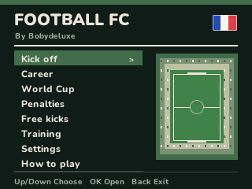
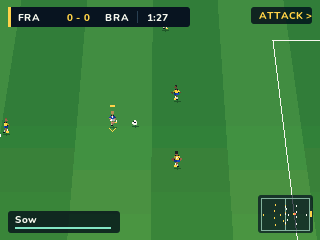
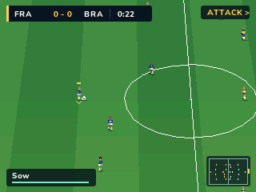
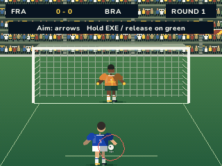
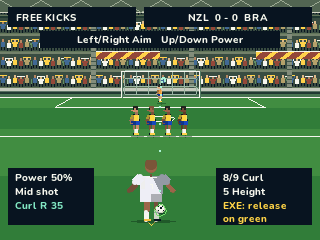
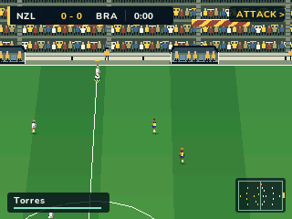

# Football FC for NumWorks

An English-language native football game for the N0110, N0115 and N0120.
Inspired by the public screenshots and description of
[Élite Foot 26 on Calcade / W Production](https://jeux.w-production.fr/#/jeu/elitefoot26).






## Play

Install **FootballFC.nwa** through the NumWorks external-app installer.

| Key | Action |
| --- | --- |
| Arrows | Move the selected player |
| XNT | Sprint while stamina remains |
| Hold OK, then release | Directional ground pass; power controls speed and target range |
| Hold 8, then release | Through ball into a teammate's run |
| Hold 9, then release | Lobbed pass or cross |
| Hold EXE or Shift, then release | Charge and shoot |
| ALPHA + EXE | Finesse shot |
| Up / Down while shooting | Aim towards the goal's corners |
| ALPHA | Close control and shielding; without possession, jockey |
| OK against an opponent in possession | Time a standing tackle |
| 5 | Ask another teammate to press |
| 6 | Cycle Balanced, Possession, Counter attack and High press |
| 7 | Switch defender; possession keeps control of the carrier |
| Back | Pause, return or cancel |
| Home / Power | Save the profile and exit safely |

The player with the gold marker is under your control. The compact ATTACK arrow
and gold minimap edge show the direction of attack. The ends change at half time.
Teammates and opponents move, pass, tackle and defend automatically. Goalkeepers
position, dive, catch or parry automatically; you control distribution when your
keeper gains possession. An intended pass receiver runs to a
reachable interception, even while a direction is held. Arrows adjust the
reception point; holding XNT or ALPHA gives full manual movement. OK on a free
ball no longer triggers a tackle that blocks its reception.
The camera follows the ball with velocity anticipation,
and player/ball positions are interpolated between simulation ticks.

Matches use an elevated **sideline camera**, with goals on the left and right.
Right moves right along the pitch; Up moves towards its far side. The camera
keeps its orientation after half time, when your attack changes from right to
left. Pitch markings, depth ordering, the minimap and the attack indicator all
use that same view. Front-on penalty shootouts keep Left / Right aiming.

## Stadium, shootouts and controls

The interface uses a dark list layout: charcoal, ivory text, ruled
lists and restrained green selections. The home slogans and floating kit panel
are removed. How to play has eight short pages covering movement, passes, shooting,
defending, penalties, match rules, free kicks and discipline; Left/Right changes
page and Back returns.
The static home redraws only when needed, and purchase notices clear on leaving
that menu.

The pitch is now **110 x 74 m**, with a slightly larger arcade goal opening:
**8.125 m wide and 2.656 m high**. The closer elevated sideline view tracks the
ball along both pitch axes and leaves room ahead of the carrier. Player size is
based on a 1.75 m world height: about 16 pixels in the centre of the view, with
the centre circle spanning about 168 pixels horizontally. Both goal rendering and
collision detection use the same dimensions. Stands include individual small
supporters, raised scarves, stairways, railings and a supported roof. Seats follow
the far touchline and pan with the pitch. The match uses original recolourable
pixel sprites: five player orientations, idle/four running contacts/kick, crowd
tiles and a rotating ball. Dugouts with substitutes, high-visibility stewards,
camera operators and tier banners add detail around the touchline. The larger
shootout figures keep articulated animation.
See the [asset sheets and generator](assets/README.md).

Shootouts use an animated run-up and strike, a power-dependent parabolic ball
flight, a keeper who moves and commits to a dive, a landing/recovery phase, and
separate goal, save, post and miss outcomes. The ball continues into the net,
out of play or back from a save/post. The kick tally preserves goal/miss order.

- Attacking: Left/Right aims across goal, Up/Down chooses height; hold EXE and
  release when the ring around the ball turns green, or tap OK for standard
  power. Green improves accuracy; orange adds dispersion, and red sends the
  ball wide or above the goal. Excessive power
  still risks going high. Good timing does not guarantee beating the keeper.
- Defending: Left/Right moves the keeper and chooses the dive side, Up/Down sets
  glove height, and OK readies the opponent. A direction may still be committed
  during the run-up. The opponent's aiming cursor is hidden.

Opponents now have lower running speeds, longer decision intervals and less
automatic tackles. The opposing keeper reacts later, dives more slowly and has
less catching reach. Three difficulty levels remain available. A kickoff fix
also keeps opponents outside the required clearance after the half-field reset.
These changes aim to improve accessibility; scripted tests do not measure human
match difficulty.



## Feints, fouls and free kicks

A sharp direction change while carrying the ball can wrong-foot nearby opponents.
Their chance of committing depends on difficulty, skill and fatigue; they carry
on along the old movement briefly before reacting. It is neither automatic nor
repeatable every tick. Opponents also use delayed position reads, variable decision
intervals and imperfect passes, especially under pressure or with low stamina.

Late tackles and fast rear collisions can cause fouls. Careless contacts need not
produce a card; reckless contact earns yellow, a second yellow sends the player
off, and dangerous high-impact contact can earn a direct red. Removed players no
longer appear, intercept, mark, receive passes or take restarts. A replacement
keeper is designated if needed. Fewer than seven active players ends the match.
Cards last for this match; there are no cross-match bans.

A foul in the penalty area uses the animated penalty view for **one kick**, then
returns to the match with its actual score or a rebound/goal kick. Other fouls
give a free kick. Nearby shooting free kicks have a three/four-player wall at
roughly 9.15 m; the wall jumps and physically blocks reachable shots.

| Free-kick key | Action |
| --- | --- |
| Up / Down | Set power |
| Left / Right | Aim across goal |
| 8 / 9 | Add left / right curl |
| 7 | Reset curl |
| 5 | Cycle low / middle / high trajectory |
| Hold EXE, then release | Strike; release on the green ring for more accuracy |
| OK | Short pass in a match; quick shot in free-kick practice |
| 6 in practice | Choose another position |

Free kicks now use a third-person view behind the taker, also in normal matches.
The camera aims towards the centre of goal from either wing and either half.
The dots preview the chosen arc and curl; the real ball uses spin and gravity.
The preview represents a clean strike, so mistimed shots can deviate. Opponents
automatically take their own kicks. Throw-ins, corners and goal kicks remain.




## Tactics and training

Teammates offer a holding midfielder behind the ball, short diagonal support,
wide outlets and staggered forward runs. The three formations preserve their
different defender/midfielder roles. Defenders divide marking duties between
nearby threats. A single player engages the ball; other players keep their
shape. The selected defender can request a second presser with 5. Opponents
use a style based on their team ratings and adapt late in the match: chase an
equaliser with pressure, or protect a lead with a deeper counter-attacking shape.
Passing decisions have more deliberate timing, and wide players avoid low-angle
shots from excessive distance. Pressing carries a stamina cost.

Four approaches are available with **6**, or **Left / Right in the pause menu**:
Balanced, Possession (closer support and patient circulation), Counter attack
(deeper defending and forward runs), and High press (a higher defensive shape).
The compact strategy reminder appears briefly on a change.

**Training** adds three 60-second sessions using the same engine and controls:

- **Finishing:** score six goals against the keeper from varied starting spots.
- **Pass & move:** complete ten passes to the player marked in cyan.
- **Slalom:** retain possession while reaching six gates in order.

Finishing automatically resets saved or missed attempts, including parries that
settle away from the keeper. A session ends when its target is reached or time
runs out, with retry and home
choices. Sessions do not award credits or alter career, cup or win statistics.
Back still pauses and safely offers leaving a session.

**Settings > Stadium** selects Daylight, Sunset or Floodlights. The venue choice
is saved; existing v4 profiles load with daylight. Players have varied skin and
hair colours, directional faces, neutral standing poses, visible kicks and
keeper dives. Airborne balls have a subtle height guide.

Fixes include both teams starting in their own half, swept saves happening
before goal awards, outfield players no longer hiding a reachable goalkeeper
from an airborne ball, and keepers only using their aerial hand-catching reach
inside their own box. Players receive some stamina back at half time. Saves
remain 256 bytes and the existing Python-script restoration works as before.

## Rendering

Native antialiased text stays readable at 320 x 240. The score, player stamina
and radar use compact overlays; charging and restarts show contextual prompts.
The full-width bottom controls banner is gone. Open Back > How to play for the
controls. Shaded mowing bands, sparse grass grain, corner flags, perspective
nets and ground shadows are drawn using the same 10 KiB strip buffer.

## Match engine

The match engine now uses individual ground touches rather than attaching the
ball to a fixed offset. Sprint accelerates progressively and pushes the ball
farther out of reach; ALPHA slows the player for tight control. Turns have
momentum, and receiving a hard pass needs a short first touch.

Pass targeting respects all directions, including backwards. It considers
passing lanes, power, receiver movement and offside. Through balls lead into
space; lobs clear nearby defenders. The direction held while charging is
remembered if you release the arrows and action button together. The intended
receiver is marked in cyan. Receiving assistance guides that player towards
the pass. A larger receiving window and immediate first touch make control
more forgiving. XNT or ALPHA gives full manual movement instead; defenders can
still intercept a pass on its actual path.

Shots respond to aim, power, pressure and player quality. Finesse shots trade
speed for a curved placed finish. Keeper reactions and the reach of a dive are
bounded, with recovery and parries rather than automatic possession on every
hard shot. Well-positioned tackles can win the ball cleanly; tackles from behind
can give away a foul. The AI presses with a designated player, tracks runners,
offers supporting triangles and times forward runs around the offside line.

The existing competition modes and 256-byte profile format are unchanged.
This is an original calculator interpretation inspired by familiar football-game
mechanics, including [EA's passing guide](https://help.ea.com/en/articles/ea-sports-fc/how-to-pass/)
and [gameplay fundamentals](https://www.ea.com/games/ea-sports-fc/fc-26/news/pitch-notes-fc26-gameplay-deep-dive).
It does not use or reproduce EA's engine or simulation parameters.

Free kicks use Left/Right aiming and Up/Down power from behind the taker.
Match penalties use the animated penalty view. Throw-ins, corners and goal kicks
retain Up/Down aiming and Left/Right power. Some idle match restarts are taken
automatically; free-kick practice lets you aim for as long as you like.

In penalty shootouts, aim across goal with Left/Right and set height with
Up/Down; charge with EXE and release, or tap OK for a standard-power shot. When
defending, choose the keeper position/dive and glove height before the kick.
OK readies the opponent's shot. After five attempts
each, tied shootouts continue with sudden death; early clinches also end them.

## Modes

- **Kick off:** choose from 32 national sides, three difficulty settings and
  matches with two, four or six minutes of active playing time.
- **Career:** an eight-team league with seven fixtures each season. Match
  income funds training, replacement players and four coach upgrades. Renew
  each player's contract for three, five or seven games; an expired contract
  reduces that player's contribution. Wins can also improve player quality.
  The squad, contracts, table, wallet and season are saved. EXE on the career
  dashboard offers a new career with confirmation.
- **World Cup:** 32 teams in eight seeded groups, followed by a round of 16,
  quarter-finals, semi-finals and final. Group standings and the next knockout
  fixtures are shown. Tied knockout matches use penalties. Other fixtures are
  simulated from team strengths. Progress is saved after each match; EXE offers
  a new competition with confirmation.
- **Penalties:** a standalone shootout between your chosen sides.
- **Free kicks:** unlimited shots against a wall and keeper from varied positions.
  Goals/attempts stay within the session. A new kick appears after each result;
  OK advances immediately and 6 selects another position. This mode awards no
  career credits or competition progress.

Settings also provide 4-3-3, 4-4-2 and 3-4-3 formations and an alternate kit.
Contrasting kits are selected for opponents when colors are similar.

This is an arcade interpretation. It includes swept goal detection, passing,
charged shots, ball height, body separation, tackles, fouls, offside involvement,
throw-ins, corners, free kicks, penalties and goal kicks. It does not claim to
implement every professional football regulation. There are no card suspensions,
substitutions, licensed player rosters or extra-time periods. Drawn knockout
matches go directly to penalties. Player surnames and ratings are fictional.

## Saves

`footballfc.sav` holds a 256-byte, versioned, CRC-checked profile.
`footballfc_save.py` is an inert comment containing its hex backup; the NumWorks
installer keeps Python scripts, allowing progress to return after reinstallation.
Keep this script to retain your career. No code in it is executed.

Settings, finished matches and purchases are saved. A match in progress is not
resumed after exiting; leaving it does not advance the career or competition.
If storage is full, the game offers retry, return, or an explicit exit without
saving. Other calculator files are preserved. A full calculator reset removes
all files, including the backup script.

## Build and verify

Requirements: ARM GCC with newlib, nwlink 1.0.0, Python 3 with pyelftools, Pillow
and Unicorn. A C compiler runs host tests.

```sh
make -C games/footballfc build NWLINK=nwlink
make -C games/footballfc test
make -C games/footballfc test-arm NWLINK=nwlink
```

`TOOLCHAIN`, `PYTHON`, `NWLINK` and `HOST_CC` may be supplied to make.
The standalone output is `games/footballfc/output/FootballFC.nwa`.
Football FC is a separate download in NumPlay's big-game section, outside the default launcher and customizer kit. From the repository root, `make build/data/apps/FootballFC.nwa` or `python tools/build.py --game footballfc` builds it.

The simulation runs at fixed 40 Hz. Rendering targets 30 FPS on N0120 and
25 FPS on the earlier models. These are scheduling targets, not measurements
of a physical LCD. The renderer uses NumPlay's antialiased fonts and a 10 KiB
strip buffer. The pitch, large shootout figures, badges and goals use procedural
drawing. The player, supporter, ball and scenery art totals 8,240 bytes of packed
read-only materials; it is recoloured and rendered directly from flash. There
is no decoded atlas, full-screen framebuffer, runtime download, audio or heap.

See the [v9 changes and checks](docs/gameplay-v9.md), [gameplay audit](docs/gameplay-audit-v7.md), [validation](docs/validation.md)
and [animated preview](docs/gameplay.gif).

## Development status

This version is playable, but it is not finished or perfectly polished. Bugs can
remain. Player control, opponent decisions, goalkeeper balance, collisions,
animations and presentation can still be improved. Host tests and ARM emulation
do not replace feedback from real matches on physical calculators; no physical
calculator has been tested. See [validation and limits](docs/validation.md).

## Credits and scope

Game made by **Bobydeluxe**. This is an unofficial recreation inspired by the
five public screenshots and feature description of **Élite Foot 26**, published
on **Calcade / W Production**. It is not affiliated with the original's makers.
No original source, binary or game assets were downloaded or extracted. The game
is named **Football FC** and uses newly written code, original pixel art and
procedural graphics. The v7 camera/player proportions also use the user's
football screenshot as a visual reference; its interface was not copied.

The screenshots establish the general perspective, stadium, match HUD, menu
structure and modes. Rules, controls, team ratings, formations, competition
seeding and career economy are original interpretations where the reference
does not provide enough detail. This is not a verified identical port.
Rendering, fonts and firmware helpers come from NumPlay under its GPL-3.0 license.
