> **2 3 4 Players is a [NumPlay](../../README.md) game that comes on its own.** Get `FourPlayers.nwa` from the [latest release](https://github.com/Mason363/NumPlay/releases/latest).

  

<h1 align="center">2 3 4 Players</h1>

  <b>One-key party games for 2, 3 or 4 players on one NumWorks calculator.</b> 
  14 minigames, and teams, 2 v 2 and 3 v 3.

  <a href="https://github.com/Mason363/NumPlay/releases/latest/download/FourPlayers.nwa"><b>Download FourPlayers.nwa</b></a>
  &nbsp;·&nbsp; <a href="#controls">Controls</a>

  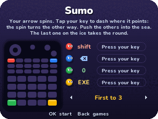

## Highlights

* **One key each:** shift, ⌫, 0 and EXE, at the four corners of the keypad, with 7 and ) for 3 v 3. Every game is played with that key alone.
* **14 minigames:** Sumo, Racing, Tanks, Snakes, Soccer, Grab the Fish, Skate Race, Jump Rope, Paint, Balloons, Birds, Gravity Run, Frog Jump and Stop the Clock. Or Mix, another one every round.
* **2, 3 or 4 players, or teams:** 2 v 2, or 3 v 3 with six around one calculator.
* **Quick rounds:** 10 to 60 seconds each, the scores between them, first to 3 rounds (or anything from 1 to 9).
* **Before each game:** its rules, and a map of the keypad with each player's key in their colour. Everyone presses theirs, and it starts.
* **Kept:** the matches each colour has won, for every game. Home saves and quits. It's also copied into `fourplayer_saves.py`, so installing apps again doesn't erase it.

<table>
  <tr>
    <td align="center">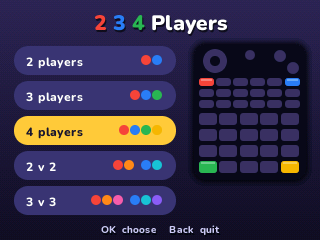 How many play, and their keys</td>
    <td align="center">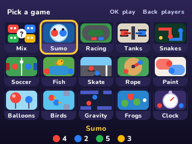 The minigames</td>
  </tr>
  <tr>
    <td align="center">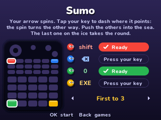 The rules, and everyone ready</td>
    <td align="center">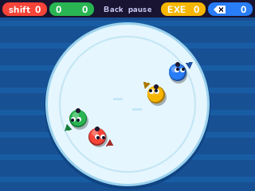 Sumo</td>
  </tr>
  <tr>
    <td align="center">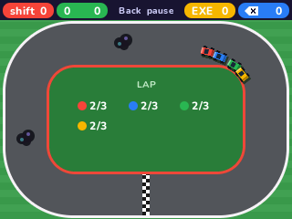 Racing</td>
    <td align="center">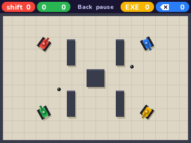 Tanks</td>
  </tr>
  <tr>
    <td align="center">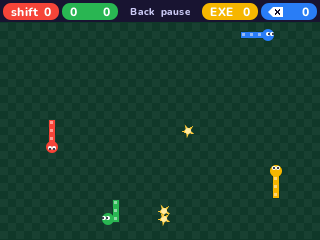 Snakes</td>
    <td align="center">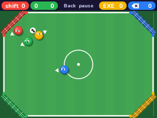 Soccer</td>
  </tr>
  <tr>
    <td align="center">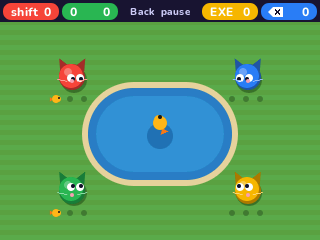 Grab the Fish</td>
    <td align="center">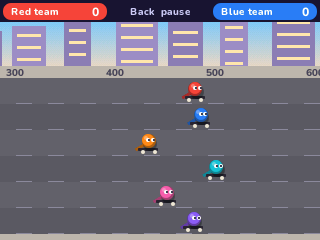 Skate Race, 3 v 3</td>
  </tr>
  <tr>
    <td align="center">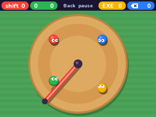 Jump Rope</td>
    <td align="center">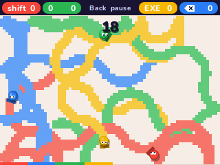 Paint</td>
  </tr>
  <tr>
    <td align="center">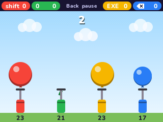 Balloons</td>
    <td align="center">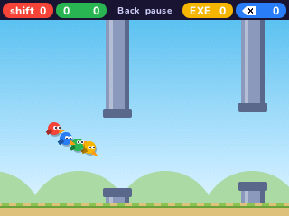 Birds</td>
  </tr>
  <tr>
    <td align="center">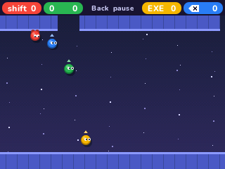 Gravity Run</td>
    <td align="center">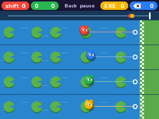 Frog Jump</td>
  </tr>
  <tr>
    <td align="center">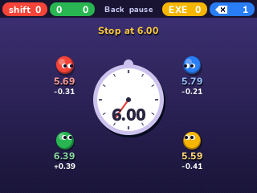 Stop the Clock</td>
    <td align="center">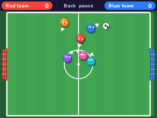 Soccer, 3 v 3</td>
  </tr>
</table>

## How to play

Choose how many play, then a game. Each player has one key: red **shift**, blue **⌫**, green **0** and yellow **EXE**. In teams, the left of the keypad is the red team and the right the blue team, and 3 v 3 adds **7** and **)**. Before a game its rules show, with the keys on the keypad. When everyone has pressed their key, 3, 2, 1, go. Each round won is a point, and the first to 3 takes the match.

| Game | Your key | The round goes to |
| --- | --- | --- |
| Sumo | Tap to dash where your arrow points. It then spins the other way | The last one on the ice |
| Racing | Hold to turn left | The first to finish three laps |
| Tanks | Hold to drive, let go to fire | The last tank left |
| Snakes | Tap to turn right | The last snake left |
| Soccer | Tap to dash where your arrow points | Two sides, the first goal. Three or four players, the last one who hasn't let one in |
| Grab the Fish | Tap to swipe at a goldfish, never at junk | The first to three goldfish |
| Skate Race | Tap as fast as you can | The first over the line |
| Jump Rope | Tap to jump over the bar | The last one on the platform |
| Paint | Tap to curve the other way | The most floor after 30 seconds |
| Balloons | Tap to pump, but not too much | The biggest balloon still whole after 10 seconds |
| Birds | Tap to flap | The last bird flying |
| Gravity Run | Tap to flip to the floor or the ceiling | The last runner left |
| Frog Jump | Hold to gather a jump, let go to jump | The first frog across |
| Stop the Clock | Tap when you think the hidden stopwatch shows the time asked | The closest |

In teams, a round won by one of you is the team's. In Grab the Fish your goldfish count together, in Paint you paint one colour, and in Balloons your air adds up.

## Controls

| Key | What it does |
| --- | --- |
| shift, ⌫, 0, EXE | The players' keys, with 7 and ) in 3 v 3 |
| Arrows, OK | Choose the players and a game |
| Left and Right | On the rules, the rounds to win |
| Back | Pause: Resume, Restart, Other games, Quit game |
| Home | Save and quit |

With two or three players, EXE works as OK too.

## Good to know

* **On its own:** NumPlay is full, so 2 3 4 Players is an app of its own.
* **Together:** there's no single player and no computer to play against, and no shop: every game is there from the start.

## Credits

Inspired by the party app 2 3 4 Player Games by JindoBlu. Made by Mason Chen as part of NumPlay. Not affiliated with JindoBlu.

* The text uses NumPlay's **Nunito** font (SIL Open Font License). The minigames, the players and the pictures are the game's own, drawn from shapes as it goes.

## License

The game's code is licensed under the GNU General Public License v3.0: see the `LICENSE` file at the root of the repository.
