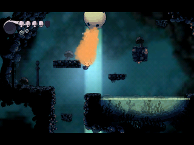
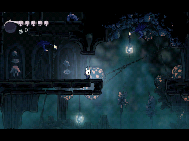
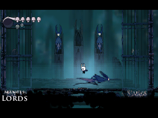
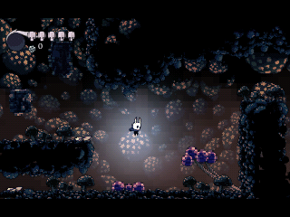
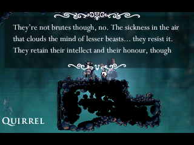

> **Hollow Knight: Fungal Wastes is a [NumPlay](../../README.md) game that comes on its own.** It is the second part of [Hollow Knight](../hollowknight/README.md) and shares its saves. Get `HollowKnightFungalWastes.nwa` from the [latest release](https://github.com/Mason363/NumPlay/releases/latest).

  

<h1 align="center">Hollow Knight: Fungal Wastes</h1>

  <b>Hallownest past Greenpath, on the NumWorks calculator.</b> 
  Down from the Forgotten Crossroads into the Fungal Wastes, to Mantis Village and the Mantis Lords.

  <a href="https://github.com/Mason363/NumPlay/releases/latest/download/HollowKnightFungalWastes.nwa"><b>Download HollowKnightFungalWastes.nwa</b></a>
  &nbsp;·&nbsp; <a href="#how-to-play">How to play</a>

  

<table>
  <tr>
    <td align="center"> Mantis Village</td>
    <td align="center"> The Mantis Lords</td>
  </tr>
  <tr>
    <td align="center"> Bounce shrooms</td>
    <td align="center"> Quirrel over Mantis Village</td>
  </tr>
</table>

## How to play

Play Hollow Knight first. At the Forgotten Crossroads' way down to the Fungal Wastes, the game saves and tells you to install this app. Install it, choose Start Game and the same save: the Knight walks in there. Going back up saves the same way, for Hollow Knight to go on.

Keys, charms, benches and the rest are as in Hollow Knight: see its [controls](../hollowknight/README.md#controls). With the Mantis Claw, press OK while sliding down a wall to jump off it.

## What's in

* **The way down:** from the Crossroads' last room through the Fungal Wastes to Queen's Station, then on to Mantis Village.
* **The Shrumal Ogres' fight:** two Ogres, one after the other, behind shut gates, and a charm notch for beating them.
* **Mantis Village:** its warriors and youths, its levers and gates, and the Mantis Claw. With it the Knight slides down walls and jumps off them, here and in Hollow Knight.
* **The Mantis Lords:** first one, then the other two together. Beat them and the tribe bows, the way to their treasure opens and the mantises leave you be.
* **Its creatures:** Shrumal Ogres, Sporgs and their Spore Bombs, Fungoons and their gas, Funglings, Amblooms, Shrumelings, Husk Hornheads, Fungified Husks, Mantis Warriors and Mantis Youths, each with its own moves.
* **Bounce shrooms:** strike one from above to bounce high.
* **Who you meet:** Quirrel at Queen's Station and over Mantis Village, and Cornifer, who sells the Fungal Wastes' map.
* **Queen's Station:** its bench, its toll and bell, and the stag. Both apps' stags go to every station opened, and a ride to one of the other app saves for it.

## Good to know

* **One app at a time:** each part takes all the room the calculator has for apps, so installing one swaps out the other, and NumPlay. Your saves are kept.
* **A new game starts in Hollow Knight:** this app opens saves that have come this far.
* **No music or sound:** the calculator has no speaker.

## Credits

Inspired by Hollow Knight, not affiliated with Team Cherry.

* The pictures, animations, maps, texts and fonts come from the game's own files.

Made by Mason Chen as part of NumPlay.

## License

The game's code is licensed under the GNU General Public License v3.0: see the `LICENSE` file at the root of the repository. The game's pictures, animations, maps, texts and fonts keep their own terms (see Credits).
