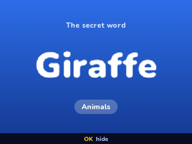
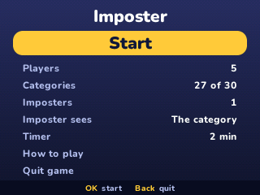
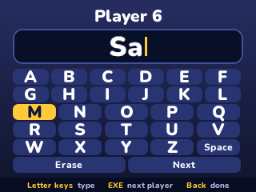
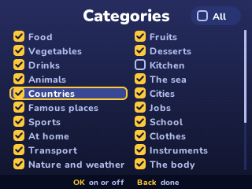
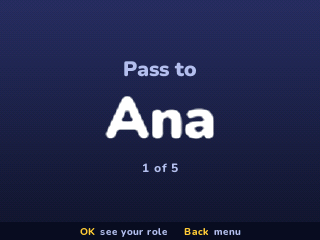
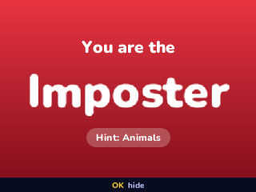
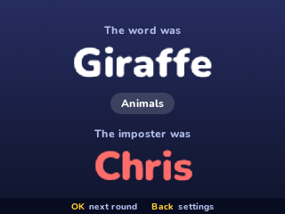

> **Imposter is a [NumPlay](../../README.md) game that comes on its own.** Get `Imposter.nwa` from the [latest release](https://github.com/Mason363/NumPlay/releases/latest).

  

<h1 align="center">Imposter</h1>

  <b>The party game played by passing one calculator around, on the NumWorks calculator.</b> 
  3 to 12 players, 30 categories, 1695 words.

  <a href="https://github.com/Mason363/NumPlay/releases/latest/download/Imposter.nwa"><b>Download Imposter.nwa</b></a>
  &nbsp;·&nbsp; <a href="#controls">Controls</a>

  

## Highlights

* **Everyone by name:** type the players' names with the letters printed on the keys, or pick the letters on the screen.
* **Passed around:** each player sees their role alone, then hides it. The others get the secret word and its category, the imposter a red screen, with the category as a hint if you want.
* **Up to 3 imposters:** 2 from 5 players, 3 from 7.
* **30 categories, 1695 words:** food, animals, countries, cities, jobs, sports, space, fantasy and more. Play them all or tick a few. No word comes back before its category runs out.
* **Who starts:** the calculator picks who says the first word, and keeps a timer if you want one.
* **Saved:** the names, the settings and the words already played. Home saves and quits, even in the middle of a round. It's also copied into `imposter_saves.py`, so installing apps again doesn't erase it.

<table>
  <tr>
    <td align="center"> The settings</td>
    <td align="center"> A player's name</td>
  </tr>
  <tr>
    <td align="center"> The categories</td>
    <td align="center"> Pass it on</td>
  </tr>
  <tr>
    <td align="center"> The imposter</td>
    <td align="center"> The reveal</td>
  </tr>
</table>

## How to play

Everyone gets the same secret word, except the imposter. Pass the calculator around. Each player presses OK to see their role alone, then OK again to hide it before passing it on.

Then the calculator says who starts. In turn, everyone says one word about the secret, enough to show they know it but not enough for the imposter to guess it. Then vote out loud for the imposter, and reveal. Caught, the imposter loses. Not caught, the imposter wins. OK starts the next round, with a new word and new imposters.

## Controls

| Key | What it does |
| --- | --- |
| Arrows | Choose |
| OK | Choose, see your role, hide it |
| Left and Right | Change a setting |
| The letter keys | Type a name (alpha or not) |
| ⌫ | Erase a letter, remove a player |
| EXE | Done with a name |
| Back | Go back. In a round, the menu (Resume, New round, Settings, Quit game) |
| Home | Save and quit |

## Good to know

* **On its own:** NumPlay is full, so Imposter is an app of its own.
* **Categories:** with none ticked, every category is played.
* **The words:** everyday words a teenager knows, nothing from a brand or a show.

## Credits

Inspired by the party game Imposter. Made by Mason Chen as part of NumPlay.

* The text uses NumPlay's **Nunito** font (SIL Open Font License). The words and the pictures are the game's own.

## License

The game's code is licensed under the GNU General Public License v3.0: see the `LICENSE` file at the root of the repository.
