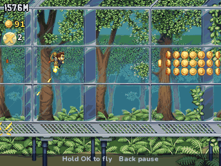

> **Jetpack Joyride is a [NumPlay](../../README.md) game that comes on its own.** It is too big to fit next to NumPlay on the calculator. Get `JetpackJoyride.nwa` from the [latest release](https://github.com/Mason363/NumPlay/releases/latest).

  

<h1 align="center">Jetpack Joyride</h1>

  <b>Barry Steakfries steals a jetpack and flies through the lab, on the NumWorks calculator.</b> 
  The zappers, missiles, lasers, coins, vehicles and the Final Spin of Halfbrick's game.

  <a href="https://github.com/Mason363/NumPlay/releases/latest/download/JetpackJoyride.nwa"><b>Download JetpackJoyride.nwa</b></a>
  &nbsp;·&nbsp; <a href="#controls">Controls</a>

  

## Highlights

* **The machine gun jetpack:** hold to fly, let go to fall, with the game's own gravity, thrust and speed. Barry starts at 11 m/s and speeds up to 28 m/s by 2000 m.
* **Zappers:** horizontal, vertical and diagonal ones of every length, and the orange ones that turn, from 400 m.
* **Missiles:** a warning follows your height, locks on, then the missile fires. Sometimes a whole swarm comes.
* **Lasers:** all 29 of the game's laser patterns, from a single shot to the sweepers and the Stager, from 400 m to 6000 m.
* **Coins:** the game's 26 coin patterns, and coin streaks.
* **Five vehicles** from the vehicle boxes: the Lil' Stomper, the Profit Bird, the Crazy Freaking Teleporter, the Bad As Hog and the Gravity Suit, each with its own controls, speed and obstacles. A vehicle takes a hit for you.
* **The Final Spin:** spin tokens play the slot machine after a run, for coins, blasts, a Second Chance, double coins or a head start.
* **The rooms:** the lab, the glass tube under the sea, the lava cave and the greenhouse, in a new order every run.
* **The machine gun jetpack fires for real:** its bullets rain down and ricochet off the floor, and they knock out the scientists they hit.
* **The game's look:** Halfbrick's own pictures of Barry, the rooms, the scientists, the hazards and the vehicles, and the game's font for the distance.
* **Saved as you go:** Home saves the run and quits, and the next start picks it up paused. Your best and coins are also copied into `jetpackjoyride_saves.py`, so installing the app again doesn't erase them.

<table>
  <tr>
    <td align="center"> A laser pattern in the cave</td>
    <td align="center"> A missile, fired after its warning</td>
  </tr>
  <tr>
    <td align="center"> The Lil' Stomper</td>
    <td align="center"> The Crazy Freaking Teleporter</td>
  </tr>
  <tr>
    <td align="center"> The Final Spin</td>
    <td align="center"> The title screen</td>
  </tr>
</table>

## How to play

Press **OK** on the title to start. Hold **OK** to fire the jetpack and fly up, and let go to fall. Barry runs on by himself: dodge the zappers, the missiles and the lasers, and grab the coins. A missile's warning shows on the right and follows your height, then stops and flashes: move away before it fires. A laser charges for a moment before it fires across the whole screen.

Fly into a vehicle box to get a vehicle. The Stomper jumps and glides while you hold **OK**, the Profit Bird flaps each time you press it, the Hog jumps, the Gravity Suit flips gravity, and the Teleporter jumps to where its arrow points. If a vehicle is hit, it breaks and Barry runs on.

Grab the spin tokens: when the run ends, each one is a spin of the Final Spin. Press **OK** to spin, or **Back** to cash the rest in for coins.

## Controls

| Key | What it does |
| --- | --- |
| OK, EXE or Up | Fly (hold), or the vehicle's action |
| Up, Down | Move the focus in menus |
| OK | Choose, spin the Final Spin |
| Back | Pause: Resume, Retry, How to play, Quit (it asks first) |
| Home | Save and quit |

## Good to know

* **On its own:** Jetpack Joyride is too big to fit next to NumPlay. Installing it from the NumWorks website swaps out NumPlay and the other apps, and installing NumPlay again swaps it back out.
* **The first year's game:** the numbers are those of versions 1.1 and 1.3.5, with the five vehicles of the first release. Mr. Cuddles and the later vehicles aren't here.
* **Left out:** The Stash (outfits, jetpacks, gadgets and upgrades), missions, coin purchases and ads, and music and sound (the calculator has no speaker). Coins add up on the title.
* **Four rooms:** the lab, the glass tube, the cave and the greenhouse, without the game's later ones. What shows behind them scrolls with them.

## Credits

Inspired by [Jetpack Joyride](https://www.halfbrick.com/games/jetpack-joyride) by [Halfbrick](https://www.halfbrick.com), not affiliated with them. Go play the original: it's free on iOS and Android, with the Stash, missions and much more.

* The numbers come from the game's own files (its settings, level pacing, zapper, laser, missile, coin, vehicle and slot machine data), read by [tools/data.py](tools/data.py) into [src/data.h](src/data.h).
* The pictures are Halfbrick's: from archive.org's [Jetpack Joyride Facebook assets](https://archive.org/details/jetpack-joyride-assets), and from the game's Android package for the machine gun jetpack and its bullets, flash and shells, the Lil' Stomper, the Bad As Hog, the spin token, the distance font (New Athletic M54) and the Final Spin's prizes, packed by [tools/art.py](tools/art.py) into [src/art.h](src/art.h).
* Brought to NumPlay by **Bobydeluxe**, who chose the Facebook assets.

Made by Mason Chen as part of NumPlay.

## License

The game's code is licensed under the GNU General Public License v3.0: see the `LICENSE` file at the root of the repository. The pictures and the game's data are Halfbrick's and keep their own terms (see Credits).
