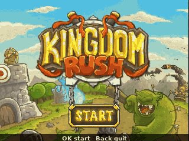
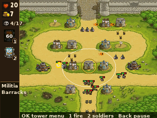
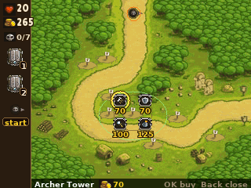
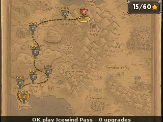
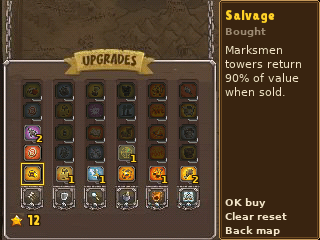
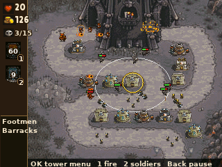

> **Kingdom Rush is a [NumPlay](../../README.md) game that comes on its own.** It is too big to fit next to NumPlay on the calculator. Get `KingdomRush.nwa` from the [latest release](https://github.com/Mason363/NumPlay/releases/latest).

  

<h1 align="center">Kingdom Rush</h1>

  <b>Defend the realm with towers, on the NumWorks calculator.</b> 
  The 2011 Flash game's 12 stages, each with its Heroic and Iron challenges.

  <a href="https://github.com/Mason363/NumPlay/releases/latest/download/KingdomRush.nwa"><b>Download KingdomRush.nwa</b></a>
  &nbsp;·&nbsp; <a href="#controls">Controls</a>

  

## Highlights

* **The whole free campaign:** Southport to the Dark Tower, with the game's own paths, waves and story, and Vez'nan at the end.
* **Heroic and Iron challenges** for every stage: 3 stars in the Campaign open them.
* **Every tower:** archers, barracks, mages and bombards to level 3, then the eight special towers (Rangers Hideout, Musketeer Garrison, Holy Order, Barbarian Hall, Arcane Wizard, Sorcerer Mage, Big Bertha, Tesla x104) with all their abilities.
* **Every enemy and boss:** 30-odd kinds, from goblins and wulves to dark knights, demons and necromancers, the Juggernaut, J.T. and Vez'nan.
* **Rain of Fire and Reinforcements,** and the upgrade tree: 30 upgrades to buy with your stars, and to take back.
* **The game's rules and numbers,** read out of its Flash file: costs, damage, range, armor, speed, bounty, every wave's timing, the gold for calling a wave early.

<table>
  <tr>
    <td align="center"> The Citadel</td>
    <td align="center"> The tower menu</td>
  </tr>
  <tr>
    <td align="center"> The map</td>
    <td align="center"> The upgrades</td>
  </tr>
  <tr>
    <td align="center"> The Dark Tower</td>
    <td></td>
  </tr>
</table>

## How to play

Enemies walk the roads, and each one that gets through costs lives. Build towers on the spots beside the road with the gold you have, and earn more for every kill. Archers and mages shoot, bombards blast what walks, and barracks send soldiers to block the road: move them with the rally point in their menu. Upgrade a tower to level 3, then pick one of its two special towers and buy their abilities.

Call the next wave early for gold. Rain of Fire and Reinforcements come back on their own after each use. Win a stage with 18 lives or more for 3 stars; stars buy upgrades on the map.

## Controls

| Key | What it does |
| --- | --- |
| Arrows | Hop between build spots, towers, wave flags and enemies |
| OK | The tower menu: build, upgrade, sell, buy an ability, move the rally point |
| 1 | Rain of Fire: aim with the arrows, OK to cast |
| 2 | Reinforcements: aim, OK to call them |
| 3 or ⌫ | The next wave now, for gold |
| Back | Close the menu, or pause |
| Home | Save and quit |

On the map: the arrows pick a stage, OK opens it, Left and Right pick the mode, and 0 opens the upgrades (OK buys one, ⌫ gives every star back).

## Good to know

* **Too big to install next to NumPlay.** Your saves in each are kept.
* **Your stars and upgrades** are saved after every stage, in `kingdomrush.sav` and a copy in `kingdomrush_saves.py`, which comes back after installing apps from the NumWorks website. A stage itself is not saved: Home in a battle leaves it.
* **Frozen towers:** J.T. freezes towers. Press OK on one three times to break the ice, as the original's three clicks.
* **New enemies** show their note once, the first time they come, where the original put an icon to click.
* **No sound:** the calculator has no speaker.
* **The pictures are the game's,** at 0.4 of their size: the 700 by 600 battlefield fills 280 by 240 pixels, beside a bar with your lives, gold and spells.
* **Left out:** the three premium stages, heroes, achievements and the encyclopedia.

## Credits

Inspired by Kingdom Rush by Ironhide Game Studio, published by Armor Games. Not affiliated with them.

* The pictures, rules and numbers come from the game's 2011 Flash file: its scripts give the towers, enemies, waves and spells, its shapes are drawn into the pictures, and `tools/pack.py` makes them into `src/data.bin`.
* The words are drawn in Lilita One ([license](../../LICENSES/OFL-1.1-LilitaOne.txt)) and the DejaVu fonts ([license](../../LICENSES/DejaVu.txt)).

Made by Mason Chen as part of NumPlay.

## License

The game's code is licensed under the GNU General Public License v3.0: see the `LICENSE` file at the root of the repository. The game's pictures keep their own terms (see Credits).

Build: `make` (needs `arm-none-eabi-gcc` and Node.js for nwlink), `make test` on a computer.
