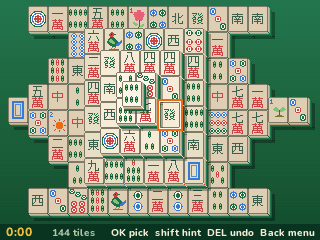
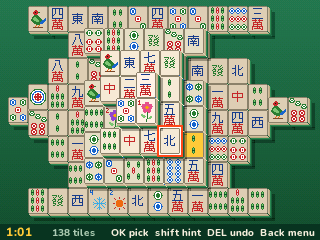
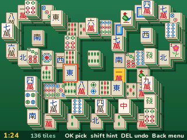
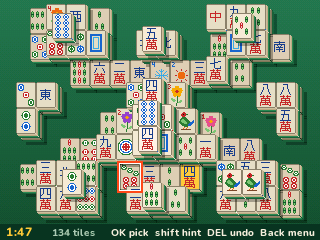
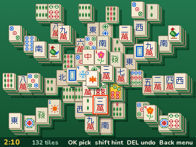
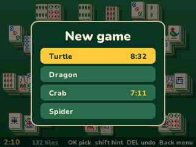
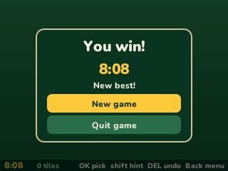

> **Mahjong is a [NumPlay](../../README.md) game that comes on its own.** NumPlay fills the calculator, so there is no room for it next to NumPlay. Get `Mahjong.nwa` from the [latest release](https://github.com/Mason363/NumPlay/releases/latest).

  

<h1 align="center">Mahjong</h1>

  <b>Mahjong solitaire for the NumWorks calculator.</b> 
  144 tiles in the Turtle and three more layouts. Match free tiles until the board is clear.

  <a href="https://github.com/Mason363/NumPlay/releases/latest/download/Mahjong.nwa"><b>Download Mahjong.nwa</b></a>
  &nbsp;·&nbsp; <a href="#controls">Controls</a>

  

## Highlights

* **The full set of 144 tiles:** dots, bamboo and characters from 1 to 9, the four winds and the three dragons, four of each, plus the four flowers and the four seasons.
* **Four layouts:** the classic Turtle, five layers high, and the Dragon, the Crab and the Spider.
* **Every deal can be won.** If you get stuck, that's from the pairs you chose, and Undo or a shuffle gets you out.
* **Hint** shows two free tiles that match, and another pair each time you ask. **Undo** goes back as far as you like.
* **No moves left?** The game tells you and offers to shuffle the tiles still on the board, so you can still win.
* **Tiles you can read:** ivory tiles with their edge and green back showing, higher layers lighter, and shadows under them. The arrows only stop on tiles you can take.
* **Saved:** your game and your best time on each layout. Home saves and quits from anywhere. Everything is also copied into `mahjong_saves.py`, so installing the app again doesn't erase it.

<table>
  <tr>
    <td align="center"> The Turtle</td>
    <td align="center"> The Dragon</td>
  </tr>
  <tr>
    <td align="center"> The Crab</td>
    <td align="center"> The Spider</td>
  </tr>
  <tr>
    <td align="center"> Your best time on each layout</td>
    <td align="center"> Board cleared</td>
  </tr>
</table>

## How to play

Take the tiles away in pairs that match. You can only take a free tile: nothing lies on it, and its left or right side is open. Two tiles match when they are the same, and any flower goes with any flower, any season with any season. Clear the whole board to win.

Move to a tile with the arrows and press **OK** to pick it: it turns gold. Then pick a free tile that matches it and both go away. Upper layers block what's under them, so start from the top and the ends of the rows.

## Controls

| Key | What it does |
| --- | --- |
| Arrows | Jump to the nearest free tile that way |
| OK or EXE | Pick a tile, or take it with the one you picked |
| Shift | Hint: two free tiles that match |
| Backspace | Undo the last pair |
| Back | Pause: Resume, New game, How to play, Quit game |
| Home | Save and quit |

8, 4, 6 and 2 work as the arrows. The line at the bottom always shows the keys.

## Good to know

* **On its own:** installing Mahjong from the NumWorks website swaps out NumPlay and the other apps, and installing NumPlay again swaps it back out. Your progress in each one is kept.
* **Quit game** in the pause menu asks first.
* The clock only runs while you play, not while the game is paused.
* A shuffle keeps the same tiles and lays them out again so the game can still be won.
* There is no music or sound: the calculator has no speaker.

## Credits

Made by Mason Chen as part of NumPlay, inspired by Mahjong solitaire, first made by **Brodie Lockard** (Mah-Jongg, 1981) and made famous by Activision's **Shanghai** (1986). Not affiliated with them.

* The tiles are drawn from scratch from the traditional designs. Their Chinese characters (the numbers, 萬, the winds and the dragons) come from **Fusion Pixel** 12px by TakWolf (SIL Open Font License).
* The four layouts come from **KMahjongg** by the KDE Games team (the Dragon, the Crab and the Spider by alchark).
* The key line and the menus use NumPlay's **Nunito** (SIL Open Font License).

## License

The game's code is licensed under the GNU General Public License v3.0: see the `LICENSE` file at the root of the repository. KMahjongg is free software under the GNU GPL. Fusion Pixel and Nunito keep the SIL Open Font License (`LICENSES/OFL-1.1-Fusion-Pixel.txt`, `LICENSES/OFL-1.1-Nunito.txt`).
