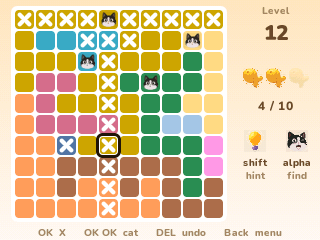

# Meowdoku

Put one cat in every row, every column and every color, and never two cats side by side, not even at a corner. Oakever Games' cat puzzle for the NumWorks calculator, with its own puzzles, cats and colors.

- **The game's own puzzles**, from its level banks, every one with exactly one solution, dealt the way the game deals them: 4×4 at level 1, then 5×5 up to 10×10 boards, a hard level every tenth, and the picture levels (a 1 at level 10, a 30 at level 30...) at the same numbers as on the phone.
- **The difficulty follows you**: it climbs while you win without help or mistakes and comes down after you fail, with the game's own rules.
- **Three fish**: a cat in the wrong cell turns into an X and costs a fish. Lose all three and the level starts over.
- **The lamp** shows the next step you can work out (the X's a cat rules out, a row with one place left, a color held in one line...) and does it on OK. **The winking cat** finds one cat for you. Both count as help.
- Levels 1 to 10 start with one cat in, as in the game. Your level and board are saved, so you can stop and carry on later.

## Controls

| Key | Action |
| --- | --- |
| Arrows | Move on the board |
| OK | Put an X, or take it off; hold OK and move to put X's along the way |
| OK twice, or EXE | Place a cat |
| shift | Hint (the lamp) |
| alpha | Find a cat (the winking cat) |
| ⌫ | Take back X's |
| Back | Menu: Resume, How to play, Quit game |

## Good to know

- The game has thousands of puzzles; this keeps the first ones of each of its puzzle pools (309 in all, the ones a player meets in the first few hundred levels). When a pool runs out, its puzzles come back turned and mirrored, as the game does with its own.
- Ads, purchases, daily challenges, leaderboards and the online level picks are left out. Hints and Find are free: in the game they run out and come back with ads.

## Credits

Meowdoku is **[Oakever Games](https://play.google.com/store/apps/details?id=com.oakever.meowdoku)**' game. Its puzzles, cats, fish, lamp, colors and rules come from its Android package (version 1.23.0). Not affiliated with Oakever Games.

Made by Mason Chen as part of NumPlay. Lettered in the **Nunito** font, and **Fusion Pixel** for Chinese (SIL Open Font License).

It isn't in the default NumPlay.nwa: add it in [NumPlay Studio](https://mason363.github.io/NumPlay/customize/), or get it on its own as `Meowdoku.nwa` from the [latest release](https://github.com/Mason363/NumPlay/releases/latest).

Build: `make` (needs `arm-none-eabi-gcc` and Node.js for nwlink); `make test` checks every puzzle, the hints and the dealing on a computer.
