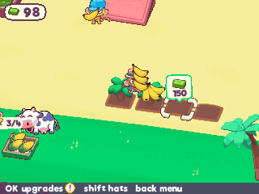

> **Monkey Mart is a [NumPlay](../../README.md) game that comes on its own.** It is too big to fit next to NumPlay on the calculator. Get `MonkeyMart.nwa` from the [latest release](https://github.com/Mason363/NumPlay/releases/latest).

  

<h1 align="center">Monkey Mart</h1>

  <b>Run a grocery mart as a monkey, on the NumWorks calculator.</b> 
  Both marts of TinyDobbins' web game: crops, animals, machines, customers and workers.

  <a href="https://github.com/Mason363/NumPlay/releases/latest/download/MonkeyMart.nwa"><b>Download MonkeyMart.nwa</b></a>
  &nbsp;·&nbsp; <a href="#controls">Controls</a>

  

## Highlights

* **Both marts:** the first one sells bananas, corn, eggs, milk, popcorn and yogurt; the truck takes you to the second, with cocoa, coffee beans, peanuts, chocolate, ground coffee, peanut butter, cappuccino and chocolate bars.
* **Everything by walking:** stand by a palm, a plant, a hen, a cow or a machine to pick up what it makes, by its shelf to put it there, by the till to take the money, and on a pad to pay for what comes next.
* **Customers with their own lists:** each wants a few foods, takes a basket for a long list, waits at the till and pays the game's prices.
* **Animals and machines tire:** the hens, the cow and the machines stop after a few items until you walk up to them.
* **Workers:** a cashier, assistants, a farmer, chefs and a manager, each with the game's rounds. They tire and nap, and the manager wakes them.
* **The troublemaker:** he throws food off a shelf until you shoo him away.
* **Upgrades and hats:** stamina, stack and speed for you, your workers, animals and machines, at the game's prices, and 17 hats to buy and wear.
* **The game's look:** its own pictures, monkeys, animals and font.
* **Saved as you go:** Home saves and quits, and the game saves every 30 seconds. Your marts are also copied into `monkeymart_saves.py`, so installing the app again doesn't erase them.

<table>
  <tr>
    <td align="center"> The first mart, with customers at the shelves and the till</td>
    <td align="center"> The first minute: the guide points to each pad</td>
  </tr>
  <tr>
    <td align="center"> Upgrades for you and your workers</td>
    <td align="center"> The hat shop</td>
  </tr>
  <tr>
    <td align="center"> The second mart</td>
    <td align="center"> The title screen</td>
  </tr>
</table>

## How to play

Walk with the arrows. Stand by a banana palm until your arms are full, then by the banana shelf to put them there. Customers walk in, take what they want and wait at the till: stand by it to serve them, and pick up the money they leave. Spend it on the next pad with a price: a new shelf, plant, animal, machine or worker. Hens, cows and machines need corn and bananas brought to their dishes, and stop now and then until you walk up to them. Buy the truck at the end of the first mart to drive to the second.

## Controls

| Key | What it does |
| --- | --- |
| Arrows | Walk, or move the selection in windows |
| OK | Open the upgrades; buy or choose in windows |
| shift | Open the hats |
| Back | Pause (Resume, Marts, How to play, Quit game), or close a window |
| Home | Save and quit |

## Good to know

* **On its own:** Monkey Mart is too big to fit next to NumPlay. Installing it from the NumWorks website swaps out NumPlay and the other apps, and installing NumPlay again swaps it back out.
* **Version 2.1, the web game:** its two marts, with their places, prices and order. The third mart was still to come in that version.
* **Left out:** the ads and what they gave (double money, energy boosts, the cash machine, and the four hats you got for watching ads), and music and sound (the calculator has no speaker).
* **As in the game:** what's on the shelves and in your arms isn't kept when you leave (the shelves restock at random on your return), and nothing is saved until the tutorial ends.
* **On the keypad:** pressing two arrows into a counter slides you along it, where the game would stop you.

## Credits

Inspired by [Monkey Mart](https://poki.com/en/g/monkey-mart) by TinyDobbins, not affiliated with them. Go play the original: it's free on the web, with music, sound and the newer marts.

* The pictures (the marts' floors, shelves, plants, machines, decorations, the clouds and icons), the monkeys and animals (baked from the game's Spine skeleton) and the Riffic font (InkyType's) come from the game's own web build, read by [tools/data.py](tools/data.py) and [tools/art.py](tools/art.py) into [src/data.c](src/data.c) and [src/art.c](src/art.c). Its rules and numbers follow the game's own code.
* The calculator adaptation is by **Bobydeluxe**, who brought it to NumPlay.

Made by Mason Chen as part of NumPlay.

## License

The game's code is licensed under the GNU General Public License v3.0: see the `LICENSE` file at the root of the repository. The pictures, the font and the game's data are TinyDobbins' and keep their own terms (see Credits).
