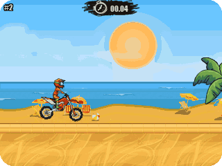
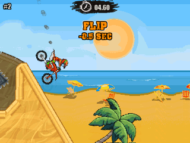
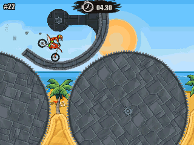
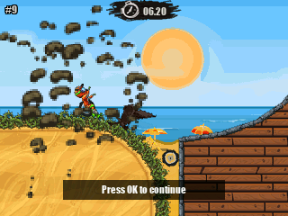
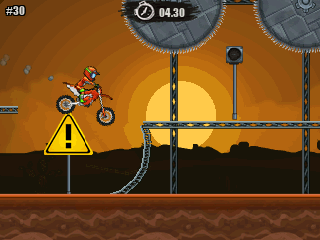
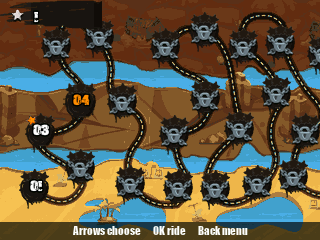
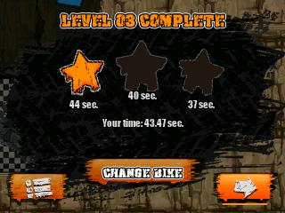

> **Moto X3M is a [NumPlay](../../README.md) game that comes on its own.** It is too big to fit next to NumPlay on the calculator. Get `MotoX3M.nwa` from the [latest release](https://github.com/Mason363/NumPlay/releases/latest).

  

<h1 align="center">Moto X3M</h1>

  <b>Race your bike through 50 levels of loops, jumps and traps, on the NumWorks calculator.</b> 
  Flip in the air, beat the clock, earn stars and new bikes.

  <a href="https://github.com/Mason363/NumPlay/releases/latest/download/MotoX3M.nwa"><b>Download MotoX3M.nwa</b></a>
  &nbsp;·&nbsp; <a href="#controls">Controls</a>

  

## Highlights

* **The game's own 50 levels:** read from Moto X3M's web release, with every loop, ramp, saw, spike, barrel and TNT where the original puts them.
* **The real physics:** Nape, the engine the original runs on, ported to C and set up as the original sets it up: the same gravity, steps, bike, springs and rider. The rider goes limp when you crash.
* **Everything in the levels:** TNT that blows up, glass that breaks, planks that fall, gates and switches, moving platforms, geysers, boosts and water.
* **Flips:** each one takes half a second off your time.
* **Stars and bikes:** beat each level's three times for stars. Stars open the six bikes of the bike shop.
* **The game's look:** its three worlds, its bikes, rider, menus, level map and fonts.
* **Saves:** every level's stars and best time. Home saves and quits. Your progress is also copied into `motox3m_saves.py`, so installing the app again doesn't erase it.

<table>
  <tr>
    <td align="center"> Flip for half a second off</td>
    <td align="center"> Loops</td>
  </tr>
  <tr>
    <td align="center"> TNT</td>
    <td align="center"> Saws</td>
  </tr>
  <tr>
    <td align="center"> The level map</td>
    <td align="center"> Stars by time</td>
  </tr>
</table>

## How to play

Ride to the finish as fast as you can. Up is the gas and Down the brake. Left and Right lean the bike: lean to land on your wheels, and keep leaning in the air to flip. Each flip takes half a second off your time. If your head hits the ground, or you touch spikes, a saw or water, you crash: press OK to go on from the last checkpoint.

Beat a level's times for one, two or three stars. Finishing a level opens the next one. Stars open new bikes in the bike shop: 10, 20, 30, 40 and 50 stars.

## Controls

| Key | What it does |
| --- | --- |
| Up | Gas |
| Down | Brake |
| Left and Right | Lean (flip in the air) |
| OK | Go on after a crash |
| Back | Pause (Resume, Restart, Levels, Quit game) |
| Home | Save and quit |

## Good to know

* **On its own:** Moto X3M is too big to fit next to NumPlay. Installing it from the NumWorks website swaps out NumPlay and the other apps, and installing NumPlay again swaps it back out. Your progress in each one is kept.
* **What's in:** the 50 levels of the web version 1.2.4. There is no music or sound (the calculator has no speaker).
* **Far off the screen:** to save the calculator's memory, loose planks and barrels far from the screen hold still until you come near.

## Credits

Inspired by Moto X3M by Madpuffers, not affiliated with them. Go play the original.

* The levels, the bikes, the rider, the worlds, the menus and the **Impact** and **CF Crack and Bold** fonts come from the game's web release, read by [tools/pack.py](tools/pack.py) into `src/data.bin`. Its rules and numbers follow the game's own code.
* The physics is [Nape](https://github.com/deltaluca/nape) by Luca Deltodesco (BSD 2-clause license, see [LICENSES/BSD-2-Clause-Nape.txt](../../LICENSES/BSD-2-Clause-Nape.txt)), ported to C in [src/nape.c](src/nape.c).

Made by Mason Chen as part of NumPlay.

## License

The game's code is licensed under the GNU General Public License v3.0: see the `LICENSE` file at the root of the repository. The physics keeps Nape's BSD license. The game's pictures, fonts and levels keep their own terms (see Credits). Moto X3M is a trademark of Madpuffers.
