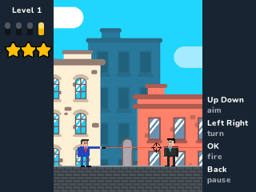
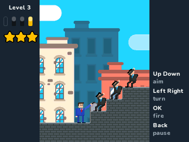
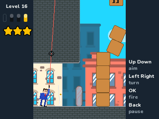
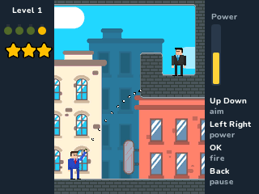
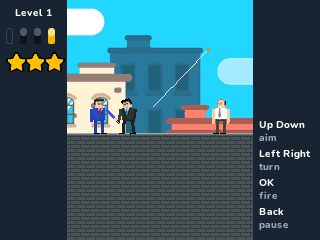
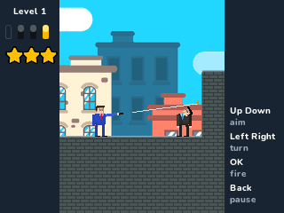
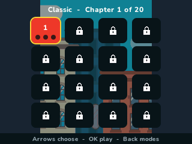

> **Mr Bullet is a [NumPlay](../../README.md) game that comes on its own.** It is too big to fit next to NumPlay on the calculator. Get `MrBullet.nwa` from the [latest release](https://github.com/Mason363/NumPlay/releases/latest).

  

<h1 align="center">Mr Bullet</h1>

  <b>Bounce your bullets off the walls and get every spy, on the NumWorks calculator.</b> 
  596 levels: Classic, Grenades, Hostages and Friendly Fire.

  <a href="https://github.com/Mason363/NumPlay/releases/latest/download/MrBullet.nwa"><b>Download MrBullet.nwa</b></a>
  &nbsp;·&nbsp; <a href="#controls">Controls</a>

  

## Highlights

* **The game's own levels:** 320 Classic levels, 84 Grenades, 84 Hostages and 108 Friendly Fire, read from Mr Bullet's level files.
* **The real physics:** Box2D, the engine the original runs on, set up as the original sets it up: the same gravity, steps and iterations, the same bullets, crates, balls and ragdolls. Bullets bounce off walls up to 20 times.
* **Everything in the levels:** glass that breaks, red boxes that explode, switches that make blocks vanish or appear, ropes a bullet cuts, swinging and moving platforms, heavy blocks and balls.
* **Ragdolls:** a spy hit by a bullet, a falling crate or a blast goes limp, as in the original.
* **The game's look:** its spies, hostages, Mr Bullet himself and the city behind them.
* **Stars:** clear a level with as few bullets as it needs for three stars. Every level's best is saved. Home saves and quits. Your progress is also copied into `mrbullet_saves.py`, so installing the app again doesn't erase it.

<table>
  <tr>
    <td align="center"> One bullet off the stairs</td>
    <td align="center"> The tower comes down</td>
  </tr>
  <tr>
    <td align="center"> Grenades</td>
    <td align="center"> Hostages</td>
  </tr>
  <tr>
    <td align="center"> Friendly Fire</td>
    <td align="center"> The levels</td>
  </tr>
</table>

## How to play

Shoot every spy in the level. Aim with Up and Down, turn with Left and Right, and fire with OK. Bullets bounce off walls, so aim at a wall to reach a spy you can't see, or knock something onto him. Each level gives you a few bullets more than it needs: use as few as you can for three stars. The gold bullet is the last one and gives none.

In Grenades you throw grenades that go off after 2.5 seconds: Left and Right set how hard. In Hostages, don't hit the hostages. In Friendly Fire, don't let your own bullet come back at you.

Grenades opens at 50 stars, Hostages at 120 and Friendly Fire at 200.

## Controls

| Key | What it does |
| --- | --- |
| Up and Down | Aim (hold to aim faster) |
| Left and Right | Turn round (Grenades: how hard you throw) |
| OK | Fire |
| Back | Pause (Resume, Restart, Levels, How to play, Quit game) |
| Home | Save and quit |

## Good to know

* **On its own:** Mr Bullet is too big to fit next to NumPlay. Installing it from the NumWorks website swaps out NumPlay and the other apps, and installing NumPlay again swaps it back out. Your progress in each one is kept.
* **What's in:** the levels of version 5.58's Classic, Grenades, Hostages and Friendly Fire modes. The missions, seasons, mini games, duels, weapons and suits are not, nor the coins that buy them. There is no music or sound (the calculator has no speaker).
* **The screen:** the original is played upright, so its play field stands in the middle of the screen, with your bullets on the left and the keys on the right.
* **A crowded level:** when the calculator's memory runs short, spies fall stiff instead of limp and things may overlap for a moment.

## Credits

Inspired by Mr Bullet - Spy Puzzles by [Lion Studios](https://lionstudios.cc), made by 1Button, not affiliated with them. Go play the original.

* The levels, the characters' pictures, the background and the title come from the game's Android release, read by [tools/pack.py](tools/pack.py) into `src/data.bin`. Its rules and numbers follow the game's own code.
* The physics is [Box2D](https://box2d.org) 2.3.1 by Erin Catto (zlib license, see [src/box2d/License.txt](src/box2d/License.txt)), altered to fit the calculator's memory. The text uses NumPlay's **Nunito** font (SIL Open Font License).

Made by Mason Chen as part of NumPlay.

## License

The game's code is licensed under the GNU General Public License v3.0: see the `LICENSE` file at the root of the repository. Box2D keeps its zlib license. The game's pictures and levels keep their own terms (see Credits). Mr Bullet is a trademark of Lion Studios.
