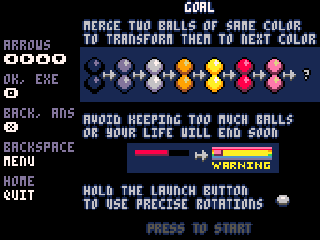
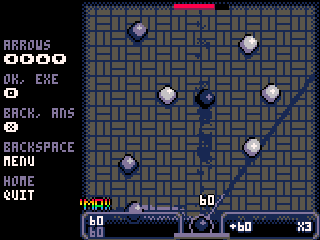
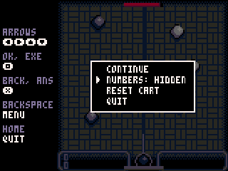

> **NumPico is a [NumPlay](../../README.md) app that comes on its own.** Add your carts in [NumPlay Studio](https://mason363.github.io/NumPlay/customize/): it puts NumPico and the carts inside your NumPlay.

  

<h1 align="center">NumPico</h1>

  <b>PICO-8 carts on the NumWorks calculator.</b> 
  Drop your .p8 and .p8.png carts on NumPlay Studio and play them with the keypad.

  <a href="https://mason363.github.io/NumPlay/customize/"><b>Add carts in NumPlay Studio</b></a>
  &nbsp;·&nbsp; <a href="#controls">Controls</a>

  

## Highlights

* **PICO-8's Lua and its whole API:** drawing, sprites, the map, text with P8SCII, memory, `peek` and `poke`, `menuitem`, coroutines, fixed point numbers, from femto8.
* **Your carts:** .p8 and .p8.png, packed or not. Several carts show in a list with their labels. Carts that load another cart (`load`) find it when you add it too.
* **Full speed:** 30 and 60 frames a second at the cart's own pace. When the calculator can't keep up, a picture is skipped now and then, as PICO-8 does.
* **The picture:** 128 by 128 pixels drawn on 240 by 240, with the keys written beside it.
* **PICO-8's pause menu:** Continue, the cart's own items, Reset cart and Quit.
* **Saves:** `cartdata` is kept on the calculator.

<table>
  <tr>
    <td align="center"> Combo Pool</td>
    <td align="center"> The pause menu</td>
  </tr>
</table>

## How to play

Open [NumPlay Studio](https://mason363.github.io/NumPlay/customize/), drop your carts on **Your own PICO-8 carts** and install. NumPico appears in NumPlay with your carts. Only add carts you made or that their authors share.

## Controls

| Key | What it does |
| --- | --- |
| Arrows, or 8 4 6 2 | The D-pad |
| OK, EXE | 🅾️ |
| Back, Ans | ❎ |
| ⌫ (backspace) | The pause menu |
| Home | Quit |

## Good to know

* **Memory:** PICO-8 gives a cart 2 MB, the calculator about 110 KB. Most small and mid-sized carts fit; the biggest ones say they need more memory than the calculator has.
* PICO-8's memory goes up to 0x7fff. The extra 32 KB above it isn't there.
* No sound: the calculator has no speaker.
* An error shows the line where its function starts.
* `cstore` saves nothing: the carts are in the calculator's flash.

## Credits

[PICO-8](https://www.lexaloffle.com/pico-8.php) is Lexaloffle's fantasy console. NumPico runs carts made for it and is not affiliated with Lexaloffle.

- **[femto8](https://github.com/benbaker76/femto8)** by Ben Baker and its contributors (MIT License, [LICENSE](src/femto8/LICENSE)) is NumPico's PICO-8: its API and its Lua.
- Its Lua is **z8lua** by Sam Hocevar ([zepto8](https://github.com/samhocevar/zepto8), WTFPL), PICO-8's flavour of **Lua 5.2** by Lua.org, PUC-Rio (MIT License).
- The packed code of .p8.png carts is unpacked with **Lexaloffle's own algorithms** (pxa, MIT License; the first format, zlib License).
- The pictures show **[Combo Pool](https://www.lexaloffle.com/bbs/?pid=combopool-0)** by NuSan (CC4-BY-NC-SA), which isn't in NumPico.

Made by Mason Chen as part of NumPlay.

Build: `make CARTS="a.p8 b.p8.png"` makes `output/numpico.nwa` with those carts in it, and `make test` checks the carts on your computer (see `tests/`).

## License

NumPico is GPL-3.0, like NumPlay. femto8 and the Lua in `src/femto8/` keep their own licenses.
