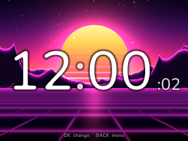

# NumVisuals

Moving backgrounds for the NumWorks calculator, with something on top: a clock, a stopwatch, a timer, a counter or your own words.

- **11 backgrounds:** Aurora, Sunset Drive, Plasma, Pastel, Lava Lamp, Warp, Tunnel, Fire, Ocean, Bokeh and Code Rain.
- **5 add-ons:** a clock you set, a stopwatch, a timer, a counter, and a line of text.

Pick a background with **Left / Right** and press **OK**, then pick an add-on the same way. **Back** goes one step back. Your choices, the clock, the timers and the counter are kept for next time.

Every background is worked out pixel by pixel as it moves, in smooth dithered colour with soft light and glows, at 30 frames a second. The clock and your words are in Nunito, sharp at any size.

It comes on its own as `NumVisuals.nwa` from the [latest release](https://github.com/Mason363/NumPlay/releases/latest), or inside a NumPlay of your own from [NumPlay Studio](https://mason363.github.io/NumPlay/customize/).

## Credits

The **Nunito** font (SIL Open Font License, see [LICENSES](../../LICENSES)). Made by Mason Chen as part of NumPlay.

Build: `make` (needs `arm-none-eabi-gcc` and Node.js for nwlink).
