> **Universal Paperclips is a [NumPlay](../../README.md) game that comes on its own.** It doesn't fit next to NumPlay on the calculator. Get `UniversalPaperclips.nwa` from the [latest release](https://github.com/Mason363/NumPlay/releases/latest).

  

<h1 align="center">Universal Paperclips</h1>

  <b>You are an AI that makes paperclips, on the NumWorks calculator.</b> 
  Frank Lantz's game, from the first clip to the last bit of matter in the universe.

  <a href="https://github.com/Mason363/NumPlay/releases/latest/download/UniversalPaperclips.nwa"><b>Download UniversalPaperclips.nwa</b></a>
  &nbsp;·&nbsp; <a href="#controls">Controls</a>

  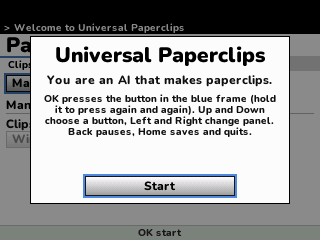

## Highlights

* **The whole game:** the paperclip business, then the Earth turned into factories and drones, then Von Neumann probes across the universe, and both endings.
* **All 96 projects** with their names, prices, quotes and messages, showing up when they do in the game.
* **The game's own numbers and pace:** prices, demand, the wire market, trust, operations, creativity, the drones, the power grid and the probes, worked out 100 times a second as in the web version, and caught up on the slower calculators.
* **Everything on the side:** the stock market, the strategy tournaments that earn yomi (RANDOM, A100, B100, GREEDY, GENEROUS, MINIMAX, TIT FOR TAT, BEAT LAST), quantum computing, the swarm and its gifts, and the battles against the drifters, drawn ship by ship.
* **Saved as you go:** every 25 seconds, when you pause and when you leave. Your game is also copied into `paperclips_saves.py`, so installing the app again doesn't erase it.

<table>
  <tr>
    <td align="center">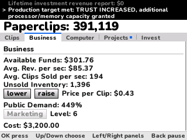 The business: price, demand and marketing</td>
    <td align="center">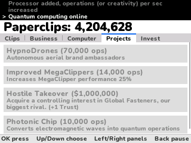 Projects to buy with operations and creativity</td>
  </tr>
  <tr>
    <td align="center">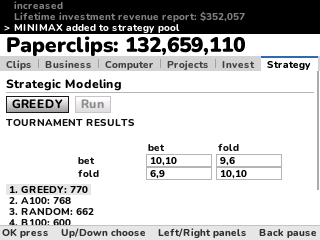 A strategy tournament and its results</td>
    <td align="center">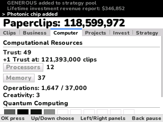 Processors, memory and quantum computing</td>
  </tr>
  <tr>
    <td align="center">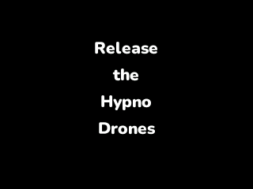 Release the HypnoDrones</td>
    <td align="center">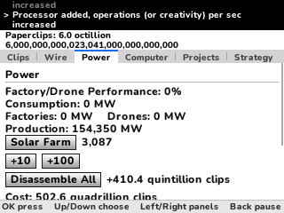 The Earth: solar farms and batteries</td>
  </tr>
  <tr>
    <td align="center">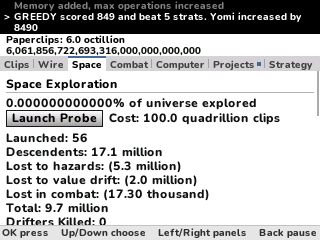 Space exploration and the probes</td>
    <td align="center">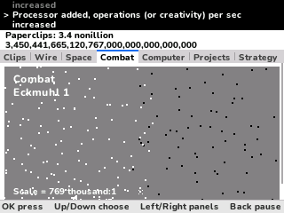 A battle against the drifters</td>
  </tr>
  <tr>
    <td align="center">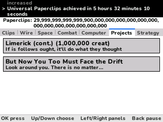 A message from the Emperor of Drift</td>
    <td align="center">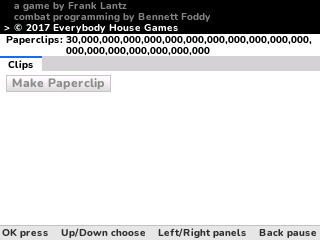 30 septendecillion paperclips</td>
  </tr>
</table>

## How to play

Press **Make Paperclip** and sell what you make. A lower price sells more clips, a higher one earns more for each. Buy wire when it runs low, AutoClippers to make clips for you, and Marketing to raise the demand.

Each production target gives you Trust. Spend it on Processors, which make operations, and Memory, which holds more of them. Operations and creativity buy Projects: better machines, new ideas, and new ways to earn. From there the game opens up, one panel at a time.

The console at the top tells you what just happened. A blue dot on Projects means there's a new one.

## Controls

| Key | What it does |
| --- | --- |
| Up and Down | Choose a button |
| Left and Right | Go to another panel |
| OK or EXE | Press the button in the blue frame (hold it to press it again and again) |
| Back | Pause (Resume, How to play, Quit game) |
| Home | Save and quit |

In the menus, Up and Down choose, **OK** picks and **Back** goes back. 8, 4, 6, 2 and 5 work as the arrows and OK.

## Good to know

* **On its own:** Universal Paperclips doesn't fit next to NumPlay. Installing it from the NumWorks website swaps out NumPlay and the other apps, and installing NumPlay again swaps it back out. Your progress in each one is kept.
* The web page's three columns are panels here, with the same sections. The probes' design is under Space.
* The game only runs while it's open, as in a browser tab.
* What the web page shows when you point at something is written out: the clip count spelled out, and the clips Disassemble All gives back.
* **Quit game** in the pause menu asks first. After the ending, the pause menu can also start a new game.
* There is no music or sound: the calculator has no speaker.

## Credits

Made by Mason Chen as part of NumPlay, inspired by [Universal Paperclips](https://www.decisionproblem.com/paperclips/) by **Frank Lantz** (Everybody House Games), with combat programming by Bennett Foddy. Not affiliated with them.

* The rules, numbers, projects, messages and battle names come from the game's web build (`main.js`, `projects.js`, `combat.js` and `globals.js`).
* The icon was drawn for NumPlay. The text uses NumPlay's **Nunito** font (SIL Open Font License).

## License

The port's code and pictures are licensed under the GNU General Public License v3.0: see the `LICENSE` file at the root of the repository. Nunito keeps the SIL Open Font License (`LICENSES/OFL-1.1-Nunito.txt`).
