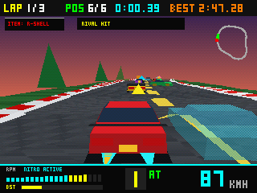

# PolyGT 3D

A low-poly retro 3D racing simulator for the NumWorks graphing calculator, built with a custom tile-strip software rasterizer and true 3D world physics.

## Highlights

- **Custom 3D Engine in ~52 KB Binary**:
  - 6-strip (`320x40`) tile Z-buffer renderer using only 51.2 KB of RAM for full `320x240` 16-bit depth-buffered output.
  - Sub-pixel PS1 integer vertex snapping/jitter and perspective-correct affine textures.
  - Analytic scanline span rasterizer hitting 2,600+ FPS on PC simulator and 60 FPS on Cortex-M7.
- **True 3D Physics & Simcade Handling**:
  - Full Euclidean 3D world coordinates `(wx, wy, wz, yaw)`.
  - Body roll/pitch suspension, progressive steering rack, tire smoke, and exhaust flame sparks.
  - Automatic & 6-speed Manual transmission (`Alpha` / `+` / `-`), E-brake power drifting (`Shift` / `Backspace`).
  - Nitro Boost (`Ans` / `EXE` / `x,n,t`) and 3D spinning crystal boost orbs.
- **Game Modes & Content**:
  - **Circuits**: Ridge Valley GT (Sunset), Neo-Tokyo Wangan (Midnight Expressway), Mt. Akagi Touge (Dusk Mountain Pass).
  - **Procedural Infinity Mode**: Endless streaming highway with dynamic terrain biomes, elevation changes, and zero bot traffic.
  - **Cars**: RX-79 Apex GT, NSX-R Proto, Evo-IV Rally, Black Stallion, Brown Mustang.
  - **Rivals**: 3D AI rivals with corner braking, overtaking, and drafting slipstream.
  - **Best Lap Ghost**: 3D transparent stipple ghost car recording your fastest run.

## Controls

Designed to match the physical ergonomics of the NumWorks keyboard:

| Action | NumWorks Key | PC Key |
| :--- | :--- | :--- |
| **Steer** | `◀ Left` / `▶ Right` (or `4` / `6`) | `A` / `D` or `◀` / `▶` |
| **Accelerate** | `OK` / `▲ Up` / `EXE` / `×` | `W` / `▲` / `Enter` |
| **Brake / Reverse** | `Back` (`⮌`) / `▼ Down` / `÷` | `S` / `▼` / `Backspace` |
| **E-Brake Drift** | `shift` (Left Thumb) or `clear ⌫` (Right Thumb) | `Left Shift` |
| **Nitro Boost** | `Ans` / `x,n,t` / `0` / `.` / `EXE` | `Space` / `X` / `Left Ctrl` |
| **Shift Up / Down (MT)** | `+` / `-` (or `(` / `)`) | `E` / `Q` or `+` / `-` |
| **AT / MT Toggle** | `alpha` | `M` / `Tab` |
| **Change Camera** | `toolbox` or `var` | `C` / `V` / `P` |
| **Return to Garage** | `Home` | `Esc` |

## Credits

- Developed by Boris-TH
