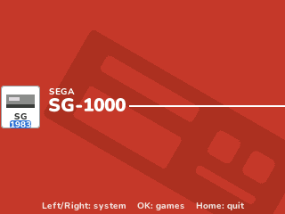
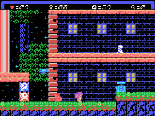
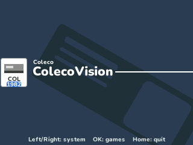
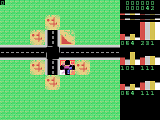
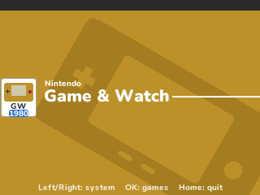
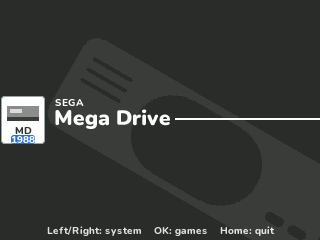
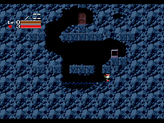

# Retro-Go

Play your own Game Boy, Game Boy Color, NES, Master System, Game Gear, SG-1000, ColecoVision, Game & Watch and Mega Drive games on the NumWorks calculator. Retro-Go is the launcher and emulators of handhelds like the ODROID-GO, whose screen is the calculator's size; this is its look and its menus, made for the keypad.

You pick the games on NumPlay's customizer website: it puts them inside your NumPlay (or inside Retro-Go on its own), and they stay in the calculator's memory for apps. Only games you own or that are free to share, like the homebrew games in the pictures here.

- **Retro-Go's launcher:** a tab for each system with its own colours, the game list, and for each game Resume game, New game, Delete save and Properties.
- **Game Boy and Game Boy Color** with gnuboy, the emulator Retro-Go started from: the cartridges with MBC1, MBC2, MBC3 (with its clock), MBC5, HuC1 and HuC3 bank controllers, up to 32 KB of cartridge RAM. Big games fit too, like the 2 MB Game Boy Color ones, in a NumPlay made for Epsilon 26 or Nwagra (NumPlay Studio says when a game needs it).
- **NES** with nofrendo, Retro-Go's NES emulator at its start: 34 mappers, among them NROM, MMC1, UNROM, CNROM, MMC3, MMC5, AxROM, MMC2, Namco 163 and the Konami VRC chips.
- **Master System, Game Gear and SG-1000** with a machine written for NumPlay around superzazu's Z80: Sega's, Codemasters' and the Korean mappers, the cartridges' RAM, the 224-line pictures, the European games that need 50 Hz, the Game Gear games made for the Master System's mode, and the SG-1000's TMS9918 pictures (Graphics I and II, Text, Multicolor and its sprites).
- **ColecoVision** on the same machine: its BIOS, its joystick and keypad, cartridges up to 32 KB and the Super Game Module's extra RAM.
- **Game & Watch** and the other LCD games with LCD-Game-Emulator, Retro-Go's: the .gw files LCD-Game-Shrinker makes from them, their LCD over its background picture, on the whole screen or under a line of their keys. Game A, Game B, Time and Alarm are on 1 to 4, ACL on 0.
- **Mega Drive** with gwenesis, Retro-Go's: games up to 4 MB in .md, .gen, .bin or .smd files, at full speed on the N0110 and the N0120. It needs Retro-Go on its own (RetroGo.nwa): inside NumPlay there isn't the RAM for it.
- **Full speed** on every calculator: as Retro-Go does, a frame is drawn, then at least one is skipped, more when the calculator can't keep up, so the game always runs at its own speed.
- **Retro-Go's menu** in a game: Save & Continue, Save & Quit, Load game, Reset, Options, Controls, About and Quit.
- **4 save slots** for each game, and the cartridges' own battery saves, kept a few seconds after the game writes them. Home saves and quits.
- **Options:** the picture at 1x, Fit or Full screen, the speed from 0.5x to 2.5x, the Game Boy's DMG, Pocket, Light, GBC or SGB colours, the NES's Nofrendo or NTSC colours, its overscan, side cropping and sprite limit, the Game Boy's clock.

<table>
  <tr>
    <td align="center"> The NES tab</td>
    <td align="center"> Thwaite, an NES homebrew game, in Fit</td>
  </tr>
  <tr>
    <td align="center"> Retro-Go's menu</td>
    <td align="center"> Options</td>
  </tr>
  <tr>
    <td align="center"> Raposa do Sol, a Master System homebrew game</td>
    <td align="center"> Waternet on the Game Gear, at 1x</td>
  </tr>
  <tr>
    <td align="center"> The SG-1000 tab</td>
    <td align="center"> Cheril Perils Classic on the SG-1000</td>
  </tr>
  <tr>
    <td align="center"> The ColecoVision tab</td>
    <td align="center"> Bankruptcy Builder on the ColecoVision</td>
  </tr>
  <tr>
    <td align="center"> The Game & Watch tab</td>
    <td align="center"> The Mega Drive tab</td>
  </tr>
  <tr>
    <td align="center"> Cave Story MD on the Mega Drive</td>
    <td></td>
  </tr>
</table>

## Controls

| Key | In the launcher | In a game |
| --- | --- | --- |
| Arrows | Choose a system, then a game | The D-pad |
| OK | Open the system, then the game | A (Sega: 2, ColecoVision: left button, Mega Drive: C) |
| Back | Back to the systems | B (Sega: 1, ColecoVision: right button) |
| 0 to 9, ×, ÷ | | The ColecoVision's keypad (× is *, ÷ is #) |
| 1, 2, 3, 4, 0 | | Game & Watch: Game A, Game B, Time, Alarm, ACL |
| shift | | Select (Mega Drive: A, Game & Watch: Time) |
| EXE | Like OK | Start (Master System: Pause, Game & Watch: Game A) |
| Backspace | Options, Controls, About | Retro-Go's menu |
| Home | Quit | Save and quit |

In 1x on the Game Boy and the Game Gear, the keys are written on the side of the screen. The first time you play, Retro-Go shows them, and Controls in its menu shows them again and changes them: pick a button, press OK, then the key you want for it (the D-pad asks for its four). Default keys puts them back.

## Good to know

- No sound: the calculator has no speaker.
- Game Boy and Sega games go in without the empty space their files are padded with (up to a quarter of a game), so more of them fit.
- The calculator has about 42 KB for every app's saves. A Game Boy or NES state takes 2 to 10 KB, a Master System or Game Gear one 3 to 15 KB, a Game Boy Color one up to 30 KB, so keep the slots you need and delete the others in the launcher (Delete save).
- The calculator has no clock for apps: a Game Boy game's clock runs while you play, and you can set it in Options, RTC config.
- Cartridges with more than 32 KB of RAM (a few Game Boy Color games) and NES mappers nofrendo doesn't have say so instead of starting.
- The light gun and 3-D glasses games of the Master System don't play, nor do the SC-3000's keyboard and BASIC.
- The Mega Drive plays in RetroGo.nwa on its own, not inside NumPlay, and needs Epsilon 23 or newer (not Upsilon, nor custom builds of the calculator's software, which give apps less RAM). NumPlay Studio makes RetroGo.nwa when a Mega Drive game is in your list.
- A Mega Drive save state takes around 30 KB, so keep one. Its battery saves aren't kept: save in a slot. No sound: its Z80, which plays it, can be turned off in Options to go faster, though a few games wait for it.
- A Game & Watch's clock starts at 12:00 and runs while you play. Its .gw files come from LCD-Game-Shrinker, with their background picture inside (not a JPEG one).
- ColecoVision cartridges bigger than 32 KB (the MegaCart) and the ones for the Roller Controller, the Super Action Controller or the steering wheel don't play.

## Credits

[Retro-Go](https://github.com/ducalex/retro-go) is **ducalex**'s. Its code is under the GPL version 2 only, which can't be mixed with NumPlay's GPL version 3, so none of it is copied here: the launcher, the menus, the options and the frame skipping are written again from how Retro-Go looks and works, and its pictures are drawn again in its style. Not affiliated with Retro-Go.

- **[gnuboy](https://github.com/rofl0r/gnuboy)** by Laguna and Gilgamesh and gnuboy's contributors (GPL-2.0-or-later, [COPYING](src/gb/COPYING)), from rofl0r's tree, emulates the Game Boy. Its picture is drawn by new code here: gnuboy's keeps 256 KB of decoded tiles, more than the calculator has.
- **nofrendo** by Matthew Conte and nofrendo's contributors (version 2 of the GNU Library GPL, [COPYING.LGPL](src/nes/COPYING.LGPL), used under the GPL as its section 3 allows) emulates the NES. Its 2.0 release is the one used here.
- **[z80](https://github.com/superzazu/z80)** by Nicolas Allemand (superzazu) (MIT License, [LICENSE.z80](src/sms/LICENSE.z80)) is the Master System's and Game Gear's processor, changed to run faster on the calculator. The rest of those machines is NumPlay's, written from Charles MacDonald's notes on their hardware, Texas Instruments' TMS9918A manual and SMS Power's pages. Retro-Go's own Master System emulator, SMS Plus, can't be used: its Z80 may not be shared freely. The ColecoVision's BIOS is Coleco's (1982), in the version Retro-Go keeps, its title screen skipped by the fire button. The short list of games that need something of their own is [SMS Plus GX](https://github.com/libretro/smsplus-gx)'s (GPL-2.0-or-later).
- **[LCD-Game-Emulator](https://github.com/bzhxx/LCD-Game-Emulator)** by bzhxx (GPL-3.0-or-later, [LICENSE](src/gw/LICENSE)), as Retro-Go has it, plays the Game & Watch games, with the Sharp SM5xx processors of [MAME](https://github.com/mamedev/mame) by hap (BSD-3-Clause). Its LCD is drawn by new code here, 16 lines at a time: its frame buffer is more than the calculator has. The .gw files are made with bzhxx's [LCD-Game-Shrinker](https://github.com/bzhxx/LCD-Game-Shrinker).
- **[gwenesis](https://github.com/bzhxx/gwenesis)** by bzhxx (GPL-3.0-or-later, [LICENSE](src/md/LICENSE)), as Retro-Go has it, plays the Mega Drive, with [Musashi](https://github.com/kstenerud/Musashi) by Karl Stenerud (MIT License) as its 68000. Its sound chips aren't here (no speaker), and its Z80, Marat Fayzullin's, which may not be shared freely, is superzazu's here. Its two RAMs are in small pages and its picture goes out a line at a time, and it has two of its bugs fixed (the window plane, the line drawn past its end).
- The tests run [Blargg's test ROMs](https://github.com/retrio/gb-test-roms), [dmg-acid2 and cgb-acid2](https://github.com/mattcurrie) by Matt Currie, [nestest](https://github.com/christopherpow/nes-test-roms) by kevtris, Frank Cringle's zexdoc and zexall, as [superzazu's z80](https://github.com/superzazu/z80) has them and in [Maxim's Master System port](https://github.com/maxim-zhao/zexall-sms), which aren't in NumPlay. The pictures show [Thwaite](https://github.com/pinobatch/thwaite-nes), [Concentration Room](https://github.com/pinobatch/croom-nes), [Libbet and the Magic Floor](https://github.com/pinobatch/libbet) and the [240p Test Suite](https://github.com/pinobatch/240p-test-mini) by Damian Yerrick and others, [µCity](https://github.com/AntonioND/ucity) by Antonio Niño Díaz, [Raposa do Sol](https://github.com/jflores82/raposadosol) by tibonev, [Waternet](https://github.com/joyrider3774/waternet) by Willems Davy, [Tunnel](https://github.com/liamhays/tunnel) by Liam Hays and [Cheril Perils Classic](https://www.mojontwins.com/) by the Mojon Twins, and [Bankruptcy Builder](http://www.colecovision.eu/ColecoVision/games/Bankruptcy%20Builder.shtml) by Philip Klaus Krause and Breakout by Daniel Bienvenu from [retrobrews' ColecoVision homebrew](https://github.com/retrobrews/colecovision-games), and [Cave Story MD](https://github.com/andwn/cave-story-md) by andwn, all free homebrew games. The Game & Watch is tested with a .gw file made by the tests (tests/gwrom.py).
- Game Boy, Game Boy Color, NES and Game & Watch are trademarks of Nintendo, Master System, Game Gear, SG-1000, Mega Drive and Genesis of Sega, ColecoVision of Coleco. Not affiliated with Nintendo, Sega or Coleco.

Made by Mason Chen as part of NumPlay. It comes from the customizer website with your games in it, inside [NumPlay](https://github.com/Mason363/NumPlay) or on its own.

Build: `make ROMS="game.gb game.nes game.sms game.gw game.md"` makes `output/retrogo.nwa` with those games in it, and `make test` checks the emulators and the saves on your computer (see `tests/`).
