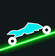
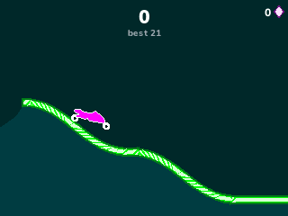
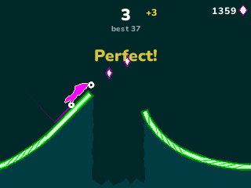
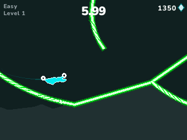
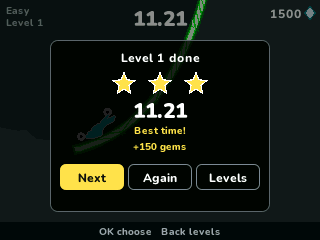
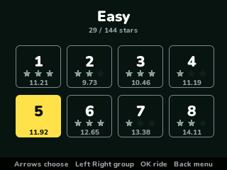
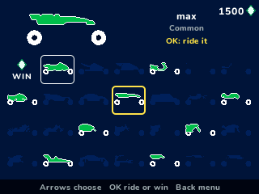
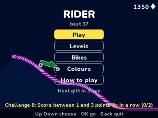

> **Rider is a [NumPlay](../../README.md) game that comes on its own.** It is too big to fit next to NumPlay on the calculator. Get `Rider.nwa` from the [latest release](https://github.com/Mason363/NumPlay/releases/latest).

  

<h1 align="center">Rider</h1>

  <b>Ketchapp's neon motorbike game for the NumWorks calculator.</b> 
  One button to ride and flip. Land on both wheels.

  <a href="https://github.com/Mason363/NumPlay/releases/latest/download/Rider.nwa"><b>Download Rider.nwa</b></a>
  &nbsp;·&nbsp; <a href="#controls">Controls</a>

  

## Highlights

* **One button:** hold it and the bike speeds up on the ground. Hold it in the air and the bike turns backwards. Let go to land on both wheels, not on its head.
* **The game's physics:** its gravity, speed, push down in the air, turning force and the way the turn dies down when you let go, all read from the game's own settings. The track is slippery, as in the game.
* **The endless run:** the game's 95 track pieces, picked at random, harder as your score grows. Every landed flip is a point, and two wheels down together is a perfect flip.
* **48 levels** in six groups, from Easy to Extreme, with the game's tracks: loops, ramps that tip, catapults, trapdoors, falling platforms, speed pads and red saws. Finish fast for three stars. Each flip takes half a second off your time.
* **55 bikes:** win them with gems, or open the special ones by playing runs, scoring, getting stars and finishing challenges, as the game has it.
* **Challenges:** the game's challenges one after another, with gems, bikes and colours as rewards. **Ten colour themes** for the endless run.
* **Saved:** your bikes, gems, stars, times and challenges. Home saves and quits from anywhere. Your game is also copied into `rider_saves.py`, so installing the app again doesn't erase it.

<table>
  <tr>
    <td align="center"> A perfect landing</td>
    <td align="center"> Easy, level 1</td>
  </tr>
  <tr>
    <td align="center"> Three stars</td>
    <td align="center"> The levels</td>
  </tr>
  <tr>
    <td align="center"> 55 bikes</td>
    <td align="center"> The menu and the challenge on</td>
  </tr>
</table>

## How to play

Hold **OK** and the bike rides. Over a ramp it flies: keep holding and it turns backwards, a flip. Let go before it comes down so that it lands on both wheels. If it lands on its head, or hits a red saw, it breaks.

In the endless run every landed flip is a point. Gems you pick up win new bikes. In the levels, reach the end as fast as you can: flips take time off, crashes start the level again.

## Controls

| Key | What it does |
| --- | --- |
| OK, EXE or Up (hold) | Ride, and flip in the air |
| Arrows | Choose in the menus |
| Back | Pause (Resume, How to play, Quit game) |
| Home | Save and quit |

8, 4, 6, 2 and 5 work as the arrows and OK.

## Good to know

* **On its own:** Rider is too big to fit next to NumPlay. Installing it from the NumWorks website swaps out NumPlay and the other apps, and installing NumPlay again swaps it back out. Your progress in each one is kept.
* **Quit game** in the pause menu asks first.
* No ads, no purchases, no revive and nothing online. The free gift comes after minutes of play, as in the game. The calculator has no clock for the daily rewards, so every fifth gift is one of the four secret bikes instead. The bike you got for liking Ketchapp is won with gems.
* The tracks are drawn from their collision shapes, so a few pieces look filled where the game draws a line.
* There is no music or sound: the calculator has no speaker.

## Credits

Made by Mason Chen as part of NumPlay, inspired by **Rider** by **Ketchapp**. Not affiliated with Ketchapp.

* From the game's files: the levels, the endless run's pieces, the collision shapes, the physics numbers, the bikes' unlock rules, the challenges, the colour themes and the texts, read by `tools/data.py`. The bikes and the icon are drawn again as outlines; none of the game's pictures are kept.
* The texts use NumPlay's **Nunito** (SIL Open Font License).

## License

The game's code is licensed under the GNU General Public License v3.0: see the `LICENSE` file at the root of the repository. Rider and its levels belong to Ketchapp. Nunito keeps the SIL Open Font License (`LICENSES/OFL-1.1-Nunito.txt`).
