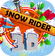
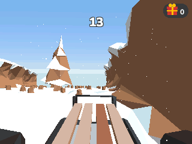
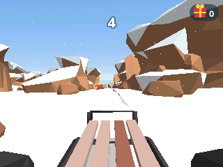
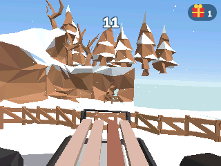
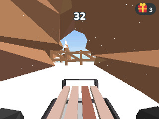
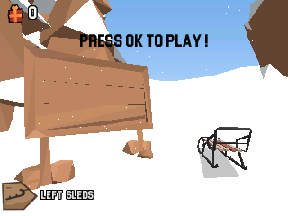
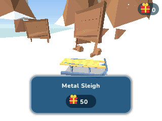
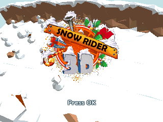
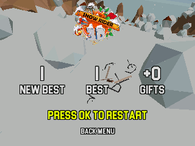

> **Snow Rider 3D is a [NumPlay](../../README.md) game that comes on its own.** It is too big to fit next to NumPlay on the calculator. Get `SnowRider3D.nwa` from the [latest release](https://github.com/Mason363/NumPlay/releases/latest).

<p align="center">
  
</p>

<h1 align="center">Snow Rider 3D</h1>

<p align="center">
  <b>The endless sled run for the NumWorks calculator.</b><br>
  Its slope, sleds, gifts and crashes, read from the game's own Unity project.
</p>

<p align="center">
  <a href="https://github.com/Mason363/NumPlay/releases/latest/download/SnowRider3D.nwa"><b>Download SnowRider3D.nwa</b></a>
  &nbsp;·&nbsp; <a href="#controls">Controls</a>
</p>

<p align="center">
  
</p>

## Highlights

* **The game's own slope:** made as Snow Rider 3D makes it, 10 metres at a time from its forest and plains, with the same structures, chunks, trees, rocks, snowmen, stumps and fences, turned at random as in the game.
* **Tunnels, cracks and floating islands:** past 10 points the slope throws in tunnels, ramps over a crack and islands floating over the void, and rows of giant snowballs roll across it.
* **The game's sled:** its speed, which grows with your score, its turning, its jump and its gravity, and the three rays that tell when it hits something (the game has a fourth, switched off), all with Snow Rider 3D's numbers.
* **Its camera and look:** the view from just behind the sled, leaning with the turns and the slopes, the world bending away over a near horizon, the low-poly colours, the sun and the falling snow.
* **Gifts and 11 sleds:** pick up the gifts on the slope and spend them on the Metal Sleigh, the Santa Sleigh and the rest, each with its own model.
* **Crashes:** the sled breaks into its pieces, time slows down and the camera turns around the wreck.
* **Saved as you go:** your best score, gifts and sleds are kept. They are also copied into `snowrider_saves.py`, so installing the app again doesn't erase them.

<table>
  <tr>
    <td align="center"><br><sub>The plains and their snowmen</sub></td>
    <td align="center"><br><sub>The forest's rocks and banks</sub></td>
  </tr>
  <tr>
    <td align="center"><br><sub>Floating islands over the void</sub></td>
    <td align="center"><br><sub>Into a tunnel</sub></td>
  </tr>
  <tr>
    <td align="center"><br><sub>The camp, before a run</sub></td>
    <td align="center"><br><sub>The sleds, bought with gifts</sub></td>
  </tr>
  <tr>
    <td align="center"><br><sub>The title over the slope</sub></td>
    <td align="center"><br><sub>A crash, in slow motion</sub></td>
  </tr>
</table>

## How to play

Press **Play** at the camp. The sled slides off down the slope by itself and goes faster and faster: steer with **Left** and **Right** around the trees, rocks, snowmen, stumps and walls. **Up** or **OK** jumps, and held, jumps again as soon as you land. Every 10 metres past the start is a point.

Fences and signs break as you ride through them. Gifts lie in a line that wanders across the slope; ride through one to pick it up. The snow banks at the sides can be ridden up, but go over the top and you fall. The sled turns no further than a little past sideways.

## Controls

| Key | What it does |
| --- | --- |
| Left and Right | Steer |
| Up, OK or EXE | Jump |
| Back | Pause (Resume, Restart, Quit game) |
| Home | Save and quit |

In the menus, the arrows choose, **OK** picks and **Back** goes back. 8, 4, 6, 2 and 5 work as the arrows and OK.

## Good to know

* **On its own:** Snow Rider 3D is too big to fit next to NumPlay. Installing it from the NumWorks website swaps out NumPlay and the other apps, and installing NumPlay again swaps it back out. Your progress in each one is kept.
* **Quit game** in the pause menu asks first.
* The meshes have fewer triangles than the game's, each with a simpler version for far away, so that it runs at about 38 frames a second on the N0110 (31 on the crash). The walls, ramps and rocks the sled meets keep all their triangles. Only the sled casts a shadow.
* There is no music or sound: the calculator has no speaker.

## Credits

Made for NumPlay, inspired by **Snow Rider 3D**. Not affiliated with its makers.

* Read from the game's Unity project ([q8j-dev/snow-rider-3d](https://github.com/q8j-dev/snow-rider-3d)) by `tools/gen.py`: the slope's generator settings, biomes, structures and chunks, the prefabs' models (simplified for the calculator) and colliders, their colours, the sleds and their pieces, the camp, the sled's and the camera's numbers, the light and the sky. The logo and the icon are the game's.
* The rules of the sled, the slope and the camera are its scripts (`PlayerControl`, `SledgePoint`, `CollisionRay`, `GGen`, `CameraControlC`) written again in C.
* The 3D renderer is NumPlay's Subway Surfers', with a camera that turns any way, and `tools/decimate.py` is its mesh simplifier.

## Build

```bash
make NWLINK=nwlink                     # output/snowrider.nwa
make check NWLINK=nwlink               # link it like the calculator does
make test                              # the slope, a two-minute ride, walls, a jump, saves, random keys
make data UNITY=path/to/Assets         # src/data.c, src/data.h and src/logo.c again, from the game's Unity project
```

`build/play shots DIR SCRIPT` plays a script of keys on a computer and saves pictures (`tests/play.c`).
