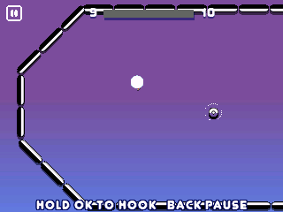

> **Stickman Hook is a [NumPlay](../../README.md) game that comes on its own.** It is too big to fit next to NumPlay on the calculator. Get `StickmanHook.nwa` from the [latest release](https://github.com/Mason363/NumPlay/releases/latest).

  

<h1 align="center">Stickman Hook</h1>

  <b>Swing from hook to hook to the checkered line, on the NumWorks calculator.</b> 
  The 39 levels of Madbox's game, then levels without end, and its 23 characters.

  <a href="https://github.com/Mason363/NumPlay/releases/latest/download/StickmanHook.nwa"><b>Download StickmanHook.nwa</b></a>
  &nbsp;·&nbsp; <a href="#controls">Controls</a>

  

## Highlights

* **The swing:** hold to grab the nearest hook, let go to fly, with the game's own gravity, rope, momentum and bounces. Every step was checked against the web game's own code.
* **39 levels made by hand:** the 9 first levels and the 30 that come after, in the game's order.
* **Then no end:** as in the original, every level after 39 joins a start, a middle and an end drawn at random from the game's 105 sections.
* **Bumpers and walls:** the springy bumpers, the ones that throw you a set way, and the walls you bump off.
* **The finish:** slow motion, the zoom on the stickman, confetti, then the victory dance.
* **23 characters:** 14 from the start, and 9 that open on reaching levels 5 to 150, each with its own poses and dance.
* **The game's look:** Madbox's own pictures, backgrounds, logo and lettering.
* **Saved as you go:** Home saves and quits, and the level you were on comes back with the same course. Your progress is also copied into `stickmanhook_saves.py`, so installing the app again doesn't erase it.

<table>
  <tr>
    <td align="center"> Level 9, the last of the first levels</td>
    <td align="center"> Level 47, drawn at random</td>
  </tr>
  <tr>
    <td align="center"> Past the line</td>
    <td align="center"> The victory dance</td>
  </tr>
  <tr>
    <td align="center"> The skins</td>
    <td align="center"> The title screen</td>
  </tr>
</table>

## How to play

Press **OK** on the title to play. Hold **OK** to grab the nearest hook, the one with the dotted ring, and swing. Let go to fly on with your speed, then grab the next hook. Bumpers bounce you, walls stop you. Cross the checkered line to clear the level. If you fall off the bottom, you start the level again.

The bar at the top shows how far you've got. The button with a character on the title and the victory screen opens the skins: pick one with the arrows and **OK**.

## Controls

| Key | What it does |
| --- | --- |
| OK or EXE | Hold to hook, let go to fly; choose in menus |
| Arrows | Move the focus in menus |
| Back | Pause: Resume, Restart, Levels, How to play, Quit game (it asks first) |
| Home | Save and quit |

## Good to know

* **On its own:** Stickman Hook is too big to fit next to NumPlay. Installing it from the NumWorks website swaps out NumPlay and the other apps, and installing NumPlay again swaps it back out.
* **Without end:** after level 39, a level's course is drawn when you start it, so playing it again from Levels gives a new one. Levels lets you play any level you've reached.
* **No videos:** the 14 skins on the original's "Watch Videos" page are free from the start, as in its web version.
* **Left out:** leaderboards, sharing, ads, and music and sound (the calculator has no speaker).

## Credits

Inspired by [Stickman Hook](https://apps.apple.com/app/stickman-hook/id1435807944) by Madbox, not affiliated with them. Go play the original: it's free on iOS, Android and [the web](https://poki.com/en/g/stickman-hook).

* The levels, the skins and their pictures come from the game's web version, read by [tools/data.py](tools/data.py) into [src/levels.c](src/levels.c) and [src/art.c](src/art.c). Its physics are checked step by step against the game's own code ([tests/oracle.cjs](tests/oracle.cjs), which reads it from the web build).
* The pictures (the stickmen and their dances, the hooks, bumpers, walls, finish platform, backgrounds and logo) and the JUNEGULL font are Madbox's, from the game.
* Adapted for the calculator by **Bobydeluxe**.

Made by Mason Chen as part of NumPlay.

## License

The game's code is licensed under the GNU General Public License v3.0: see the `LICENSE` file at the root of the repository. The pictures, the font and the levels are Madbox's and keep their own terms (see Credits).
