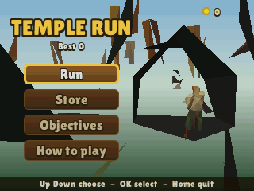
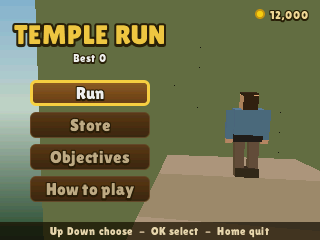
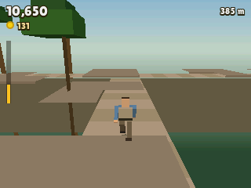
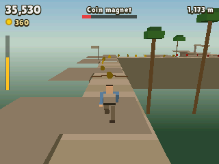
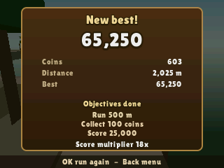
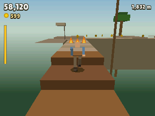
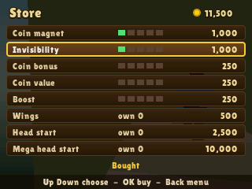

> **Temple Run is a [NumPlay](../../README.md) game that comes on its own.** It is too big to sit next to NumPlay. Get `TempleRun.nwa` from the [latest release](https://github.com/Mason363/NumPlay/releases/latest).

  

<h1 align="center">Temple Run</h1>

  <b>Run from the temple, turn at the corners, jump and slide, on the NumWorks calculator.</b> 
  The endless run in 3D, with the original game's rules and numbers: its path, its speed, its coins, power-ups, store and objectives.

  <a href="https://github.com/Mason363/NumPlay/releases/latest/download/TempleRun.nwa"><b>Download TempleRun.nwa</b></a>
  &nbsp;·&nbsp; <a href="#controls">Controls</a>

  

## Highlights

* **The path, laid as the game lays it:** straight runs, corners and junctions, gaps, roots to jump, fallen trees, fire, branches to slide under and narrow paths to lean along, in the temple, on the plank bridges and along the cliffs, with steps between them. What comes, and how often, follows the game's own pacing as you go farther.
* **The game's numbers:** a start at 100 and a top speed of 210, the speed-up easing off as you near it, jumps as high as your speed allows, slides of up to 0.75 seconds, a turn taken within 10 of the corner.
* **Stumbles:** trip on a root or a step and they catch up. Trip again within 10 seconds, or in the first 3 seconds of a run, and they get you.
* **Coins:** yellow, then red and blue ones farther on. Every 100 coins in a run is 500 points.
* **Power-ups:** the **Coin magnet**, **Invisibility**, the **Coin bonus** and the **Boost**, each with five upgrades in the store, as in the game.
* **Wings, head starts:** wings save one run (OK during a run), a head start runs you to 950 m and a mega head start to 2,350 m (1 or 3 at the start).
* **Objectives:** 40 of the game's objectives. Each one done adds 1 to your score multiplier.
* **Smooth:** about 60 frames a second, even on the N0110.
* **Saved:** your coins, best score, upgrades, wings, head starts and objectives. Home or On/Off saves and quits from anywhere, and keeps the coins of a run. The save is also copied into `templerun_saves.py`, so installing the app again doesn't erase it.

<table>
  <tr>
    <td align="center" width="50%"></td>
    <td align="center" width="50%"></td>
  </tr>
  <tr>
    <td align="center"></td>
    <td align="center"></td>
  </tr>
  <tr>
    <td align="center"></td>
    <td align="center"></td>
  </tr>
</table>

## Controls

| Key | Action |
| --- | --- |
| Left, Right | Turn at a corner (press a little before it) |
| Up or 8 | Jump |
| Down or 2 | Slide |
| 4, 6 (or shift with Left, Right) | Lean, held: for coins and narrow paths |
| OK, EXE or 5 | Wings (in a run); choose, buy |
| 1, 3 | A head start, a mega head start (at the start of a run) |
| Back or ⌫ | Pause (Resume, How to play, Quit game, which asks first); back in the menus |
| Home or On/Off | Save and quit |

## Good to know

* **One app at a time:** Temple Run is too big to sit next to NumPlay or the other big games. Installing it from the NumWorks website swaps them out, and installing them again swaps it out. Your saves in each one are kept.
* **Plain models for now:** the runner, the pursuers and the path are simple block models in the game's colours.
* **Left out:** the other characters and wallpapers, the permanent wings, the tutorial run, the online leaderboards, ads and purchases.
* **No music or sound:** the calculator has no speaker.

## Credits

Temple Run is a game by Imangi Studios. This port is not affiliated with or endorsed by them.

* The rules and numbers (the path and its pacing, speeds, jumps, slides, stumbles, turns, coins, power-ups, upgrades and their prices, objectives) are Imangi's, read from the game's Android package (version 1.0.8).
* The models are plain stand-ins made for this port (`tools/models.py`).
* The lettering is **Lilita One** by Juan Montoreano (SIL Open Font License 1.1, [license](../../LICENSES/OFL-1.1-LilitaOne.txt)).

Made by Mason Chen as part of NumPlay.

Build: `make` (needs `arm-none-eabi-gcc` and Node.js for nwlink); `make test` plays it on a computer. `make models` makes `src/data.c` again: every model is a mesh in one table there, by number, so the art can be made again without touching the game.

## License

The port's code is licensed under the GNU General Public License v3.0: see the `LICENSE` file at the root of the repository. Temple Run's rules and numbers are Imangi Studios', and the font keeps its own terms (see Credits).
