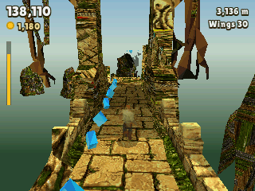
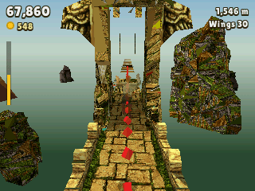

> **Temple Run is a [NumPlay](../../README.md) game that comes on its own.** It is too big to sit next to NumPlay. Get `TempleRun.nwa` from the [latest release](https://github.com/Mason363/NumPlay/releases/latest).

  

<h1 align="center">Temple Run</h1>

  <b>Run from the temple, turn at the corners, jump and slide, on the NumWorks calculator.</b> 
  The endless run in 3D, with the original game's rules and numbers: its path, its speed, its coins, power-ups, store and objectives.

  <a href="https://github.com/Mason363/NumPlay/releases/latest/download/TempleRun.nwa"><b>Download TempleRun.nwa</b></a>
  &nbsp;·&nbsp; <a href="#controls">Controls</a>

  

## Highlights

* **The game's own look:** the temple's stone path with its moss and carvings, the plank bridges, the cliffs, the trees with their hanging roots, all the game's own models in its own pictures and lit by its own light maps.
* **The game's own path, piece for piece:** its straights, corners and junctions, gaps and long gaps, narrow paths to lean along, roots, trunks and branches, flame towers, in the temple, on the plank bridges and along the cliffs. Each piece is one of the game's, chosen and laid by its rules as you go farther, and where you have ground under you is where the game has it. Going down to the bridges you drop off the end of the temple's path; going up to the cliffs you jump.
* **The game's numbers:** a start at 100 and a top speed of 210, the speed-up easing off as you near it, jumps as high as your speed allows, slides of up to 0.75 seconds, a turn taken within 10 of the corner.
* **Stumbles:** trip on a root, or land short on a ledge, and they catch up. Trip again within 10 seconds, or in the first 3 seconds of a run, and they get you. Jump too low at a higher ledge and you hit it.
* **Coins:** yellow, then red and blue ones farther on. Every 100 coins in a run is 500 points.
* **Power-ups:** the **Coin magnet**, **Invisibility**, the **Coin bonus** and the **Boost**, each with five upgrades in the store, as in the game.
* **Wings, head starts:** wings save one run (OK during a run), a head start runs you to 950 m and a mega head start to 2,350 m (1 or 3 at the start).
* **Objectives:** 40 of the game's objectives. Each one done adds 1 to your score multiplier.
* **Smooth:** about 60 frames a second on the N0120, about 25 on the N0110 and N0115.
* **Saved:** your coins, best score, upgrades, wings, head starts and objectives. Home or On/Off saves and quits from anywhere, and keeps the coins of a run. The save is also copied into `templerun_saves.py`, so installing the app again doesn't erase it.

<table>
  <tr>
    <td align="center" width="50%"></td>
    <td align="center" width="50%"></td>
  </tr>
  <tr>
    <td align="center"></td>
    <td align="center"></td>
  </tr>
  <tr>
    <td align="center"></td>
    <td align="center"></td>
  </tr>
</table>

## Controls

| Key | Action |
| --- | --- |
| Left, Right | Turn at a corner (press a little before it) |
| Up or 8 | Jump |
| Down or 2 | Slide |
| 4, 6 (or shift with Left, Right) | Lean, held: for coins and narrow paths |
| OK, EXE or 5 | Wings (in a run); choose, buy |
| 1, 3 | A head start, a mega head start (at the start of a run) |
| Back or ⌫ | Pause (Resume, How to play, Quit game, which asks first); back in the menus |
| Home or On/Off | Save and quit |

## Good to know

* **One app at a time:** Temple Run is too big to sit next to NumPlay or the other big games. Installing it from the NumWorks website swaps them out, and installing them again swaps it out. Your saves in each one are kept.
* **The game's own models and pictures:** the path's pieces and the scenery keep all their triangles up close, with the game's pictures at 512 by 512 (the stone) and 256 by 256 (the trees) in 256 colours; farther off they keep their biggest triangles, and past 40 metres each one is drawn in its average colour. Guy Dangerous, the demon monkeys and the coins have fewer triangles, one colour each. The power-ups and the fire are drawn by the port.
* **Left out:** the other characters and wallpapers, the permanent wings, the tutorial run, the online leaderboards, ads and purchases.
* **No music or sound:** the calculator has no speaker.

## Credits

Temple Run is a game by Imangi Studios. This port is not affiliated with or endorsed by them.

* The rules and numbers (the path, its pieces and their ground and obstacles, its pacing, speeds, jumps, slides, stumbles, turns, coins, power-ups, upgrades and their prices, objectives) are Imangi's, read from the game's Android package (version 1.0.8).
* Guy Dangerous, the demon monkeys, the path's pieces, the coins and the scenery are Imangi's own models, with its own pictures and light maps, read from the game's Android package by `tools/apk.py`. The power-ups and the fire are drawn by the port (`tools/models.py`).
* The lettering is **Lilita One** by Juan Montoreano (SIL Open Font License 1.1, [license](../../LICENSES/OFL-1.1-LilitaOne.txt)).

Made by Mason Chen as part of NumPlay.

Build: `make` (needs `arm-none-eabi-gcc` and Node.js for nwlink); `make test` plays it on a computer. `make data DATA=DIR` makes `src/data.c` again from the game's package unzipped (`DIR` is its `assets/bin/Data`; `tools/apk.py` reads it with UnityPy, nothing in it is run): every model is a mesh in one table there, by number, the path's pieces and the scenery named after the game's prefabs. `make models` makes the port's stand-ins instead (`tools/models.py`). `make floor DATA=DIR` makes `src/floor.c` again, the ground and obstacles of each piece, from the game's package unzipped (`DIR` is its `assets/bin/Data`).

## License

The port's code is licensed under the GNU General Public License v3.0: see the `LICENSE` file at the root of the repository. Temple Run's models, pictures, rules and numbers are Imangi Studios', and the font keeps its own terms (see Credits).
