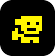
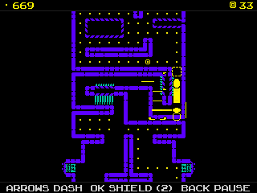

> **Tomb of the Mask is a [NumPlay](../../README.md) game that comes on its own.** It is too big to fit next to NumPlay on the calculator. Get `TombOfTheMask.nwa` from the [latest release](https://github.com/Mason363/NumPlay/releases/latest).

  

<h1 align="center">Tomb of the Mask</h1>

  <b>Dash through a tomb full of traps, on the NumWorks calculator.</b> 
  The endless arcade climb ahead of the lava, and all 200 stages.

  <a href="https://github.com/Mason363/NumPlay/releases/latest/download/TombOfTheMask.nwa"><b>Download TombOfTheMask.nwa</b></a>
  &nbsp;·&nbsp; <a href="#controls">Controls</a>

  

## Highlights

* **The arcade:** an endless climb built as the original builds it, from its 517 sections: zones that grow longer, new wall styles and colours at each zone's end, and bonus zones (the run up a shaft, and the pipes).
* **All 200 stages:** each with its exit, three stars and the dots to collect, unlocked one after the other. The lava rises in the stages that have it.
* **Every trap:** spikes, trap spikes, bats, cannons, puffer fish, snakes, monkeys throwing rocks, light balls, rotors, moving platforms, timer walls, close bricks, ice, portals and tramplins, at the original's speeds and timings.
* **Powerups:** coin addict, freeze, magnet and score booster turn up as you climb, and shields from the shop take a hit.
* **Masks, upgrades, missions and the chest:** 16 masks with their powers, opened by your level and bought with coins, the four powerups' upgrades, three missions at a time, and the chest's wheel.
* **The game's look:** its own pictures, characters, walls and pixel font, with the colours it gives each zone.
* **Saved as you go:** Home saves and quits, from anywhere. Your progress is also copied into `tombofthemask_saves.py`, so installing the app again doesn't erase it.

<table>
  <tr>
    <td align="center"> The arcade: dots, coins and spikes</td>
    <td align="center"> Stage 5, with a star to take</td>
  </tr>
  <tr>
    <td align="center"> The lava, close behind</td>
    <td align="center"> A bonus zone: the run up the shaft</td>
  </tr>
  <tr>
    <td align="center"> The stages and their stars</td>
    <td align="center"> The masks and their powers</td>
  </tr>
  <tr>
    <td align="center"> The chest's wheel</td>
    <td align="center"> The title screen</td>
  </tr>
</table>

## How to play

Press an arrow and you dash that way until a wall stops you; then dash again. You cannot dash into the wall you are standing against. Dots score points, coins pay for shields, upgrades, masks and spins of the wheel. Spikes, enemies and the lava end the run, unless a shield takes the hit; after that you can come back where you last landed for 200 coins (three times in the arcade, once in a stage).

In the arcade the lava wakes up with your first dash and rises faster and faster: keep climbing. Each zone ends at a shaft in its ceiling that takes you to the next one. A door in the wall leads to a bonus zone, full of coins. In a stage, find the exit; the three stars and every dot are there to take on the way.

## Controls

| Key | What it does |
| --- | --- |
| Arrows | Dash, or move the selection in menus |
| OK | Use a shield; choose, buy or claim in menus |
| Back | Pause (Resume, Restart, How to play, Quit game), or go back in menus |
| Home | Save and quit |

## Good to know

* **On its own:** Tomb of the Mask is too big to fit next to NumPlay. Installing it from the NumWorks website swaps out NumPlay and the other apps, and installing NumPlay again swaps it back out.
* **The web version's content:** its arcade, its 200 stages, masks, upgrades, missions and chest. The free chest comes back after four hours of play rather than four hours of the clock, since the calculator keeps no time.
* **Left out:** the ads and what they gave (video revives, doubled rewards and coins), and music and sound (the calculator has no speaker).

## Credits

Inspired by [Tomb of the Mask](https://www.playgendary.com) by Playgendary, not affiliated with them. Go play the original: it's free on Android and iOS, with music, sound and the newer modes.

* The pictures (the characters and masks, the walls, traps, enemies, powerups and icons) and the pixel font come from the game's own web build, read by [tools/art.py](tools/art.py) into [src/art.c](src/art.c). The arcade's sections and the stages come from its own maps, read by [tools/data.py](tools/data.py) into [src/data.c](src/data.c). Its rules and numbers follow the game's own code.
* The calculator adaptation is by **Bobydeluxe**, who brought it to NumPlay.

Made by Mason Chen as part of NumPlay.

## License

The game's code is licensed under the GNU General Public License v3.0: see the `LICENSE` file at the root of the repository. The game's pictures, maps and font keep their own terms (see Credits).
