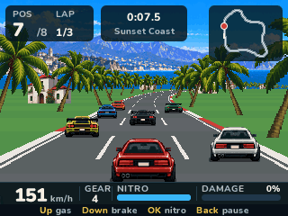
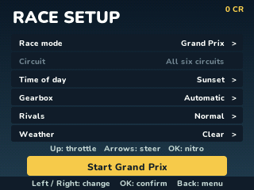

> **Turbo Rush is a [NumPlay](../../README.md) game that comes on its own.** It is too big to fit next to NumPlay on the calculator. Get `TurboRush.nwa` from the [latest release](https://github.com/Mason363/NumPlay/releases/latest).

  

<h1 align="center">Turbo Rush</h1>

  <b>An arcade racer for the NumWorks calculator.</b> 
  Six circuits, seven rivals, a Grand Prix and a garage.

  <a href="https://github.com/Mason363/NumPlay/releases/latest/download/TurboRush.nwa"><b>Download TurboRush.nwa</b></a>
  &nbsp;·&nbsp; <a href="#controls">Controls</a>

  

## Highlights

* **Six circuits:** Sunset Coast, Pine Valley, Red Rock Run, Harbor Sprint, Alpine Pass and Metro Circuit, each with its own bends, hills and roadside.
* **Seven rivals** who brake for the bends, pass each other and leave you room, at three levels: Easy, Normal and Expert.
* **Grand Prix:** the six circuits in a row, with 15, 12, 10, 8, 6, 4, 2 and 1 points a race and a bonus for the top of the table.
* **Single races and Free Ride:** one circuit against the field, or as long as you like in light, normal or busy traffic.
* **The garage:** every race pays credits for the engine, tires, nitro and armor, four levels each. Eight paints and two bodies are free.
* **Your way:** day, sunset or night, clear or rain, automatic or manual gears.
* **Saved as you go:** Home saves and quits, even in the middle of a race, and Continue picks it up. Your progress is also copied into `turborush_saves.py`, so installing the app again doesn't erase it.

<table>
  <tr>
    <td align="center"> Sunset Coast: seven rivals ahead</td>
    <td align="center"> Alpine Pass, its hairpins and climbs</td>
  </tr>
  <tr>
    <td align="center"> Red Rock Run at sunset</td>
    <td align="center"> Metro Circuit at night</td>
  </tr>
  <tr>
    <td align="center"> Pine Valley in the rain</td>
    <td align="center"> The Grand Prix table after a race</td>
  </tr>
  <tr>
    <td align="center"> The garage: upgrades, paint and body</td>
    <td align="center"> Choosing a race</td>
  </tr>
</table>

## How to play

You start at the back of the grid. Hold **Up** to accelerate, steer with **Left** and **Right**, and finish three laps ahead of as many rivals as you can. The map at the top right shows where everyone is.

A bend pulls you outwards, more the faster you go: brake before the sharp ones (the blue arrows warn you) and steer into them. The grass slows you down, and trees, lamps and buildings stop you dead and damage the car; at 100% damage the race is over. Bumping a rival hurts too. **OK** burns nitro for a burst of speed, and it refills by itself.

Every race pays credits, more the better you finish. Spend them in the garage: the engine raises your top speed, tires hold the bends better, nitro refills faster, and armor takes the sting out of crashes. With the engine and tires up, Expert rivals are yours to beat.

## Controls

| Key | What it does |
| --- | --- |
| Up | Accelerate |
| Down | Brake |
| Left and Right | Steer |
| OK or EXE | Nitro |
| + and - | Change gear, with the manual gearbox |
| Back | Pause (Resume, Restart race, How to play, Quit game) |
| Home | Save and quit |

In the menus, the arrows choose, **OK** picks and **Back** goes back. 8, 4, 6, 2 and 5 work as the arrows and OK.

## Good to know

* **On its own:** Turbo Rush is too big to fit next to NumPlay. Installing it from the NumWorks website swaps out NumPlay and the other apps, and installing NumPlay again swaps it back out. Your progress in each one is kept.
* **Quit game** in the pause menu asks first, and can take you back to the main menu instead. The race is kept either way.
* There is no music or sound: the calculator has no speaker.

## Credits

A game by **Bobydeluxe**, made for NumPlay, inspired by [Turbo Rush](https://jeux.w-production.fr/#/jeu/turborush) by W Production. Not affiliated with W Production.

* The cars, the roadside and the four landscapes were made for the game by Bobydeluxe.
* The text uses NumPlay's **Nunito** font (SIL Open Font License).

## License

The game's code and pictures are licensed under the GNU General Public License v3.0: see the `LICENSE` file at the root of the repository. Nunito keeps the SIL Open Font License (`LICENSES/OFL-1.1-Nunito.txt`).
