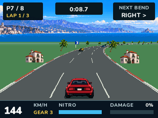
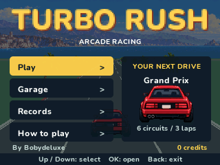
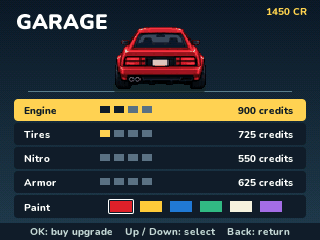

# Turbo Rush for NumWorks

A lightweight, native arcade racer for NumWorks N0110, N0115 and N0120.
The menus and controls are entirely in English. No audio or downloaded runtime
assets are required.





[Animated driving preview](docs/driving-v4.gif)

## Play

Install `TurboRush.nwa` through the NumWorks external app installer. It is a separate download in NumPlay's big-game section, outside the default launcher and customizer kit.

- Up: accelerate. Down: brake. Left / Right: steer.
- Hold Up + OK or EXE: nitro, which gradually recharges. Braking cancels nitro.
- Manual gearbox: 7 shifts up; 4 shifts down.
- Back: pause. Home / Power: save your profile and exit safely.
- Menus: Up / Down selects; Left / Right changes a setting; OK confirms.

Complete three laps against seven rivals. Race a single circuit or compete in a
six-race Grand Prix. Easy, Normal and Expert rivals are available. The circuits
are Sunset Coast, Pine Valley, Red Rock Run, Harbor Sprint, Alpine Pass and
Metro Circuit. Day, sunset and night work on every circuit; rain is optional.

For relaxed driving, choose **Play > Race mode > Free Ride**. Pick any circuit
and Light, Normal or Busy traffic. There is no countdown, finish line, lap limit,
race ranking or damage-based game over. A few slower cars travel in their lanes;
passed traffic is replaced farther ahead, beyond the immediate driving area.
The HUD shows distance and overtakes. Contacts still slow the car. This mode
does not earn credits or modify race records. Back pauses or ends the ride.

In races, the starting grid uses two staggered files with wide row spacing.
The road is a world-space mesh viewed through a perspective chase camera.
Scenery, traffic and the player's tire contact point use the same camera.
Fractional positions and interpolation remove whole-metre movement steps;
the horizon stays level and the ground no longer uses scrolling color bands.
See the [rendering overhaul](docs/driving-v4.md).

Steering has a progressive response, and releasing the arrows settles the car.
Grass slows the car; barrier impacts and car collisions cause damage.
Severe damage reduces top speed; 100% damage ends the race. Nitro is most useful
on straights. Empty nitro recharges to a usable reserve before restarting.
Rivals anticipate bends, choose a clear lane and slow for nearby traffic.
Each opposing car has its own collision cooldown, and finished rivals keep moving
rather than becoming invisible obstacles on the finish line.

Race prizes buy four levels each of engine, tire, nitro and armor upgrades.
Six paint colors are free. Grand Prix positions grant 15/12/10/8/6/4/2/1 points;
a wreck earns no championship points. The final standing adds a credit bonus.
Credits, upgrades, settings (including Free Ride), wins and circuit records are saved in an 80-byte
`turborush.sav`. An unfinished race or championship is not resumed after exiting.

## Build and verify

Requirements: Python 3 with pyelftools, ARM GCC, Node.js and nwlink 1.0.0.
Pillow is used for asset conversion and host-test screenshots. A normal C compiler runs the
host tests.

```sh
make build
make test
make test-arm
```

`TOOLCHAIN`, `NWLINK`, `PYTHON` and `HOST_CC` may be supplied to make. From the repository root, `make build/data/apps/TurboRush.nwa` or `python tools/build.py --game turborush` builds the standalone download. The build
also produces a module for future integration, without changing the launcher's game catalogue.
The standalone `.nwa` is relocatable for the three official calculator models
and Upsilon. `output/sizes.json` contains measured installed size and RAM use.

The engine uses fixed-point physics at 50 Hz, independently of the LCD rate.
Rendering targets 50 FPS on N0120 and 30 FPS on the earlier models, with render
interpolation. These are scheduling targets, not measured physical LCD rates.
A 10 KiB 16-line drawing buffer replaces a full 150 KiB framebuffer. The road
uses a fixed-distance world mesh, near-plane clipping and perspective projection.
The upcoming-turn indicator reflects the actual course ahead.
Original panoramas, two car body styles with three steering views,
and eight roadside sprites use 6-bit indexed art stored in flash. No full image
is decompressed into RAM. There is no heap allocation. `make assets` regenerates
the native art header from the source atlases; see [asset notes](assets/README.md).
Saves have a version, CRC and value validation, and failed writes leave other
calculator files untouched.

Tests cover full simulated races on every circuit and difficulty, upgrades,
manual gears, collision width and cooldowns, progressive steering, braking,
nitro depletion, barrier impacts, finish ordering, corrupt saves, guarded rendering,
real ARM keyboard paths, all six Grand Prix transitions, pause, persistence,
full storage and clean return to the firmware. ARM emulation is not a substitute
for testing LCD responsiveness on a physical calculator. The menu tests check
text glyph bounds on every screen and at maximum displayed values.

## Credits and scope

Adaptation by **Bobydeluxe**. Visual and gameplay reference:
[Turbo Rush on Calcade / W Production](https://jeux.w-production.fr/#/jeu/turborush).

This is an unofficial recreation based on the five publicly displayed screenshots
and the site's feature description. No original source code or game assets were
available or extracted. The code, scenery, vehicles and track data were recreated
for this version. Circuit layouts, names, physics, progression and menu details
are new interpretations, rather than a verified identical copy of the original.
